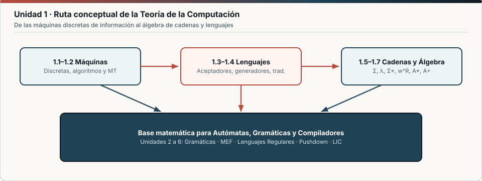

<!-- _class: lead -->

Unidad 1 · 3 horas

# Unidad 1: Introducción

### Cimientos matemáticos de máquinas, algoritmos y lenguajes abstractos

**Universidad Vasco de Quiroga (UVAQ)**  
Ingeniería en Sistemas y Seguridad Informática · Primer Semestre

---

# Propósito y competencia de la unidad

- **Competencia a desarrollar:** Analizar los conceptos y notaciones de máquinas y lenguajes abstractos mediante su estudio y desarrollo de ejercicios como base para su diseño y construcción.
- **Preguntas rectoras de la unidad:**
  1. *¿Qué significa computar de forma mecánica y precisa?*
  2. *¿Cómo representamos simbólicamente los lenguajes que procesa una máquina?*
  3. *¿Qué operaciones algebraicas nos permiten construir y combinar lenguajes?*

---

# Esquema visual: Unidad 1: Introducción

---

<!-- _class: invert -->
# Panorama de la Unidad 1

> La unidad conecta el concepto intuitivo de **dispositivo que procesa símbolos** con el lenguaje matemático exacto que usaremos en todo el curso.

1. **1.1 – 1.2:** De las máquinas de información a las máquinas abstractas y algoritmos.
2. **1.3 – 1.4:** Lenguajes abstractos y sus tres roles: aceptadores, generadores y traductores.
3. **1.5 – 1.7:** Álgebra elemental de símbolos ($\Sigma$), cadenas ($w, \lambda$) y lenguajes ($L \subseteq \Sigma^*$).

---

# Ruta temática (Subtemas 1.1 – 1.4)

| Subtema | Conceptos clave | Aplicación en compiladores |
| :--- | :--- | :--- |
| **1.1 Máquinas de información** | Información discreta, estado interno, entrada–salida | Modelo abstracto de hardware y software |
| **1.2 Máquinas abstractas** | Algoritmo, Tesis de Church-Turing, AF / AP / MT | Niveles de memoria y capacidad de cálculo |
| **1.3 Lenguajes abstractos** | Lenguaje natural vs. formal, sintaxis vs. semántica | Especificación de programas válidos |
| **1.4 Aceptadores, generadores, traductores** | $f_M: \Sigma^* \to \{0,1\}$, $L(G)$, $T: \Sigma^* \to \Delta^*$ | Escáner, analizador sintáctico y traductor |

---

# Ruta temática (Subtemas 1.5 – 1.7)

| Subtema | Conceptos clave | Notación principal |
| :--- | :--- | :--- |
| **1.5 Cadenas de lenguajes** | Símbolo, alfabeto, cadena vacía, universo de palabras | $\Sigma$, $\lambda$, $\Sigma^*$, $\Sigma^+$, $w \in L$ |
| **1.6 Cadenas y operaciones** | Longitud, concatenación, potencia, reflexión, prefijos | $|w|$, $uv$, $w^n$, $w^R$ |
| **1.7 Operaciones sobre lenguajes** | Unión, intersección, complemento, Kleene y reflexión | $A \cup B$, $AB$, $A^*$, $A^+$, $A^R$ |

---

<!-- _class: invert -->
# Lo esencial para recordar

> **El puente del curso:**  
> Un **lenguaje formal** es simplemente un conjunto de cadenas finitas sobre un alfabeto finito ($L \subseteq \Sigma^*$), y las **máquinas abstractas** nos permiten decidir, generar o transformar dichas cadenas sin depender de detalles físicos.

---

# Referencias bibliográficas

- Acevedo Juárez, A. (2006). *Teoría de la computación* [Tesis de licenciatura, Instituto Tecnológico de Celaya]. (Unidad 1: Introducción, pp. 3–42).
- De Castro Korgi, R. (2004). *Teoría de la computación: Lenguajes, autómatas, gramáticas*. Universidad Nacional de Colombia. (Introducción, pp. 3–4; Capítulo 1, Secc. 1.1–1.12, pp. 5–18).
