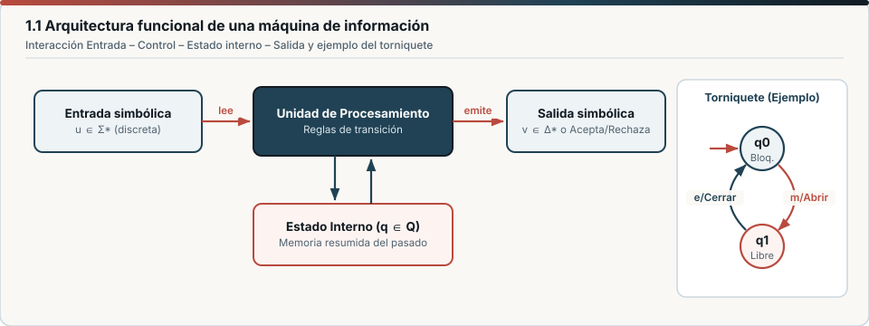

<!-- _class: lead -->

Tema 1.1

# 1.1 Máquinas de información

### Información discreta, arquitectura entrada–estado–salida y modelos formales

Unidad 1: Introducción · Primer Semestre

---

# ¿Qué es una máquina de información?

- En ingeniería distinguimos máquinas según lo que transforman:
  - **De energía:** transforman energía (motor eléctrico).
  - **De materiales:** moldean materia física (torno, prensa).
  - **De información:** capturan, almacenan, procesan y emiten **representaciones simbólicas** de datos.
- **Ejemplos:** computador digital, cajero automático, enrutador de red y **compilador**.
- La Teoría de la Computación abstrae los voltajes y circuitos para estudiar el cómputo como **manipulación de secuencias finitas de símbolos** (De Castro Korgi, 2004, p. 5).

---

# Esquema visual: 1.1 Máquinas de información

---

# Información continua vs. información discreta

### Información continua (analógica)
- Varía de forma ininterrumpida en un intervalo real.
- Entre dos valores siempre hay infinitos valores intermedios.
- *Ejemplos:* temperatura ambiente, voltaje de un micrófono.

### Información discreta
- Toma valores de un conjunto finito o enumerable de **símbolos bien diferenciados**.
- No hay ambigüedad entre un símbolo y otro.
- *Ejemplos:* bits $\{0, 1\}$, dígitos $\{0, \dots, 9\}$, caracteres ASCII.

---

<!-- _class: invert -->
# Principio de representación simbólica finita

> Todo dispositivo real o teórico de cómputo debe operar e identificar sus datos en tiempo finito (De Castro Korgi, 2004, p. 5).

1. **Conjunto finito de símbolos ($\Sigma$):** el repertorio elemental de marcas para codificar entradas, salidas y memoria interna es finito.
2. **Representaciones de longitud finita:** todo dato o programa entregado o devuelto por la máquina es una secuencia finita de símbolos.

---

# Arquitectura funcional: entrada, estado y salida

$$\text{Entrada } (u \in \Sigma^*) \;\longrightarrow\; \boxed{\text{Control} \longleftrightarrow \text{Estado interno } (q \in Q)} \;\longrightarrow\; \text{Salida } (v \in \Delta^*)$$

- **Entrada:** secuencia discreta de símbolos sobre un alfabeto $\Sigma$.
- **Estado interno ($q \in Q$):** "memoria" resumida de lo ocurrido hasta ese momento.
- **Salida:** respuesta simbólica sobre $\Delta$, o decisión de **Acepta / Rechaza**.

---

# Taxonomía básica de máquinas discretas

| Criterio | Categoría | Característica | Ejemplo |
| :--- | :--- | :--- | :--- |
| **Memoria** | Combinacional | Salida depende solo de la entrada actual | Compuerta XOR |
| **Memoria** | Secuencial (con estado) | Depende de la entrada y del estado actual | Cerradura, CPU |
| **Capacidad** | Memoria finita acotada | Número finito de estados ($\lvert Q \rvert < \infty$) | Autómata finito |
| **Capacidad** | Memoria auxiliar ilimitada | Pila o cinta externa potencialmente infinita | AP, Máquina de Turing |
| **Previsibilidad** | Determinista / No det. | Una única opción o varias opciones por paso | AFD / AFN |

---

# Sistemas físicos frente a modelos formales

| Aspecto | Sistema físico (real) | Modelo formal (abstracto) |
| :--- | :--- | :--- |
| **Soporte** | Circuitos, RAM, reloj físico | Conjuntos, funciones, relaciones y grafos |
| **Memoria** | Limitada por el hardware | Finita (AF) o idealmente ilimitada (pila/cinta) |
| **Operación** | Sujeta a latencia, energía y fallas | Pasos discretos ideales sin fallas |
| **Propósito** | Ejecutar software real | Demostrar qué problemas son resolubles |

---

# Ejemplo paso a paso: torniquete electrónico

- **Alfabeto de entrada:** $\Sigma = \{m, e\}$ (`m`: moneda/tarjeta, `e`: empujar).
- **Estados:** $Q = \{q_0 \text{ (Bloqueado)},\; q_1 \text{ (Desbloqueado)}\}$.

| Estado actual | Entrada | Nuevo estado | Salida |
| :---: | :---: | :---: | :---: |
| $q_0$ (Bloqueado) | `m` | $q_1$ | Abrir |
| $q_0$ (Bloqueado) | `e` | $q_0$ | Alarma |
| $q_1$ (Desbloqueado) | `m` | $q_1$ | Esperar |
| $q_1$ (Desbloqueado) | `e` | $q_0$ | Cerrar |

- **Traza para `emem`:** $q_0 \xrightarrow{e/\text{Alarma}} q_0 \xrightarrow{m/\text{Abrir}} q_1 \xrightarrow{e/\text{Cerrar}} q_0 \xrightarrow{m/\text{Abrir}} q_1$.

---

# Aplicación en compiladores: analizador léxico

- El **analizador léxico** (*scanner*) lee el código carácter por carácter y agrupa *tokens*:
  - Alfabeto simplificado: $\Sigma = \{L \text{ (letra)},\; D \text{ (dígito)},\; \_ \text{ (espacio)}\}$.
  - Estados: $q_0$ (Inicio), $q_{\text{ID}}$ (Identificador), $q_{\text{NUM}}$ (Número), $q_{\text{ERR}}$ (Error).
- **Entrada `x2_`:** $q_0 \xrightarrow{L} q_{\text{ID}} \xrightarrow{D} q_{\text{ID}} \xrightarrow{\_} q_0$ $\implies$ emite token `ID("x2")`.
- **Entrada `2x_`:** $q_0 \xrightarrow{D} q_{\text{NUM}} \xrightarrow{L} q_{\text{ERR}}$ $\implies$ emite `ERROR_LÉXICO`.

---

<!-- _class: invert -->
# Ideas clave y ejercicio en clase

> **Resumen:** Una máquina abstracta nos permite predecir límites reales: si un problema no cabe en memoria finita en el modelo matemático, **ningún** hardware con memoria fija podrá resolverlo para entradas arbitrarias.

**Ejercicio rápido:**
Diseña los estados y transiciones de una cerradura binaria que se abre solo cuando los últimos tres bits recibidos fueron `101`, y traza la entrada `11010`.

---

# Referencias

- Acevedo Juárez, A. (2006). *Teoría de la computación* [Tesis de licenciatura, Instituto Tecnológico de Celaya]. (Secc. 1.1 y 1.4, pp. 3, 27).
- De Castro Korgi, R. (2004). *Teoría de la computación: Lenguajes, autómatas, gramáticas*. Universidad Nacional de Colombia. (Introducción y Secc. 1.1, pp. 3–6).
