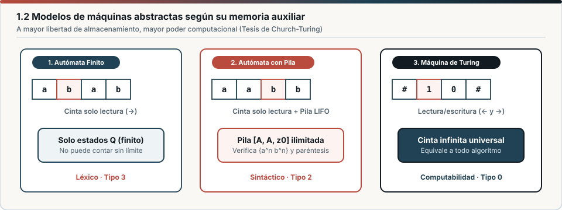

<!-- _class: lead -->

Tema 1.2

# 1.2 Máquinas abstractas y algoritmos

### Procedimientos efectivos, Tesis de Church-Turing y modelos de cómputo

Unidad 1: Introducción · Primer Semestre

---

# ¿Qué es una máquina abstracta?

- Es un **modelo matemático idealizado** de un dispositivo computacional que procesa cadenas finitas mediante reglas discretas (De Castro Korgi, 2004, pp. 3, 25).
- **Componentes típicos:**
  1. **Medio de entrada / almacenamiento:** cinta dividida en casillas (y opcionalmente una pila).
  2. **Unidad de control:** cabeza lectora/escritora con un conjunto finito de estados $Q$ y estado inicial $q_0$.
  3. **Reglas de transición ($\delta$):** instrucciones finitas que indican el siguiente estado y acción.

---

# Esquema visual: 1.2 Máquinas abstractas y algoritmos

---

# Algoritmo y procedimiento efectivo

Un **procedimiento efectivo** es una lista finita de instrucciones mecánicas que no requieren intuición humana. Un **algoritmo** exige:

1. **Descripción finita:** expresable con un texto finito de símbolos.
2. **Efectividad:** cada paso es elemental y ejecutable mecánicamente en tiempo finito.
3. **Entrada y salida bien definidas:** opera sobre datos discretos y produce respuesta.
4. **Terminación:** todo algoritmo que *decide* un problema termina en pasos finitos para toda entrada (aunque en computabilidad también se estudian procedimientos que pueden entrar en bucle).

---

# Contexto histórico (1936): Church y Turing

- En 1928, David Hilbert preguntó si existía un método mecánico universal para decidir la validez de cualquier fórmula lógica (*Entscheidungsproblem*).
- En **1936** surgieron dos respuestas independientes y **matemáticamente equivalentes**:
  - **Alonzo Church:** propuso el **cálculo-$\lambda$** (basado en funciones simbólicas).
  - **Alan Turing:** propuso la **Máquina de Turing (MT)** (inspirada en un calculista que lee/escribe sobre una cinta por casillas).
- Modelos posteriores (Gödel-Kleene, Post, Markov, Chomsky) resultaron todos equivalentes a la MT.

---

<!-- _class: invert -->
# Tesis de Church-Turing

> **Enunciado (De Castro Korgi, 2004, p. 198):**  
> *"Todo algoritmo puede ser descrito por medio de una máquina de Turing."*

- Se llama **tesis** y no *teorema* porque conecta una noción intuitiva no formalizada ("procedimiento efectivo") con un modelo matemático formal (la Máquina de Turing).
- No puede demostrarse formalmente, pero podría refutarse si apareciera un algoritmo intuitivo que ninguna MT pudiera simular. Hasta hoy, **no existe contraejemplo**.

---

# Comparativa de modelos de máquinas abstractas

| Dimensión | Autómata Finito (AF) | Autómata con Pila (AP) | Máquina de Turing (MT) |
| :--- | :--- | :--- | :--- |
| **Cinta de entrada** | Solo lectura, avance $\to$ | Solo lectura, avance $\to$ | Lectura/escritura ($\leftarrow, \rightarrow$) |
| **Memoria auxiliar** | Ninguna (solo $Q$) | Pila LIFO ilimitada | Cinta infinita |
| **Lenguajes** | Regulares (Tipo 3) | Independientes del contexto (Tipo 2) | Recursivamente enumerables (Tipo 0) |
| **Terminación** | Siempre en $\lvert w \rvert$ pasos | Ciclos-$\lambda$ evitables | Puede detenerse o ciclar |
| **En compiladores** | Análisis léxico | Análisis sintáctico | Análisis semántico y ejecución |

---

# Ejemplo 1: Algoritmo finito de paridad binaria

Decidir si una cadena $w \in \{0, 1\}^*$ tiene un **número par de unos**:
- Estados: $Q = \{q_{\text{par}}, q_{\text{impar}}\}$, inicial $q_0 = q_{\text{par}}$, aceptación $F = \{q_{\text{par}}\}$.
- Reglas: con `0` conserva paridad; con `1` alterna entre $q_{\text{par}}$ y $q_{\text{impar}}$.

**Traza para $w = 1011$:**
1. Inicio en $q_{\text{par}}$ (0 unos).
2. Lee `1` $\to q_{\text{impar}}$; lee `0` $\to q_{\text{impar}}$; lee `1` $\to q_{\text{par}}$; lee `1` $\to q_{\text{impar}}$.
3. Como $q_{\text{impar}} \notin F$, **rechaza** `1011` (tiene 3 unos).

---

# Ejemplo 2: ¿Por qué una pila supera a la memoria finita?

Considérese el lenguaje $L = \{a^n b^n : n \ge 0\}$ (análogos a paréntesis balanceados):

- **Por qué falla un AF:** si tiene $k$ estados, al leer $a^1, a^2, \dots, a^{k+1}$ repite estado para dos potencias distintas $a^i$ y $a^j$ ($i \neq j$), y no puede exigir exactamente el mismo número de $b$'s después.
- **Cómo lo resuelve un AP sobre `aabb`:**
  - Lee `a`, `a` $\to$ apila $A, A$ (pila $[A, A, z_0]$).
  - Lee `b`, `b` $\to$ desapila $A, A$ (pila $[z_0]$).
  - Al llegar al final con $z_0$ en el tope $\to$ **Acepta**.

---

<!-- _class: invert -->
# Conclusión y práctica

> **Idea central:** Aumentar el poder de la memoria externa (de estados finitos $\to$ pila LIFO $\to$ cinta bidireccional) determina exactamente qué problemas algorítmicos puede resolver una máquina.

**Ejercicios propuestos:**
1. Explica por qué una receta de cocina con *"sal al gusto"* no es un procedimiento efectivo.
2. Clasifica qué modelo mínimo (AF, AP o MT) necesita: (a) validar identificadores, (b) verificar llaves `{ ... }` anidadas, (c) decidir si un programa termina siempre.

---

# Referencias

- Acevedo Juárez, A. (2006). *Teoría de la computación* [Tesis de licenciatura, Instituto Tecnológico de Celaya]. (Secc. 1.4, p. 27).
- De Castro Korgi, R. (2004). *Teoría de la computación: Lenguajes, autómatas, gramáticas*. Universidad Nacional de Colombia. (pp. 3–4, 25, 198–199).
