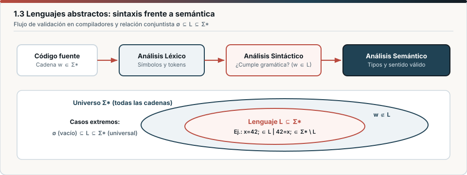

<!-- _class: lead -->

Tema 1.3

# 1.3 Lenguajes abstractos

### Lenguajes naturales vs. formales, sintaxis vs. semántica y definición de $L \subseteq \Sigma^*$

Unidad 1: Introducción · Primer Semestre

---

# Lenguajes naturales vs. lenguajes formales

| Criterio | Lenguaje natural | Lenguaje formal abstracto | Lenguaje de programación |
| :--- | :--- | :--- | :--- |
| **Origen de reglas** | Histórico y social (*a posteriori*) | Matemático y explícito (*a priori*) | Ingeniería sobre bases formales |
| **Alfabeto** | Letras, fonemas, signos | Alfabeto finito arbitrario $\Sigma$ | Caracteres ASCII / Unicode y *tokens* |
| **Ambigüedad** | Frecuente e inevitable | Evitada; pertenencia exacta | Eliminada para una sola interpretación |
| **Herramientas** | Diccionarios y gramáticas descriptivas | Conjuntos, ER, gramáticas, autómatas | BNF, expresiones regulares y reglas de tipos |

---

# Esquema visual: 1.3 Lenguajes abstractos

---

# Sintaxis frente a semántica

### Sintaxis (forma)
- Reglas que determinan qué secuencias de símbolos están bien escritas.
- Nivel léxico (*tokens*) y nivel gramatical (oraciones o sentencias).
- Se especifica con expresiones regulares y gramáticas (BNF).

### Semántica (significado)
- Reglas que asignan sentido operativo y validez de contexto.
- Ejemplo: verificar que una variable esté declarada o que los tipos sean compatibles.
- `int x = "hola" + 3;` es **sintácticamente válida**, pero **semánticamente inválida**.

---

<!-- _class: invert -->
# Definición formal de alfabeto y lenguaje abstracto

> Siguiendo la notación de De Castro Korgi (2004, Secc. 1.1 y 1.7, pp. 5–11):

1. **Alfabeto ($\Sigma$):** conjunto **finito y no vacío** de símbolos elementales.
2. **Cadena ($w$):** secuencia finita de símbolos de $\Sigma$ (si tiene 0 símbolos es $\lambda$).
3. **Universo $\Sigma^*$:** conjunto de todas las cadenas finitas formadas sobre $\Sigma$.
4. **Lenguaje formal ($L$):** cualquier subconjunto de $\Sigma^*$, es decir:
   $$L \subseteq \Sigma^*.$$

---

# Casos extremos y propiedades inmediatas

- Todo lenguaje $L$ sobre $\Sigma$ cumple:
  $$\varnothing \subseteq L \subseteq \Sigma^*.$$
- **Lenguaje vacío ($L = \varnothing$):** no contiene ninguna cadena.
- **Lenguaje universal ($L = \Sigma^*$):** contiene todas las cadenas finitas sobre $\Sigma$.
- Un lenguaje puede ser **finito** (palabras reservadas de C) o **infinito** (todos los programas válidos posibles).

---

# Ejemplo 1: Asignaciones simples y análisis por fases

Sea $\Sigma = \{x, y, z, 0, \dots, 9, =, ;\}$ y $L$ el lenguaje de cadenas `<id>=<dígitos>;` con `<id>` $\in \{x, y, z\}$:

- `x=42;` $\in L$ (todos los símbolos están en $\Sigma$ y cumple la sintaxis).
- `42=x;` $\notin L$ (error sintáctico: inicia con dígitos en vez de identificador).
- `x=05` $\notin L$ (error sintáctico: falta el terminador `;`).
- `w=10;` $\notin L$ (error léxico: `w` no pertenece al alfabeto $\Sigma$).
- Si añadimos la regla semántica *"el valor no puede superar 100"*, `z=250;` pertenece a $L$ pero falla la **semántica**.

---

# Ejemplo 2: Lenguajes formales clásicos

1. **Sobre $\Sigma = \{a, b\}$:** $L_1 = \{a b^n a : n \ge 0\} \cup \{\lambda\}$.
   - $n = 0 \implies aa \in L_1$; $\; n = 1 \implies aba \in L_1$; $\; n = 2 \implies abba \in L_1$.
   - $abab \notin L_1$ (termina en `b`) y $aabba \notin L_1$ (inicia con dos `a`).
2. **Sobre $\Sigma = \{0, 1\}$:** $L_2 = \{w \in \{0, 1\}^* : w \text{ tiene número impar de unos}\}$.
   - $\lambda \notin L_2$ (0 unos, par); `010` $\in L_2$ (1 uno); `1100` $\notin L_2$ (2 unos).

---

<!-- _class: invert -->
# Conclusión y ejercicio

> **Idea clave:** Para la Teoría de la Computación, un programa fuente es simplemente una cadena finita $w \in \Sigma^*$, y un lenguaje de programación (en su aspecto sintáctico) es un subconjunto bien definido $L \subseteq \Sigma^*$.

**Ejercicio en clase:**  
Sea $\Sigma = \{a, b, c\}$ y $L = \{w \in \Sigma^* : w \text{ no contiene } c \text{ y } |w| \text{ es par}\}$. Determina cuáles pertenecen a $L$: $\lambda$, $ab$, $aba$, $abba$, $abca$.

---

# Referencias

- Acevedo Juárez, A. (2006). *Teoría de la computación* [Tesis de licenciatura, Instituto Tecnológico de Celaya]. (Secc. 1.2.3, pp. 19, 39–40).
- De Castro Korgi, R. (2004). *Teoría de la computación: Lenguajes, autómatas, gramáticas*. Universidad Nacional de Colombia. (pp. 4–11, 81, 94).
