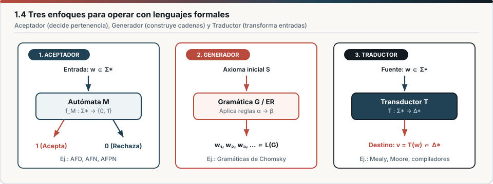

<!-- _class: lead -->

Tema 1.4

# 1.4 Aceptadores, generadores y traductores

### Las tres perspectivas operativas sobre los lenguajes formales

Unidad 1: Introducción · Primer Semestre

---

# Tres formas de operar con un lenguaje

- **Aceptador (reconocedor):** dada una cadena candidata $w \in \Sigma^*$, ¿pertenece a $L$? $\to$ responde **Sí / No**.
- **Generador:** ¿cómo producir sistemáticamente todas las cadenas válidas de $L$? $\to$ construye las cadenas de $L$.
- **Traductor (transductor):** dada una cadena fuente $w \in \Sigma^*$, ¿qué cadena destino $v \in \Delta^*$ le corresponde?

---

# Esquema visual: 1.4 Aceptadores, generadores y traductores

---

# 1. Aceptadores (o reconocedores)

Un aceptador $M$ define su **lenguaje aceptado** $L(M) = \{w \in \Sigma^* : M \text{ acepta } w\}$. Cuando siempre termina, implementa la **función característica** de $L(M)$:

$$f_M : \Sigma^* \longrightarrow \{0, 1\}, \qquad f_M(w) = \begin{cases} 1 \text{ (Acepta)}, & \text{si } w \in L(M), \\ 0 \text{ (Rechaza)}, & \text{si } w \notin L(M). \end{cases}$$

- **AFD / AFN:** reconocen lenguajes regulares (base del analizador léxico).
- **AFPD / AFPN:** reconocen lenguajes independientes del contexto (base del analizador sintáctico).

---

# 2. Generadores

Un **generador** es un sistema finito que produce todas las cadenas de $L$ y ninguna ajena a $L$:

1. **Gramáticas formales ($G = (V, \Sigma, S, P)$):** aplican reglas de reescritura $\alpha \to \beta$ desde el símbolo inicial $S$:
   $$L(G) = \{w \in \Sigma^* : S \Rightarrow_G^* w\}.$$
2. **Expresiones regulares ($R$):** fórmulas algebraicas formadas con unión, concatenación y estrella de Kleene.
3. **Máquinas de Turing enumeradoras:** listan las cadenas de $L$ sobre una cinta.

---

# 3. Traductores (o transductores)

Un **traductor** $T$ transforma cadenas sobre un alfabeto fuente $\Sigma$ en cadenas sobre un alfabeto destino $\Delta$:

$$T : \Sigma^* \longrightarrow \Delta^*$$

- **Transductores finitos (Mealy y Moore):** máquinas de estado finito con salida.
- **Máquinas de Turing calculadoras:** reciben $w$ en cinta y dejan $h(w)$ al detenerse.
- **Compiladores:** integran aceptadores (léxico/sintáctico) y traductores (código objeto).

---

<!-- _class: invert -->
# Cuadro comparativo de los tres modelos

| Aspecto | Aceptador | Generador | Traductor |
| :--- | :--- | :--- | :--- |
| **Pregunta central** | ¿$w \in L$? | ¿Qué cadenas están en $L$? | ¿Qué salida $v$ corresponde a $w$? |
| **Función / Objeto** | $f_M : \Sigma^* \to \{0, 1\}$ | Gramática $G$ o expresión $R$ | $T : \Sigma^* \to \Delta^*$ |
| **Salida** | Decisión binaria (1 / 0) | Conjunto de cadenas $L$ | Cadena transformada $v \in \Delta^*$ |
| **Ejemplos** | AFD, AFN, AFPN, MT | Gramáticas de Chomsky, ER | Mealy, Moore, compiladores |

---

# Ejemplos paso a paso

### Aceptador (terminadas en `01`)
- $Q = \{q_0, q_1, q_2\}$, $F = \{q_2\}$.
- `1001`: $q_0 \xrightarrow{1} q_0 \xrightarrow{0} q_1 \xrightarrow{0} q_1 \xrightarrow{1} q_2 \in F$ (**1**).
- `010`: $q_0 \xrightarrow{0} q_1 \xrightarrow{1} q_2 \xrightarrow{0} q_1 \notin F$ (**0**).

### Generador (palíndromos pares)
- Gramática $S \to aSa \mid bSb \mid \lambda$.
- Derivación de `abba`:
  $$S \Rightarrow aSa \Rightarrow abSba \Rightarrow abba.$$

---

# Ejemplo 3: Traductor (complemento a uno binario)

Queremos convertir cada `0` en `1` y cada `1` en `0` sobre $\Sigma = \Delta = \{0, 1\}$:
- Basta un único estado $q_0$ con reglas `entrada / salida`: `0 / 1` y `1 / 0`.
- **Traza paso a paso de $w = 10110$:**
  - Lee `1` $\to$ emite `0`
  - Lee `0` $\to$ emite `1`
  - Lee `1` $\to$ emite `0`, lee `1` $\to$ emite `0`, lee `0` $\to$ emite `1`.
- **Resultado:** $T(10110) = 01001$ (en un único recorrido de izquierda a derecha).

---

<!-- _class: invert -->
# Conclusión y ejercicio

> **Síntesis:** En Teoría de la Computación estudiaremos cómo un mismo lenguaje puede **reconocerse** con autómatas, **generarse** con gramáticas o **transformarse** con traductores, demostrando equivalencias entre ellos.

**Ejercicio:** Dada la gramática generadora $S \to 0S1 \mid 01$, escribe las tres cadenas más cortas que genera y describe el lenguaje $L(G)$ por comprensión.

---

# Referencias

- Acevedo Juárez, A. (2006). *Teoría de la computación* [Tesis de licenciatura, Instituto Tecnológico de Celaya]. (Secc. 1.2.2 y 1.4, pp. 11–17, 27).
- De Castro Korgi, R. (2004). *Teoría de la computación: Lenguajes, autómatas, gramáticas*. Universidad Nacional de Colombia. (pp. 4, 19, 25–28, 81–83, 167–179).
