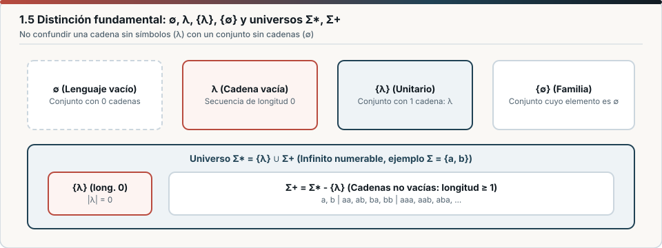

<!-- _class: lead -->

Tema 1.5

# 1.5 Cadenas de lenguajes

### Símbolos, alfabetos $\Sigma$, cadena vacía $\lambda$ y universos $\Sigma^*, \Sigma^+$

Unidad 1: Introducción · Primer Semestre

---

# Símbolos y alfabetos ($\Sigma$)

- **Símbolo:** entidad indivisible y elemental de representación (`a`, `0`, `+`, `;`). Se denotan con minúsculas iniciales ($a, b, c, \dots$) o dígitos.
- **Alfabeto ($\Sigma$):** conjunto **finito y no vacío** de símbolos ($\lvert \Sigma \rvert < \infty$, $\Sigma \neq \varnothing$).
  - Alfabeto binario: $\Sigma = \{0, 1\}$.
  - Alfabeto latino: $\Sigma = \{a, b, \dots, z\}$.
  - Alfabeto estándar ASCII en compiladores.

---

# Esquema visual: 1.5 Cadenas de lenguajes

---

# Cadena ($w$), cadena vacía ($\lambda$) e igualdad

- **Cadena (o palabra):** secuencia finita de símbolos de $\Sigma$ escritos por yuxtaposición ($u, v, w, x, y, z$).
- **Cadena vacía ($\lambda$):** única secuencia con cero símbolos. *(Adoptamos $\lambda$ siguiendo a De Castro Korgi para evitar confundir $\varepsilon$ con $\in$)*.
- **Igualdad de cadenas:** importa el orden y la repetición:
  $$u = v \iff |u| = |v| \text{ y } a_i = b_i \text{ en cada posición } i.$$
  Por ejemplo, $aba \neq aab$ y $aa \neq a$.

---

<!-- _class: invert -->
# Universos de cadenas: $\Sigma^*$ y $\Sigma^+$

> Dado un alfabeto $\Sigma$, construimos dos conjuntos **infinitos numerables** (De Castro Korgi, 2004, p. 7):

1. **Clausura de Kleene ($\Sigma^*$):** todas las cadenas finitas sobre $\Sigma$, **incluyendo** $\lambda$:
   $$\Sigma^* = \{\lambda\} \cup \{a_1 a_2 \cdots a_n : n \ge 1,\; a_i \in \Sigma\}.$$
2. **Clausura positiva ($\Sigma^+$):** todas las cadenas finitas **no vacías** sobre $\Sigma$:
   $$\Sigma^+ = \Sigma^* - \{\lambda\}.$$

---

<!-- _class: invert -->
# Distinción crítica: $\varnothing$, $\lambda$, $\{\lambda\}$ y $\{\varnothing\}$

| Objeto | Naturaleza | Tamaño | Significado |
| :---: | :--- | :---: | :--- |
| $\varnothing$ | Conjunto (lenguaje vacío) | $0$ elementos | Lenguaje sin ninguna cadena |
| $\lambda$ | Cadena | Longitud $0$ | Palabra con cero símbolos (no es conjunto) |
| $\{\lambda\}$ | Conjunto (lenguaje unitario) | $1$ elemento | Lenguaje cuya única cadena es $\lambda$ |
| $\{\varnothing\}$ | Conjunto de conjuntos | $1$ elemento | Caja que contiene al conjunto vacío |

---

# Pertenencia ($w \in L$) y especificación de lenguajes

Un lenguaje es un subconjunto $L \subseteq \Sigma^*$. Se especifica de tres maneras:

1. **Por extensión (enumeración):** listando elementos (solo riguroso si $L$ es finito): $L = \{a, aba, aca\}$.
2. **Por comprensión (propiedad $P$):** $L = \{w \in \Sigma^* : P(w)\}$.
   - *Ejemplo:* $L = \{w \in \{a, b, c\}^* : w \text{ no contiene } c\}$.
3. **Por sistemas formales:** expresiones regulares, gramáticas $L(G)$ o autómatas $L(M)$.

---

# Ejemplo 1: Enumeración ordenada de $\Sigma^*$ y $\Sigma^+$

Para $\Sigma = \{a, b\}$, ordenamos por longitud creciente:
- Longitud 0: $\lambda$
- Longitud 1: $a, b$ ($2^1 = 2$)
- Longitud 2: $aa, ab, ba, bb$ ($2^2 = 4$)
- Longitud 3: $aaa, aab, aba, abb, baa, bab, bba, bbb$ ($2^3 = 8$)

**Verificaciones rápidas:**
- $\lambda \in \Sigma^*$ (**Verdadero**); $\quad \lambda \in \Sigma^+$ (**Falso**).
- $\varnothing \subseteq \Sigma^*$ (**Verdadero**); $\quad \varnothing \in \Sigma^*$ (**Falso**, $\Sigma^*$ contiene cadenas, no conjuntos).

---

# Ejemplo 2: Números naturales sin ceros iniciales

Sobre $\Sigma = \{0, 1, \dots, 9\}$ (De Castro Korgi, 2004, p. 11):
$$L_{\mathbb{N}} = \{0\} \cup \{w \in \Sigma^+ : \text{el primer símbolo de } w \text{ es } \neq 0\}.$$

- `0` $\in L_{\mathbb{N}}$ (está en $\{0\}$).
- `2026` $\in L_{\mathbb{N}}$ (pertenece a $\Sigma^+$ e inicia con `2` $\neq 0$).
- `025` $\notin L_{\mathbb{N}}$ (inicia con `0` y no es `"0"`).
- $\lambda \notin L_{\mathbb{N}}$ (se exige $w \in \Sigma^+$, al menos un dígito).

---

<!-- _class: invert -->
# Práctica en clase

**Determina verdadero o falso y justifica:**
1. $\lambda \in \varnothing$
2. $\lambda \in \{\lambda\}$
3. $\varnothing \subseteq \{\lambda\}$
4. $\{\lambda\} = \varnothing$

**Reto:** Escribe por extensión $L = \{a^n b^m : n \ge 1,\; m \ge 0 \text{ y } n + m \le 3\}$.

---

# Referencias

- Acevedo Juárez, A. (2006). *Teoría de la computación* [Tesis de licenciatura, Instituto Tecnológico de Celaya]. (Secc. 1.2.1 y 1.2.3, pp. 4–6, 18–22).
- De Castro Korgi, R. (2004). *Teoría de la computación: Lenguajes, autómatas, gramáticas*. Universidad Nacional de Colombia. (Secc. 1.1 y 1.7, pp. 5–7, 10–11).
