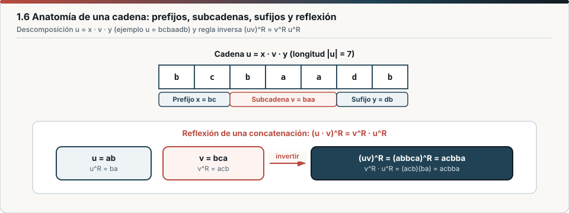

<!-- _class: lead -->

Tema 1.6

# 1.6 Cadenas y sus operaciones

### Longitud, concatenación, potencias, reflexión, subcadenas, prefijos y sufijos

Unidad 1: Introducción · Primer Semestre

---

# 1. Longitud de una cadena ($|w|$)

Número total de ocurrencias de símbolos que forman la cadena:

- **Definición descriptiva:** $|\lambda| = 0$, y $|a_1 a_2 \cdots a_n| = n$.
- **Definición recursiva:**
  1. Base: $|\lambda| = 0$.
  2. Paso recursivo: $|wa| = |w| + 1$ para $w \in \Sigma^*$, $a \in \Sigma$.
- **Consecuencia:** $|w| = 0 \iff w = \lambda$, y todo símbolo individual cumple $|a| = 1$.

---

# Esquema visual: 1.6 Cadenas y sus operaciones

---

# 2. Concatenación de cadenas ($uv$)

Escribir los símbolos de $v$ inmediatamente después de los de $u$ (De Castro Korgi, 2004, p. 7):

- **Definición recursiva:** $u \cdot \lambda = u$, y $u \cdot (va) = (u \cdot v)a$.
- **Propiedades algebraicas clave:**
  1. **Asociatividad:** $(uv)w = u(vw)$.
  2. **Elemento neutro ($\lambda$):** $u\lambda = \lambda u = u$ (como sumar $0$ o multiplicar por $1$).
  3. **No conmutatividad:** en general $uv \neq vu$ (p. ej., $ab \neq ba$).
  4. **Aditividad de la longitud:** $|uv| = |u| + |v|$.

---

# 3. Potencias de una cadena ($w^n$)

Concatenar $w$ consigo misma $n$ veces ($n \ge 0$):
- **Base:** $w^0 = \lambda$.
- **Paso recursivo:** $w^{n+1} = w^n \cdot w$.

**Propiedades:**
1. $\lambda^n = \lambda$ para todo $n \ge 0$.
2. $|w^n| = n \cdot |w|$.
3. $w^{n+m} = w^n w^m$ y $(w^n)^m = w^{nm}$.

---

<!-- _class: invert -->
# 4. Reflexión o inversa ($w^R$) y palíndromos

> Invertir el orden de los símbolos de $w$: $\lambda^R = \lambda$ y $(wa)^R = a \cdot w^R$.

**Propiedades fundamentales (demostrables por inducción sobre $|v|$):**
1. **Invarianza de longitud:** $|w^R| = |w|$.
2. **Doble reflexión:** $(w^R)^R = w$.
3. **Reflexión de una concatenación (orden invertido):**
   $$(uv)^R = v^R u^R.$$
- **Palíndromo:** cadena que coincide con su inversa ($w = w^R$), como $\lambda$, `aba`, `1001`, `reconocer`.

---

# 5. Subcadenas, prefijos y sufijos

Dada una cadena $u \in \Sigma^*$ (De Castro Korgi, 2004, pp. 9–10):

- **Subcadena:** $v$ es subcadena de $u$ si $u = xvy$ para algunas $x, y \in \Sigma^*$ (posiciones **contiguas**).
- **Prefijo:** $v$ es prefijo de $u$ si $u = vw$ ($v$ propio si $v \neq u$).
- **Sufijo:** $v$ es sufijo de $u$ si $u = wv$ ($v$ propio si $v \neq u$).
- Toda cadena de longitud $n$ tiene **$n + 1$ prefijos** y **$n + 1$ sufijos** (incluyendo $\lambda$ y $u$).

---

# Ejemplo 1: Evaluación paso a paso

Sean $\Sigma = \{a, b, c\}$, $u = ab$ y $v = bca$:

1. **Concatenación:** $uv = ab \cdot bca = abbca$, con $|uv| = 2 + 3 = 5$.
2. **Potencia ($u^3$):** $u^0 = \lambda$, $u^1 = ab$, $u^2 = abab$, $u^3 = ababab$ ($|u^3| = 6$).
3. **Reflexión paso a paso:**
   - $(ab)^R = b \cdot (a)^R = ba$; $\quad (bca)^R = a(bc)^R = acb$.
   - $v^R u^R = (acb)(ba) = acbba = (abbca)^R = (uv)^R$.

---

# Ejemplo 2: Prefijos, sufijos y regla del prefijo más largo

Para $u = bcbaadb$ ($|u| = 7$, De Castro Korgi, 2004, p. 10):
- **8 prefijos:** $\lambda, b, bc, bcb, bcba, bcbaa, bcbaad, bcbaadb$.
- **8 sufijos:** $\lambda, b, db, adb, aadb, baadb, cbaadb, bcbaadb$.
- **Subcadenas:** incluyen `ba`, `aa`, `cba`, etc., pero **no** `bcd` (no son contiguos).

> **En compiladores:** Al leer `int1 = 5;`, el analizador léxico ve `int` (palabra reservada), pero al llegar al `1` elige el **prefijo válido más largo** (`int1`) como identificador.

---

<!-- _class: invert -->
# Ejercicios propuestos

1. Sean $u = 101$ y $v = 00$. Calcula $uv$, $vu$, $u^2 v^R$, $|u^3 v^2|$ y verifica $(uv)^R = v^R u^R$.
2. Para $w = abba$, lista todos sus prefijos, sus sufijos y sus subcadenas distintas (comprueba la cota $1 + \frac{4 \cdot 5}{2} = 11$).
3. Demuestra por inducción sobre $n$ que $|w^n| = n|w|$ y $(w^n)^R = (w^R)^n$.

---

# Referencias

- Acevedo Juárez, A. (2006). *Teoría de la computación* [Tesis de licenciatura, Instituto Tecnológico de Celaya]. (Secc. 1.2.3.1 y 1.3, pp. 19–26).
- De Castro Korgi, R. (2004). *Teoría de la computación: Lenguajes, autómatas, gramáticas*. Universidad Nacional de Colombia. (Secc. 1.2–1.6, pp. 7–10).
