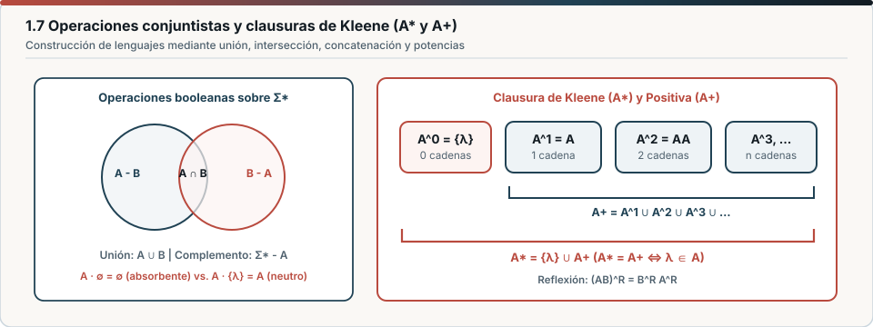

<!-- _class: lead -->

Tema 1.7

# 1.7 Operaciones sobre lenguajes

### Operaciones conjuntistas y lingüísticas ($AB$, $A^n$, $A^*$, $A^+$, $A^R$)

Unidad 1: Introducción · Primer Semestre

---

# 1. Operaciones conjuntistas (booleanas)

Al ser subconjuntos de $\Sigma^*$ ($A, B \subseteq \Sigma^*$), los lenguajes heredan las operaciones de conjuntos:

- **Unión:** $A \cup B = \{w \in \Sigma^* : w \in A \text{ o } w \in B\}$.
- **Intersección:** $A \cap B = \{w \in \Sigma^* : w \in A \text{ y } w \in B\}$.
- **Diferencia:** $A - B = \{w \in \Sigma^* : w \in A \text{ y } w \notin B\}$.
- **Complemento:** $\overline{A} = \Sigma^* - A$ *(depende siempre del alfabeto $\Sigma$ fijado)*.

---

# Esquema visual: 1.7 Operaciones sobre lenguajes

---

<!-- _class: invert -->
# Distinción crítica entre $\varnothing$ y $\{\lambda\}$

| Operación / Propiedad | Lenguaje vacío ($\varnothing$) | Lenguaje unitario ($\{\lambda\}$) |
| :--- | :--- | :--- |
| **Unión con $A$** | $A \cup \varnothing = A$ (neutro de $\cup$) | $A \cup \{\lambda\}$ agrega $\lambda$ si faltaba |
| **Concatenación con $A$** | $A \cdot \varnothing = \varnothing \cdot A = \varnothing$ (**absorbente**) | $A \cdot \{\lambda\} = \{\lambda\} \cdot A = A$ (**neutro**) |
| **Potencias ($n \ge 1$)** | $\varnothing^0 = \{\lambda\}$, $\;\varnothing^n = \varnothing$ | $\{\lambda\}^n = \{\lambda\}$ para todo $n \ge 0$ |
| **Clausuras** | $\varnothing^* = \{\lambda\}$, $\;\varnothing^+ = \varnothing$ | $\{\lambda\}^* = \{\lambda\}^+ = \{\lambda\}$ |

---

# 2. Concatenación ($AB$) y potencias ($A^n$)

- **Concatenación:** $AB = \{uv : u \in A,\; v \in B\}$.
  - Asociativa y distributiva sobre la unión: $A(B \cup C) = AB \cup AC$.
  - No conmutativa ($AB \neq BA$ en general) y solo se cumple $A(B \cap C) \subseteq AB \cap AC$.
- **Potencias de un lenguaje:**
  $$A^0 = \{\lambda\}, \qquad A^n = A^{n-1} \cdot A = \{u_1 \cdots u_n : u_i \in A\}.$$
  *Ojo:* Si $A = \{a, b\}$, entonces $A^2 = \{aa, ab, ba, bb\}$ (combina cadenas distintas).

---

<!-- _class: invert -->
# Clausura de Kleene ($A^*$) y clausura positiva ($A^+$)

> Son las operaciones centrales para describir repeticiones arbitrarias en lenguajes y expresiones regulares (De Castro Korgi, 2004, pp. 14–16).

- **Clausura de Kleene ($A^*$):** unión de todas las potencias desde $n = 0$:
  $$A^* = \bigcup_{n \ge 0} A^n = A^0 \cup A^1 \cup A^2 \cup \cdots$$
- **Clausura positiva ($A^+$):** unión desde $n = 1$:
  $$A^+ = \bigcup_{n \ge 1} A^n = A^1 \cup A^2 \cup A^3 \cup \cdots$$
- **Relación clave:** $A^* = A^+ \cup \{\lambda\}$, y $A^* = A^+ \iff \lambda \in A$.

---

# Propiedades de $A^*$, $A^+$ y reflexión $A^R$

### Propiedades de $*$ y $+$
- $A^+ = A^* A = A A^*$
- $A^* A^* = A^*$ y $(A^*)^* = A^*$
- $(A^+)^* = (A^*)^+ = A^*$
- $(A \cup B)^* = (A^* B^*)^*$

### Reflexión $A^R = \{u^R : u \in A\}$
- $(A \cdot B)^R = B^R \cdot A^R$
- $(A \cup B)^R = A^R \cup B^R$
- $(A \cap B)^R = A^R \cap B^R$
- $(A^*)^R = (A^R)^*$ y $(A^R)^R = A$

---

# Ejemplo 1: Operaciones con lenguajes finitos

Sean $A = \{a, ab, \lambda\}$ y $B = \{b, ab\}$ sobre $\Sigma = \{a, b\}$:

- $A \cup B = \{\lambda, a, b, ab\}$, $\quad A \cap B = \{ab\}$, $\quad A - B = \{\lambda, a\}$.
- **Concatenación $AB$:** combinamos cada elemento de $A$ con cada uno de $B$:
  $$AB = \{ab, aab, abb, abab, b\}.$$
- **Concatenación $BA$:**
  $$BA = \{ba, bab, b, aba, abab, ab\} \neq AB.$$
- **Reflexión:** $A^R = \{a, ba, \lambda\}$, $B^R = \{b, ba\} \implies B^R A^R = \{b, ba, baa, bba, baba\} = (AB)^R$.

---

# Ejemplo 2: Potencias de $L = \{a, bb\}$ e identificadores

- $L^0 = \{\lambda\}$, $\; L^1 = \{a, bb\}$, $\; L^2 = \{aa, abb, bba, bbbb\}$.
- $L^+ = L^1 \cup L^2 \cup \cdots$ (cualquier `b` aparece en bloques pares; $\lambda \notin L^+$).
- $L^* = \{\lambda\} \cup L^+$ (aquí $L^* \neq L^+$ porque $\lambda \notin L$).

**Aplicación a compiladores (identificadores):**  
Con $D_{\text{letra}} = \{a,\dots,Z\}$ y $D_{\text{dígito}} = \{0,\dots,9\}$:
$$I = D_{\text{letra}} \cdot (D_{\text{letra}} \cup D_{\text{dígito}})^*.$$
Así `var2A` $\in I$, pero `2var` $\notin I$ y $\lambda \notin I$.

---

<!-- _class: invert -->
# Ejercicios propuestos

1. Sean $A = \{\lambda, a, bc\}$ y $B = \{b, ca\}$. Calcula $A \cup B$, $AB$, $BA$, $A^2$ y verifica $(AB)^R = B^R A^R$.
2. Indica si es verdadero o falso (da contraejemplo si es falso):
   - $A \cdot \varnothing = A$
   - $(A \cup \{\lambda\})^+ = A^*$
   - $A(B \cap C) = AB \cap AC$
3. Usando los conjuntos $D = \{0,\dots,9\}$, $S = \{+, -\}$ y $P = \{.\}$, escribe una expresión algebraica para números decimales con signo opcional (p. ej. `-12.5` o `0.05`).

---

# Referencias

- Acevedo Juárez, A. (2006). *Teoría de la computación* [Tesis de licenciatura, Instituto Tecnológico de Celaya]. (Secc. 1.2.1.1 y 1.2.3.2, pp. 7–10, 21–24).
- De Castro Korgi, R. (2004). *Teoría de la computación: Lenguajes, autómatas, gramáticas*. Universidad Nacional de Colombia. (Secc. 1.7–1.14, pp. 10–20, 95).
