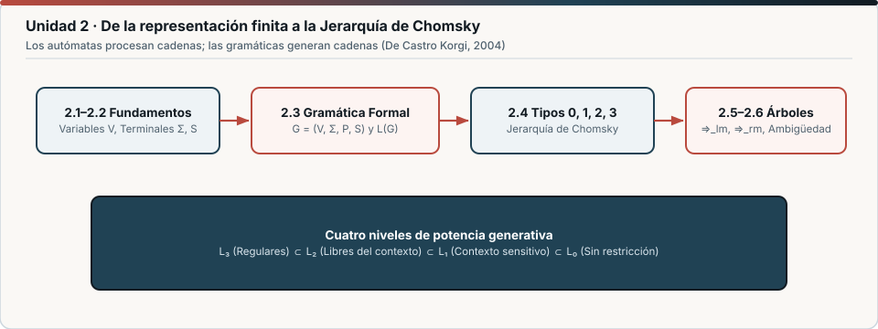

<!-- _class: lead -->

Unidad 2 · 20 horas

# Unidad 2: Gramáticas Formales

### Sistemas generadores, jerarquía de Chomsky, árboles de derivación y ambigüedad

**Universidad Vasco de Quiroga (UVAQ)**  
Ingeniería en Sistemas y Seguridad Informática · Primer Semestre

---

# Propósito y competencia de la unidad

- **Competencia a desarrollar:** Comparar las principales clases de gramáticas, construyendo gramáticas generadoras de lenguajes para conocer la relación que guardan con las clases de lenguajes de la jerarquía de Chomsky.
- **Idea rectora (De Castro Korgi, 2004, p. 81):**
  > *"Los autómatas procesan cadenas; las gramáticas generan cadenas."*

---

# Esquema visual: Unidad 2: Gramáticas Formales

---

<!-- _class: invert -->
# Panorama de la Unidad 2

1. **2.1 Representación de los lenguajes:** ¿Cómo describir lenguajes infinitos con reglas finitas?
2. **2.2 Conceptos básicos de gramáticas:** Variables, terminales, símbolo inicial y producciones.
3. **2.3 Gramáticas formales:** La cuádrupla $G = (V, \Sigma, P, S)$, derivaciones y equivalencia.
4. **2.4 Tipos de gramáticas:** La jerarquía de Chomsky ($\mathcal{L}_3 \subsetneq \mathcal{L}_2 \subsetneq \mathcal{L}_1 \subsetneq \mathcal{L}_0$).
5. **2.5 Árboles y diagramas de derivación:** Frontera, derivaciones $\Rightarrow_{lm}$ y $\Rightarrow_{rm}$.
6. **2.6 Ambigüedad:** Múltiples árboles sintácticos y técnicas de desambiguación.

---

# Mapa de subtemas y modelos asociados

| Subtema | Tema central | Conexión con el curso |
| :--- | :--- | :--- |
| **2.1** | Extensión, comprensión, recursión, ER, gramáticas | Elige la representación adecuada |
| **2.2 – 2.3** | $G = (V, \Sigma, P, S)$, $\Rightarrow_G$, $\Rightarrow_G^*$, $L(G)$ | Formalismo base para todo el curso |
| **2.4** | Tipos 0, 1, 2 y 3 (Chomsky) | Relación con MT, ALA, AP y AF |
| **2.5 – 2.6** | Árboles sintácticos, precedencia y *dangling else* | Diseño de compiladores sin ambigüedad |

---

<!-- _class: invert -->
# Idea clave para recordar

> Las **gramáticas formales** permiten describir con un puñado finito de reglas lenguajes infinitos complejos —como toda la sintaxis de C, Java o Python— y clasificarlos según la memoria que requiere una máquina para reconocerlos.

---

# Referencias bibliográficas

- Acevedo Juárez, A. (2006). *Teoría de la computación* [Tesis de licenciatura, Instituto Tecnológico de Celaya].
- Chomsky, N. (1956). Three models for the description of language. *IRE Transactions on Information Theory*, *2*(3), 113–124.
- De Castro Korgi, R. (2004). *Teoría de la computación: Lenguajes, autómatas, gramáticas*. Universidad Nacional de Colombia.
