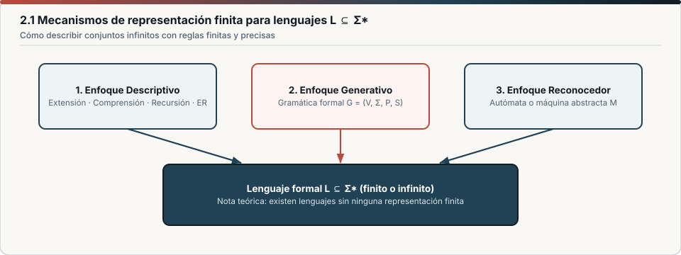

<!-- _class: lead -->

Tema 2.1

# 2.1 Representación de los lenguajes

### Cómo describir lenguajes infinitos mediante especificaciones finitas

Unidad 2: Gramáticas Formales · Primer Semestre

---

# El problema metodológico central

- Un lenguaje formal $L \subseteq \Sigma^*$ casi siempre es **infinito** (p. ej., todos los programas válidos en C o todas las expresiones aritméticas).
- Sin embargo, los humanos y las computadoras solo podemos almacenar descripciones de **tamaño finito**.
- **Tres enfoques complementarios:**
  1. **Descriptivo:** extensión, comprensión, definición recursiva, expresión regular.
  2. **Generativo:** gramáticas formales $G = (V, \Sigma, P, S)$.
  3. **Reconocedor:** autómatas o máquinas abstractas $M$.

---

# Esquema visual: 2.1 Representación de los lenguajes

---

# 1. Extensión, 2. Comprensión y 3. Definición recursiva

- **Por extensión:** listar todos los elementos $L = \{w_1, \dots, w_n\}$. Solo es riguroso para **lenguajes finitos**; usar `...` en infinitos es ambiguo.
- **Por comprensión:** usar una propiedad $P(w)$: $L = \{w \in \Sigma^* \mid P(w)\}$ (p. ej. $\{a^n b^n \mid n \ge 0\}$). Exacto, pero declarativo.
- **Definición recursiva (3 cláusulas):**
  1. **Base:** cadenas iniciales (p. ej. $\lambda \in L$).
  2. **Paso inductivo:** regla constructiva (si $u, v \in L \implies (u) \in L$ y $uv \in L$).
  3. **Cierre:** ninguna otra cadena pertenece a $L$.

---

# 4. Expresiones regulares, 5. Gramáticas y 6. Autómatas

- **Expresiones regulares (ER):** notación algebraica ($\emptyset, \lambda, a$, unión $\cup$, concatenación $\cdot$, estrella $*$) para **lenguajes regulares** ($\mathcal{L}_3$).
- **Gramáticas formales ($G$):** reglas de reescritura desde $S$; abarcan lenguajes con anidamiento como $\{a^n b^n \mid n \ge 0\}$.
- **Autómatas ($M$):** máquinas que leen $w$ y deciden aceptación (AF $\to \mathcal{L}_3$, AP $\to \mathcal{L}_2$, ALA $\to \mathcal{L}_1$, MT $\to \mathcal{L}_0$).

---

<!-- _class: invert -->
# ¿Todo lenguaje tiene representación finita?

> **Respuesta sorprendente: NO.**

- Toda receta finita (una gramática, una expresión regular o un programa) es un texto finito, por lo que todas las recetas posibles se pueden enumerar en una lista ordenada (receta 1, receta 2, receta 3...).
- Sin embargo, la colección de **todos** los subconjuntos de cadenas posibles ($\mathcal{P}(\Sigma^*)$) forma un infinito estrictamente más grande que no cabe en ninguna lista.
- Por ello, existen lenguajes que **ninguna gramática ni programa podrá describir jamás**.

---

# Cuadro comparativo de representaciones

| Mecanismo | Naturaleza | Alcance | Ventaja principal |
| :--- | :--- | :--- | :--- |
| **Extensión** | Descriptiva | Solo finitos | Sin ambigüedad |
| **Comprensión** | Descriptiva | Cualquier $L$ definible | Concisión matemática |
| **Definición recursiva** | Inductiva | Lenguajes inductivos | Ideal para demostraciones |
| **Expresión regular** | Algebraica | Solo regulares ($\mathcal{L}_3$) | Base del análisis léxico |
| **Gramática formal** | Generativa | Jerarquía completa | Modela sintaxis jerárquica |
| **Autómata** | Reconocedora | Según memoria | Implementación directa |

---

# Ejemplo 1: Naturales en binario sin ceros iniciales

Representar $L_1 = \{\texttt{0}, \texttt{1}, \texttt{10}, \texttt{11}, \texttt{100}, \dots\}$ (De Castro Korgi, 2004, p. 85):
- **Comprensión:** $L_1 = \{0\} \cup \{1w \mid w \in \{0, 1\}^*\}$.
- **Recursiva:** Base $0, 1 \in L_1$; si $w \in L_1$ y $w \ne 0 \implies w0, w1 \in L_1$.
- **Expresión regular:** $R_1 = 0 \cup 1(0 \cup 1)^*$.
- **Gramática:** $S \to 0 \mid 1A$, $\; A \to 0A \mid 1A \mid \lambda$.
  *(Para `101`: $S \Rightarrow 1A \Rightarrow 10A \Rightarrow 101A \Rightarrow 101$)*.

---

# Ejemplo 2: Un lenguaje no regular $L_2 = \{a^n b^n \mid n \ge 0\}$

- **¿Por qué falla un AF / ER?** Un autómata finito tiene memoria finita y no puede contar indefinidamente cuántas $a$ preceden a las $b$.
- **Definición recursiva:** Base $\lambda \in L_2$; si $w \in L_2 \implies awb \in L_2$.
  $$\lambda \in L_2 \implies ab \in L_2 \implies aabb \in L_2 \implies aaabbb \in L_2.$$
- **Gramática formal:** $G_2 = (\{S\}, \{a, b\}, \{S \to aSb \mid \lambda\}, S)$.
  $$S \Rightarrow aSb \Rightarrow aaSbb \Rightarrow aaaSbbb \Rightarrow aaabbb.$$

---

<!-- _class: invert -->
# Ejercicios en clase

1. Escribe **dos representaciones finitas distintas** para:
   - (a) Cadenas sobre $\{a, b\}$ con longitud $\le 2$.
   - (b) Cadenas sobre $\{a, b\}$ con un número par de $a$'s.
   - (c) Palíndromos de longitud impar sobre $\{a, b\}$.
2. Dada la definición recursiva: Base $0, 1 \in L$; paso $w \in L \implies 0w0, 1w1 \in L$. Describe $L$ por comprensión y construye una gramática que lo genere.

---

# Referencias

- Acevedo Juárez, A. (2006). *Teoría de la computación* [Tesis de licenciatura, Instituto Tecnológico de Celaya].
- De Castro Korgi, R. (2004). *Teoría de la computación: Lenguajes, autómatas, gramáticas*. Universidad Nacional de Colombia. (pp. 10, 18–20, 81–86).
