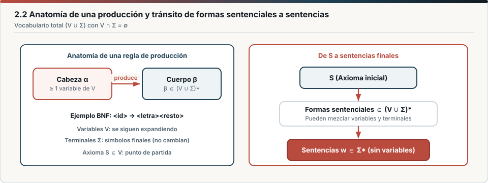

<!-- _class: lead -->

Tema 2.2

# 2.2 Conceptos básicos de gramáticas

### Origen lingüístico, variables, terminales, símbolo inicial y producciones

Unidad 2: Gramáticas Formales · Primer Semestre

---

# Origen de las gramáticas generativas

- **Noam Chomsky (1956)** propuso modelar las lenguas naturales mediante un conjunto finito de reglas capaces de generar todas las oraciones válidas:
  $$\text{Oración} \to \text{Sujeto} \;\text{Verbo} \;\text{Compl. Directo} \to \text{Juan lee un libro}.$$
- En la década de 1960, **Backus y Naur** adaptaron esta idea para describir la sintaxis de lenguajes de programación (**notación BNF**), dando origen a la base de los analizadores sintácticos (*parsers*).

---

# Esquema visual: 2.2 Conceptos básicos de gramáticas

---

# Los cuatro elementos de una gramática

1. **Variables / No terminales ($V$):** símbolos intermedios o categorías sintácticas que aún se van a expandir (mayúsculas $S, A, B$ o $\langle\text{expresión}\rangle$).
2. **Símbolos terminales ($\Sigma$):** alfabeto básico de las palabras finales; **no pueden seguir reemplazándose**. Condición obligatoria:
   $$V \cap \Sigma = \emptyset.$$
3. **Símbolo inicial ($S \in V$):** axioma o categoría principal desde donde inicia toda generación.
4. **Reglas de producción ($\alpha \to \beta$):** reglas de reescritura donde la **cabeza** $\alpha$ contiene al menos una variable de $V$ y el **cuerpo** $\beta \in (V \cup \Sigma)^*$.

---

<!-- _class: invert -->
# Formas sentenciales vs. sentencias

> Al ir aplicando reglas desde el símbolo inicial $S$, obtenemos pasos intermedios y resultados finales:

$$\text{Sentencias } (w \in \Sigma^*) \;\subseteq\; \text{Formas sentenciales } (\gamma \in (V \cup \Sigma)^*) \;\subseteq\; (V \cup \Sigma)^*$$

- **Forma sentencial:** cualquier cadena obtenida desde $S$ que aún puede mezclar variables y terminales (p. ej. `María escribe <ComplDirecto>`).
- **Sentencia:** forma sentencial que contiene **únicamente terminales** (ya no quedan variables por sustituir).

---

# Notación abreviada y producciones $\lambda$

- Cuando una misma cabeza $\alpha$ tiene varios cuerpos posibles, se agrupan con barra vertical `|` (*"o"*):
  $$\alpha \to \beta_1 \mid \beta_2 \mid \cdots \mid \beta_k$$
- Por ejemplo, $S \to aSb$ y $S \to \lambda$ se abrevian $S \to aSb \mid \lambda$.
- En BNF se suele usar `::=` en lugar de $\to$.
- Si el cuerpo es la cadena vacía ($\alpha \to \lambda$), se denomina **producción $\lambda$** (permite borrar una variable).

---

# Ejemplo 1: Fragmento gramatical en español

Adaptado de De Castro Korgi (2004, p. 96):
- $\langle\text{Oración}\rangle \to \langle\text{Sujeto}\rangle\;\langle\text{Verbo}\rangle\;\langle\text{ComplDirecto}\rangle$
- $\langle\text{Sujeto}\rangle \to \text{Juan} \mid \text{María}$, $\;\langle\text{Verbo}\rangle \to \text{lee} \mid \text{escribe}$
- $\langle\text{ComplDirecto}\rangle \to \langle\text{Artículo}\rangle\;\langle\text{Sustantivo}\rangle$, $\;\langle\text{Artículo}\rangle \to \text{un} \mid \text{una}$, $\;\langle\text{Sustantivo}\rangle \to \text{libro} \mid \text{carta}$.

**Generación paso a paso:**
1. $\langle\text{Oración}\rangle \to \langle\text{Sujeto}\rangle\;\langle\text{Verbo}\rangle\;\langle\text{ComplDirecto}\rangle$ *(forma sentencial)*
2. $\to \text{María}\;\text{escribe}\;\langle\text{Artículo}\rangle\;\langle\text{Sustantivo}\rangle$ *(forma sentencial mixta)*
3. $\to \text{María escribe una carta}$ *(sentencia en $\Sigma^*$)*

---

# Ejemplo 2: Identificadores en BNF

- $\langle\text{id}\rangle \to \langle\text{letra}\rangle\;\langle\text{resto}\rangle$
- $\langle\text{resto}\rangle \to \langle\text{letra}\rangle\;\langle\text{resto}\rangle \mid \langle\text{dígito}\rangle\;\langle\text{resto}\rangle \mid \lambda$
- $\langle\text{letra}\rangle \to a \mid b \mid x$, $\quad \langle\text{dígito}\rangle \to 0 \mid 1 \mid 2$.

**Generación de `x2a`:**  
$\langle\text{id}\rangle \Rightarrow \langle\text{letra}\rangle\langle\text{resto}\rangle \Rightarrow x\langle\text{resto}\rangle \Rightarrow x\langle\text{dígito}\rangle\langle\text{resto}\rangle \Rightarrow x2\langle\text{resto}\rangle \Rightarrow x2\langle\text{letra}\rangle\langle\text{resto}\rangle \Rightarrow x2a\langle\text{resto}\rangle \Rightarrow x2a$.

*(La cadena `2xa` es imposible porque toda derivación comienza obligatoriamente con $\langle\text{letra}\rangle$).*

---

<!-- _class: invert -->
# Ejercicios en clase

1. Con las producciones $S \to aSb \mid A$, $\;A \to cA \mid c$, clasifica cada cadena como *sentencia*, *forma sentencial (no sentencia)* o *ninguna*: `aSbb`, `aaAbb`, `aaccbb`, `accb`, `ba`.
2. ¿Por qué se exige que la cabeza $\alpha$ de toda regla $\alpha \to \beta$ contenga al menos una variable de $V$?
3. Diseña $V, \Sigma, S$ y $P$ para generar asignaciones simples como `x = y + 1;` o `a = 0;`.

---

# Referencias

- Acevedo Juárez, A. (2006). *Teoría de la computación* [Tesis de licenciatura, Instituto Tecnológico de Celaya].
- Chomsky, N. (1956). Three models for the description of language. *IRE Transactions on Information Theory*, *2*(3), 113–124.
- De Castro Korgi, R. (2004). *Teoría de la computación: Lenguajes, autómatas, gramáticas*. Universidad Nacional de Colombia. (Secc. 4.1, 4.5–4.6, pp. 81–82, 94–96).
