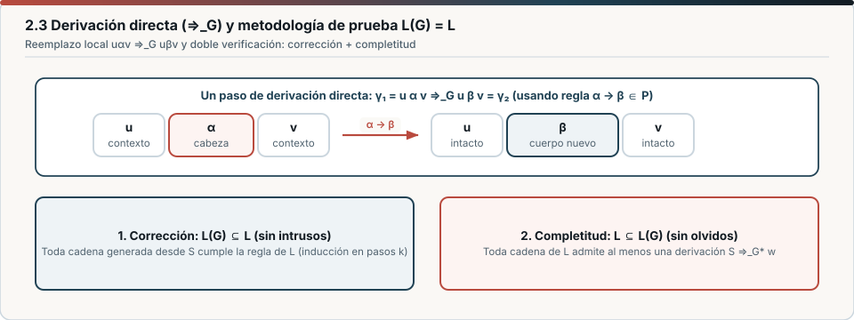

<!-- _class: lead -->

Tema 2.3

# 2.3 Gramáticas formales

### Definición de la cuádrupla $G = (V, \Sigma, P, S)$, derivación y lenguaje generado

Unidad 2: Gramáticas Formales · Primer Semestre

---

<!-- _class: invert -->
# Definición 2.3.1: Gramática formal

> Una **gramática formal** (o generativa) es una cuádrupla ordenada:
> $$G = (V, \Sigma, P, S)$$

1. **$V$:** alfabeto finito no vacío de **variables** (no terminales).
2. **$\Sigma$:** alfabeto finito de **terminales**, disjunto con $V$ ($V \cap \Sigma = \emptyset$).
3. **$P$:** conjunto finito de **producciones** $\alpha \to \beta$ donde $\alpha$ tiene al menos una variable de $V$ y $\beta \in (V \cup \Sigma)^*$.
4. **$S \in V$:** **símbolo inicial**.  
*(Nota: De Castro Korgi, 2004, p. 81 usa el orden equivalente $(V, \Sigma, S, P)$).*

---

# Esquema visual: 2.3 Gramáticas formales

---

# Relación de derivación ($\Rightarrow_G$, $\Rightarrow_G^k$, $\Rightarrow_G^*$, $\Rightarrow_G^+$)

- **Derivación directa ($\gamma_1 \Rightarrow_G \gamma_2$):** existen $u, v \in (V \cup \Sigma)^*$ y una regla $\alpha \to \beta \in P$ tales que:
  $$\gamma_1 = u\alpha v \qquad \text{y} \qquad \gamma_2 = u\beta v.$$
- **Derivación en $k$ pasos ($\Rightarrow_G^k$):** aplicar $k$ pasos directos seguidos ($\gamma \Rightarrow_G^0 \gamma$).
- **Cero o más pasos ($\Rightarrow_G^*$):** aplicar cero, una o varias reglas consecutivas (*clausura reflexiva y transitiva*).
- **Uno o más pasos ($\Rightarrow_G^+$):** aplicar al menos un paso (*clausura transitiva*).

---

# Lenguaje generado $L(G)$ y equivalencia

- **Lenguaje generado por $G$ (De Castro Korgi, 2004, p. 83):**
  $$L(G) = \{w \in \Sigma^* \mid S \Rightarrow_G^* w\} = \{w \in \Sigma^* \mid S \Rightarrow_G^+ w\}.$$
  *(Como $S \in V$ y $V \cap \Sigma = \emptyset$, ninguna cadena terminal se obtiene en 0 pasos).*
- **Compatibilidad con concatenación:** si $\gamma \Rightarrow_G^* \delta$, entonces $u\gamma v \Rightarrow_G^* u\delta v$.
- **Equivalencia de gramáticas ($G_1 \equiv G_2$):** generan exactamente el mismo lenguaje, es decir, $L(G_1) = L(G_2)$.

---

<!-- _class: invert -->
# Metodología de prueba: $L(G) = L$

> Probar que $G$ genera exactamente un lenguaje $L$ requiere comprobar dos cosas (De Castro Korgi, 2004, pp. 86–87):

1. **Corrección ($L(G) \subseteq L$ — *"no genera intrusos"*):**  
   Toda cadena terminal que produce $G$ cumple las reglas de $L$ (se prueba por inducción sobre el número de pasos $k$).
2. **Completitud ($L \subseteq L(G)$ — *"no olvida ninguna cadena válida"*):**  
   Toda cadena perteneciente a $L$ tiene al menos una derivación en $G$ (se prueba por inducción sobre $|w|$ o sobre los exponentes).

---

# Ejemplo 1: Equivalencia $G_1 \equiv G_2$ para $a^* b^*$

Adaptado de De Castro Korgi (2004, pp. 84–85):
- $G_1$: $\;S \to aS \mid bA \mid \lambda$, $\quad A \to bA \mid b \mid \lambda$.
- $G_2$: $\;S \to AB$, $\quad A \to aA \mid \lambda$, $\quad B \to bB \mid \lambda$.

**Derivación de `aabbb` en $G_1$ (5 pasos) y en $G_2$ (8 pasos):**
- $G_1$: $S \Rightarrow aS \Rightarrow aaS \Rightarrow aabA \Rightarrow aabbA \Rightarrow aabbb$.
- $G_2$: $S \Rightarrow AB \Rightarrow aAB \Rightarrow aaAB \Rightarrow aaB \Rightarrow aabB \Rightarrow aabbB \Rightarrow aabbbB \Rightarrow aabbb$.
- Ambas generan $\{a^m b^n \mid m, n \ge 0\} = a^* b^*$, luego **$G_1 \equiv G_2$**.

---

# Ejemplo 2: Prueba de $L(G) = \{a^n b^n \mid n \ge 0\}$

Sea $G = (\{S\}, \{a, b\}, \{S \to aSb \mid \lambda\}, S)$:

1. **Corrección ($L(G) \subseteq L$):** por inducción en los pasos $k$, toda forma sentencial $S \Rightarrow^k \gamma$ tiene la forma $a^k S b^k$ o bien $a^{k-1} b^{k-1}$ ($k \ge 1$). Al terminar sin variables, $w = a^{k-1} b^{k-1} \in L$.
2. **Completitud ($L \subseteq L(G)$):** por inducción en $n \ge 0$, $S \Rightarrow^n a^n S b^n \Rightarrow a^n b^n$.  
   Ejemplo ($n = 3$): $S \Rightarrow aSb \Rightarrow aaSbb \Rightarrow aaaSbbb \Rightarrow aaabbb$.

---

<!-- _class: invert -->
# Ejercicios propuestos

1. Para $G_1: S \to aS \mid aA,\; A \to bA \mid b$, deriva una cadena de longitud $\ge 4$ indicando $u, \alpha, v, \beta$ en cada paso.
2. Verifica si son equivalentes entre sí sobre $\{a, b\}$:
   - $G_1: S \to aSa \mid bSb \mid aSb \mid bSa \mid \lambda$
   - $G_2: S \to aaS \mid bbS \mid abS \mid baS \mid \lambda$
3. Demuestra por corrección y completitud que $S \to aSbb \mid \lambda$ genera $L = \{a^i b^{2i} \mid i \ge 0\}$.

---

# Referencias

- Acevedo Juárez, A. (2006). *Teoría de la computación* [Tesis de licenciatura, Instituto Tecnológico de Celaya]. (p. 88).
- De Castro Korgi, R. (2004). *Teoría de la computación: Lenguajes, autómatas, gramáticas*. Universidad Nacional de Colombia. (Secc. 4.1–4.2, pp. 81–87).
