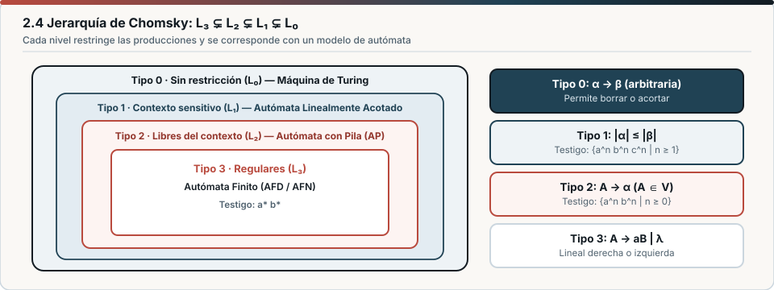

<!-- _class: lead -->

Tema 2.4

# 2.4 Tipos de gramáticas

### La Jerarquía de Chomsky: Tipos 0, 1, 2 y 3 y sus máquinas asociadas

Unidad 2: Gramáticas Formales · Primer Semestre

---

<!-- _class: invert -->
# La Jerarquía de Chomsky (1956, 1959)

> Noam Chomsky clasificó las gramáticas en **cuatro niveles** según las restricciones sobre sus producciones $\alpha \to \beta$, formando inclusiones estrictas:
> $$\mathcal{L}_3 \subsetneq \mathcal{L}_2 \subsetneq \mathcal{L}_1 \subsetneq \mathcal{L}_0.$$

| Tipo | Gramática | Restricción en $\alpha \to \beta$ | Autómata equivalente |
| :---: | :--- | :--- | :--- |
| **0** | Sin restricción | $\alpha$ contiene al menos una variable | Máquina de Turing (MT) |
| **1** | Contexto sensitivo | $\lvert \alpha \rvert \le \lvert \beta \rvert$ (salvo $S \to \lambda$) | Autómata Linealmente Acotado |
| **2** | Libre del contexto (GIC) | $A \to \alpha$ con $A \in V$ (una sola variable) | Autómata con Pila (AP) |
| **3** | Regular (GR) | Lineal derecha o lineal izquierda | Autómata Finito (AFD / AFN) |

---

# Esquema visual: 2.4 Tipos de gramáticas

---

# 2.4.1 Gramáticas sin restricción (Tipo 0)

- **Reglas $\alpha \to \beta$:** la cabeza $\alpha$ puede mezclar varios terminales y variables (al menos una en $V$), y $\beta \in (V \cup \Sigma)^*$ es arbitrario.
- Permiten **producciones contractivas** ($\lvert \alpha \rvert > \lvert \beta \rvert$) y de **borrado** ($\alpha \to \lambda$).
- Generan los **lenguajes recursivamente enumerables ($\mathcal{L}_0$)**, equivalentes a las Máquinas de Turing.
- **Ejemplo ($L = \{a^{2^n} \mid n \ge 0\}$):** utiliza reglas como $CB \to E$ y $AE \to \lambda$ (contractivas) para duplicar $a$'s entre marcadores $A$ y $B$.

---

# 2.4.2 Gramáticas de contexto sensitivo (Tipo 1)

Dos caracterizaciones equivalentes (Chomsky, 1959; De Castro Korgi, 2004, p. 82):
1. **Contextual:** $\alpha A \beta \to \alpha \gamma \beta$ con $\gamma \neq \lambda$ ($A$ se reemplaza solo en el contexto $(\alpha, \beta)$).
2. **No contractiva:** $\lvert \alpha \rvert \le \lvert \beta \rvert$ (se permite $S \to \lambda$ solo si $S$ no aparece en lados derechos).

- Generan $\mathcal{L}_1$, reconocida por **Autómatas Linealmente Acotados (ALA)**. Como las cadenas nunca se acortan, todo lenguaje de Tipo 1 es **decidible**.

---

# Ejemplo Tipo 1: $L = \{a^n b^n c^n \mid n \ge 1\}$

Este lenguaje no es Tipo 2, pero sí Tipo 1 mediante:
$$S \to aSBC \mid aBC, \quad CB \to BC, \quad aB \to ab, \quad bB \to bb, \quad bC \to bc, \quad cC \to cc.$$

**Derivación de `aabbcc` ($n = 2$):**
1. $S \Rightarrow aSBC \Rightarrow aaBCBC$ *(genera dos $a$'s y dos pares $BC$)*.
2. $aaB\underline{CB}C \Rightarrow aaBBCC$ *(ordena $B$'s antes de $C$'s)*.
3. $a\underline{aB}BCC \Rightarrow aab\underline{B}CC \Rightarrow aabb\underline{C}C$? No: $aab\underline{bC}C \Rightarrow aabbc\underline{C}$...  
   Exactamente: $a\underline{aB}BCC \Rightarrow aa\underline{bB}CC \Rightarrow aab\underline{bC}C \Rightarrow aabbc\underline{c}$ $\implies$ `aabbcc`.

---

# 2.4.3 Gramáticas libres del contexto (Tipo 2)

- **Forma de las reglas:** $A \to \alpha$, donde la cabeza es **una única variable** $A \in V$ y $\alpha \in (V \cup \Sigma)^*$.
- Se llaman *"libres (o independientes) del contexto"* porque $A$ puede sustituirse sin importar los símbolos vecinos.
- Generan los **LIC ($\mathcal{L}_2$)**, equivalentes a los **Autómatas con Pila (AFPN)**.
- **Ejemplo:** $S \to (S)S \mid [S]S \mid \lambda$ genera expresiones con paréntesis y corchetes balanceados como `[()[]]`.

---

# 2.4.4 Gramáticas regulares (Tipo 3)

Dos formas equivalentes (De Castro Korgi, 2004, Secc. 4.7, pp. 98–101):
- **Forma estándar / lineal derecha:** $A \to aB \mid \lambda$ (o $A \to wB \mid w$).
- **Lineal izquierda:** $A \to Bw \mid w$.

> **¡Precaución!** Mezclar reglas lineales derechas e izquierdas en la misma gramática (p. ej. $S \to aA,\; A \to Sb \mid \lambda$) **puede sacar al lenguaje de Tipo 3** (ese ejemplo genera $\{a^n b^n\}$).

- Generan $\mathcal{L}_3$, exactamente los lenguajes aceptados por **AFD / AFN**.

---

<!-- _class: invert -->
# Separación estricta entre los 4 tipos

> $$\mathcal{L}_3 \;\subsetneq\; \mathcal{L}_2 \;\subsetneq\; \mathcal{L}_1 \;\subsetneq\; \mathcal{L}_0$$

- $a^* b^* \in \mathcal{L}_3$ (Regular).
- $\{a^n b^n \mid n \ge 0\} \in \mathcal{L}_2 \setminus \mathcal{L}_3$ (LIC, pero no regular).
- $\{a^n b^n c^n \mid n \ge 1\} \in \mathcal{L}_1 \setminus \mathcal{L}_2$ (Sensible al contexto, pero no LIC).
- Lenguajes recursivamente enumerables no decidibles $\in \mathcal{L}_0 \setminus \mathcal{L}_1$.

---

# Ejercicios propuestos

1. Clasifica en el tipo más específico posible (3, 2, 1 o 0):
   - (a) $S \to aSb \mid ab$
   - (b) $S \to 0S \mid 1A \mid \lambda,\; A \to 0B,\; B \to 1B \mid \lambda$
   - (c) $S \to AB,\; AB \to BA,\; A \to a,\; B \to b$
   - (d) $S \to Aa,\; Aa \to \lambda$
2. Con la gramática de Tipo 1 de $\{a^n b^n c^n\}$, verifica qué pasa si conviertes la primera $B$ en $b$ antes de intercambiar $CB \to BC$.

---

# Referencias

- Acevedo Juárez, A. (2006). *Teoría de la computación* [Tesis de licenciatura, Instituto Tecnológico de Celaya]. (pp. 48–50).
- Chomsky, N. (1956, 1959). *Three models...* / *On certain formal properties of grammars*.
- De Castro Korgi, R. (2004). *Teoría de la computación: Lenguajes, autómatas, gramáticas*. Universidad Nacional de Colombia. (pp. 4, 82, 98–101).
