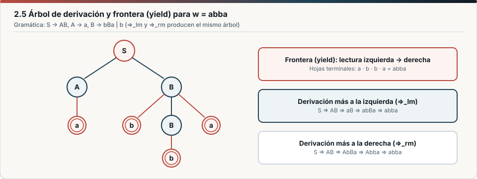

<!-- _class: lead -->

Tema 2.5

# 2.5 Árboles y diagramas de derivación

### Estructura jerárquica, frontera (*yield*) y derivaciones canónicas

Unidad 2: Gramáticas Formales · Primer Semestre

---

# ¿Por qué usar árboles de derivación?

- En una GIC, varias derivaciones distintas pueden expresar exactamente la **misma estructura sintáctica**, cambiando solo el orden en que expandimos variables independientes.
- Un **árbol de derivación** (o árbol sintáctico) abstrae ese orden irrelevante y muestra directamente cómo se construyó la cadena (De Castro Korgi, 2004, pp. 88–90).
- Es la estructura central que construye el analizador sintáctico (*parser*) de un compilador.

---

# Esquema visual: 2.5 Árboles y diagramas de derivación

---

# Definición formal de árbol de derivación

Para una GIC $G = (V, \Sigma, P, S)$:
1. La **raíz** está etiquetada con $S$ (o una variable $A \in V$ en un subárbol).
2. Todo **nodo interior** está etiquetado con una variable $A \in V$.
3. Si un nodo $A$ tiene hijos $X_1, X_2, \dots, X_k$ (de izquierda a derecha), entonces $A \to X_1 \cdots X_k \in P$.
4. Si un nodo lleva $\lambda$, es una **hoja** y es el **único hijo** de su padre $A$ ($A \to \lambda \in P$).
5. **Frontera (*yield*):** cadena obtenida al leer las hojas de **izquierda a derecha** (ignorando $\lambda$).

---

# Derivaciones canónicas: $\Rightarrow_{lm}$ y $\Rightarrow_{rm}$

Para eliminar el orden arbitrario al escribir derivaciones lineales:

- **Derivación más a la izquierda ($\Rightarrow_{lm}$):** en cada paso se expande **siempre la variable más a la izquierda** de la forma sentencial.
- **Derivación más a la derecha ($\Rightarrow_{rm}$):** en cada paso se expande **siempre la variable más a la derecha** de la forma sentencial.

---

<!-- _class: invert -->
# Teorema 2.5.1: Equivalencia entre derivaciones y árboles

> Para toda GIC $G$ y toda cadena terminal $w \in \Sigma^*$, las cuatro afirmaciones son equivalentes:
> 1. Existe una derivación arbitraria $S \Rightarrow_G^* w$.
> 2. Existe un árbol de derivación completo con raíz $S$ y frontera $w$.
> 3. Existe una derivación más a la izquierda $S \Rightarrow_{lm}^* w$.
> 4. Existe una derivación más a la derecha $S \Rightarrow_{rm}^* w$.

**Correspondencia uno a uno:** cada árbol de derivación distinto corresponde a **una única** derivación $\Rightarrow_{lm}^*$ y a **una única** derivación $\Rightarrow_{rm}^*$.

---

# Ejemplo 1: Un mismo árbol, dos derivaciones canónicas

Sea $G$: $S \to AB \mid AaB$, $\; A \to aA \mid a$, $\; B \to bBa \mid b$ (De Castro Korgi, 2004, p. 89), y $w = abba$:

- **Más a la izquierda ($\Rightarrow_{lm}$):**
  $$\underline{S} \Rightarrow_{lm} \underline{A}B \Rightarrow_{lm} a\underline{B} \Rightarrow_{lm} ab\underline{B}a \Rightarrow_{lm} abba$$
- **Más a la derecha ($\Rightarrow_{rm}$):**
  $$\underline{S} \Rightarrow_{rm} A\underline{B} \Rightarrow_{rm} Ab\underline{B}a \Rightarrow_{rm} \underline{A}bba \Rightarrow_{rm} abba$$

En el árbol: $S$ tiene hijos $A, B$; $A \to a$; $B$ tiene hijos $b, B, a$; $B \to b$. Leyendo las hojas de izquierda a derecha: `a · b · b · a = abba`.

---

# Ejemplo 2: Árbol de derivación con producción $\lambda$

Sea $S \to BAa$, $\; A \to bBC \mid a$, $\; B \to bB \mid b \mid \lambda$, $\; C \to aB \mid aa$, y $w = bbbaa$:

- **Derivación $\Rightarrow_{lm}$:**
  $$\underline{S} \Rightarrow \underline{B}Aa \Rightarrow b\underline{A}a \Rightarrow bb\underline{B}Ca \Rightarrow bbb\underline{C}a \Rightarrow bbba\underline{B}a \Rightarrow bbba\lambda a = bbbaa$$
- **Frontera del árbol:** leyendo sus hojas de izquierda a derecha obtenemos `b · b · b · a · λ · a = bbbaa`.
- La hoja $\lambda$ refleja la regla $B \to \lambda$, pero no agrega caracteres visibles a la cadena final.

---

<!-- _class: invert -->
# Ejercicios propuestos

1. Para $S \to aS \mid AaB,\; A \to aA \mid a,\; B \to bBbB \mid b$, construye una derivación $\Rightarrow_{lm}$, una $\Rightarrow_{rm}$ y el árbol de derivación para `aaaabbbb`.
2. Para $S \to ABC \mid BaC \mid aB,\; A \to Aa \mid a,\; B \to BAB \mid bab,\; C \to cC \mid \lambda$, construye el árbol (con hojas $\lambda$) de `abab` y `babacc`.
3. Dibuja dos derivaciones generales distintas para $w = (())()$ en $S \to (S)S \mid \lambda$ que correspondan al mismo árbol.

---

# Referencias

- Acevedo Juárez, A. (2006). *Teoría de la computación* [Tesis de licenciatura, Instituto Tecnológico de Celaya]. (Secc. 3.3, pp. 90–92).
- De Castro Korgi, R. (2004). *Teoría de la computación: Lenguajes, autómatas, gramáticas*. Universidad Nacional de Colombia. (Secc. 4.3–4.4, pp. 88–91).
