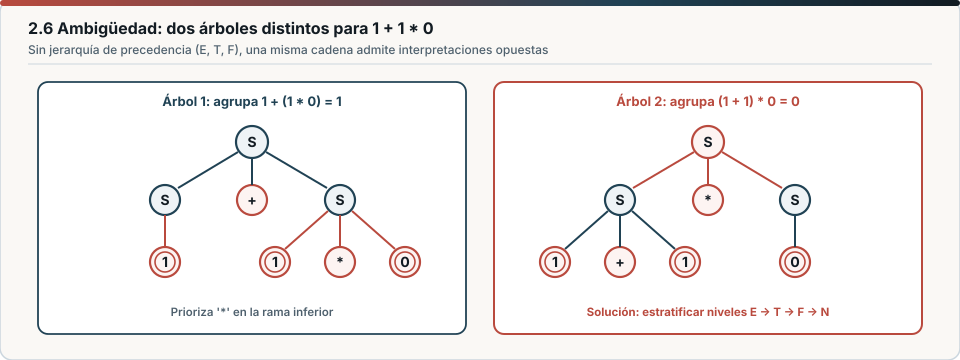

<!-- _class: lead -->

Tema 2.6

# 2.6 Ambigüedad

### Múltiples árboles sintácticos, desambiguación y lenguajes inherentemente ambiguos

Unidad 2: Gramáticas Formales · Primer Semestre

---

<!-- _class: invert -->
# Definición 2.6.1: Gramática ambigua

> Una GIC $G = (V, \Sigma, P, S)$ es **ambigua** si existe al menos una cadena $w \in L(G)$ que admite **dos o más árboles de derivación distintos** (De Castro Korgi, 2004, p. 91).

Por el Teorema 2.5.1, esto equivale a que exista $w \in L(G)$ con:
- **Al menos dos derivaciones más a la izquierda ($\Rightarrow_{lm}^*$) distintas**, o
- **Al menos dos derivaciones más a la derecha ($\Rightarrow_{rm}^*$) distintas**.

*(¡Cuidado! Dos derivaciones generales distintas no prueban ambigüedad si producen el mismo árbol).*

---

# Esquema visual: 2.6 Ambigüedad

---

# Ejemplo 1: Ambigüedad en expresiones aritméticas

Considere $S \to S + S \mid S * S \mid (S) \mid 0S \mid 1S \mid 0 \mid 1$ para $w = 1 + 1 * 0$:

- **Derivación $\Rightarrow_{lm}$ 1 (expande $+$ primero):**  
  $S \Rightarrow S + S \Rightarrow 1 + S \Rightarrow 1 + S * S \Rightarrow 1 + 1 * 0$ $\implies$ agrupa **$1 + (1 * 0) = 1$**.
- **Derivación $\Rightarrow_{lm}$ 2 (expande $*$ primero):**  
  $S \Rightarrow S * S \Rightarrow S + S * S \Rightarrow 1 + S * S \Rightarrow 1 + 1 * 0$ $\implies$ agrupa **$(1 + 1) * 0 = 0$**.

Dos árboles distintos cambian el **resultado matemático** de la expresión.

---

# Desambiguación por precedencia y asociatividad

Separamos niveles sintácticos (**Expresión** $E$, **Término** $T$, **Factor** $F$, **Número** $N$):

$$\begin{aligned}
E &\to E + T \mid T \\
T &\to T * F \mid F \\
F &\to (E) \mid N \\
N &\to 1N \mid 0N \mid 0 \mid 1
\end{aligned}$$

- **Precedencia:** $*$ está en un nivel más profundo ($T$) que $+$ ($E$), así que $*$ se evalúa primero.
- **Asociatividad izquierda:** $E \to E + T$ obliga a que $1 + 1 + 0$ se agrupe como $(1 + 1) + 0$.

---

# Ejemplo 2: El problema del *dangling else*

En $S \to iS \mid iSeS \mid a$ (`i`: `if cond then`, `e`: `else`, `a`: instrucción), la cadena `iiaea` tiene dos árboles:
- El `else` se asocia al `if` **interno**: `if c1 then (if c2 then s1 else s2)`.
- El `else` se asocia al `if` **externo**: `if c1 then (if c2 then s1) else s2`.

**Gramática desambiguada** (distingue sentencias completas $M$ de abiertas $U$):
$$S \to M \mid U, \qquad M \to iMeM \mid a, \qquad U \to iS \mid iMeU.$$

---

<!-- _class: invert -->
# Lenguajes inherentemente ambiguos e indecidibilidad

> La ambigüedad suele ser propiedad de la **gramática** (y puede eliminarse reescribiéndola), pero a veces pertenece al **lenguaje mismo**.

- **Lenguaje inherentemente ambiguo:** toda GIC que lo genera es forzosamente ambigua.
  *Ejemplo clásico (De Castro Korgi, 2004, p. 93):*
  $$L = \{a^i b^i c^j d^j \mid i, j \ge 1\} \cup \{a^i b^j c^j d^i \mid i, j \ge 1\}.$$
- **Indecidibilidad:** no existe ningún algoritmo general que reciba una GIC cualquiera $G$ y decida siempre si es ambigua o no.

---

# Ejemplo 3: Ambigüedad sin operadores

Sea $G: S \to aSA \mid \lambda,\; A \to bA \mid \lambda$ (De Castro Korgi, 2004, pp. 92–93). Para `aab`:
- **Derivación $\Rightarrow_{lm}$ 1:** la primera $A$ se anula ($A \to \lambda$) y la segunda genera `b`.
- **Derivación $\Rightarrow_{lm}$ 2:** la primera $A$ genera `b` y la segunda se anula.
- **Solución no ambigua para $L(G) = a^+ b^* \cup \{\lambda\}$:**
  $$S \to AB \mid \lambda, \qquad A \to aA \mid a, \qquad B \to bB \mid \lambda.$$

---

<!-- _class: invert -->
# Ejercicios propuestos

1. Demuestra que son ambiguas exhibiendo una cadena con dos $\Rightarrow_{lm}$ y dos árboles:
   - (a) $S \to aSbS \mid bSaS \mid \lambda$
   - (b) $S \to abS \mid abScS \mid \lambda$
2. Construye una GIC **no ambigua** equivalente a $S \to AaSbB \mid \lambda,\; A \to aA \mid a,\; B \to bB \mid \lambda$.
3. Amplía la gramática $E, T, F, N$ para incluir resta `-` (misma precedencia que `+`, asociativa a la izquierda) y potencia `^` (mayor precedencia que `*`, asociativa a la derecha).

---

# Referencias

- Acevedo Juárez, A. (2006). *Teoría de la computación* [Tesis de licenciatura, Instituto Tecnológico de Celaya].
- De Castro Korgi, R. (2004). *Teoría de la computación: Lenguajes, autómatas, gramáticas*. Universidad Nacional de Colombia. (Secc. 4.4–4.5, pp. 91–95).
- Hopcroft, J. E., Motwani, R., & Ullman, J. D. (2007). *Introduction to automata theory, languages, and computation* (3.ª ed.). Pearson Addison-Wesley.
