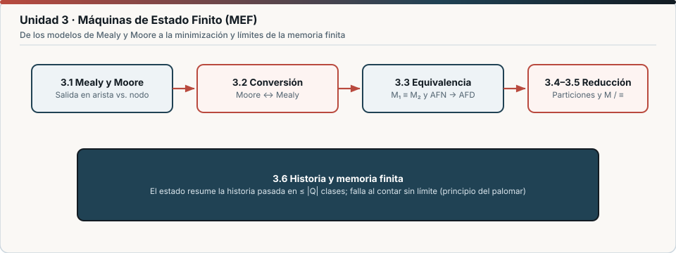

<!-- _class: lead -->

Unidad 3 · 20 horas

# Unidad 3: Máquinas de Estado Finito

### Modelos de Mealy y Moore, conversión, equivalencia, minimización e historia

**Universidad Vasco de Quiroga (UVAQ)**  
Ingeniería en Sistemas y Seguridad Informática · Primer Semestre

---

# Propósito y competencia de la unidad

- **Competencia a desarrollar:** Estudiar la formulación matemática del autómata más simple —la máquina de estado finito— mediante la solución creativa de ejercicios y la transformación entre máquinas equivalentes.
- **Doble perspectiva en la unidad:**
  1. **Máquinas secuenciales con salida (Mealy y Moore):** transforman entradas $w \in \Sigma^*$ en salidas sobre $\Delta$.
  2. **Autómatas aceptadores (AFD, AFN, AFN-$\lambda$):** deciden pertenencia $w \in L(M)$.

---

# Esquema visual: Unidad 3: Máquinas de Estado Finito

---

<!-- _class: invert -->
# Panorama de la Unidad 3

1. **3.1 Propiedades de las MEF:** Máquinas de transición (Mealy) y máquinas de estado (Moore).
2. **3.2 Conversión:** Transformación bidireccional Moore $\leftrightarrow$ Mealy (módulo símbolo inicial).
3. **3.3 Equivalencia de máquinas:** Extensión $\hat{\delta}, \hat{\omega}$ y equivalencia $\text{AFD} \equiv \text{AFN} \equiv \text{AFN-}\lambda$.
4. **3.4 Estados equivalentes:** Relación $\equiv_k$ y refinamiento de particiones $P_0, P_1, \dots, P_k$.
5. **3.5 Reducción y prueba de equivalencia:** Minimización, Myhill-Nerode y pruebas $M_1 \equiv M_2$.
6. **3.6 Historia de máquinas y memoria finita:** El estado como resumen y límites del modelo.

---

# Mapa de subtemas y herramientas

| Subtema | Concepto central | Algoritmo / Teorema |
| :--- | :--- | :--- |
| **3.1** | $M = (Q, \Sigma, \Delta, \delta, \omega, q_0)$ | Modelos Mealy vs. Moore |
| **3.2** | Desfase de 1 símbolo inicial | Desdoblamiento de estados $Q \times \Delta$ |
| **3.3** | Comportamiento sobre $\Sigma^*$ | Construcción de subconjuntos y $\lambda$-clausura |
| **3.4 – 3.5** | Estados indistinguibles | Particiones, tabla de pares, `ALC`, Myhill-Nerode |
| **3.6** | Ventana finita de orden $k$ | Principio del palomar y evolución histórica |

---

<!-- _class: invert -->
# Idea clave para recordar

> En una **máquina de estado finito**, toda la historia pasada que importa para decidir el futuro se condensa en un conjunto finito de estados $Q$. Dos máquinas distintas pueden ser **equivalentes** si producen exactamente las mismas respuestas para toda entrada posible.

---

# Referencias bibliográficas

- Acevedo Juárez, A. (2006). *Teoría de la computación* [Tesis de licenciatura, Instituto Tecnológico de Celaya].
- De Castro Korgi, R. (2004). *Teoría de la computación: Lenguajes, autómatas, gramáticas*. Universidad Nacional de Colombia.
- Kohavi, Z., & Jha, N. K. (2010). *Switching and finite automata theory* (3.ª ed.). Cambridge University Press.
