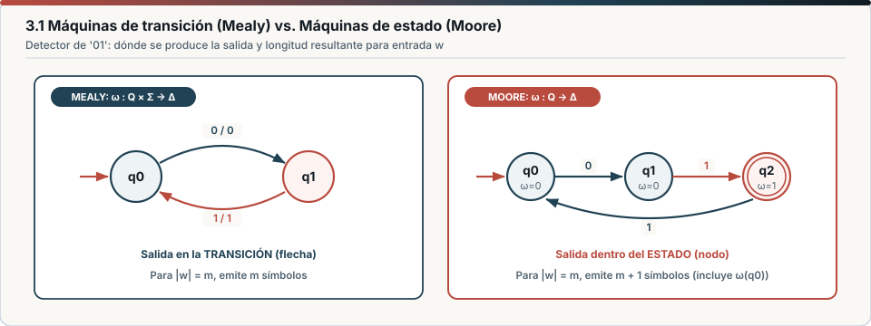

<!-- _class: lead -->

Tema 3.1

# 3.1 Propiedades de las máquinas de estado finito

### Modelo formal, máquinas de transición (Mealy) y máquinas de estado (Moore)

Unidad 3: Máquinas de Estado Finito · Primer Semestre

---

# Modelo general de una MEF determinista con salida

Una **máquina de estado finito** (traductor secuencial) es una séxtupla:
$$M = (Q, \Sigma, \Delta, \delta, \omega, q_0)$$

- **$Q$:** conjunto finito no vacío de **estados internos**.
- **$\Sigma$:** **alfabeto de entrada**; **$\Delta$:** **alfabeto de salida**.
- **$\delta: Q \times \Sigma \to Q$:** función de **transición de estados**.
- **$\omega$:** función de **salida** *(usamos $\omega$ o $\lambda_{\text{out}}$ para reservar $\lambda$ a la cadena vacía)*.
- **$q_0 \in Q$:** **estado inicial**.

---

# Esquema visual: 3.1 Propiedades de las máquinas de estado finito

---

# Cinco propiedades estructurales de las MEF

1. **Finitud:** $Q, \Sigma, \Delta$ son finitos ($\lceil \log_2 |Q| \rceil$ bits de memoria en hardware).
2. **Determinismo y completitud:** desde cada estado y símbolo hay exactamente una transición definida.
3. **Operación síncrona y unidireccional:** lee $w = a_1 \cdots a_m$ de izquierda a derecha sin retroceder.
4. **Causalidad:** la salida presente nunca depende de símbolos futuros.
5. **Relación con AFD:** un AFD es una máquina de Moore con $\Delta = \{0, 1\}$ ($\omega(q) = 1 \iff q \in F$).

---

<!-- _class: invert -->
# 3.1.1 Mealy vs. 3.1.2 Moore: la diferencia fundamental

| Característica | Máquina de transición (**Mealy**, 1955) | Máquina de estado (**Moore**, 1956) |
| :--- | :--- | :--- |
| **Función de salida** | $\omega: Q \times \Sigma \to \Delta$ | $\omega: Q \to \Delta$ |
| **¿De qué depende?** | Estado actual **y** símbolo de entrada | **Únicamente** el estado actual |
| **Etiquetas en diagrama** | En las flechas (`entrada / salida`) | En los estados (`estado (salida)`) |
| **Salida para $w = \lambda$** | $\lambda$ (longitud $0$) | $\omega(q_0)$ (longitud $1$) |
| **Salida para $|w| = m$** | Longitud **$m$** | Longitud **$m + 1$** |

---

# Ejemplo 1 (Mealy): Detector de `01` con traslape

Emitir `1` al detectar los dos últimos bits `01`, y `0` en otro caso:
- Estados: $q_0$ (último fue `1` o inicio), $q_1$ (último fue `0`).

| Estado | $\delta(q, 0)$ | $\omega(q, 0)$ | $\delta(q, 1)$ | $\omega(q, 1)$ |
| :--- | :---: | :---: | :---: | :---: |
| $\to q_0$ | $q_1$ | `0` | $q_0$ | `0` |
| $q_1$ | $q_1$ | `0` | $q_0$ | `1` |

- **Traza para `100101`:**  
  $q_0 \xrightarrow{1/0} q_0 \xrightarrow{0/0} q_1 \xrightarrow{0/0} q_1 \xrightarrow{1/1} q_0 \xrightarrow{0/0} q_1 \xrightarrow{1/1} q_0 \implies$ salida **`000101`** (longitud 6).

---

# Ejemplo 2 (Mealy): Complemento a dos en serie

Leyendo un binario del bit menos significativo (LSB) al más significativo (MSB):
- Regla: copiar los ceros iniciales y el **primer `1`**, e invertir todos los bits siguientes.
- $q_0$: *aún no llega el primer `1`* (`0 / 0` $\to q_0$, `1 / 1` $\to q_1$).
- $q_1$: *modo inversión* (`0 / 1` $\to q_1$, `1 / 0` $\to q_1$).
- **Prueba con $1010_2$ (entrada `0101` LSB$\to$MSB):**  
  $q_0 \xrightarrow{0/0} q_0 \xrightarrow{1/1} q_1 \xrightarrow{0/1} q_1 \xrightarrow{1/0} q_1 \implies$ **`0110`** ($0110_2 = 6_{10}$, complemento a dos exacto).

---

# Ejemplo 3 (Moore): Detector de `01`

En Moore la salida va en el estado, por lo que necesitamos **3 estados**:
- $q_0$ (`0`): inicio o último bit `1` sin `01`.
- $q_1$ (`0`): último bit fue `0`.
- $q_2$ (`1`): últimos dos bits fueron `01`.

| Estado | $\delta(q, 0)$ | $\delta(q, 1)$ | $\omega(q)$ |
| :--- | :---: | :---: | :---: |
| $\to q_0$ | $q_1$ | $q_0$ | `0` |
| $q_1$ | $q_1$ | $q_2$ | `0` |
| $q_2$ | $q_1$ | $q_0$ | `1` |

- **Traza para `100101`:** $q_0[0] \xrightarrow{1} q_0[0] \xrightarrow{0} q_1[0] \xrightarrow{0} q_1[0] \xrightarrow{1} q_2[1] \xrightarrow{0} q_1[0] \xrightarrow{1} q_2[1]$ $\implies$ **`0000101`** (longitud 7).

---

# Ejemplo 4 (Moore): Residuo módulo 3 en binario

Leyendo de MSB a LSB, si el prefijo vale $N$ con residuo $r$, al leer $b \in \{0, 1\}$ el nuevo residuo es $r' = (2r + b) \bmod 3$:
- Estados $q_0 (\omega=0)$, $q_1 (\omega=1)$, $q_2 (\omega=2)$.
- Transiciones: $\delta(q_0, 0)=q_0, \delta(q_0, 1)=q_1$; $\;\delta(q_1, 0)=q_2, \delta(q_1, 1)=q_0$; $\;\delta(q_2, 0)=q_1, \delta(q_2, 1)=q_2$.
- **Entrada `1101` ($13_{10}$):** $q_0[0] \xrightarrow{1} q_1[1] \xrightarrow{1} q_0[0] \xrightarrow{0} q_0[0] \xrightarrow{1} q_1[1]$ ($13 \bmod 3 = 1$).

---

<!-- _class: invert -->
# Ejercicios propuestos

1. Para la máquina de Mealy del Ejemplo 1, traza la secuencia de estados y la salida para $\lambda$, `0011010` y `111000`.
2. Diseña una máquina de Mealy sobre $\{a, b\}$ que emita `1` cuando el número acumulado de `a` sea par y el de `b` sea impar, y `0` en otro caso.
3. Convierte el AFD $Q=\{q_0,q_1,q_2\}$, $F=\{q_0,q_2\}$ en máquina de Moore con $\Delta=\{0, 1\}$.

---

# Referencias

- Acevedo Juárez, A. (2006). *Teoría de la computación* [Tesis de licenciatura, Instituto Tecnológico de Celaya].
- De Castro Korgi, R. (2004). *Teoría de la computación: Lenguajes, autómatas, gramáticas*. Universidad Nacional de Colombia. (Cap. 2, pp. 25–28).
- Mealy, G. H. (1955) / Moore, E. F. (1956).
