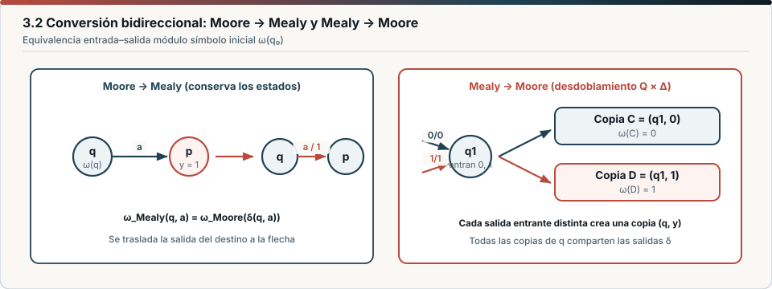

<!-- _class: lead -->

Tema 3.2

# 3.2 Conversión entre máquinas de transición y estados

### Equivalencia Mealy–Moore y algoritmos de transformación mutua

Unidad 3: Máquinas de Estado Finito · Primer Semestre

---

<!-- _class: invert -->
# Equivalencia módulo símbolo inicial

> Una máquina de Mealy y una de Moore sobre los mismos alfabetos $\Sigma$ y $\Delta$ tienen exactamente la misma capacidad de traducción, salvo el símbolo inicial de Moore:

$$\hat{\omega}_{\text{Moore}}(q_{02}, w) \;=\; \omega_{\text{Moore}}(q_{02}) \cdot \hat{\omega}_{\text{Mealy}}(q_{01}, w) \qquad \forall w \in \Sigma^*.$$

Si descartamos el primer carácter $\omega_{\text{Moore}}(q_{02})$ (emitido antes de leer $\lambda$), las $m$ salidas restantes coinciden símbolo a símbolo.

---

# Esquema visual: 3.2 Conversión entre máquinas de transición y estados

---

# Algoritmo 1: Moore $\to$ Mealy (Teorema 3.2.1)

Conversión directa sin aumentar estados:
1. Conservar exactamente los mismos estados $Q$, estado inicial $q_0$ y función de transición $\delta$.
2. Trasladar la salida de cada nodo destino a la flecha que llega a él:
   $$\omega_{\text{Mealy}}(q, a) = \omega_{\text{Moore}}\bigl(\delta(q, a)\bigr) \qquad \forall q \in Q,\; a \in \Sigma.$$

*(La demostración por inducción sobre $|w|$ verifica que ambos modelos visitan la misma secuencia de estados y coinciden en la salida tras quitar $\omega_{\text{Moore}}(q_0)$).*

---

# Ejemplo 1: Moore $\to$ Mealy paso a paso

### Moore original $M_1$

| Estado | $\delta(q,a)$ | $\delta(q,b)$ | $\omega$ |
| :--- | :---: | :---: | :---: |
| $\to q_0$ | $q_1$ | $q_0$ | `0` |
| $q_1$ | $q_2$ | $q_0$ | `1` |
| $q_2$ | $q_2$ | $q_1$ | `0` |

### Mealy equivalente $M_1'$

| Estado | $\delta(q,a)/\omega$ | $\delta(q,b)/\omega$ |
| :--- | :---: | :---: |
| $\to q_0$ | $q_1 / 1$ | $q_0 / 0$ |
| $q_1$ | $q_2 / 0$ | $q_0 / 0$ |
| $q_2$ | $q_2 / 0$ | $q_1 / 1$ |

**Verificación para `aaba`:** Moore da `01010`; Mealy da `1010` (`0` + `1010` = `01010`).

---

<!-- _class: invert -->
# Algoritmo 2: Mealy $\to$ Moore (desdoblamiento de estados)

> Como a un estado $q$ de Mealy pueden llegar flechas con salidas distintas, en Moore debemos **desdoblar** $q$ en copias $(q, y)$, una por cada salida entrante $y \in Y(q)$.

1. Listar para cada $q \in Q$ el conjunto de salidas entrantes $Y(q)$.
2. Crear un estado $(q, y)$ por cada $y \in Y(q)$ (con salida fija $\omega'((q, y)) = y$). Si a $q_0$ no entran flechas o se requiere salida inicial fija, crear $(q_0, y_0)$.
3. Transiciones: desde cualquier copia $(q, y)$ bajo $a$, ir a:
   $$\delta'\bigl((q, y), a\bigr) = \bigl(\delta(q, a),\; \omega_{\text{Mealy}}(q, a)\bigr).$$

*(Máximo $\lvert Q \rvert \cdot \lvert \Delta \rvert + 1$ estados; las copias de un mismo $q$ comparten idénticas transiciones salientes).*

---

# Ejemplo 2: Mealy $\to$ Moore paso a paso

Sea la máquina de Mealy $M_2$: $q_0: 0\to(q_1,0), 1\to(q_2,1)$; $\;q_1: 0\to(q_1,1), 1\to(q_0,0)$; $\;q_2: 0\to(q_0,1), 1\to(q_2,1)$.

- **Salidas entrantes:**
  - $Y(q_0) = \{0, 1\} \implies$ se desdobla en $A=(q_0,0)$ y $B=(q_0,1)$.
  - $Y(q_1) = \{0, 1\} \implies$ se desdobla en $C=(q_1,0)$ y $D=(q_1,1)$.
  - $Y(q_2) = \{1\} \implies$ un único estado $E=(q_2,1)$.

---

# Tabla de Moore resultante $M_2'$ y verificación

| Estado | Par asociado | $\delta'(s, 0)$ | $\delta'(s, 1)$ | $\omega'(s)$ |
| :--- | :---: | :---: | :---: | :---: |
| $\to A$ | $(q_0, 0)$ | $C$ | $E$ | `0` |
| $B$ | $(q_0, 1)$ | $C$ | $E$ | `1` |
| $C$ | $(q_1, 0)$ | $D$ | $A$ | `0` |
| $D$ | $(q_1, 1)$ | $D$ | $A$ | `1` |
| $E$ | $(q_2, 1)$ | $B$ | $E$ | `1` |

**Prueba con `00110`:** Mealy emite `01011`; Moore emite `001011` (sin el `0` inicial de $A$, coinciden).

---

<!-- _class: invert -->
# Ejercicios propuestos

1. Convierte la máquina de Moore del residuo módulo 3 (Ejemplo 4 de 3.1) a Mealy usando el Algoritmo 1 y prueba `1011`.
2. Convierte la máquina de Mealy del complemento a dos (Ejemplo 2 de 3.1) a Moore mediante el Algoritmo 2.
3. **Reflexión:** Si conviertes una máquina de Moore $M$ a Mealy $M'$ y luego $M'$ de regreso a Moore $M''$, ¿siempre tienen el mismo número de estados?

---

# Referencias

- De Castro Korgi, R. (2004). *Teoría de la computación: Lenguajes, autómatas, gramáticas*. Universidad Nacional de Colombia.
- Hopcroft, J. E., Motwani, R., & Ullman, J. D. (2002). *Introducción a la teoría de autómatas, lenguajes y computación* (2.ª ed.). Pearson Educación.
- Kohavi, Z., & Jha, N. K. (2010). *Switching and finite automata theory* (3.ª ed.). Cambridge University Press.
