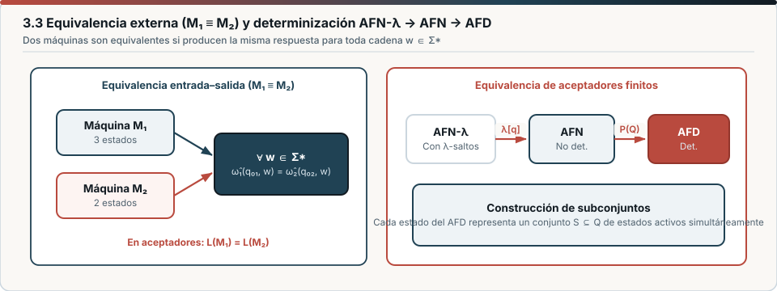

<!-- _class: lead -->

Tema 3.3

# 3.3 Equivalencia de máquinas de estado finito

### Funciones extendidas $\hat{\delta}, \hat{\omega}$, equivalencia $M_1 \equiv M_2$ y $\text{AFD} \equiv \text{AFN} \equiv \text{AFN-}\lambda$

Unidad 3: Máquinas de Estado Finito · Primer Semestre

---

# Extensión de $\delta$ y $\omega$ a cadenas $w \in \Sigma^*$

Para evaluar cadenas completas de forma recursiva (De Castro Korgi, 2004, Def. 2.5.2):

- **Función de transición extendida ($\hat{\delta}: Q \times \Sigma^* \to Q$):**
  $$\hat{\delta}(q, \lambda) = q, \qquad \hat{\delta}(q, wa) = \delta\bigl(\hat{\delta}(q, w),\, a\bigr).$$
  Propiedad de composición: $\hat{\delta}(q, uv) = \hat{\delta}(\hat{\delta}(q, u), v)$.
- **Función de respuesta extendida ($\hat{\omega}: Q \times \Sigma^* \to \Delta^*$):**
  - *Mealy:* $\hat{\omega}(q, \lambda) = \lambda$, $\;\hat{\omega}(q, wa) = \hat{\omega}(q, w) \cdot \omega(\hat{\delta}(q, w), a)$.
  - *Moore:* $\hat{\omega}(q, \lambda) = \omega(q)$, $\;\hat{\omega}(q, wa) = \hat{\omega}(q, w) \cdot \omega(\hat{\delta}(q, wa))$.

---

# Esquema visual: 3.3 Equivalencia de máquinas de estado finito

---

<!-- _class: invert -->
# Definición de equivalencia entre máquinas ($M_1 \equiv M_2$)

> Dos máquinas del mismo tipo sobre $\Sigma$ y $\Delta$ son **equivalentes** si producen exactamente la misma salida para toda cadena posible:
> $$M_1 \equiv M_2 \iff \forall w \in \Sigma^*,\quad \hat{\omega}_1(q_{01}, w) = \hat{\omega}_2(q_{02}, w).$$

- Para **aceptadores** ($L(M) = \{w \in \Sigma^* : \hat{\delta}(q_0, w) \in F\}$), dos autómatas son equivalentes si aceptan exactamente el mismo lenguaje:
  $$L(M_1) = L(M_2).$$

---

# Ejemplo 1: Equivalencia entre máquinas de Mealy de distinto tamaño

- **$M_1$ (3 estados):** $q_0: 0\to(q_1,0), 1\to(q_2,0)$; $\;q_1: 0\to(q_1,1), 1\to(q_2,0)$; $\;q_2: 0\to(q_1,0), 1\to(q_2,0)$.
- **$M_2$ (2 estados):** $p_0: 0\to(p_1,0), 1\to(p_0,0)$; $\;p_1: 0\to(p_1,1), 1\to(p_0,0)$.

**Prueba por correspondencia $R = \{(q_0, p_0), (q_2, p_0), (q_1, p_1)\}$:**  
Inducción sobre $|w|$: desde todo par en $R$, leer `0` o `1` produce la **misma salida** y lleva a otro par en $R$. Luego $M_1 \equiv M_2$ (ambas emiten `1` al detectar `00`).

---

<!-- _class: invert -->
# Equivalencia computacional: $\text{AFD} \equiv \text{AFN} \equiv \text{AFN-}\lambda$

> Aunque el **no determinismo** (AFN) y las **transiciones espontáneas** (AFN-$\lambda$) facilitan el diseño, **no aumentan el poder de reconocimiento** (De Castro Korgi, 2004, Secc. 2.5–2.7).

1. **Teorema 3.3.1 (AFN $\to$ AFD — Construcción de subconjuntos):**  
   Cada estado del nuevo AFD es un **subconjunto** $S \subseteq Q$ de los estados posibles simultáneamente:
   $$q'_0 = \{q_0\}, \quad \delta'(S, a) = \bigcup_{q \in S} \Delta_{\text{AFN}}(q, a), \quad F' = \{S : S \cap F \neq \emptyset\}.$$
2. **Teorema 3.3.2 (AFN-$\lambda \to$ AFN — $\lambda$-clausura $\lambda[q]$):**  
   $\Delta'(q, a) = \lambda[\Delta(\lambda[q], a)]$ y $F' = \{q \in Q : \lambda[q] \cap F \neq \emptyset\}$.

---

# Ejemplo 2: Subconjuntos del AFN para $(01 \cup 010)^*$

AFN $M$: $q_0 \xrightarrow{0} \{q_1\}$, $\;q_1 \xrightarrow{1} \{q_0, q_2\}$, $\;q_2 \xrightarrow{0} \{q_0\}$, con $F = \{q_0\}$ (De Castro Korgi, p. 39):

| Estado de $M'$ | Subconjunto | `0` | `1` | ¿Acepta? |
| :--- | :---: | :---: | :---: | :---: |
| $\to * S_0$ | $\{q_0\}$ | $S_1$ | $S_\emptyset$ | Sí |
| $S_1$ | $\{q_1\}$ | $S_\emptyset$ | $S_2$ | No |
| $* S_2$ | $\{q_0, q_2\}$ | $S_3$ | $S_\emptyset$ | Sí |
| $* S_3$ | $\{q_0, q_1\}$ | $S_1$ | $S_2$ | Sí |
| $S_\emptyset$ | $\emptyset$ | $S_\emptyset$ | $S_\emptyset$ | No |

---

# Ejemplo 3: Eliminación de transiciones $\lambda$ para $a^* b^* c^*$

AFN-$\lambda$: $q_0 \xrightarrow{a} q_0$, $q_0 \xrightarrow{\lambda} q_1$, $q_1 \xrightarrow{b} q_1$, $q_1 \xrightarrow{\lambda} q_2$, $q_2 \xrightarrow{c} q_2$, $F = \{q_2\}$:

1. **Clausuras-$\lambda$:** $\lambda[q_0] = \{q_0, q_1, q_2\}$, $\;\lambda[q_1] = \{q_1, q_2\}$, $\;\lambda[q_2] = \{q_2\}$.
2. **Nuevos finales:** $F' = \{q_0, q_1, q_2\}$ (todos alcanzan $q_2$ vía $\lambda$).
3. **Nuevas transiciones $\Delta'(q, s) = \lambda[\Delta(\lambda[q], s)]$:**
   - $q_0$: con `a` $\to \{q_0, q_1, q_2\}$, con `b` $\to \{q_1, q_2\}$, con `c` $\to \{q_2\}$.
   - $q_1$: con `b` $\to \{q_1, q_2\}$, con `c` $\to \{q_2\}$.
   - $q_2$: con `c` $\to \{q_2\}$.

---

<!-- _class: invert -->
# Ejercicios propuestos

1. Para la máquina de Moore del residuo mod 3 (3.1), calcula $\hat{\delta}(q_0, 10110)$ y $\hat{\omega}(q_0, 10110)$ usando la definición recursiva.
2. Convierte a AFD por subconjuntos el AFN sobre $\{a, b\}$: $F=\{q_3\}$, $\Delta(q_0, a)=\{q_1\}$, $\Delta(q_0, b)=\{q_0\}$, $\Delta(q_1, a)=\{q_1\}$, $\Delta(q_1, b)=\{q_2\}$, $\Delta(q_2, a)=\{q_3\}$, $\Delta(q_2, b)=\{q_2\}$, $\Delta(q_3, a)=\{q_3\}$, $\Delta(q_3, b)=\{q_3\}$.
3. Elimina transiciones $\lambda$ en el AFN-$\lambda$ del Ejercicio 4 de las notas.

---

# Referencias

- Acevedo Juárez, A. (2006). *Teoría de la computación* [Tesis de licenciatura, Instituto Tecnológico de Celaya]. (p. 55).
- De Castro Korgi, R. (2004). *Teoría de la computación: Lenguajes, autómatas, gramáticas*. Universidad Nacional de Colombia. (Secc. 2.5–2.7, pp. 38–49).
- Rabin, M. O., & Scott, D. (1959). Finite automata and their decision problems.
