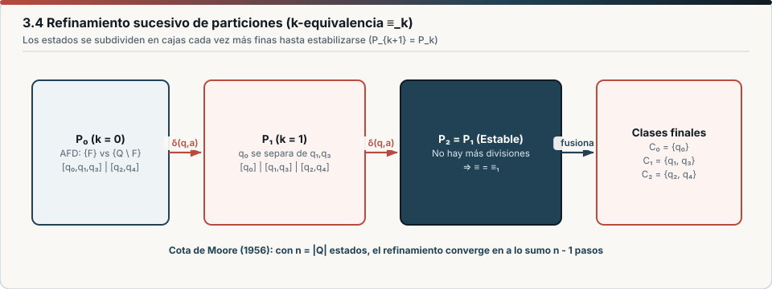

<!-- _class: lead -->

Tema 3.4

# 3.4 Estados equivalentes

### Equivalencia de estados ($p \equiv q$), $k$-equivalencia y particiones sucesivas

Unidad 3: Máquinas de Estado Finito · Primer Semestre

---

# Equivalencia y distinguibilidad de estados

- **Estados equivalentes ($p \equiv q$):** ningún experimento con cadenas $w \in \Sigma^*$ logra distinguir si la máquina inició en $p$ o en $q$:
  $$p \equiv q \iff \forall w \in \Sigma^*,\quad \hat{\omega}(p, w) = \hat{\omega}(q, w).$$
  *(En un AFD: $\hat{\delta}(p, w) \in F \iff \hat{\delta}(q, w) \in F$ para todo $w \in \Sigma^*$).*
- **Estados distinguibles ($p \not\equiv q$):** existe al menos una cadena testigo $w$ tal que $\hat{\omega}(p, w) \neq \hat{\omega}(q, w)$.

---

# Esquema visual: 3.4 Estados equivalentes

---

<!-- _class: invert -->
# La relación de $k$-equivalencia ($p \equiv_k q$)

> Para evitar revisar infinitas cadenas en $\Sigma^*$, acotamos el problema por longitud:

$$p \equiv_k q \iff \forall w \in \Sigma^* \text{ con } |w| \le k,\quad \hat{\omega}(p, w) = \hat{\omega}(q, w).$$

- **Caso base en Moore / AFD ($k = 0$):** $p \equiv_0 q \iff \omega(p) = \omega(q)$ (en AFD: $F$ vs $Q \setminus F$).
- **Caso base en Mealy ($k = 1$):** $p \equiv_0 q$ es trivial; $p \equiv_1 q \iff \forall a \in \Sigma,\; \omega(p, a) = \omega(q, a)$.
- **Paso inductivo (Teorema 3.4.1):**
  $$p \equiv_{k+1} q \iff (p \equiv_k q) \;\land\; \bigl(\forall a \in \Sigma,\; \delta(p, a) \equiv_k \delta(q, a)\bigr).$$

---

# Particiones y cota de convergencia (Moore, 1956)

- Cada $\equiv_k$ es reflexiva, simétrica y transitiva, por lo que divide a $Q$ en **grupos (bloques) sin traslape** llamados **particiones** $P_0, P_1, \dots, P_k$.
- **Refinamiento monótono:** dos estados quedan juntos en $P_{k+1}$ solo si ya estaban juntos en $P_k$ y sus sucesores bajo cada $a \in \Sigma$ caen en el **mismo bloque de $P_k$**.
- **Estabilización:** si $P_{k+1} = P_k$, entonces $P_m = P_k$ para todo $m \ge k$ ($\equiv \;=\; \equiv_k$).
- **Cota:** con $n = |Q|$ estados, el proceso termina a lo sumo en $k \le n - 1$ pasos.

---

# Ejemplo 1: Particiones en máquina de Mealy ($M_1$)

Máquina $M_1$ ($Q = \{q_0, \dots, q_5\}$):
- $q_0, q_1, q_3, q_5$ tienen salidas $(0, 1)$; $\;q_2, q_4$ tienen salidas $(1, 0)$.
- **$P_0$:** $\{\{q_0, q_1, q_2, q_3, q_4, q_5\}\}$.
- **$P_1$:** $\{\underbrace{\{q_0, q_1, q_3, q_5\}}_A,\; \underbrace{\{q_2, q_4\}}_B\}$.
- **$P_2$:** en $A$, $q_5 \mapsto (B, B)$ mientras $q_0, q_1, q_3 \mapsto (A, B) \implies$ **$q_5$ se separa**.  
  $$P_2 = \{\{q_0, q_1, q_3\}_ {A_1},\; \{q_5\}_{A_2},\; \{q_2, q_4\}_B\}.$$

---

# Continuación del Ejemplo 1 ($P_3, P_4, P_5$)

- **$P_3$:** en $B$, $q_2 \mapsto (A_2, A_1)$ y $q_4 \mapsto (A_1, A_1) \implies$ **$q_2, q_4$ se separan**:
  $$P_3 = \{\{q_0, q_1, q_3\}_{A_1},\; \{q_5\}_{A_2},\; \{q_2\}_{B_1},\; \{q_4\}_{B_2}\}.$$
- **$P_4$:** en $A_1$, $q_1 \mapsto (A_1, B_2)$ mientras $q_0, q_3 \mapsto (A_1, B_1) \implies$ **$q_1$ se separa**:
  $$P_4 = \{\{q_0, q_3\},\; \{q_1\},\; \{q_5\},\; \{q_2\},\; \{q_4\}\}.$$
- **$P_5 = P_4$** (se estabiliza): concluimos **$q_0 \equiv q_3$**. *(Testigo de longitud 4 entre $q_0$ y $q_1$: `1000`)*.

---

# Ejemplo 2: Particiones en un AFD ($M_2$)

AFD con $Q = \{q_0, q_1, q_2, q_3, q_4\}$ y $F = \{q_2, q_4\}$:
- **$P_0$ ($F$ vs $Q \setminus F$):** $\{\underbrace{\{q_0, q_1, q_3\}}_A,\; \underbrace{\{q_2, q_4\}}_B\}$.
- **$P_1$:** en $A$, $q_0 \mapsto (A, A)$ mientras $q_1, q_3 \mapsto (B, A) \implies$ $q_0$ se separa:
  $$P_1 = \{\{q_0\}_{A_1},\; \{q_1, q_3\}_{A_2},\; \{q_2, q_4\}_B\}.$$
- **$P_2$:** en $A_2$ y $B$ todos coinciden en destino $\implies$ **$P_2 = P_1$**.
- Clases finales: $\{q_0\}$, $\{q_1, q_3\}$, $\{q_2, q_4\}$ ($q_1 \equiv q_3$ y $q_2 \equiv q_4$).

---

<!-- _class: invert -->
# Ejercicios propuestos

1. Para $M_2$ del Ejemplo 2, encuentra la cadena testigo más corta que distingue $(q_0, q_2)$, $(q_0, q_1)$ y $(q_0, q_4)$.
2. Calcula las particiones $P_0, P_1, \dots, P_k$ de la máquina de Moore obtenida en el Ejemplo 2 de 3.2 (estados $A, B, C, D, E$).
3. Demuestra formalmente la **propiedad de congruencia**: si $p \equiv q$, entonces para todo símbolo $a \in \Sigma$ se cumple $\delta(p, a) \equiv \delta(q, a)$.

---

# Referencias

- De Castro Korgi, R. (2004). *Teoría de la computación: Lenguajes, autómatas, gramáticas*. Universidad Nacional de Colombia.
- Hopcroft, J. E., Motwani, R., & Ullman, J. D. (2002). *Introducción a la teoría de autómatas, lenguajes y computación* (2.ª ed.). Pearson Educación.
- Moore, E. F. (1956). Gedanken-experiments on sequential machines.
