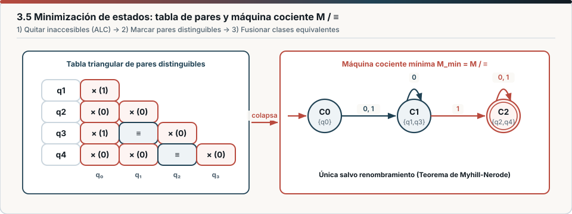

<!-- _class: lead -->

Tema 3.5

# 3.5 Reducción de estados y prueba de equivalencia

### Eliminación de inaccesibles, minimización, Myhill-Nerode y pruebas $M_1 \equiv M_2$

Unidad 3: Máquinas de Estado Finito · Primer Semestre

---

# Paso previo: estados alcanzables (`ALC`)

Antes de minimizar estados, eliminamos todo estado que jamás se visite desde $q_0$ (De Castro Korgi, 2004, Secc. 3.6, p. 77):
1. **Inicializar:** $\text{ALC} := \{q_0\}$.
2. **Repetir:** para cada $q \in \text{ALC}$ y $a \in \Sigma$, agregar $\delta(q, a)$ a $\text{ALC}$.
3. **Detenerse** cuando no aparezcan estados nuevos; descartar $Q \setminus \text{ALC}$.

---

# Esquema visual: 3.5 Reducción de estados y prueba de equivalencia

---

# Dos métodos equivalentes para minimizar

### 1. Refinamiento de particiones
- Inicia en $P_0$ (Moore/AFD) o $P_1$ (Mealy).
- Subdivide bloques según adónde transitan con cada $a \in \Sigma$.
- Termina cuando $P_{k+1} = P_k$.

### 2. Tabla de pares distinguibles
- Tabla triangular con pares $\{p, q\}$ ($p \ne q$).
- **Base:** marcar pares con distinta salida inicial ($F$ vs $Q \setminus F$).
- **Propagación:** marcar $\{p, q\}$ si $\{\delta(p, a), \delta(q, a)\}$ ya está marcado.

---

<!-- _class: invert -->
# Máquina mínima ($M_{\min} = M / {\equiv}$) y Teorema de Myhill-Nerode

> Minimizar consiste en **fusionar cada grupo $[q]$ de estados equivalentes en un único estado**, con $q_{0,\min} = [q_0]$ y $\delta_{\min}([q], a) = [\delta(q, a)]$.

**Teorema 3.5.1 (Myhill-Nerode, 1958):**  
Definiendo $x \sim_L y \iff \forall z \in \Sigma^*,\; (xz \in L \iff yz \in L)$:
1. $L$ es regular $\iff \sim_L$ divide a $\Sigma^*$ en un número **finito** de grupos (su *índice*).
2. El número mínimo de estados de todo AFD para $L$ es igual a ese índice.
3. La máquina reducida $M_{\min}$ es **única salvo renombramiento de estados** (*única salvo isomorfismo*).

---

# Cómo decidir si dos máquinas $M_1$ y $M_2$ son equivalentes

- **Algoritmo A (Unión disjunta):** unir $Q_1 \cup Q_2$ y aplicar particiones o tabla de pares. $M_1 \equiv M_2 \iff q_{01} \equiv q_{02}$.
- **Algoritmo B (Autómata producto + `ALC`, De Castro Korgi, 2004, p. 77):**
  - Explorar pares alcanzables $(p, q) \in Q_1 \times Q_2$ desde $(q_{01}, q_{02})$ con $\delta_{\times}((p,q), a) = (\delta_1(p,a), \delta_2(q,a))$.
  - $L(M_1) = L(M_2) \iff$ ningún par alcanzable cae en $F_\oplus$ (donde uno acepta y el otro rechaza).

---

# Ejemplo 1: Minimización completa de un AFD

AFD con $Q = \{q_0, q_1, q_2, q_3, q_4, q_5\}$ y $F = \{q_2, q_4\}$:
1. **`ALC`:** desde $q_0$ alcanzamos $\{q_0, q_1, q_2, q_3, q_4\}$; **$q_5$ es inaccesible** y se elimina.
2. **Tabla de pares distinguibles sobre $\{q_0, \dots, q_4\}$:**
   - Base (0): marcamos $\{q_0,q_2\}, \{q_0,q_4\}, \{q_1,q_2\}, \{q_1,q_4\}, \{q_3,q_2\}, \{q_3,q_4\}$.
   - Iteración 1: con `1`, $\{q_0,q_1\} \to \{q_3,q_2\}$ (marcado) y $\{q_0,q_3\} \to \{q_3,q_4\}$ (marcado).
   - Sin marcar quedan $\{q_1, q_3\}$ y $\{q_2, q_4\}$.
3. **Máquina mínima (3 estados):** $C_0=\{q_0\}$, $C_1=\{q_1,q_3\}$, $C_2=\{q_2,q_4\} \in F_{\min}$.

---

# Ejemplo 2: Prueba de equivalencia con producto y `ALC`

Decidir si $A_1$ (paridad impar de `1`) y $A_2$ (terminadas en `1`) aceptan el mismo lenguaje sobre $\{0, 1\}$:
- Estados de aceptación: $F_1 = \{q_1\}$, $F_2 = \{r_1\}$.
- Discrepancia: $F_\oplus = \{(q_0, r_1), (q_1, r_0)\}$.
- **Exploración desde $(q_0, r_0)$:**
  - Con `1` $\to (q_1, r_1) \notin F_\oplus$ (ambos aceptan `1`).
  - Desde $(q_1, r_1)$ con `0` $\to (q_1, r_0) \in F_\oplus$ ($q_1 \in F_1$, pero $r_0 \notin F_2$).
- **Resultado:** $A_1 \not\equiv A_2$; la ruta seguida entrega el contraejemplo mínimo **$w = 10$**.

---

<!-- _class: invert -->
# Ejercicios propuestos

1. Minimiza el AFD sobre $\{a, b\}$ con $Q = \{q_0, \dots, q_5\}$, $F = \{q_2, q_3\}$ y las transiciones del Ejercicio 1 de las notas (eliminando primero inaccesibles).
2. Reduce la máquina de Moore de 5 estados ($A, B, C, D, E$) obtenida en el Ejemplo 2 de 3.2.
3. Usa el autómata producto y `ALC` para decidir si $A_1$ y $A_2$ del Ejercicio 4 de las notas aceptan el mismo lenguaje (y da un contraejemplo si difieren).

---

# Referencias

- Acevedo Juárez, A. (2006). *Teoría de la computación* [Tesis de licenciatura, Instituto Tecnológico de Celaya].
- De Castro Korgi, R. (2004). *Teoría de la computación: Lenguajes, autómatas, gramáticas*. Universidad Nacional de Colombia. (Secc. 3.3 y 3.6, pp. 70–77).
- Hopcroft, J. E., Motwani, R., & Ullman, J. D. (2002). / Nerode, A. (1958).
