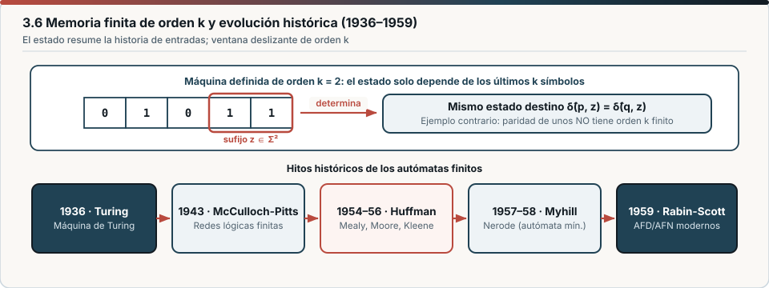

<!-- _class: lead -->

Tema 3.6

# 3.6 Historia de máquinas y memoria finita

### El estado como resumen de historias, eventos definidos y evolución histórica

Unidad 3: Máquinas de Estado Finito · Primer Semestre

---

# El estado como resumen finito de la historia

Tras leer una historia $w = a_1 a_2 \cdots a_m \in \Sigma^*$, la máquina queda en $q = \hat{\delta}(q_0, w)$.
- La máquina **no guarda toda la cadena leída**; solo recuerda en qué estado está.
- Dos historias $u$ y $v$ son equivalentes para $M$ ($u \sim_M v$) si $\hat{\delta}(q_0, u) = \hat{\delta}(q_0, v)$.
- Aunque hay infinitas historias en $\Sigma^*$, una máquina con $|Q|$ estados solo puede distinguir **a lo sumo $|Q|$ situaciones pasadas**.

---

# Esquema visual: 3.6 Historia de máquinas y memoria finita

---

# Máquinas definidas de orden $k$

Una máquina $M$ tiene **memoria de entrada finita (es definida) de orden $k$** si el estado tras leer cualquier cadena de longitud $\ge k$ depende **únicamente de los últimos $k$ símbolos**:
$$\forall p, q \in Q,\quad \forall z \in \Sigma^k:\qquad \hat{\delta}(p, z) = \hat{\delta}(q, z).$$

- **Ejemplo ($k = 2$):** detector de `11` al final de la entrada ($q_0$: termina en `0`, $q_1$: termina en `01`, $q_2$: termina en `11`).
  Para toda $z \in \{00, 01, 10, 11\}$, los tres estados convergen al mismo destino.
- **Contraejemplo:** el detector de **paridad de unos** (2 estados) **no** tiene orden definido finito $k$, porque tras leer $0^k$, el estado final sigue dependiendo de si antes hubo un número par o impar de unos.

---

<!-- _class: invert -->
# Limitación fundamental: principio del palomar

> **Una máquina de estado finito no puede contar cantidades no acotadas.**

- Si $M$ tiene $n = |Q|$ estados, al probar las $n + 1$ cadenas $0^1, 0^2, \dots, 0^{n+1}$, al menos dos potencias distintas $0^i$ y $0^j$ ($i < j$) llegan al **mismo estado** ($\hat{\delta}(q_0, 0^i) = \hat{\delta}(q_0, 0^j)$).
- Al añadir $1^i$, la máquina alcanza el mismo estado para $0^i 1^i$ y para $0^j 1^i$: si acepta $0^i 1^i$, **acepta por error** $0^j 1^i$.
- Por tanto, ninguna MEF reconoce $\{0^m 1^m : m \ge 1\}$ ni paréntesis arbitrariamente anidados.

---

# Evolución histórica del concepto de autómata finito

| Año | Autores | Aportación clave |
| :---: | :--- | :--- |
| **1936** | Alan M. Turing | Máquina de Turing (origen de modelos con cinta restringida) |
| **1943** | McCulloch y Pitts | Redes neuronales lógicas equivalentes a dispositivos finitos |
| **1954** | David A. Huffman | Tablas de flujo y reducción de circuitos secuenciales |
| **1955–56** | Mealy / Moore | Máquinas de transición, máquinas de estado y cota $n - 1$ |
| **1956** | Stephen C. Kleene | Teorema de Kleene (expresiones regulares y eventos definidos) |
| **1957–58** | Myhill y Nerode | Caracterización del autómata mínimo único ($\sim_L$) |
| **1959** | Rabin y Scott | Formulación moderna de AFD/AFN y problemas de decisión |

---

<!-- _class: invert -->
# Ejercicios propuestos

1. Construye la máquina mínima de Moore (4 estados) que emite `1` cuando los últimos tres símbolos fueron `101`, y demuestra mediante tabla que es definida de orden $k = 3$ (pero no $k = 2$).
2. Usa el principio del palomar para demostrar que ninguna MEF reconoce el lenguaje de los palíndromos $L = \{w \in \{0, 1\}^* : w = w^R\}$.
3. Compara las motivaciones originales de McCulloch–Pitts (1943), Mealy (1955), Moore (1956) y Rabin–Scott (1959).

---

# Referencias

- De Castro Korgi, R. (2004). *Teoría de la computación: Lenguajes, autómatas, gramáticas*. Universidad Nacional de Colombia. (pp. 3–4, 25, 59).
- Kleene, S. C. (1956). / Kohavi, Z., & Jha, N. K. (2010). / Rabin, M. O., & Scott, D. (1959).
