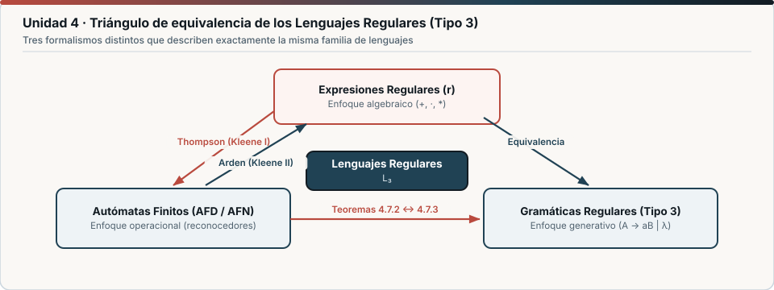

<!-- _class: lead -->

Unidad 4 · 15 horas

# Unidad 4: Lenguajes de Estado Finito

### Aceptadores finitos, gramáticas regulares, expresiones regulares y propiedades

**Universidad Vasco de Quiroga (UVAQ)**  
Ingeniería en Sistemas y Seguridad Informática · Primer Semestre

---

# Propósito y competencia de la unidad

- **Competencia a desarrollar:** Diseñar máquinas abstractas, lenguajes generados por gramáticas formales y expresiones regulares mediante la solución de ejercicios para analizar las relaciones que guardan entre ellos.
- **Aplicación directa en compiladores:** Esta unidad fundamenta el **analizador léxico** (*scanner*), compilando patrones declarativos (expresiones regulares) en autómatas que validan *tokens* en tiempo lineal.

---

# Esquema visual: Unidad 4: Lenguajes de Estado Finito

---

<!-- _class: invert -->
# El triángulo de equivalencia de los lenguajes regulares (Tipo 3)

> Todos los lenguajes de estado finito admiten **tres caracterizaciones exactamente equivalentes**:

1. **Enfoque operacional (4.1):** Autómatas finitos (**AFD**, **AFN**, **AFN-$\lambda$**).
2. **Enfoque generativo (4.2):** Gramáticas regulares (lineales por la derecha o izquierda).
3. **Enfoque algebraico (4.3):** Expresiones regulares ($+, \cdot, *$).

---

# Mapa de subtemas

| Subtema | Contenido principal | Resultados clave |
| :--- | :--- | :--- |
| **4.1** | AFD, AFN, AFN-$\lambda$ | Clausura-$\lambda$, subconjuntos ($\text{AFN-}\lambda \equiv \text{AFN} \equiv \text{AFD}$) |
| **4.2** | Gramáticas regulares (Tipo 3) | Teoremas 4.7.2 y 4.7.3 (AFD $\leftrightarrow$ GR), reflexión |
| **4.3** | Expresiones regulares y Teorema de Kleene | Construcción de Thompson ($\text{ER} \to \text{AFN-}\lambda$), Arden y eliminación ($\text{AFD} \to \text{ER}$) |
| **4.4** | Propiedades de los lenguajes regulares | Lema de bombeo, clausura (producto, homomorfismos) y decisión |

---

<!-- _class: invert -->
# Idea clave para recordar

> Un lenguaje es **regular** si y solo si puede ser reconocido por un **autómata finito**, generado por una **gramática regular**, o descrito por una **expresión regular**. Además, podemos saber qué lenguajes **no** son regulares usando el Lema de bombeo.

---

# Referencias bibliográficas

- Acevedo Juárez, A. (2006). *Teoría de la computación* [Tesis de licenciatura, Instituto Tecnológico de Celaya].
- De Castro Korgi, R. (2004). *Teoría de la computación: Lenguajes, autómatas, gramáticas*. Universidad Nacional de Colombia. (Capítulos 2, 3 y 4).
