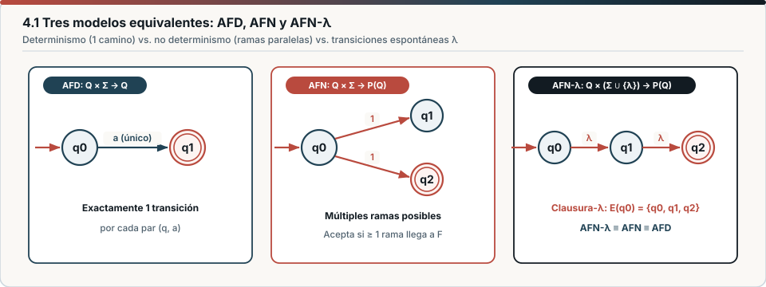

<!-- _class: lead -->

Tema 4.1

# 4.1 Aceptadores de estado finito

### AFD, AFN, AFN-$\lambda$ y su equivalencia computacional

Unidad 4: Lenguajes de Estado Finito · Primer Semestre

---

# 4.1.1 Autómata Finito Determinista (AFD)

Un **AFD** lee la cinta de entrada de izquierda a derecha en exactamente $\lvert w \rvert$ pasos (un paso por símbolo). Se define como una 5-tupla:
$$M = (Q, \Sigma, \delta, q_0, F)$$
- $Q$: estados finitos; $\Sigma$: alfabeto de entrada; $q_0 \in Q$: estado inicial; $F \subseteq Q$: estados finales.
- $\delta: Q \times \Sigma \to Q$: función de transición total (único destino).
- **Lenguaje aceptado:** $L(M) = \{w \in \Sigma^* : \hat{\delta}(q_0, w) \in F\}$.
- **Representación:** tabla de transición (`->` inicial, `*` final) o diagrama (doble círculo para $F$).

---

# Esquema visual: 4.1 Aceptadores de estado finito

---

# 4.1.2 Autómata Finito No Determinista (AFN)

Permite **varios caminos simultáneos** o **ninguno** (rama abortada) para un mismo símbolo:
$$M = (Q, \Sigma, \Delta, q_0, F), \qquad \Delta : Q \times \Sigma \to \mathcal{P}(Q).$$

- Función extendida sobre subconjuntos: $\hat{\Delta}(q, \lambda) = \{q\}$, $\;\hat{\Delta}(q, wa) = \bigcup_{p \in \hat{\Delta}(q, w)} \Delta(p, a)$.
- **Criterio existencial de aceptación:**
  $$L(M) = \{w \in \Sigma^* : \hat{\Delta}(q_0, w) \cap F \neq \emptyset\}.$$
  *(Basta con que **al menos un** camino llegue a $F$).*

---

# 4.1.3 AFN con transiciones $\lambda$ ($\text{AFN-}\lambda$)

Permite cambiar de estado de manera espontánea **sin consumir símbolo de entrada**:
$$\Delta : Q \times (\Sigma \cup \{\lambda\}) \to \mathcal{P}(Q).$$

- **Clausura-$\lambda$ ($E(q)$ o $\lambda[q]$):** conjunto de estados alcanzables desde $q$ usando $0, 1$ o más transiciones $\lambda$ (siempre $q \in E(q)$).
- **Función extendida:** $\hat{\Delta}_\lambda(q, \lambda) = E(q)$ y $\hat{\Delta}_\lambda(q, wa) = E\bigl(\Delta(\hat{\Delta}_\lambda(q, w), a)\bigr)$.

---

<!-- _class: invert -->
# 4.1.4 Equivalencia: $\text{AFN-}\lambda \equiv \text{AFN} \equiv \text{AFD}$

> Los tres modelos reconocen **exactamente la misma clase de lenguajes**: los lenguajes regulares.

1. **Teorema 4.1.1 ($\text{AFN-}\lambda \to \text{AFN}$):**
   - $\Delta'(q, a) = E\bigl(\Delta(E(q), a)\bigr)$ para todo $q \in Q, a \in \Sigma$.
   - $F' = \{q \in Q : E(q) \cap F \neq \emptyset\}$.
2. **Teorema 4.1.2 ($\text{AFN} \to \text{AFD}$, construcción de subconjuntos):**
   - Estados alcanzables $S \subseteq Q$, inicial $\{q_0\}$ (o $E(q_0)$ directo desde AFN-$\lambda$).
   - $\delta(S, a) = \bigcup_{q \in S} \Delta'(q, a)$ y $F'' = \{S : S \cap F' \neq \emptyset\}$.

---

# Ejemplo 1: AFD para cadenas que terminan en `ab`

$Q = \{q_0 \text{ (inicio)}, q_1 \text{ (último } a\text{)}, q_2 \text{ (últimos } ab\text{)}\}$, $F = \{q_2\}$:

| Estado | `a` | `b` |
| :--- | :---: | :---: |
| $\to q_0$ | $q_1$ | $q_0$ |
| $q_1$ | $q_1$ | $q_2$ |
| $* q_2$ | $q_1$ | $q_0$ |

- **Para `aab`:** $\hat{\delta}(q_0, aab) = \delta(\delta(\delta(q_0, a), a), b) = \delta(\delta(q_1, a), b) = \delta(q_1, b) = q_2 \in F$ (**Acepta**).
- **Para `aba`:** $\hat{\delta}(q_0, aba) = q_1 \notin F$ (**Rechaza**).

---

# Ejemplo 2: Conversión completa $\text{AFN-}\lambda \to \text{AFN} \to \text{AFD}$

Para $L = a^* b^+ c^*$: $q_0 \xrightarrow{a} q_0,\; q_0 \xrightarrow{\lambda} q_1,\; q_1 \xrightarrow{b} q_2,\; q_2 \xrightarrow{b} q_2,\; q_2 \xrightarrow{\lambda} q_3,\; q_3 \xrightarrow{c} q_3$, $F=\{q_3\}$.

1. **Clausuras:** $E(q_0)=\{q_0,q_1\}$, $E(q_1)=\{q_1\}$, $E(q_2)=\{q_2,q_3\}$, $E(q_3)=\{q_3\}$; $\;F'=\{q_2,q_3\}$.
2. **AFN sin $\lambda$:** $\Delta'(q_0, a)=\{q_0,q_1\}$, $\Delta'(q_0,b)=\{q_2,q_3\}$, $\Delta'(q_1,b)=\{q_2,q_3\}$, $\Delta'(q_2,b)=\{q_2,q_3\}$, $\Delta'(q_2,c)=\{q_3\}$, $\Delta'(q_3,c)=\{q_3\}$.
3. **Subconjuntos alcanzables (AFD):** $S_0=\{q_0\}$, $S_1=\{q_0,q_1\}$, $S_2=\{q_2,q_3\}^*$, $S_3=\{q_3\}^*$, $S_\emptyset=\emptyset$.

---

<!-- _class: invert -->
# Ejercicios propuestos

1. Construye un AFD sobre $\{d, ., +, -\}$ para literales decimales con signo opcional y parte fraccionaria obligatoria ($\{+, -, \lambda\} d^+ . d^+$).
2. Diseña un AFD sobre $\{0, 1\}$ que acepte cadenas con un número impar de ceros y sin la subcadena `11`.
3. Convierte el $\text{AFN-}\lambda$ del Ejercicio 4 de las notas a AFN y luego a AFD por subconjuntos.

---

# Referencias

- Acevedo Juárez, A. (2006). *Teoría de la computación* [Tesis de licenciatura, Instituto Tecnológico de Celaya]. (pp. 44–81).
- De Castro Korgi, R. (2004). *Teoría de la computación: Lenguajes, autómatas, gramáticas*. Universidad Nacional de Colombia. (Secc. 2.1–2.7, pp. 25–49).
