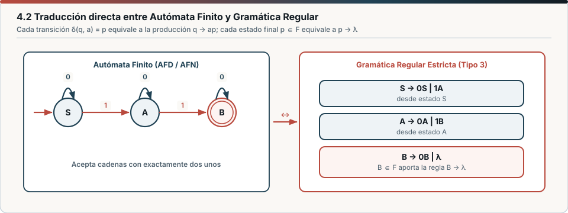

<!-- _class: lead -->

Tema 4.2

# 4.2 Aceptadores de estado finito y gramáticas regulares

### Equivalencia constructiva entre AFD / AFN y gramáticas de Tipo 3

Unidad 4: Lenguajes de Estado Finito · Primer Semestre

---

# 4.2.1 Gramáticas regulares y variantes

- **Gramática regular estricta (De Castro Korgi, 2004, Def. 4.7.1):** todas sus producciones son de la forma:
  $$A \to aB \qquad \text{o} \qquad A \to \lambda \qquad (A, B \in V,\; a \in \Sigma).$$
  *(Equivalente a usar $A \to aB \mid a$ con $S \to \lambda$ opcional).*
- **Lineales por la derecha:** $A \to wB \mid w$ ($w \in \Sigma^*$).
- **Lineales por la izquierda:** $A \to Bw \mid w$ ($w \in \Sigma^*$).
- **Regla de oro:** nunca mezclar reglas derechas e izquierdas en la misma gramática.

---

# Esquema visual: 4.2 Aceptadores de estado finito y gramáticas regulares

---

<!-- _class: invert -->
# Teorema 4.2.1: Equivalencia AF $\leftrightarrow$ Gramática Regular

> Un lenguaje $L \subseteq \Sigma^*$ es aceptado por un autómata finito si y solo si existe una gramática regular $G$ tal que $L = L(G)$.

**Idea intuitiva:**  
Cada transición $\delta(q, a) = p$ del autómata hace exactamente lo mismo que la producción $q \to ap$ de la gramática: emite el terminal $a$ y avanza del estado/variable $q$ al estado/variable $p$. Al llegar a un estado final $p \in F$, la regla $p \to \lambda$ concluye la derivación.

---

# Dirección 1: De AFD a Gramática Regular (Teorema 4.7.2)

Dado un AFD $M = (Q, \Sigma, \delta, q_0, F)$, construimos $G = (V, \Sigma, S, P)$:
1. $V = Q$ (cada estado se vuelve una variable).
2. $S = q_0$.
3. Reglas $P$:
   - Por cada transición $\delta(q, a) = p$, añadir **$q \to ap$**.
   - Por cada estado final $q \in F$, añadir **$q \to \lambda$**.

*(Prueba por inducción: $\hat{\delta}(q, w) = p \iff q \Rightarrow^* wp$).*

---

# Dirección 2: De Gramática Regular a AFN (Teorema 4.7.3)

Dada una gramática regular estricta $G = (V, \Sigma, S, P)$, construimos el AFN $M = (Q, \Sigma, \Delta, q_0, F)$:
1. $Q = V$ y $q_0 = S$.
2. $\Delta(A, a) = \{B \in V : (A \to aB) \in P\}$.
3. $F = \{A \in V : (A \to \lambda) \in P\}$.

- Si $G$ es lineal derecha general ($A \to a_1 \cdots a_k B$), se parte en variables auxiliares.
- Si $G$ es lineal izquierda ($A \to Bw$), se invierten los cuerpos ($G^R$), se construye el autómata $M^R$ y luego se invierten sus flechas e inicio/fin.

---

# Ejemplo 1: De AFD a gramática regular

AFD para cadenas con **exactamente dos unos** ($0^* 1 0^* 1 0^*$), con $Q = \{S, A, B, T\}$, inicial $S$, $F = \{B\}$ y estado trampa $T$:
- Transiciones: $S \xrightarrow{0} S, S \xrightarrow{1} A$; $\;A \xrightarrow{0} A, A \xrightarrow{1} B$; $\;B \xrightarrow{0} B, B \xrightarrow{1} T$; $\;T \xrightarrow{0,1} T$.
- **Reglas directas:**
  $S \to 0S \mid 1A$, $\;A \to 0A \mid 1B$, $\;B \to 0B \mid 1T \mid \lambda$, $\;T \to 0T \mid 1T$.
- Eliminando $T$ (variable no terminable):
  $$S \to 0S \mid 1A, \qquad A \to 0A \mid 1B, \qquad B \to 0B \mid \lambda.$$

---

# Ejemplo 2: De gramática lineal derecha a AFN y AFD

Sea $G: S \to abS \mid aA \mid \lambda, \quad A \to bS \mid a$:
1. **Normalización estricta:** $S \to aX_1 \mid aA \mid \lambda$, $\;X_1 \to bS$, $\;A \to bS \mid aZ$, $\;Z \to \lambda$.
2. **AFN resultante:** $q_0 = S$, $F = \{S, Z\}$, $\Delta(S, a) = \{X_1, A\}$, $\Delta(X_1, b) = \{S\}$, $\Delta(A, b) = \{S\}$, $\Delta(A, a) = \{Z\}$.
3. **Determinización por subconjuntos:**  
   $\{S\}^* \xrightarrow{a} \{X_1, A\}$, $\;\{X_1, A\} \xrightarrow{a} \{Z\}^*$, $\;\{X_1, A\} \xrightarrow{b} \{S\}^*$, resto al estado pozo $\emptyset$.  
   Lenguaje reconocido: $(ab)^*(\lambda + aa)$.

---

<!-- _class: invert -->
# Ejercicios propuestos

1. Obtén una gramática regular estricta equivalente al AFD $M = (\{q_0, q_1, q_2\}, \{a, b\}, \delta, q_0, \{q_2\})$ con $\delta(q_0, a)=q_1, \delta(q_0, b)=q_0, \delta(q_1, a)=q_1, \delta(q_1, b)=q_2, \delta(q_2, a)=q_1, \delta(q_2, b)=q_0$.
2. Convierte $S \to 01S \mid 1A \mid 0,\; A \to 00A \mid 1S \mid \lambda$ a forma estricta, luego a AFN y finalmente a AFD.
3. A partir de la gramática lineal izquierda $S \to Sa \mid Ab,\; A \to Aa \mid \lambda$, halla un AFD y una gramática regular por la derecha equivalentes.

---

# Referencias

- Acevedo Juárez, A. (2006). *Teoría de la computación* [Tesis de licenciatura, Instituto Tecnológico de Celaya]. (pp. 47–51).
- De Castro Korgi, R. (2004). *Teoría de la computación: Lenguajes, autómatas, gramáticas*. Universidad Nacional de Colombia. (Secc. 4.7, pp. 98–101).
