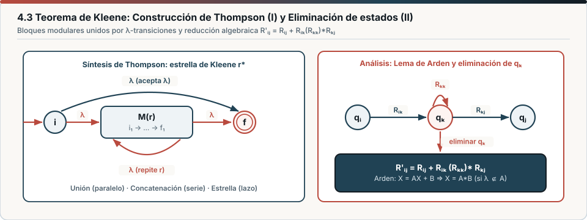

<!-- _class: lead -->

Tema 4.3

# 4.3 Expresiones regulares y aceptadores de estado finito

### Definición recursiva, álgebra de ER, construcción de Thompson y Lema de Arden

Unidad 4: Lenguajes de Estado Finito · Primer Semestre

---

# 4.3.1 Expresiones regulares (ER) y su lenguaje

1. **Básicas:** $\emptyset$ ($L(\emptyset)=\emptyset$), $\;\lambda$ ($L(\lambda)=\{\lambda\}$), $\;a \in \Sigma$ ($L(a)=\{a\}$).
2. **Compuestas:** si $r, s$ son ER, también lo son:
   - $(r + s)$ o $(r \cup s)$: unión $L(r) \cup L(s)$ *(menor precedencia)*.
   - $(r \cdot s)$ o $(rs)$: concatenación $L(r) \cdot L(s)$ *(precedencia media)*.
   - $(r)^*$: estrella de Kleene $(L(r))^*$ *(máxima precedencia)*.
- **Abreviatura útil:** $r^+ = r \cdot r^*$.

---

# Esquema visual: 4.3 Expresiones regulares y aceptadores de estado finito

---

# Identidades algebraicas de las ER

| Propiedad | Identidad |
| :--- | :--- |
| Conmutatividad / Idempotencia de $+$ | $r + s = s + r$, $\quad r + r = r$ |
| Neutro aditivo ($\emptyset$) y multiplicativo ($\lambda$) | $r + \emptyset = r$, $\quad r\lambda = \lambda r = r$ |
| Absorbente multiplicativo ($\emptyset$) | $r\emptyset = \emptyset r = \emptyset$ |
| Distributividad | $r(s + t) = rs + rt$, $\quad (s + t)r = sr + tr$ |
| Identidades de $*$ | $\emptyset^* = \lambda^* = \lambda$, $\quad r^* = (r^*)^* = \lambda + rr^*$ |
| Suma con estrella | $(r + s)^* = (r^* s)^* r^*$ *(Ojo: $(r+s)^* \neq r^* + s^*$)* |

---

<!-- _class: invert -->
# 4.3.2 Teorema de Kleene (De Castro Korgi, 2004, p. 49)

> Un lenguaje $L \subseteq \Sigma^*$ es **regular** ($L = L(r)$ para alguna ER $r$) si y solo si existe un **autómata finito** $M$ (AFD, AFN o $\text{AFN-}\lambda$) tal que $L = L(M)$.

- **Parte I (Síntesis, $\text{ER} \to \text{AFN-}\lambda$):** Construcción de McNaughton–Yamada–Thompson.
- **Parte II (Análisis, $\text{AFD/AFN} \to \text{ER}$):** Sistemas de ecuaciones con el **Lema de Arden** o eliminación gráfica de estados.

---

# 4.3.3 Parte I: Construcción de Thompson

Construimos paso a paso desde los bloques básicos hasta las expresiones compuestas (cada subautómata tiene un único inicio y un único fin separados):

- **Básicos:** $M(\emptyset)$ sin camino; $\;M(\lambda)$: $q_0 \xrightarrow{\lambda} q_1$; $\;M(a)$: $q_0 \xrightarrow{a} q_1$.
- **Unión ($r + s$):** nuevo inicio $i \xrightarrow{\lambda} i_1, i_2$ y fines $f_1, f_2 \xrightarrow{\lambda} f$.
- **Concatenación ($rs$):** unir el fin de $M_1$ al inicio de $M_2$ mediante $f_1 \xrightarrow{\lambda} i_2$.
- **Estrella ($r^*$):** nuevo inicio $i$ y fin $f$ con cuatro $\lambda$-arcos: $i \to i_1$, $i \to f$, $f_1 \to i_1$, $f_1 \to f$.

---

<!-- _class: invert -->
# 4.3.4 Lema de Arden (Teorema de Kleene, Parte II)

> **Lema de Arden (De Castro Korgi, 2004, p. 55):** Sean $A, B \subseteq \Sigma^*$ tales que $\lambda \notin A$. Entonces la ecuación:
> $$X = AX + B \qquad (\text{es decir, } X = AX \cup B)$$
> tiene una **única solución**, dada por:
> $$X = A^* B.$$

**Idea intuitiva:** Al sustituir repetidamente $X = AX + B = A(AX + B) + B = A^2X + AB + B = \dots$, surgen todas las potencias $(\lambda + A + A^2 + \dots)B = A^* B$.

---

# Dos métodos para pasar de AFD/AFN a ER

### 1. Ecuaciones y Lema de Arden
- Definir $A_i = L(M_i)$ desde cada estado $q_i$.
- Plantear $A_i = \sum a A_j$ ($+ \lambda$ si $q_i \in F$).
- Despejar hacia atrás usando $X = \alpha X + \beta \implies X = \alpha^* \beta$ hasta obtener $A_0$.

### 2. Eliminación de estados
- Agregar $q_{\text{ini}} \xrightarrow{\lambda} q_0$ y $F \xrightarrow{\lambda} q_{\text{fin}}$.
- Al eliminar un estado interno $q_k$, actualizar cada arco $q_i \to q_j$ con:
  $$R'_{ij} = R_{ij} + R_{ik}(R_{kk})^* R_{kj}.$$

---

# Ejemplo: De AFD (múltiplos de 3 en binario) a ER con Arden

AFD: $Q = \{q_0, q_1, q_2\}$, $F = \{q_0\}$; $q_0 \xrightarrow{0} q_0, q_0 \xrightarrow{1} q_1$; $\;q_1 \xrightarrow{1} q_0, q_1 \xrightarrow{0} q_2$; $\;q_2 \xrightarrow{0} q_1, q_2 \xrightarrow{1} q_2$.

1. **Sistema:**
   $A_0 = 0 A_0 + 1 A_1 + \lambda$, $\quad A_1 = 1 A_0 + 0 A_2$, $\quad A_2 = 0 A_1 + 1 A_2$.
2. **Despejando $A_2$ por Arden:** $A_2 = 1^* 0 A_1$.
3. **Sustituyendo en $A_1$:** $A_1 = (0 1^* 0) A_1 + 1 A_0 \implies A_1 = (0 1^* 0)^* 1 A_0$.
4. **Sustituyendo en $A_0$ y aplicando Arden:**
   $$L(M) = A_0 = \big(0 + 1 (0 1^* 0)^* 1\big)^*.$$

---

<!-- _class: invert -->
# Ejercicios propuestos

1. Simplifica algebraicamente: $(\lambda + aa)^* = (aa)^*$ y $(a + b)^* = (a^* b)^* a^*$.
2. Aplica el algoritmo de Thompson para construir un $\text{AFN-}\lambda$ para $r_1 = a^* b + (ab)^+$.
3. Usa el Lema de Arden (y verifica por eliminación de estados) para hallar la ER del AFD sobre $\{a, b\}$ que acepta cadenas con un número par de $a$'s e impar de $b$'s.

---

# Referencias

- Acevedo Juárez, A. (2006). *Teoría de la computación* [Tesis de licenciatura, Instituto Tecnológico de Celaya]. (pp. 62–64).
- De Castro Korgi, R. (2004). *Teoría de la computación: Lenguajes, autómatas, gramáticas*. Universidad Nacional de Colombia. (Secc. 1.13–1.14 y 2.8–2.12, pp. 18–24, 49–62).
