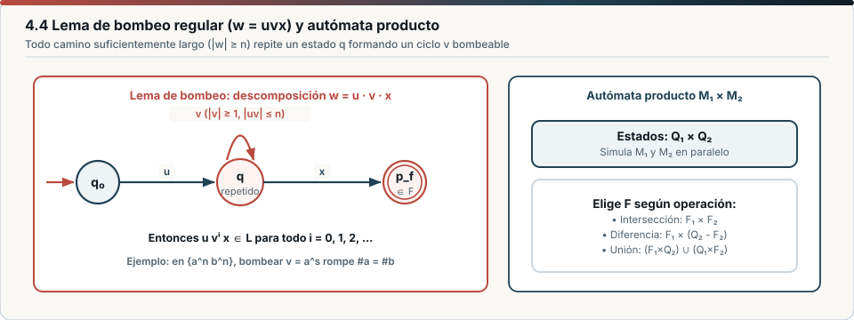

<!-- _class: lead -->

Tema 4.4

# 4.4 Propiedades de los lenguajes de estado finito

### Lema de bombeo, propiedades de clausura y algoritmos de decisión

Unidad 4: Lenguajes de Estado Finito · Primer Semestre

---

<!-- _class: invert -->
# 4.4.1 El Lema de bombeo para lenguajes regulares

> **Lema 3.1.1 (De Castro Korgi, 2004, p. 63):** Sea $L \subseteq \Sigma^*$ un lenguaje regular. Existe una constante $n \ge 1$ tal que toda cadena $w \in L$ con $|w| \ge n$ se descompone como $w = uvx$ cumpliendo:
> 1. $|uv| \le n$
> 2. $v \neq \lambda$ ($|v| \ge 1$)
> 3. $u v^i x \in L$ para todo $i \ge 0$.

*(Por el principio del palomar en un AFD de $n$ estados, al leer $n$ símbolos necesariamente se repite un estado formando un ciclo $v$ que puede omitirse ($i=0$) o repetirse ($i \ge 2$)).*

---

# Esquema visual: 4.4 Propiedades de los lenguajes de estado finito

---

# ¿Cómo demostrar que un lenguaje NO es regular?

El Lema de bombeo es una **condición necesaria** (todo finito lo cumple automáticamente por vacuidad). Para probar **no regularidad** por contradicción:
1. **Suponer** que $L$ es regular $\implies$ existe una constante $n \ge 1$ fija (no la elegimos nosotros).
2. **Elegir** una cadena $w \in L$ en función de $n$ tal que $|w| \ge n$.
3. **Analizar todas** las particiones posibles $w = uvx$ con $|uv| \le n$ y $|v| \ge 1$.
4. **Bombeo:** mostrar un $i \ge 0$ (casi siempre $i = 0$ o $i = 2$) tal que $u v^i x \notin L \implies$ contradicción.

---

# Ejemplo 1: Tres pruebas clásicas de no regularidad

1. **$L_1 = \{a^k b^k : k \ge 0\}$:** elegimos $w = a^n b^n$. Como $|uv| \le n$, $v = a^s$ ($s \ge 1$). Con $i = 0$, $ux = a^{n-s} b^n \notin L_1$.
2. **Palíndromos $L_2 = \{w \in \{a, b\}^* : w = w^R\}$:** elegimos $w = a^n b a^n$. De nuevo $v = a^s$ ($s \ge 1$). Con $i = 0$, $ux = a^{n-s} b a^n \notin L_2$.
3. **$L_3 = \{a^{k^2} : k \ge 0\}$:** elegimos $w = a^{n^2}$. Con $i = 2$, $n^2 < |uv^2x| \le n^2 + n < (n+1)^2$, queda entre dos cuadrados consecutivos $\implies uv^2x \notin L_3$.

---

# 4.4.2 Propiedades de clausura de $\mathcal{R}$

Si $L, L_1, L_2$ son regulares, también son regulares:
- **Unión, concatenación, estrella ($*$):** $L_1 \cup L_2$, $L_1 L_2$, $L^*$.
- **Complemento ($\overline{L} = \Sigma^* - L$):** tomar un **AFD completo** y cambiar $F$ por $Q - F$.
- **Intersección ($L_1 \cap L_2$) y diferencia ($L_1 - L_2$):** vía leyes de De Morgan o **autómata producto** ($Q_1 \times Q_2$ simulando ambos en paralelo).
- **Reflexión ($L^R$)** y **homomorfismo ($h(L)$ / $h^{-1}(B)$):** regla uniforme de sustitución símbolo a cadena (De Castro Korgi, 2004, pp. 72–75).

*(La familia $\mathcal{R}$ **no** es cerrada bajo uniones o intersecciones infinitas).*

---

<!-- _class: invert -->
# 4.4.3 Algoritmos de decisión sobre lenguajes regulares

| Problema | Pregunta | Algoritmo de solución |
| :--- | :--- | :--- |
| **Pertenencia** | ¿$w \in L(M)$? | Simular AFD equivalente en $\lvert w \rvert$ pasos |
| **Vacío** | ¿$L(M) = \emptyset$? | Calcular `ALC` desde $q_0$ y verificar $\text{ALC} \cap F = \emptyset$ |
| **Finitud / Infinitud** | ¿Es $L(M)$ infinito? | ¿Acepta alguna $w$ con $n \le \lvert w \rvert < 2n$? (o ciclo útil en grafo) |
| **Inclusión** | ¿$L(M_1) \subseteq L(M_2)$? | Verificar si $L(M_1) \cap \overline{L(M_2)} = \emptyset$ (algoritmo de vacío) |
| **Equivalencia** | ¿$L(M_1) = L(M_2)$? | Verificar si $L(M_1) \triangle L(M_2) = \emptyset$ |

---

# Ejemplo 2: Uso combinado de clausura y homomorfismos

1. **Vía intersección:** Demostrar que $L = \{w \in \{a, b\}^* : |w|_a = |w|_b\}$ no es regular.
   - Si $L$ fuera regular, como $a^* b^*$ es regular, $L \cap a^* b^* = \{a^k b^k : k \ge 0\}$ sería regular. ¡Contradicción!
2. **Vía homomorfismo:** Demostrar que $L' = \{0^k 1 0^k : k \ge 1\}$ no es regular.
   - Usando $h(0)=0, h(1)=0, h(2)=1$ y luego $g(0)=0, g(1)=1, g(2)=\lambda$, se obtiene $g(h^{-1}(L') \cap 0^* 2 1^*) = \{0^k 1^k : k \ge 1\}$, que tiene la misma estructura que $\{a^k b^k : k \ge 1\}$ (no regular).

---

<!-- _class: invert -->
# Ejercicios propuestos

1. Usa el Lema de bombeo para probar que no son regulares: $L_a = \{0^i 1^{2i} : i \ge 0\}$, $\;L_b = \{ww : w \in \{a,b\}^*\}$, $\;L_c = \{a^p : p \text{ primo}\}$.
2. Determina verdadero o falso: si $L_1 \cup L_2$ es regular, entonces $L_1$ y $L_2$ son regulares.
3. Diseña un algoritmo de decisión para determinar si $L(M) = \Sigma^*$ dado un AFD $M$.

---

# Referencias

- Acevedo Juárez, A. (2006). *Teoría de la computación* [Tesis de licenciatura, Instituto Tecnológico de Celaya]. (pp. 64–65).
- De Castro Korgi, R. (2004). *Teoría de la computación: Lenguajes, autómatas, gramáticas*. Universidad Nacional de Colombia. (Secc. 3.1–3.6, pp. 63–79).
