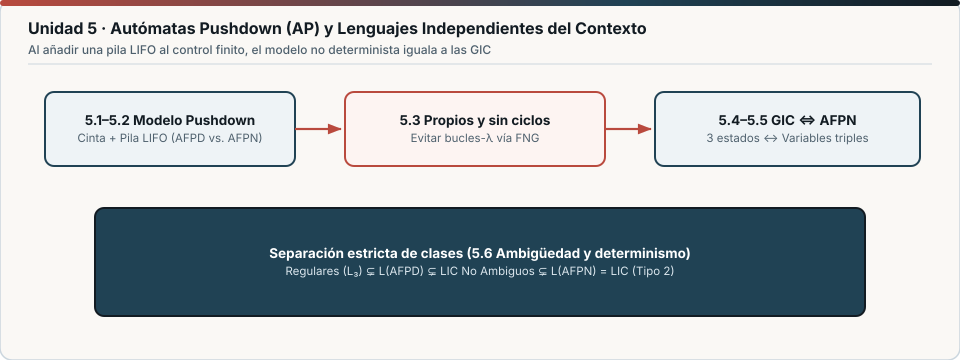

<!-- _class: lead -->

Unidad 5 · 20 horas

# Unidad 5: Autómatas Pushdown

### Autómatas de cinta con pila LIFO y equivalencia con gramáticas independientes del contexto

**Universidad Vasco de Quiroga (UVAQ)**  
Ingeniería en Sistemas y Seguridad Informática · Primer Semestre

---

# Propósito y competencia de la unidad

- **Competencia a desarrollar:** Analizar el alcance de los autómatas de cinta con relación a los lenguajes independientes del contexto (LIC).
- **Salto conceptual:** Los autómatas finitos fallan al contar cantidades arbitrarias ($\{a^n b^n\}$) o validar paréntesis anidados. Al añadir **una pila LIFO** (*pushdown*), el autómata alcanza exactamente el poder de las GIC.

---

# Esquema visual: Unidad 5: Autómatas Pushdown

---

<!-- _class: invert -->
# Panorama de la Unidad 5

> A diferencia de los autómatas finitos ($\text{AFD} \equiv \text{AFN}$), en autómatas con pila el modelo no determinista es **estrictamente más potente** que el determinista:
> $$\mathcal{L}(\text{Regulares}) \;\subsetneq\; \mathcal{L}(\text{AFPD}) \;\subsetneq\; \mathcal{L}(\text{AFPN}) \;=\; \text{LIC}.$$

- **5.1 Introducción:** Autómatas de cinta y acceso LIFO.
- **5.2 Aceptadores *pushdown*:** AFPD vs. AFPN, estado final $L(M)$ vs. pila vacía $N(M)$.
- **5.3 Propios y sin ciclos:** Eliminación de bucles-$\lambda$ y terminación garantizada.
- **5.4 De GIC a AFPN** y **5.5 De AFPN a GIC:** Equivalencia $\text{LIC} = \mathcal{L}(\text{AFPN})$.
- **5.6 Ambigüedad:** Múltiples cómputos en AFPN y lenguajes inherentemente ambiguos.

---

# Mapa de subtemas

| Subtema | Tema central | Resultado clave |
| :--- | :--- | :--- |
| **5.1** | Autómatas de cinta | Arquitectura LIFO y comparación AF / AP / ALA / MT |
| **5.2** | Aceptadores *pushdown* | 7-tupla, configuraciones $(q, w, \alpha)$, $L(M) \equiv N(M)$ en AFPN |
| **5.3** | Propios y sin ciclos | Evitar bucles-$\lambda$ vía Forma Normal de Greibach |
| **5.4** | Análisis sintáctico | De cualquier GIC a un AFPN de 3 estados |
| **5.5** | Variables triples | De cualquier AFPN por pila vacía a GIC equivalente |
| **5.6** | Ambigüedad | Múltiples cómputos de aceptación y conflictos |

---

<!-- _class: invert -->
# Idea clave para recordar

> Los **autómatas con pila no deterministas (AFPN)** son el equivalente operacional exacto de las **gramáticas independientes del contexto (Tipo 2)** y constituyen la base teórica de los analizadores sintácticos en compiladores.

---

# Referencias bibliográficas

- Acevedo Juárez, A. (2006). *Teoría de la computación* [Tesis de licenciatura, Instituto Tecnológico de Celaya].
- De Castro Korgi, R. (2004). *Teoría de la computación: Lenguajes, autómatas, gramáticas*. Universidad Nacional de Colombia. (Cap. 5).
- Hopcroft, J. E., Motwani, R., & Ullman, J. D. (2007). *Introducción a la teoría de autómatas, lenguajes y computación* (3.ª ed.). Pearson Educación.
