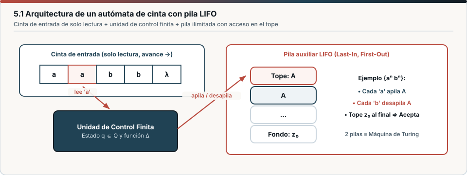

<!-- _class: lead -->

Tema 5.1

# 5.1 Introducción a los Autómatas Pushdown

### Límites de la memoria finita y arquitectura de los autómatas de cinta

Unidad 5: Autómatas Pushdown · Primer Semestre

---

# ¿Por qué necesitamos una pila?

- Los autómatas finitos solo recuerdan un número acotado de estados $Q$.
- Por el Lema de bombeo, ningún AF reconoce $L_0 = \{a^n b^n : n \ge 0\}$ ni paréntesis anidados arbitrariamente profundos.
- **Solución:** añadir una **memoria auxiliar ilimitada** con acceso **LIFO** (*Last-In, First-Out*): solo leemos y modificamos el símbolo del **tope** de la pila (*stack* / *pushdown*).

---

# Esquema visual: 5.1 Introducción a los Autómatas Pushdown

---

# 5.1.1 Arquitectura de un autómata de cinta

Cuatro componentes principales (De Castro Korgi, 2004, pp. 143–144):
1. **Cinta de entrada:** contiene $w \in \Sigma^*$; es de **solo lectura**.
2. **Cabezal de entrada:** avanza de izquierda a derecha (o se queda fijo en transiciones $\lambda$).
3. **Unidad de control finita:** estados $Q$ y reglas de transición $\Delta$.
4. **Cinta auxiliar (pila LIFO):** almacena símbolos de $\Gamma$, con marcador de fondo $z_0$; solo se accede al **tope**.

---

<!-- _class: invert -->
# Jerarquía de autómatas de cinta

| Modelo | Cinta de entrada | Memoria auxiliar | Lenguajes reconocidos |
| :--- | :--- | :--- | :--- |
| **AF (AFD/AFN)** | Solo lectura ($\to$) | Ninguna (solo $Q$) | Regulares (**Tipo 3**) |
| **AFPD** | Solo lectura ($\to$) | 1 pila LIFO (determinista) | LIC deterministas ($\mathcal{L}(\text{AFPD})$) |
| **AFPN** | Solo lectura ($\to$) | 1 pila LIFO (no determinista) | Independientes del Contexto (**Tipo 2**) |
| **ALA** | Lectura/escritura | Misma cinta acotada a $O(\lvert w \rvert)$ | Sensibles al Contexto (**Tipo 1**) |
| **MT / 2 Pilas** | Lectura/escritura | Cinta ilimitada o **2 pilas LIFO** | Recursivamente Enumerables (**Tipo 0**) |

*(Con **dos pilas**, un autómata ya iguala el poder de una Máquina de Turing).*

---

# Ejemplo 1: Conteo ilimitado para $L = \{a^n b^n : n \ge 1\}$

Estrategia con marcador de fondo $z_0$ y símbolo $A$:
- Por cada `a` leída en $q_0$, apilar una $A$.
- Al leer la primera `b`, pasar a $q_1$ y desapilar $A$; seguir desapilando una $A$ por cada `b`.
- Si al terminar la entrada queda solo $z_0$ en el tope, pasar a $q_2 \in F$.

**Traza rápida para `aabb`:**  
$(q_0, \texttt{aabb}, z_0) \to (q_0, \texttt{abb}, Az_0) \to (q_0, \texttt{bb}, AAz_0) \to (q_1, \texttt{b}, Az_0) \to (q_1, \lambda, z_0) \to q_2$ (**Acepta**).

---

# Ejemplo 2: Delimitadores anidados `([()])` vs. `([)]`

Reglas: `(` apila `P`, `[` apila `C`; `)` exige `P` en el tope y lo desapila; `]` exige `C` en el tope.
- **Para `([()])`:** pila evoluciona $z_0 \to Pz_0 \to CPz_0 \to PCPz_0 \to CPz_0 \to Pz_0 \to z_0$ (**Acepta**).
- **Para `([)]`:** tras `(` y `[` la pila es $CPz_0$; al leer `)` exige `P`, pero el tope es `C` $\implies$ **Cómputo abortado (Rechaza)**.

---

<!-- _class: invert -->
# Ejercicios propuestos

1. Clasifica qué modelo mínimo (AF, AP o MT/AF2P) reconoce:
   - $L_1 = \{w \in \{a,b\}^* : w \text{ tiene número par de } a\text{'s}\}$
   - $L_2 = \{a^n b^m c^n : n, m \ge 1\}$
   - $L_3 = \{a^n b^n c^n : n \ge 1\}$
2. Diseña las reglas informales de pila para $L = \{a^i b^j c^{i+j} : i, j \ge 1\}$ y traza `aabccc` y `abbcc`.

---

# Referencias

- Acevedo Juárez, A. (2006). *Teoría de la computación* [Tesis de licenciatura, Instituto Tecnológico de Celaya].
- De Castro Korgi, R. (2004). *Teoría de la computación: Lenguajes, autómatas, gramáticas*. Universidad Nacional de Colombia. (Cap. 5 y 6, pp. 143–149, 188–193).
