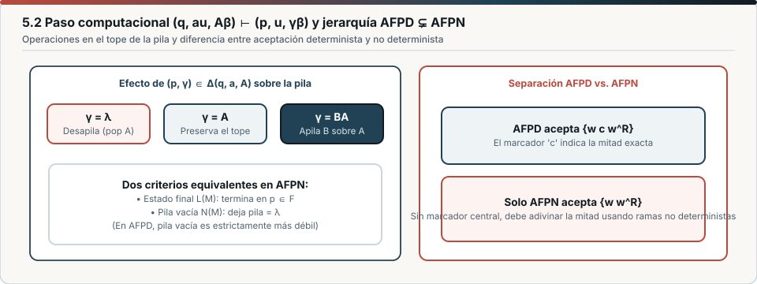

<!-- _class: lead -->

Tema 5.2

# 5.2 Aceptadores "pushdown"

### Definición formal de AFPD y AFPN, configuraciones y criterios de aceptación

Unidad 5: Autómatas Pushdown · Primer Semestre

---

# Definición formal: AFPD y AFPN

Un **autómata con pila** se define como una **7-tupla** (De Castro Korgi, 2004, pp. 143, 149):
$$M = (Q, q_0, F, \Sigma, \Gamma, z_0, \Delta)$$
- $Q$: estados; $\;q_0 \in Q$: inicial; $\;F \subseteq Q$: aceptación; $\;\Sigma$: entrada; $\;\Gamma$: pila; $\;z_0 \in \Gamma$: fondo.
- **AFPD (determinista):** $\Delta : Q \times (\Sigma \cup \{\lambda\}) \times \Gamma \to Q \times \Gamma^*$ es función parcial con **a lo sumo 1 opción**, y si $\Delta(q, \lambda, A)$ está definida, entonces $\Delta(q, a, A)$ **no existe** para ningún $a \in \Sigma$.
- **AFPN (no determinista):** $\Delta : Q \times (\Sigma \cup \{\lambda\}) \times \Gamma \to \mathcal{P}_f(Q \times \Gamma^*)$ admite múltiples ramas y transiciones-$\lambda$ simultáneas.

---

# Esquema visual: 5.2 Aceptadores "pushdown"

---

# Configuraciones instantáneas y relación de paso ($\vdash_M$)

Una **configuración** describe el estado completo de la máquina en un instante:
$$(q, w, \alpha) \in Q \times \Sigma^* \times \Gamma^*$$
*(estado actual $q$, entrada pendiente $w$, contenido de pila $\alpha$ con tope a la izquierda).*

- Si $(p, \gamma) \in \Delta(q, a, A)$ (con $a \in \Sigma \cup \{\lambda\}$), entonces:
  $$(q, au, A\beta) \vdash_M (p, u, \gamma\beta).$$
- **Operaciones típicas:** preservar ($A$), desapilar ($\lambda$), apilar ($BA$), o transición espontánea ($a = \lambda$).
- $\vdash_M^*$ denota cero, uno o más pasos consecutivos (*clausura reflexiva y transitiva*).

---

<!-- _class: invert -->
# Dos criterios de aceptación: $L(M)$ vs. $N(M)$

1. **Por estado final ($L(M)$):** consumir $w$ y alcanzar un estado $p \in F$:
   $$L(M) = \{w \in \Sigma^* : (q_0, w, z_0) \vdash_M^* (p, \lambda, \beta),\; p \in F\}.$$
2. **Por pila vacía ($N(M)$):** consumir $w$ y dejar la pila completamente vacía ($\lambda$):
   $$N(M) = \{w \in \Sigma^* : (q_0, w, z_0) \vdash_M^* (p, \lambda, \lambda),\; p \in Q\}.$$

> **Teoremas 5.3.2 y 5.3.3 (De Castro Korgi):** Para los **AFPN**, ambos criterios son **exactamente equivalentes** (aceptar por estado final $\iff$ aceptar por pila vacía).  
> *(En cambio, en AFPD la pila vacía es más débil porque exige que ninguna palabra válida sea prefijo propio de otra).*

---

<!-- _class: invert -->
# Diferencia de poder expresivo

$$\mathcal{L}(\text{Regulares}) \;\subsetneq\; \mathcal{L}(\text{AFPD}) \;\subsetneq\; \mathcal{L}(\text{AFPN}) \;=\; \text{LIC}$$

- **AFPD sí reconoce $\{w c w^R\}$:** el símbolo central `c` le avisa exactamente cuándo dejar de apilar y empezar a desapilar.
- **AFPD NO reconoce $\{w w^R\}$ (palíndromos pares):** sin marcador central, un autómata determinista no puede adivinar dónde termina $w$ y empieza $w^R$. Un **AFPN sí lo acepta** usando una rama no determinista en cada paso.

---

# Ejemplo 1: AFPD para $\{w c w^R : w \in \{a, b\}^*\}$

- $Q = \{q_0, q_1, q_2\}$, $F = \{q_2\}$, $\Gamma = \{z_0, A, B\}$ (De Castro Korgi, p. 148):
  - En $q_0$: con `a`/`b` apila $A$/$B$; con `c` pasa a $q_1$ (o a $q_2$ si tope es $z_0$).
  - En $q_1$: empareja `a` con $A$ y `b` con $B$ desapilando; con $(\lambda, z_0)$ salta a $q_2$.
- **Traza de `abcba`:**
  $$(q_0, \texttt{abcba}, z_0) \vdash (q_0, \texttt{bcba}, Az_0) \vdash (q_0, \texttt{cba}, BAz_0) \vdash (q_1, \texttt{ba}, BAz_0) \vdash (q_1, \texttt{a}, Az_0) \vdash (q_1, \lambda, z_0) \vdash (q_2, \lambda, z_0) \in F.$$

---

# Ejemplo 2: AFPN para $\{w w^R : w \in \{a, b\}^*\}$

En $q_0$, ante $(a, A)$ el autómata tiene **dos opciones**: seguir apilando $(q_0, AA)$ o apostar que ya llegó a la mitad pasando a $(q_1, \lambda)$ (y análogamente con $(b, B)$).

**Dos ramas para `abba`:**
- **Rama 1 (nunca adivina):** $(q_0, \texttt{abba}, z_0) \vdash^* (q_0, \lambda, ABBAz_0)$ $\implies$ $q_0 \notin F$ (**Rechaza**).
- **Rama 2 (adivina en la 2.ª `b`):** $(q_0, \texttt{abba}, z_0) \vdash (q_0, \texttt{bba}, Az_0) \vdash (q_0, \texttt{ba}, BAz_0) \vdash (q_1, \texttt{a}, Az_0) \vdash (q_1, \lambda, z_0) \vdash (q_2, \lambda, z_0)$ $\implies$ **Acepta**.

---

<!-- _class: invert -->
# Ejercicios propuestos

1. Diseña un AFPD para $L = \{a^i b^{2i} : i \ge 1\}$ y traza `aabbbb` y `aabbb`.
2. Diseña un AFPN que acepte $L = \{0^i 1^j : i \ne j\}$ explicando dónde actúa el no determinismo.
3. Explica con un ejemplo por qué $a^*$ puede aceptarse con un AFPD por estado final, pero no por pila vacía sin marcador de fin de cinta.

---

# Referencias

- Acevedo Juárez, A. (2006). *Teoría de la computación* [Tesis de licenciatura, Instituto Tecnológico de Celaya].
- De Castro Korgi, R. (2004). *Teoría de la computación: Lenguajes, autómatas, gramáticas*. Universidad Nacional de Colombia. (Secc. 5.1–5.3, pp. 143–156).
- Hopcroft, J. E., Motwani, R., & Ullman, J. D. (2007). / Sipser, M. (2012).
