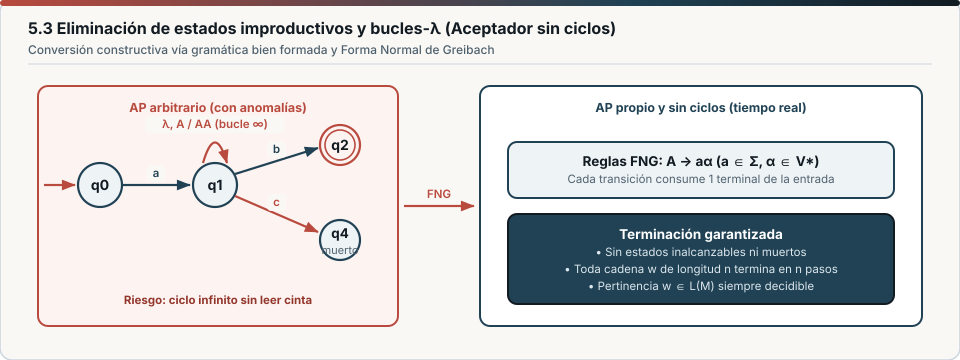

<!-- _class: lead -->

Tema 5.3

# 5.3 Aceptadores propios y sin ciclos

### Depuración de estados inútiles, eliminación de bucles-$\lambda$ y terminación garantizada

Unidad 5: Autómatas Pushdown · Primer Semestre

---

# Anomalías en un AFPN arbitrario

Un AFPN sin restricciones puede presentar defectos graves:
1. **Estados inalcanzables:** nunca se visitan desde $(q_0, w, z_0)$.
2. **Estados muertos:** alcanzables, pero sin camino posible hacia la aceptación (p. ej., estados trampa).
3. **Símbolos y transiciones inútiles:** nunca participan en un cómputo exitoso.
4. **Ciclos-$\lambda$ (bucles sin leer entrada):**
   - *Estacionario:* $(q, \lambda, A) \vdash^+ (q, \lambda, A)$.
   - *Creciente (explosión de pila):* $(q, \lambda, A) \vdash^+ (q, \lambda, \gamma A)$ con $|\gamma| \ge 1$.

---

# Esquema visual: 5.3 Aceptadores propios y sin ciclos

---

<!-- _class: invert -->
# Aceptadores propios y sin ciclos (*loop-free*)

- **Aceptador propio (reducido):** todo estado es alcanzable desde $q_0$ y co-alcanzable (participa en alguna aceptación); no hay símbolos muertos ni inútiles.
- **Aceptador sin ciclos (*loop-free*):** **no admite cómputos infinitos** sobre ninguna entrada $w \in \Sigma^*$ (no existen cadenas infinitas de transiciones-$\lambda$).

> **Teorema (Terminación garantizada):** Todo lenguaje independiente del contexto posee un AFPN propio y sin ciclos que decide $w \in L$ en tiempo finito (en exactamente $\lvert w \rvert$ pasos si proviene de Forma Normal de Greibach, para $w \neq \lambda$).

---

# Método constructivo para eliminar bucles-$\lambda$

Siguiendo a De Castro Korgi (2004, Secc. 4.8–4.12 y 6.6.2, pp. 187–188):

1. **AP $\to$ GIC** (usando variables triples, Teorema 5.5.1).
2. **Limpiar la GIC $\to$ Gramática bien formada** (quitar variables inútiles, producciones-$\lambda$ y producciones unitarias).
3. **Convertir a Forma Normal de Greibach (FNG):** toda regla tiene la forma $A \to a\alpha$ ($a \in \Sigma,\; \alpha \in V^*$).
4. **Construir AFPN $M'$ en tiempo real:** cada transición $\Delta'(q_1, a, A)$ incluye $(q_1, \alpha)$ por cada regla $A \to a\alpha$: **cada paso lee 1 símbolo**, haciendo imposible todo bucle-$\lambda$.

*(Alternativa: usando Forma Normal de Chomsky, $2|w|-1$ pasos acotan la pila y tampoco hay bucles).*

---

# Ejemplo 1: Depuración de un AFPN defectuoso

AFPN con bucle $\Delta(q_0, \lambda, A) = \{(q_0, AA), (q_0, A)\}$, estado muerto $q_4$ y estado inalcanzable $q_3$:
- **Problema:** sobre $w = ab$, el bucle-$\lambda$ dispara $(q_0, b, Az_0) \vdash (q_0, b, AAz_0) \vdash (q_0, b, AAAz_0) \vdash \cdots$ sin consumir entrada.
- **Depuración:** eliminar la regla espuria-$\lambda$, suprimir $q_3$ (inalcanzable), $q_4$ (muerto) y el símbolo inútil $X$.
- El autómata limpio $M'$ termina toda entrada de longitud $n$ en $\le n + 1$ pasos.

---

# Ejemplo 2: Eliminación de recursividad izquierda vía FNG

Sea $G: S \to Sa \mid b$ (genera $ba^*$). Su AFPN ingenuo tiene $\Delta(q_1, \lambda, S) = \{(q_1, Sa), (q_1, b)\}$, causando bucle infinito $(q_1, baa, S) \vdash (q_1, baa, Sa) \vdash (q_1, baa, Saa) \vdash \cdots$.

**Solución:** eliminar la recursividad izquierda $\implies$ $S \to b \mid bZ$, $\;Z \to a \mid aZ$ (ya en **FNG**):
- $\Delta'(q_0, b, z_0) = \{(q_1, \lambda), (q_1, Z)\}$; $\quad \Delta'(q_1, a, Z) = \{(q_1, \lambda), (q_1, Z)\}$.
- **Traza de `baa` (3 pasos exactos, 0 transiciones-$\lambda$):**  
  $(q_0, \texttt{baa}, z_0) \vdash (q_1, \texttt{aa}, Z) \vdash (q_1, \texttt{a}, Z) \vdash (q_1, \lambda, \lambda)$ (**Acepta**).

---

<!-- _class: invert -->
# Ejercicios propuestos

1. En el AFPN del Ejercicio 1 de las notas, identifica los estados inalcanzables, los símbolos de pila inútiles y el ciclo-$\lambda$, y construye un equivalente propio y sin ciclos.
2. Para $G: S \to A \mid aSb,\; A \to S \mid \lambda$, explica el ciclo-$\lambda$ sobre `ab`, limpia la gramática, pásala a FNG y construye el AFPN sin ciclos.
3. Da un ejemplo de un AFPN sin ciclos que **no** sea propio (tenga un estado muerto alcanzable).

---

# Referencias

- De Castro Korgi, R. (2004). *Teoría de la computación: Lenguajes, autómatas, gramáticas*. Universidad Nacional de Colombia. (Secc. 4.8–4.12 y 6.6.2, pp. 102–124, 186–188).
- Hopcroft, J. E., Motwani, R., & Ullman, J. D. (2007). *Introducción a la teoría de autómatas, lenguajes y computación* (3.ª ed.). Pearson Educación.
