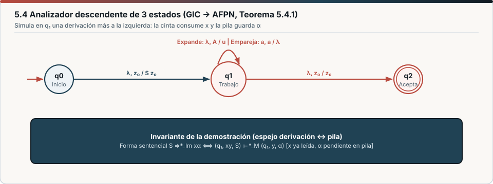

<!-- _class: lead -->

Tema 5.4

# 5.4 Aceptadores "pushdown" para lenguajes independientes del contexto

### Análisis sintáctico y construcción de un AFPN equivalente a cualquier GIC

Unidad 5: Autómatas Pushdown · Primer Semestre

---

# 5.4.1 Análisis de sintaxis (*parsing*)

El analizador sintáctico verifica si los *tokens* $w \in \Sigma^*$ pertenecen a $L(G)$. Dos paradigmas:

| Criterio | Descendente (*Top-Down*) | Ascendente (*Bottom-Up*) |
| :--- | :--- | :--- |
| **Construcción del árbol** | De la raíz $S$ a las hojas $w$ | De las hojas $w$ a la raíz $S$ |
| **Derivación simulada** | Más a la izquierda ($\Rightarrow_{lm}$) | Más a la derecha invertida ($\Rightarrow_{rm}$) |
| **Acciones sobre pila** | **Expandir** ($A \to u$) y **emparejar** ($a$) | **Desplazar** (*shift*) y **reducir** (*reduce*) |
| **En Compiladores** | Familias tipo LL | Familias tipo LR / SLR / LALR |

---

# Esquema visual: 5.4 Aceptadores "pushdown" para lenguajes independientes del contexto

---

<!-- _class: invert -->
# 5.4.2 Teorema 5.4.1: De cualquier GIC a un AFPN de 3 estados

> **Teorema (De Castro Korgi, 2004, p. 157):** Dada una GIC $G = (V, \Sigma, P, S)$, existe un AFPN $M = (\{q_0, q_1, q_2\}, q_0, \{q_2\}, \Sigma, \Sigma \cup V \cup \{z_0\}, z_0, \Delta)$ tal que $L(M) = L(G)$.

1. **Inicialización:** $\Delta(q_0, \lambda, z_0) = \{(q_1, S z_0)\}$ (coloca $S$ en el tope).
2. **Expansión ($\lambda$-transición):** para cada variable $A \in V$:
   $$\Delta(q_1, \lambda, A) = \{(q_1, u) : (A \to u) \in P\}.$$
3. **Emparejamiento:** para cada terminal $a \in \Sigma$, $\;\Delta(q_1, a, a) = \{(q_1, \lambda)\}$.
4. **Aceptación:** $\Delta(q_1, \lambda, z_0) = \{(q_2, z_0)\}$ (pila libre hasta el fondo $z_0$).

---

<!-- _class: invert -->
# 5.4.3 Idea intuitiva de la demostración ($L(M) = L(G)$)

> **Guía de lectura:** En una derivación más a la izquierda $S \Rightarrow_{lm}^* \gamma$, la cadena tiene un prefijo ya terminado $x \in \Sigma^*$ y un sufijo pendiente $\alpha$ (que comienza en una variable).

- El AFPN $M$ actúa como un **espejo exacto** en su estado de trabajo $q_1$:
  - La parte $x$ ya fue **consumida de la cinta** de entrada.
  - La parte pendiente $\alpha$ es **exactamente el contenido de la pila** (encima de $z_0$).
- Formalmente: $S \Rightarrow_{lm}^* w \iff (q_1, w, S) \vdash_M^* (q_1, \lambda, \lambda) \iff w \in L(M)$ (probado por inducción en los Lemas 1 y 2).

---

# Ejemplo 1: Analizador descendente completo (De Castro Korgi, p. 158)

Para $G$: $S \to aAbS \mid bBa \mid \lambda$, $\;A \to aA \mid a$, $\;B \to bB \mid b$, con $w = \texttt{aabbba}$:

| Paso | Estado | Entrada | Pila (tope izq.) | Acción |
| :---: | :---: | :--- | :--- | :--- |
| 0–1 | $q_0 \to q_1$ | `aabbba` | $Sz_0$ | Inicializa $S$ |
| 2 | $q_1$ | `aabbba` | $aAbSz_0$ | Expande $S \to aAbS$ |
| 3–4 | $q_1$ | `abbba` | $AbSz_0 \to abSz_0$ | Empareja `a`, expande $A \to a$ |
| 5–6 | $q_1$ | `bbba` $\to$ `bba` | $bSz_0 \to Sz_0$ | Empareja `a` y `b` |
| 7–11 | $q_1$ | `bba` $\to \lambda$ | $bBaz_0 \to \dots \to z_0$ | Expande $S \to bBa$, $B \to b$, empareja |
| 12 | $q_2 \in F$ | $\lambda$ | $z_0$ | **Acepta** por $\Delta(q_1, \lambda, z_0)$ |

---

# Ejemplo 2: Paréntesis balanceados $S \to (S)S \mid \lambda$

Para $w = \texttt{(())}$ (De Castro Korgi, p. 86):
- Inicializa: $(q_1, \texttt{(())}, Sz_0)$.
- Expande $S \to (S)S$: $(q_1, \texttt{(())}, \texttt{(}S\texttt{)}Sz_0) \vdash (q_1, \texttt{())}, S\texttt{)}Sz_0)$.
- Expande $S \to (S)S$ y empareja `(`: $(q_1, \texttt{))}, S\texttt{)}S\texttt{)}Sz_0)$.
- Aplica $S \to \lambda$, empareja `)`, aplica $S \to \lambda$, empareja `)`, aplica $S \to \lambda$: queda $(q_1, \lambda, z_0) \vdash (q_2, \lambda, z_0)$ (**Acepta**).
- Con `(()`, faltará un `)` en la entrada cuando la pila aún tenga `)S z_0` $\implies$ **Rechaza**.

---

<!-- _class: invert -->
# Ejercicios propuestos

1. Construye el AFPN de 3 estados para $S \to Aba \mid AB \mid \lambda,\; A \to aAS \mid a,\; B \to bBA \mid \lambda$ y haz la tabla de traza completa para `aaababa`.
2. Modifica el AFPN del Ejemplo 1 para que use un solo estado $q_1$ y acepte **por pila vacía** iniciando en $(q_1, w, S)$, y traza `bbaa`.
3. Muestra qué ocurre en $S \to aS \mid Sa \mid b$ sobre `aba`: exhibe una rama que acepta y una rama que cicla en un bucle-$\lambda$ por culpa de $S \to Sa$.

---

# Referencias

- Acevedo Juárez, A. (2006). *Teoría de la computación* [Tesis de licenciatura, Instituto Tecnológico de Celaya]. (pp. 113–117).
- De Castro Korgi, R. (2004). *Teoría de la computación: Lenguajes, autómatas, gramáticas*. Universidad Nacional de Colombia. (Secc. 5.4, pp. 157–159).
- Hopcroft, J. E., Motwani, R., & Ullman, J. D. (2007). (Cap. 6, pp. 215–218).
