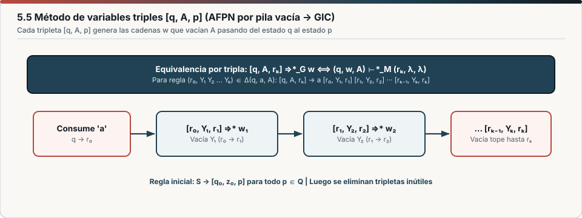

<!-- _class: lead -->

Tema 5.5

# 5.5 Gramáticas independientes al contexto para aceptadores "pushdown"

### Construcción inversa mediante variables triples $[q, A, p]$ y equivalencia total

Unidad 5: Autómatas Pushdown · Primer Semestre

---

# Completando la equivalencia $\text{LIC} = \mathcal{L}(\text{AFPN})$

- En 5.4 probamos $\text{LIC} \subseteq \mathcal{L}(\text{AFPN})$.
- Ahora probamos la dirección inversa ($\mathcal{L}(\text{AFPN}) \subseteq \text{LIC}$): dado cualquier AFPN que acepta **por pila vacía** $N(M)$ (equivalente a aceptar por estado final), construiremos una GIC $G$ tal que $L(G) = N(M)$.

---

# Esquema visual: 5.5 Gramáticas independientes al contexto para aceptadores "pushdown"

---

<!-- _class: invert -->
# Construcción de $G$ mediante variables triples $[q, A, p]$

> **Significado de $[q, A, p]$ (De Castro Korgi, 2004, Teorema 5.5.1, p. 160):**  
> Genera todas las cadenas $w \in \Sigma^*$ que llevan a $M$ del estado $q$ al estado $p$ **vaciando por completo el símbolo $A$** del tope de la pila:
> $$[q, A, p] \Rightarrow_G^* w \iff (q, w, A) \vdash_M^* (p, \lambda, \lambda).$$

1. **Regla inicial:** para cada $p \in Q$, agregar $S \to [q_0, z_0, p]$.
2. **Desapilar directo ($k = 0$):** si $(p, \lambda) \in \Delta(q, a, A)$, agregar $[q, A, p] \to a$.
3. **Sustituir tope por $Y_1 \cdots Y_k$ ($k \ge 1$):** si $(r_0, Y_1 \cdots Y_k) \in \Delta(q, a, A)$, para todas las secuencias $(r_1, \dots, r_k) \in Q^k$:
   $$[q, A, r_k] \to a\,[r_0, Y_1, r_1]\,[r_1, Y_2, r_2]\,\cdots\,[r_{k-1}, Y_k, r_k].$$

---

# Idea intuitiva de la demostración ($L(G) = N(M)$)

- Si al reemplazar $A$ el autómata apila $Y_1 Y_2$, primero deberá leer un trozo $w_1$ para vaciar $Y_1$ (pasando de $r_0$ a cierto estado $r_1$) y luego leer $w_2$ para vaciar $Y_2$ (pasando de $r_1$ a $r_2 = p$).
- La regla de tripletas $[q, A, p] \to a[r_0, Y_1, r_1][r_1, Y_2, p]$ divide exactamente ese trabajo en sub-problemas independientes.
- Por inducción fuerte sobre los pasos $n \ge 1$, se cumple $(q, w, X) \vdash_M^+ (p, \lambda, \lambda) \iff [q, X, p] \Rightarrow_G^+ w$, concluyendo **$L(G) = N(M)$**.

---

# Ejemplo 1: AFPN para $|w|_a = |w|_b$ (De Castro Korgi, pp. 162–164)

AFPN por pila vacía ($Q = \{q_0, q_1\}$, $\Gamma = \{z_0, A, B\}$):
- $(q_0, Az_0) \in \Delta(q_0, a, z_0)$, $\;(q_0, Bz_0) \in \Delta(q_0, b, z_0)$
- $(q_0, AA) \in \Delta(q_0, a, A)$, $\;(q_0, BB) \in \Delta(q_0, b, B)$
- $(q_0, \lambda) \in \Delta(q_0, a, B) \cap \Delta(q_0, b, A)$, $\;(q_1, \lambda) \in \Delta(q_0, \lambda, z_0)$.

1. **Variables:** $S$ más $2^2 \cdot 3 = 12$ tripletas $[q, X, p]$.
2. **Depuración:** como $q_1$ no tiene salidas, $[q_1, X, q]$ es no terminable. Solo sobreviven $S$, $[q_0, z_0, q_1]$, $[q_0, A, q_0]$ y $[q_0, B, q_0]$.
3. **Gramática simplificada ($D=[q_0,A,q_0]$, $E=[q_0,B,q_0]$):**
   $$S \to aDS \mid bES \mid \lambda, \qquad D \to aDD \mid b, \qquad E \to bEE \mid a.$$

---

# Ejemplo 2: AFPN para $\{a^n b^n : n \ge 1\}$

Transiciones: $(q_0, Az_0) \in \Delta(q_0, a, z_0)$, $(q_0, AA) \in \Delta(q_0, a, A)$, $(q_1, \lambda) \in \Delta(q_0, b, A) \cap \Delta(q_1, b, A) \cap \Delta(q_1, \lambda, z_0)$:

- **Reglas tras eliminar variables inútiles** ($[q_1, A, q_0], [q_1, z_0, q_0], [q_0, A, q_0], [q_0, z_0, q_0]$):
  - $S \to [q_0, z_0, q_1]$
  - $[q_0, z_0, q_1] \to a\,[q_0, A, q_1]\,[q_1, z_0, q_1]$
  - $[q_0, A, q_1] \to a\,[q_0, A, q_1]\,[q_1, A, q_1] \mid b$
  - $[q_1, A, q_1] \to b$, $\quad [q_1, z_0, q_1] \to \lambda$.
- Renombrando $X = [q_0, A, q_1]$ y sustituyendo: $S \to aX$, $\;X \to aXb \mid b$.

---

<!-- _class: invert -->
# Ejercicios propuestos

1. Para el AFPN y la gramática de tripletas del Ejemplo 1, traza la cadena `baabbbaa` en el autómata y su derivación $\Rightarrow_{lm}$ paso a paso.
2. Aplica el Teorema 5.5.1 al AFPN del Ejercicio 3 de las notas (palíndromos $\{wcw^R\}$) y elimina las variables inútiles.
3. **Pregunta conceptual:** ¿Por qué es indispensable que el AFPN acepte **por pila vacía** y no por estado final al aplicar el método de variables triples?

---

# Referencias

- De Castro Korgi, R. (2004). *Teoría de la computación: Lenguajes, autómatas, gramáticas*. Universidad Nacional de Colombia. (Secc. 5.5, pp. 160–165).
- Hopcroft, J. E., Motwani, R., & Ullman, J. D. (2007). (Cap. 6, pp. 218–222).
- Sipser, M. (2012). *Introduction to the theory of computation* (3.ª ed.). Cengage Learning.
