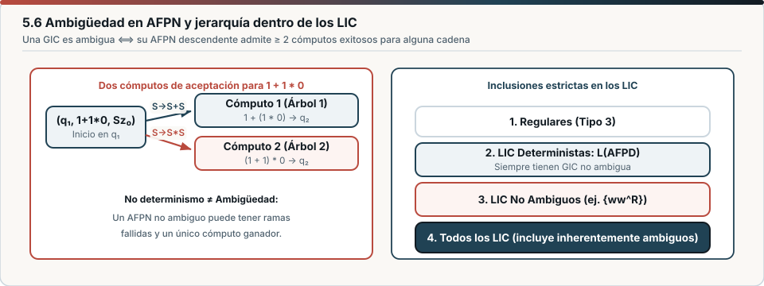

<!-- _class: lead -->

Tema 5.6

# 5.6 Ambigüedad en autómatas pushdown

### Múltiples cómputos de aceptación, determinismo y conflictos sintácticos

Unidad 5: Autómatas Pushdown · Primer Semestre

---

<!-- _class: invert -->
# Correspondencia operacional de la ambigüedad

> En el AFPN descendente $M_G$ construido desde una GIC $G$ (Secc. 5.4.2), existe una correspondencia uno a uno entre **derivaciones $\Rightarrow_{lm}^*$** y **cómputos exitosos**:
> $$G \text{ es ambigua} \iff M_G \text{ admite al menos dos cómputos de aceptación distintos para alguna } w \in L(G).$$

- Cada elección de una regla $A \to u$ equivale a elegir $(q_1, u) \in \Delta(q_1, \lambda, A)$ en la pila.

---

# Esquema visual: 5.6 Ambigüedad en autómatas pushdown

---

# Determinismo vs. no determinismo vs. ambigüedad

- **No determinismo $\neq$ ambigüedad:** un AFPN puede explorar varias ramas y aun así aceptar cada cadena por **a lo sumo un camino exitoso** (si las demás ramas fallan).
- **Teorema (Determinismo $\implies$ no ambigüedad):** todo lenguaje aceptado por un **AFPD** posee al menos una GIC **no ambigua**.
- **El recíproco es falso:** $L_{\text{pal}} = \{w w^R : w \in \{a, b\}^*\}$ tiene GIC no ambigua ($S \to aSa \mid bSb \mid \lambda$), pero **$L_{\text{pal}} \notin \mathcal{L}(\text{AFPD})$**.

$$\mathcal{L}(\text{Regulares}) \subsetneq \mathcal{L}(\text{AFPD}) \subsetneq \text{LIC No Ambiguos} \subsetneq \mathcal{L}(\text{AFPN})$$

---

# Conflictos en analizadores deterministas

Cuando se intenta construir un AFPD de una sola pasada para una gramática ambigua surgen conflictos:

1. **En análisis descendente (tipo LL):**
   - **Conflicto de predicción:** dos reglas $A \to u_1$ y $A \to u_2$ compiten ante el mismo símbolo de entrada (por ambigüedad, factores comunes o recursividad izquierda).
2. **En análisis ascendente (*shift-reduce*):**
   - **Desplazamiento–reducción (*shift/reduce*):** duda entre seguir leyendo/apilando o reducir el tope (p. ej., *dangling else*).
   - **Reducción–reducción (*reduce/reduce*):** dos reglas compiten por reducir el mismo tope.

---

# Lenguajes inherentemente ambiguos e indecidibilidad

- **Inherentemente ambiguo:** toda GIC que lo genera es ambigua (y ningún AFPD lo acepta), como:
  $$L = \{a^i b^i c^j d^j : i, j \ge 1\} \cup \{a^i b^j c^j d^i : i, j \ge 1\}.$$
- **Resultados negativos (indecidibles):** no existe ningún algoritmo general que decida si una GIC arbitraria es ambigua, si un LIC es inherentemente ambiguo, o si un AFPN admite versión determinista (De Castro Korgi, 2004, pp. 93, 140).

---

# Ejemplo: Duplicación de cómputos en $M_G$ para $1 + 1 * 0$

En $S \to S + S \mid S * S \mid (S) \mid 0S \mid 1S \mid 0 \mid 1$, $\Delta(q_1, \lambda, S)$ contiene $(q_1, S+S)$ y $(q_1, S*S)$:
- **Cómputo 1 (Árbol $1 + (1 * 0)$):** $(q_1, 1+1*0, Sz_0) \vdash (q_1, 1+1*0, \mathbf{S+S}z_0) \vdash^* (q_2, \lambda, z_0)$.
- **Cómputo 2 (Árbol $(1 + 1) * 0$):** $(q_1, 1+1*0, Sz_0) \vdash (q_1, 1+1*0, \mathbf{S*S}z_0) \vdash^* (q_2, \lambda, z_0)$.
- **Solución:** estratificar niveles $E \to E + T \mid T,\; T \to T * F \mid F,\; F \to (E) \mid N$ para lograr un análisis determinista único.

---

<!-- _class: invert -->
# Ejercicios propuestos

1. Para $S \to aSbS \mid bSaS \mid \lambda$, construye su AFPN descendente $M_G$ y exhibe **dos cómputos de aceptación distintos** para $w = abab$.
2. Clasifica en la menor clase posible ($\mathcal{L}_3$, $\mathcal{L}(\text{AFPD})$, LIC no ambiguo o inherentemente ambiguo):
   - $\{a^n b^n : n \ge 0\}$, $\;\{w \in \{a,b\}^* : w=w^R\}$, $\;L_{\text{inherente}}$, $\;(a \cup b)^* ab$.
3. Reescribe $E \to E - E \mid \mathbf{id}$ para que la resta asocie por la izquierda sin conflictos.

---

# Referencias

- Acevedo Juárez, A. (2006). *Teoría de la computación* [Tesis de licenciatura, Instituto Tecnológico de Celaya].
- De Castro Korgi, R. (2004). *Teoría de la computación: Lenguajes, autómatas, gramáticas*. Universidad Nacional de Colombia. (Secc. 4.4, 4.15, Cap. 5, pp. 91–94, 140, 149–165).
- Hopcroft, J. E., Motwani, R., & Ullman, J. D. (2007).
