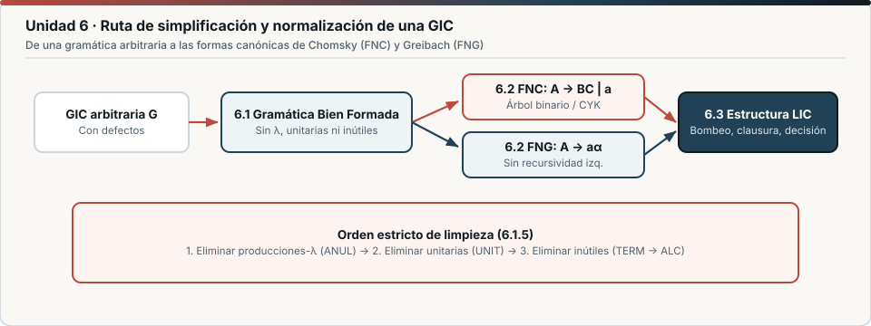

<!-- _class: lead -->

Unidad 6 · 18 horas

# Unidad 6: Lenguajes Independientes del Contexto

### Simplificación de gramáticas, formas canónicas y límites estructurales de los LIC

**Universidad Vasco de Quiroga (UVAQ)**  
Ingeniería en Sistemas y Seguridad Informática · Primer Semestre

---

# Propósito y competencia de la unidad

- **Competencia a desarrollar:** Estudiar las diferentes formas y estructuras de las gramáticas independientes al contexto para desarrollar gramáticas eficientes.
- **Motivación:** Una GIC escrita de forma intuitiva suele tener símbolos muertos, reglas-$\lambda$ y reglas unitarias. Al limpiarla y llevarla a formas canónicas habilitamos algoritmos eficientes (como **CYK**) y demostramos qué lenguajes escapan a las GIC.

---

# Esquema visual: Unidad 6: Lenguajes Independientes del Contexto

---

<!-- _class: invert -->
# Flujo de simplificación y normalización

> De una GIC arbitraria a sus dos formas normales estándar:

1. **6.1 Transformaciones elementales (Gramática Bien Formada):**  
   $$\text{1. Quitar }\lambda \;\longrightarrow\; \text{2. Quitar unitarias } (A \to B) \;\longrightarrow\; \text{3. Quitar inútiles } (TERM \to ALC)$$
2. **6.2 Formas canónicas:**  
   - **Forma Normal de Chomsky (FNC):** $A \to BC \mid a$ (árboles binarios, algoritmo **CYK**).
   - **Forma Normal de Greibach (FNG):** $A \to a\alpha$ (eliminación de recursividad izquierda).
3. **6.3 Estructura de los LIC:** Lema de bombeo, propiedades de clausura y decidibilidad.

---

# Mapa de subtemas

| Subtema | Temas clave | Herramientas principales |
| :--- | :--- | :--- |
| **6.1** | Equivalencia, sustitución, limpieza | Conjuntos $ANUL$, $UNIT$, $TERM$, $ALC$ |
| **6.2** | Formas normales | FNC ($2|w|-1$ pasos, CYK) y FNG ($|w|$ pasos) |
| **6.3** | Estructura de los LIC | Lema de bombeo ($z = uvwxy$), clausura y decidibilidad |

---

<!-- _class: invert -->
# Idea clave para recordar

> Toda GIC puede limpiarse y transformarse en **FNC** o **FNG** sin cambiar su lenguaje (salvo eventualmente $\lambda$). Gracias a ello podemos decidir si $w \in L(G)$ en tiempo polinomial y demostrar con el **Lema de bombeo** qué lenguajes como $\{a^n b^n c^n\}$ **no** son independientes del contexto.

---

# Referencias bibliográficas

- Acevedo Juárez, A. (2006). *Teoría de la computación* [Tesis de licenciatura, Instituto Tecnológico de Celaya].
- De Castro Korgi, R. (2004). *Teoría de la computación: Lenguajes, autómatas, gramáticas*. Universidad Nacional de Colombia. (Cap. 4).
