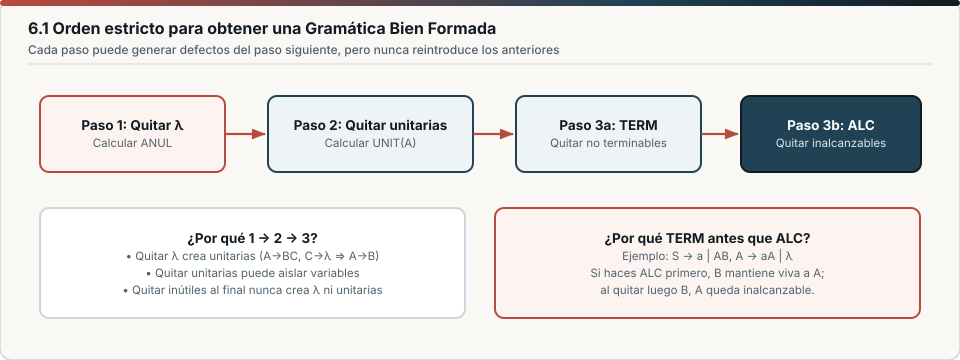

<!-- _class: lead -->

Tema 6.1

# 6.1 Transformaciones elementales de gramáticas

### Equivalencia, sustitución, eliminación de defectos y gramáticas bien formadas

Unidad 6: Lenguajes Independientes del Contexto · Primer Semestre

---

# 6.1.1 Equivalencia de gramáticas

- **Equivalencia estricta ($G_1 \equiv G_2$):** generan exactamente el mismo lenguaje:
  $$L(G_1) = L(G_2).$$
- **Equivalencia salvo $\lambda$:** coinciden en todas las cadenas no vacías:
  $$L(G_1) - \{\lambda\} = L(G_2) - \{\lambda\}.$$
  *(Útil al eliminar reglas-$\lambda$: si $\lambda \in L(G)$, basta agregar $S' \to S \mid \lambda$ al final).*

---

# Esquema visual: 6.1 Transformaciones elementales de gramáticas

---

# 6.1.2 Substitución, expansión y factorización izquierda

1. **Substitución (De Castro Korgi, Lema 4.12.3):** en $A \to \alpha B \beta$, reemplazar $B$ por todas sus producciones $B \to \gamma_1 \mid \dots \mid \gamma_r$ conserva $L(G)$.
2. **Expansión (inversa):** sustituir un fragmento $\delta$ en $A \to \alpha \delta \beta$ por una nueva variable $X \to \delta$ ($A \to \alpha X \beta$).
3. **Factorización por la izquierda:** agrupar un prefijo común $\alpha$ en $A \to \alpha\beta_1 \mid \alpha\beta_2$ como $A \to \alpha A',\; A' \to \beta_1 \mid \beta_2$ (evita dudas en analizadores descendentes).

---

# 6.1.3 Eliminación de producciones inútiles ($TERM \to ALC$)

Un símbolo es **útil** si aparece en alguna derivación $S \Rightarrow^* uXv \Rightarrow^* w \in \Sigma^*$.
1. **Variables terminables ($TERM$):** derivan alguna cadena en $\Sigma^*$.
   - Base: $A \to w \in \Sigma^*$. Iterar agregando $A$ si $A \to w \in (\Sigma \cup TERM_i)^*$.
2. **Variables alcanzables ($ALC$):** alcanzables desde $S$.
   - Base: $S \in ALC_1$. Iterar agregando símbolos alcanzables desde $ALC_i$.

> **¡El orden importa!** Siempre calcular **primero $TERM$ y después $ALC$**: si se hace al revés, eliminar una variable no terminable puede dejar otras desconectadas e inalcanzables.

---

# 6.1.4 Reemplazo de producciones-$\lambda$ y unitarias

### 1. Eliminar reglas-$\lambda$ ($ANUL$)
- $ANUL = \{A \in V : A \Rightarrow^* \lambda\}$.
- Para cada regla $A \to X_1 \cdots X_m$, incluir todas las combinaciones que mantienen o borran símbolos anulables (descartando el cuerpo vacío $\lambda$).
- Quitar $A \to \lambda$ (salvo $S \to \lambda$ si $\lambda \in L(G)$).

### 2. Eliminar unitarias ($A \to B$)
- $UNIT(A) = \{X \in V : A \Rightarrow_{\text{unit}}^* X\}$.
- Para cada $B \in UNIT(A)$ y cada producción **no unitaria** $B \to \alpha$, añadir $A \to \alpha$.
- Quitar todas las reglas $A \to B$.

---

<!-- _class: invert -->
# 6.1.5 Gramática bien formada y orden estricto

> Una GIC es **bien formada** (propia) si **no tiene símbolos inútiles, ni producciones-$\lambda$ (salvo $S \to \lambda$ con $S$ no recursiva), ni producciones unitarias**. Además queda **libre de ciclos** $A \Rightarrow^+ A$.

**Orden estricto en una sola pasada:**
$$\text{1. Eliminar }\lambda \;\longrightarrow\; \text{2. Eliminar unitarias} \;\longrightarrow\; \text{3. Eliminar inútiles } (TERM \to ALC)$$

*(Eliminar $\lambda$ puede crear unitarias, pero eliminar unitarias no crea $\lambda$ ni rompe la limpieza posterior de $TERM \to ALC$).*

---

# Ejemplo integrador paso a paso

Sea $G$: $S \to AB \mid a$, $\;A \to BC \mid B$, $\;B \to bB \mid C \mid \lambda$, $\;C \to c \mid F \mid D$, $\;D \to dD$, $\;E \to aS$, $\;F \to f$:
1. **Eliminar $\lambda$:** $ANUL = \{B, A, S\}$. En $G_1$ surgen nuevas unitarias ($S \to A, S \to B, A \to C$).
2. **Eliminar unitarias:** $UNIT(S) = \{S, A, B, C, D, F\}$, etc. Tras copiar reglas no unitarias, **$F$ queda inalcanzable**.
3. **Eliminar inútiles ($TERM \to ALC$):**
   - $TERM$: se elimina $D$ (solo $D \to dD$).
   - $ALC$: se eliminan $E$ y $F$.
   - **Resultado final ($G_4$):** $S \to AB \mid BC \mid bB \mid a \mid b \mid c \mid f \mid \lambda$, etc. (sin defectos).

---

<!-- _class: invert -->
# Ejercicios propuestos

1. Aplica factorización izquierda a $E \to \text{id} \mid \text{id}(L) \mid \text{id}[E] \mid (E)$.
2. Comprueba qué pasa si inviertes el orden ($ALC \to TERM$) en $S \to a \mid AB,\; A \to aA \mid \lambda$.
3. Transforma a **gramática bien formada** siguiendo el orden estricto:
   $S \to BCB \mid D$, $\;A \to aA \mid ab$, $\;B \to bBa \mid A \mid DC$, $\;C \to aCb \mid D \mid b$, $\;D \to aB \mid \lambda$, $\;E \to cE \mid a$.

---

# Referencias

- Acevedo Juárez, A. (2006). *Teoría de la computación* [Tesis de licenciatura, Instituto Tecnológico de Celaya]. (pp. 101–106).
- De Castro Korgi, R. (2004). *Teoría de la computación: Lenguajes, autómatas, gramáticas*. Universidad Nacional de Colombia. (Secc. 4.8–4.10, 4.12, pp. 102–113, 120).
