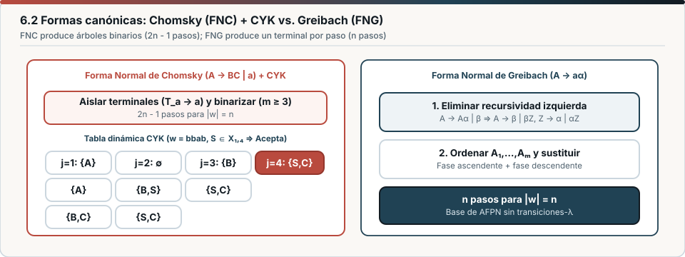

<!-- _class: lead -->

Tema 6.2

# 6.2 Formas canónicas de gramáticas

### Forma Normal de Chomsky (FNC), algoritmo CYK y Forma Normal de Greibach (FNG)

Unidad 6: Lenguajes Independientes del Contexto · Primer Semestre

---

<!-- _class: invert -->
# 6.2.1 Forma Normal de Chomsky (FNC)

> Toda GIC es equivalente (salvo $\lambda$) a una gramática en **FNC** (De Castro Korgi, 2004, p. 113), donde no hay símbolos inútiles, unitarias ni reglas-$\lambda$ (salvo opcionalmente $S \to \lambda$) y toda regla es:
> $$A \longrightarrow BC \quad (B, C \in V) \qquad \text{o} \qquad A \longrightarrow a \quad (a \in \Sigma).$$

**Conversión en 4 pasos (desde gramática bien formada):**
1. *(Opcional)* Separar $S' \to S$ para que $S'$ sea no recursiva.
2. **Aislar terminales** en cuerpos de longitud $\ge 2$: crear $T_a \to a$.
3. **Binarizar** cuerpos de longitud $m \ge 3$ ($A \to B_1 B_2 \cdots B_m$) con auxiliares $Z_1, \dots, Z_{m-2}$.

---

# Esquema visual: 6.2 Formas canónicas de gramáticas

---

# Propiedad de FNC y el algoritmo CYK

- **Teorema de longitud:** en FNC, toda derivación de una cadena de longitud $n \ge 1$ toma **exactamente $2n - 1$ pasos** (árbol binario).
- **Algoritmo CYK (Cocke–Younger–Kasami):** decide si $w = a_1 \cdots a_n \in L(G)$ llenando una tabla de abajo hacia arriba (**programación dinámica**) en tiempo $O(n^3 \cdot |P|)$:
  - **Base ($j = 1$):** $X_{i,1} = \{A \in V : (A \to a_i) \in P\}$.
  - **Paso ($j \ge 2$):** $A \in X_{i,j}$ si existe $A \to BC$ y un corte $k$ tal que $B \in X_{i,k}$ y $C \in X_{i+k,\, j-k}$.
  - **Decisión:** $w \in L(G) \iff S \in X_{1,n}$.

---

# Ejemplo de tabla CYK para $w = \texttt{bbab}$

Gramática en FNC: $S \to BA \mid AC,\; A \to CC \mid b,\; B \to AB \mid a,\; C \to BA \mid a$ (De Castro Korgi, p. 137):

| Posición $i$ | Símbolo | $j = 1$ | $j = 2$ | $j = 3$ | $j = 4$ |
| :---: | :---: | :---: | :---: | :---: | :---: |
| $1$ | `b` | $\{A\}$ | $\emptyset$ | $\{B\}$ | **$\{S, C\}$** |
| $2$ | `b` | $\{A\}$ | $\{B, S\}$ | $\{S, C\}$ | — |
| $3$ | `a` | $\{B, C\}$ | $\{S, C\}$ | — | — |
| $4$ | `b` | $\{A\}$ | — | — | — |

Como $S \in X_{1,4}$, la cadena **`bbab` pertenece a $L(G)$** (en $2(4)-1 = 7$ pasos).

---

<!-- _class: invert -->
# 6.2.2 Forma Normal de Greibach (FNG)

> Una GIC (bien formada) está en **Forma Normal de Greibach (FNG)** si toda producción (salvo $S \to \lambda$) tiene la forma:
> $$A \longrightarrow a\alpha \qquad (a \in \Sigma,\; \alpha \in V^*).$$

- Cada regla genera exactamente **un terminal al frente**, por lo que toda cadena de longitud $n \ge 1$ se deriva en **exactamente $n$ pasos**.
- Permite construir un **AFPN sin transiciones-$\lambda$** (terminación garantizada).

---

# Eliminación de recursividad izquierda y conversión a FNG

Para convertir de FNC a FNG (De Castro Korgi, 2004, Teoremas 4.12.2 y 4.12.4):
1. **Eliminar recursividad izquierda directa ($A \to A\alpha_i \mid \beta_j$):** introducir $Z \notin V$:
   $$A \to \beta_j \mid \beta_j Z, \qquad Z \to \alpha_i \mid \alpha_i Z.$$
2. **Ordenar variables** $A_1, \dots, A_m$.
3. **Fase ascendente ($i=1 \dots m$):** sustituir reglas $A_i \to A_j \gamma$ ($j < i$) hasta que toda regla inicie con terminal o $A_k$ ($k > i$), eliminando recursividad directa con $Z_i$.
4. **Fase descendente ($i=m \dots 1$)** y normalización de las auxiliares $Z_i$.

---

# Ejemplo de conversión directa a FNG

Convertir $G: S \to AA \mid a,\; A \to AA \mid b$ (De Castro Korgi, p. 122):
1. **Orden:** $A_1 = S,\; A_2 = A$.
2. **Ascendente:** $S \to AA \mid a$ ya inicia con $A_2$ ($2 > 1$). Para $A \to AA \mid b$ eliminamos recursividad izquierda ($\alpha = A, \beta = b$):
   $$A \to b \mid bZ, \qquad Z \to A \mid AZ.$$
3. **Descendente:** sustituimos la primera $A$ en $S \to AA \implies S \to bA \mid bZA \mid a$.
4. **Normalizar $Z$:** sustituimos la $A$ inicial $\implies Z \to b \mid bZ \mid bZZ$.

---

<!-- _class: invert -->
# Ejercicios propuestos

1. Convierte a **FNC** la gramática: $S \to ABC \mid BaC \mid aB$, $\;A \to Aa \mid a$, $\;B \to BAB \mid bab$, $\;C \to cC \mid c$.
2. Usa la tabla del algoritmo **CYK** con $S \to BA \mid AB,\; A \to CA \mid a,\; B \to BB \mid b,\; C \to BA \mid c$ para decidir si `bca` y `acbc` están en $L(G)$.
3. Elimina la recursividad izquierda de $S \to Aa \mid b,\; A \to Ac \mid Sd \mid a$.
4. Convierte $S \to CA \mid AC \mid a,\; A \to BA \mid AB \mid b,\; B \to AA \mid a \mid b,\; C \to AC \mid CC \mid a$ a **FNG**.

---

# Referencias

- Acevedo Juárez, A. (2006). *Teoría de la computación* [Tesis de licenciatura, Instituto Tecnológico de Celaya]. (Secc. 3.4–3.7, pp. 93–108).
- De Castro Korgi, R. (2004). *Teoría de la computación: Lenguajes, autómatas, gramáticas*. Universidad Nacional de Colombia. (Secc. 4.11–4.12, 4.15, pp. 113–126, 136–139).
