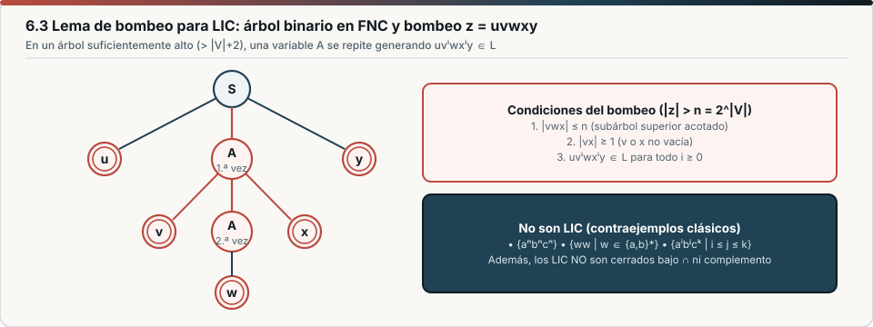

<!-- _class: lead -->

Tema 6.3

# 6.3 Estructura de los lenguajes independientes del contexto

### Lema de bombeo para LIC, propiedades de clausura y algoritmos de decisión

Unidad 6: Lenguajes Independientes del Contexto · Primer Semestre

---

<!-- _class: invert -->
# 6.3.1 Lema de bombeo para LIC (De Castro Korgi, p. 127)

> Sea $L$ un LIC. Existe una constante $n \ge 1$ ($n = 2^{|V|}$ en FNC) tal que toda cadena $z \in L$ con $|z| > n$ puede descomponerse en cinco partes $z = uvwxy$ cumpliendo:
> 1. $|vwx| \le n$
> 2. $v \neq \lambda$ o $x \neq \lambda$ ($|vx| \ge 1$)
> 3. $uv^i w x^i y \in L$ para todo $i \ge 0$.

*(Por el principio del palomar en un árbol binario de FNC de altura $> |V| + 2$, alguna variable $A$ se repite a lo largo de la trayectoria más larga, permitiendo repetir o suprimir el par $(v, x)$).*

---

# Esquema visual: 6.3 Estructura de los lenguajes independientes del contexto

---

# Ejemplo 1: $L_1 = \{a^m b^m c^m \mid m \ge 0\}$ no es LIC

1. Suponemos que $L_1$ es LIC con constante $n \ge 1$, y elegimos $z = a^n b^n c^n \in L_1$ ($|z| = 3n > n$).
2. En $z = uvwxy$, como $|vwx| \le n$, la subcadena **$vwx$ no puede contener $a$ y $c$ al mismo tiempo** (hay $n$ símbolos $b$ en medio).
3. **Caso 1:** $v$ o $x$ mezcla símbolos distintos $\implies$ $uv^2 w x^2 y$ rompe el orden $a^* b^* c^*$.
4. **Caso 2:** $v$ y $x$ son homogéneas $\implies$ con $i = 2$ crece la cuenta de al menos un símbolo, pero el símbolo ausente en $vwx$ se queda con $n$ apariciones $\implies uv^2 w x^2 y \notin L_1$.
5. Contradicción en ambos casos $\implies$ **$L_1$ no es LIC**.

---

# Ejemplo 2: $L_2 = \{ww \mid w \in \{a, b\}^*\}$ no es LIC

Elegimos $z = a^n b^n a^n b^n \in L_2$ ($|z| = 4n > n$):
- Como $|vwx| \le n$, existen 3 ubicaciones posibles para $vwx$:
  1. **Dentro de la primera mitad $a^n b^n$:** bombeando abajo ($i=0$), $uwy$ cambia la frontera central y desiguala las dos mitades (la segunda sigue terminando en $b$, la primera termina en $a$ si $|vx|$ es par).
  2. **Cruzando la frontera central ($b^n a^n$):** $uwy = a^n b^{n-r} a^{n-q} b^n$ con $r+q \ge 1$, imposible que las mitades coincidan.
  3. **Dentro de la segunda mitad:** simétrico al caso 1.
- Luego **$L_2$ no es LIC**.

---

# 6.3.2 Propiedades de clausura: Regulares vs. LIC

| Operación | Regulares ($\mathcal{L}_3$) | LIC ($\mathcal{L}_2$) |
| :--- | :---: | :---: |
| Unión ($L_1 \cup L_2$), Concatenación ($L_1 L_2$), Kleene ($L^*$) | Cerrado | **Cerrado** |
| Intersección con regular ($L \cap R$), Homomorfismo, Reflexión | Cerrado | **Cerrado** |
| **Intersección ($L_1 \cap L_2$)** | Cerrado | **NO cerrado** |
| **Complemento ($\overline{L}$) y Diferencia ($L_1 - L_2$)** | Cerrado | **NO cerrado** |

*Contraejemplo clave:* $L_1 = \{a^i b^i c^j\}$ y $L_2 = \{a^i b^j c^j\}$ son LIC, pero $L_1 \cap L_2 = \{a^i b^i c^i\}$ **no es LIC**.

---

<!-- _class: invert -->
# 6.3.3 Algoritmos de decisión: decidibles vs. indecidibles

| Problema | Regulares | LIC (GIC) | Cómo se resuelve en GIC |
| :--- | :---: | :---: | :--- |
| **Vacío ($L(G) = \emptyset$)** | Decidible | **Decidible** | Verificar si $S \in TERM$ |
| **Pertenencia ($w \in L(G)$)** | Decidible | **Decidible** | FNC + algoritmo CYK ($O(\lvert w \rvert^3)$) |
| **Finitud / Infinitud** | Decidible | **Decidible** | Ciclos en gramática bien formada (o rango $(2^k, 2^{k+1}]$) |
| **Universalidad ($L(G) = \Sigma^*$)** | Decidible | **Indecidible** | Ningún algoritmo funciona siempre |
| **Equivalencia ($L_1 = L_2$) e Inclusión** | Decidible | **Indecidible** | Ningún algoritmo funciona siempre |
| **Ambigüedad de $G$** | N/A | **Indecidible** | Ningún algoritmo funciona siempre |

---

<!-- _class: invert -->
# Ejercicios propuestos

1. Demuestra usando el Lema de bombeo para LIC que no son independientes del contexto:
   - (a) $\{a^i b^i c^j \mid j \ge i\}$ $\quad$ (b) $\{0^i 1^{2i} 0^i \mid i \ge 1\}$ $\quad$ (c) $\{a^i b^j c^i d^j \mid i, j \ge 0\}$
2. Usando únicamente **intersección con un lenguaje regular** y un resultado conocido, prueba en tres líneas que $\{w \in \{0,1,2\}^* \mid |w|_0 = |w|_1 = |w|_2\}$ no es LIC.
3. Dada una GIC $G$, diseña un algoritmo que decida si $L(G)$ contiene alguna cadena de longitud exactamente $m = 100$.

---

# Referencias

- Acevedo Juárez, A. (2006). *Teoría de la computación* [Tesis de licenciatura, Instituto Tecnológico de Celaya].
- De Castro Korgi, R. (2004). *Teoría de la computación: Lenguajes, autómatas, gramáticas*. Universidad Nacional de Colombia. (Secc. 4.13–4.15, pp. 127–140).
