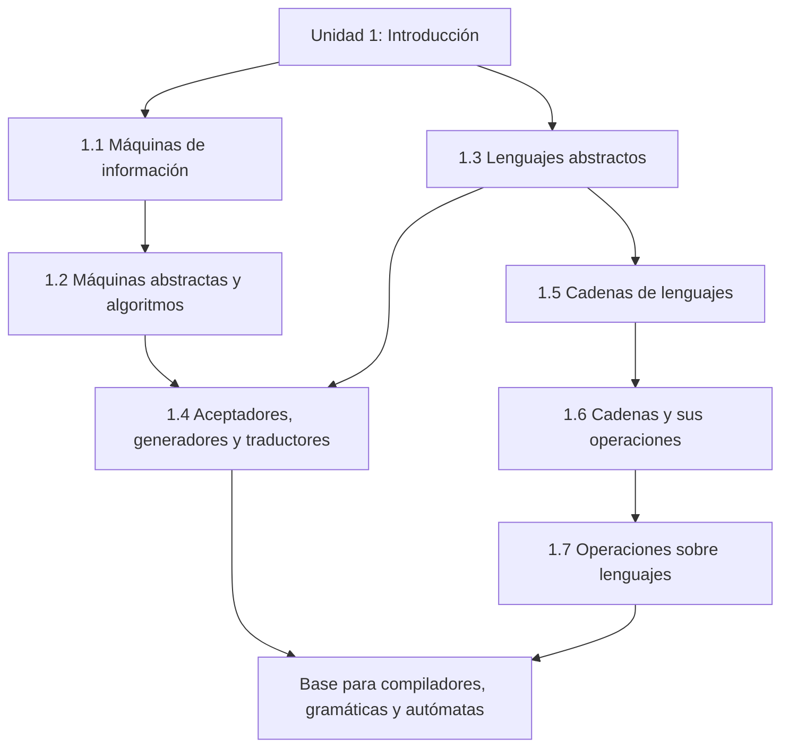
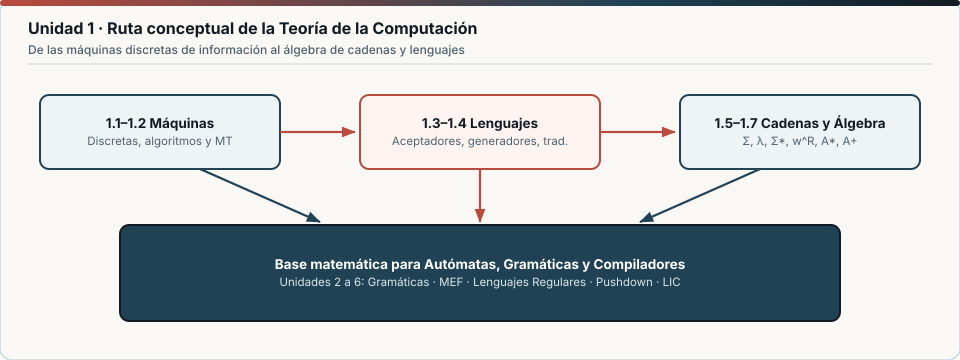

# Unidad 1: Introducción

La **Unidad 1: Introducción** establece los cimientos conceptuales y matemáticos de la asignatura *Teoría de la Computación* (`ISYSI0430`). Antes de construir autómatas finitos, gramáticas formales o analizadores para compiladores, es indispensable responder dos preguntas fundamentales: *¿qué es computar?* y *¿cómo se representan simbólicamente los lenguajes que procesa una máquina?*

En esta unidad se transita desde la noción intuitiva de **máquina de información** —un sistema capaz de recibir, almacenar, transformar y emitir símbolos discretos— hasta la formalización de las **máquinas abstractas** y los **algoritmos** mediante la Tesis de Church-Turing. A partir de este marco computacional, se introducen los **lenguajes abstractos** como subconjuntos de cadenas formadas sobre un alfabeto finito, diferenciando los roles operativos de los **aceptadores**, **generadores** y **traductores** (pilar directo del diseño de analizadores léxicos, sintácticos y compiladores). Finalmente, se construye el álgebra elemental de **cadenas** y **lenguajes** (concatenación, potencias, longitud, reflexión, subcadenas, clausura de Kleene y clausura positiva), herramientas formales que se utilizarán de manera transversal en las unidades 2 a 6.

- **Duración:** 3 horas
- **Competencia(s) a desarrollar:** Analiza los conceptos y notaciones de máquinas y lenguajes abstractos mediante su estudio y desarrollo de ejercicios como base para su diseño y construcción.

## Mapa conceptual de la unidad

## Subtemas

- [1.1 Máquinas de información](1-1-maquinas-de-informacion.md): Analiza la noción de información discreta, la codificación simbólica, la arquitectura funcional entrada–estado/procesamiento–salida y la distinción entre dispositivos físicos y modelos formales.
- [1.2 Máquinas abstractas y algoritmos](1-2-maquinas-abstractas-y-algoritmos.md): Define el concepto de máquina abstracta, algoritmo y procedimiento efectivo; contextualiza las aportaciones de Church y Turing (1936), enuncia la Tesis de Church-Turing y compara los modelos de autómatas finitos, autómatas con pila y máquinas de Turing.
- [1.3 Lenguajes abstractos](1-3-lenguajes-abstractos.md): Contrasta los lenguajes naturales, los lenguajes formales y los lenguajes de programación; distingue entre sintaxis y semántica, e introduce formalmente el alfabeto $\Sigma$ y el lenguaje formal $L \subseteq \Sigma^*$.
- [1.4 Aceptadores, generadores y traductores](1-4-aceptadores-generadores-y-traductores.md): Formaliza y compara los tres enfoques fundamentales para operar con lenguajes: reconocimiento ($f: \Sigma^* \to \{0,1\}$), generación (gramáticas y expresiones regulares) y traducción ($T: \Sigma^* \to \Delta^*$).
- [1.5 Cadenas de lenguajes](1-5-cadenas-de-lenguajes.md): Establece las definiciones de símbolo, alfabeto $\Sigma$, cadena $w$, cadena vacía $\lambda$, igualdad de cadenas, los universos $\Sigma^*$ y $\Sigma^+$, y la especificación de lenguajes mediante pertenencia $w \in L$.
- [1.6 Cadenas y sus operaciones](1-6-cadenas-y-sus-operaciones.md): Desarrolla formalmente la longitud $|w|$, la concatenación $uv$, la potencia $w^n$, la reflexión o inversa $w^R$, los palíndromos y las nociones de subcadena, prefijo y sufijo.
- [1.7 Operaciones sobre lenguajes](1-7-operaciones-sobre-lenguajes.md): Presenta las operaciones conjuntistas (unión, intersección, diferencia y complemento) y las operaciones lingüísticas sobre lenguajes (concatenación $AB$, potencia $A^n$, clausura de Kleene $A^*$, clausura positiva $A^+$ y reflexión $A^R$) junto con sus propiedades algebraicas.

## Referencias

- Acevedo Juárez, A. (2006). *Teoría de la computación* [Tesis de licenciatura, Instituto Tecnológico de Celaya]. (Unidad 1: Introducción, pp. 3–42).
- De Castro Korgi, R. (2004). *Teoría de la computación: Lenguajes, autómatas, gramáticas*. Universidad Nacional de Colombia. (Introducción: ¿Qué es la Teoría de la Computación?, pp. 3–4; Capítulo 1: Alfabetos, cadenas y lenguajes, Secc. 1.1–1.12, pp. 5–18).
