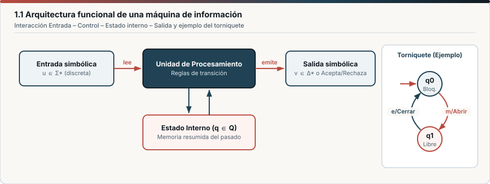
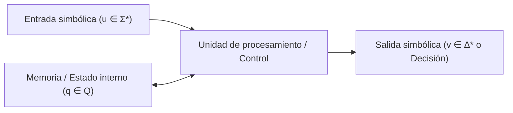

# 1.1 Máquinas de información

## Introducción y motivación

En ingeniería, las máquinas suelen clasificarse según el objeto principal que transforman: las máquinas de energía convierten una forma de energía en otra (como un motor eléctrico), las máquinas de materiales alteran la forma física de la materia (como un torno o una prensa) y las **máquinas de información** capturan, almacenan, procesan y emiten representaciones simbólicas de datos.

Un computador digital, un enrutador de red, un cajero automático y un **compilador** son todos máquinas de información. En particular, un traductor o compilador recibe una secuencia finita de caracteres escritos en un lenguaje fuente (código en C, Python o Java), mantiene información interna sobre símbolos declarados, tipos y contexto sintáctico, y produce como salida código objeto o mensajes de diagnóstico. Para estudiar estas herramientas con precisión matemática, la Teoría de la Computación abstrae el soporte físico (voltajes, transistores o discos magnéticos) y concibe todo cómputo como la **manipulación sistemática de secuencias finitas de símbolos** (De Castro Korgi, 2004, p. 5).

## Información discreta y representación simbólica

### Información continua frente a información discreta

- **Información continua (analógica):** Varía de manera ininterrumpida en un intervalo real; entre dos valores siempre existen infinitos valores intermedios (por ejemplo, el voltaje de un micrófono o la temperatura ambiente).
- **Información discreta:** Toma valores pertenecientes a un conjunto finito o numerable de estados claramente distinguibles entre sí, sin transiciones intermedias ambiguas (por ejemplo, los dígitos $\{0,1,\dots,9\}$, los niveles lógicos $\{0, 1\}$ o los caracteres del código ASCII).

### Principio de representación simbólica finita

Tal como señala De Castro Korgi (2004, p. 5), cualquier mecanismo real o teórico de cómputo está sujeto a dos restricciones esenciales derivadas de la percepción y procesamiento en tiempo finito:

1. **Conjunto finito de símbolos:** El repertorio de marcas elementales disponibles para codificar entradas, salidas y memoria interna debe ser finito. A este conjunto se le denomina **alfabeto** ($\Sigma$).
2. **Representaciones de longitud finita:** Todo dato o instrucción entregado a la máquina o producido por ella debe poder identificarse y leerse en una cantidad finita de pasos, por lo que se representa mediante secuencias finitas de símbolos.

En un computador moderno, toda información discreta —números enteros, texto fuente de un programa, instrucciones de máquina o imágenes digitales— se codifica en última instancia mediante símbolos del alfabeto binario $\Sigma = \{0, 1\}$, agrupados en palabras de longitud fija o variable.

## Estructura funcional: entrada, procesamiento/estado y salida

Una máquina de información opera mediante la interacción de tres elementos funcionales básicos:

1. **Entrada:** Secuencia discreta de símbolos provenientes del entorno y codificados sobre un alfabeto de entrada $\Sigma$.
2. **Procesamiento y estado interno:** Mecanismo o conjunto de reglas que determina cómo responde la máquina ante cada símbolo recibido. El **estado interno** ($q \in Q$) resume la historia relevante del procesamiento previo: aquello que la máquina "recuerda" en un instante dado.
3. **Salida:** Respuesta observable producida por la máquina sobre un alfabeto de salida $\Delta$, o bien una señal de aceptación/rechazo.

### Taxonomía básica de máquinas de información

Según el papel que desempeña la memoria interna y la naturaleza de sus transiciones, las máquinas de información discretas se clasifican en:

| Criterio | Categoría | Característica principal | Ejemplo |
| :--- | :--- | :--- | :--- |
| **Memoria interna** | **Combinacional (sin memoria)** | La salida depende únicamente de la entrada presente. | Compuerta lógica XOR, sumador binario puro. |
| **Memoria interna** | **Secuencial (con estado)** | La salida y el siguiente estado dependen de la entrada presente y del estado actual. | Cerradura electrónica, analizador léxico, CPU. |
| **Capacidad de almacenamiento** | **Memoria finita acotada** | El número de configuraciones de memoria posibles es finito ($|Q| < \infty$). | Autómata finito, semáforo programado. |
| **Capacidad de almacenamiento** | **Memoria auxiliar ilimitada** | Dispone de una estructura externa potencialmente infinita (pila o cinta). | Autómata con pila, Máquina de Turing. |
| **Previsibilidad** | **Determinista** | Ante cada estado y símbolo de entrada existe a lo sumo una transición posible. | Procesador secuencial clásico, AFD. |
| **Previsibilidad** | **No determinista** | Un estado y símbolo pueden habilitar múltiples caminos de evolución posibles. | Modelo teórico AFN, verificación formal. |

## Sistemas físicos frente a modelos formales

Un principio metodológico central de la Teoría de la Computación consiste en distinguir entre los dispositivos materiales construidos por la ingeniería y las abstracciones matemáticas que los modelan (De Castro Korgi, 2004, p. 3; Acevedo Juárez, 2006, p. 27):

| Aspecto | Sistema físico (real) | Modelo formal (abstracto) |
| :--- | :--- | :--- |
| **Soporte** | Circuitos electrónicos, memoria RAM, discos, reloj físico. | Entidades matemáticas: conjuntos, funciones, relaciones y grafos. |
| **Memoria** | Finita y estrictamente acotada por la capacidad física del hardware. | Puede modelarse como finita (AF) o potencialmente ilimitada (pila, cinta). |
| **Tiempo y fallas** | Sujeto a latencia, consumo eléctrico, ruido y desgaste físico. | Operación idealizada en pasos discretos sin fallas de hardware. |
| **Propósito** | Ejecutar software y resolver tareas prácticas en el mundo real. | Demostrar propiedades universales: qué problemas son resolubles, qué lenguajes son reconocibles y con qué recursos mínimos. |

La abstracción matemática permite garantizar, por ejemplo, que si un modelo formal demuestra que cierto problema sintáctico no puede resolverse sin memoria auxiliar de tipo pila, **ningún** dispositivo físico limitado a memoria constante podrá resolverlo para entradas de tamaño arbitrario, sin importar cuán veloz sea su procesador.

## Ejemplos desarrollados paso a paso

### Ejemplo 1: Modelado de un torniquete electrónico de acceso

Considérese un torniquete de metro que funciona con monedas o tarjetas válidas. Como **máquina de información discreta**, abstraemos los mecanismos metálicos y representamos su comportamiento simbólicamente:

- **Alfabeto de entrada:** $\Sigma = \{m, e\}$, donde $m$ representa "insertar moneda/tarjeta válida" y $e$ representa "empujar la barra".
- **Conjunto de estados internos:** $Q = \{q_0, q_1\}$, donde $q_0$ significa *Bloqueado* (estado inicial) y $q_1$ significa *Desbloqueado*.
- **Alfabeto de salida:** $\Delta = \{\text{Abrir}, \text{Cerrar}, \text{Alarma}, \text{Esperar}\}$.

| Estado actual | Entrada | Nuevo estado | Salida generada | Interpretación |
| :---: | :---: | :---: | :---: | :--- |
| $q_0$ (Bloqueado) | $m$ | $q_1$ | $\text{Abrir}$ | Se habilita el paso tras recibir pago. |
| $q_0$ (Bloqueado) | $e$ | $q_0$ | $\text{Alarma}$ | Intento de paso sin pago; permanece bloqueado. |
| $q_1$ (Desbloqueado) | $m$ | $q_1$ | $\text{Esperar}$ | Ya estaba abierto; mantiene estado desbloqueado. |
| $q_1$ (Desbloqueado) | $e$ | $q_0$ | $\text{Cerrar}$ | El usuario pasa y el torniquete vuelve a bloquearse. |

**Traza paso a paso** para la secuencia de entradas $u = emem$:
1. La máquina inicia en el estado $q_0$ (*Bloqueado*).
2. Lee el primer símbolo $e$: pasa a $q_0$ y emite $\text{Alarma}$.
3. Lee el segundo símbolo $m$: transita de $q_0$ a $q_1$ y emite $\text{Abrir}$.
4. Lee el tercer símbolo $e$: transita de $q_1$ a $q_0$ y emite $\text{Cerrar}$.
5. Lee el cuarto símbolo $m$: transita de $q_0$ a $q_1$ y emite $\text{Abrir}$.

Este ejemplo ilustra cómo un sistema físico mecánico-electrónico queda completamente descrito mediante símbolos discretos, estados y una función de entrada–estado–salida.

### Ejemplo 2: Un analizador léxico (*scanner*) como máquina de información

En la primera fase de un compilador, el analizador léxico lee carácter por carácter el código fuente y agrupa los caracteres en unidades significativas (*tokens*). Supóngase un analizador simplificado que distingue únicamente identificadores (que inician con letra) y números enteros (compuestos solo por dígitos), recibiendo como delimitador el espacio en blanco (`_`):

- **Alfabeto de entrada:** $\Sigma = \{L, D, \_\}$, donde $L$ denota cualquier letra (`a`–`z`), $D$ cualquier dígito (`0`–`9`) y `\_` el delimitador.
- **Estados internos:** $Q = \{q_0\text{ (Inicio)}, q_{\text{ID}}\text{ (Leyendo identificador)}, q_{\text{NUM}}\text{ (Leyendo número)}, q_{\text{ERR}}\text{ (Error léxico)}\}$.

**Procesamiento paso a paso** de la entrada codificada `x2_` (un identificador seguido de espacio):
1. Estado inicial $q_0$. Lee `x` (de tipo $L$): la máquina transita a $q_{\text{ID}}$ y almacena `'x'` en su búfer interno.
2. En $q_{\text{ID}}$, lee `2` (de tipo $D$): dado que un identificador admite dígitos después de la letra inicial, permanece en $q_{\text{ID}}$ y acumula `'2'` (búfer = `"x2"`).
3. En $q_{\text{ID}}$, lee `_` (delimitador): emite como salida el token $\langle \text{ID}, \text{"x2"} \rangle$, limpia el búfer y regresa al estado $q_0$.

En cambio, para la entrada `2x_`:
1. En $q_0$, lee `2` (tipo $D$): transita a $q_{\text{NUM}}$.
2. En $q_{\text{NUM}}$, lee `x` (tipo $L$): un número entero no admite letras; transita a $q_{\text{ERR}}$ y emite la salida $\text{ERROR\_LÉXICO}$.

Obsérvese que la máquina no necesita conocer el significado matemático de `x2`; opera estrictamente transformando símbolos discretos según su estado interno.

## Ejercicios propuestos

1. **Clasificación de sistemas:** Clasifique los siguientes dispositivos indicando si manejan información continua o discreta, y si poseen memoria interna (combinacionales o secuenciales): (a) un termómetro de mercurio, (b) un circuito que calcula la negación lógica de un bit, (c) un ascensor de 5 pisos con botones de memoria de llamada, y (d) un verificador de sintaxis de expresiones aritméticas.
2. **Diseño entrada–estado–salida:** Modele como máquina de información discreta una cerradura de combinación binaria que se desbloquea únicamente cuando recibe la secuencia exacta `101` al final de su historia reciente. Defina explícitamente el alfabeto de entrada $\Sigma$, el conjunto de estados $Q$ (con al menos 4 estados para recordar los prefijos `λ`, `1`, `10`, `101`), la tabla de transiciones y las salidas $\{\text{Cerrado}, \text{Abierto}\}$. Trace su ejecución sobre la cadena `11010`.
3. **Sistemas físicos frente a modelos formales:** Explique por qué un computador portátil con 16 GB de memoria RAM puede simular un autómata finito exacto para cualquier entrada de longitud arbitraria, pero solo puede simular una Máquina de Turing dentro de límites prácticos finitos. ¿Qué ventaja teórica ofrece estudiar el modelo formal con cinta infinita?
4. **Aplicación a traductores:** Describa el preprocesador de comentarios de un compilador de C (que elimina todo texto comprendido entre `/*` y `*/` y conserva el resto del código) como una máquina de información. Indique qué información mínima debe almacenar el estado interno para no confundir el carácter `/` de una división con el inicio o fin de un comentario.

## Referencias

- Acevedo Juárez, A. (2006). *Teoría de la computación* [Tesis de licenciatura, Instituto Tecnológico de Celaya]. (Sección 1.1 Introducción, p. 3; Sección 1.4 Autómatas, Computabilidad y Complejidad, p. 27).
- De Castro Korgi, R. (2004). *Teoría de la computación: Lenguajes, autómatas, gramáticas*. Universidad Nacional de Colombia. (Introducción: ¿Qué es la Teoría de la Computación?, pp. 3–4; Capítulo 1: Alfabetos, cadenas y lenguajes, Secc. 1.1, pp. 5–6).
