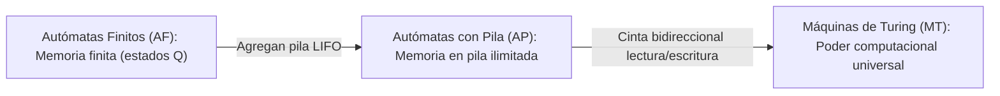
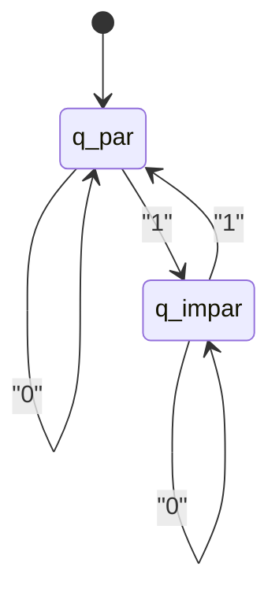

# 1.2 Máquinas abstractas y algoritmos

## Introducción y motivación

Antes de que existiera la primera computadora electrónica programable, los matemáticos del siglo XX necesitaban precisar qué significa que un problema pueda resolverse "mediante un método mecánico paso a paso". Para la ingeniería de compiladores y la informática teórica, esta cuestión es crucial: determina qué análisis puede automatizar un compilador (por ejemplo, verificar si un programa es sintácticamente correcto) y qué tareas son inherentemente imposibles de automatizar para cualquier programa futuro (por ejemplo, decidir de manera general si un código cualquiera caerá en un bucle infinito).

Con este fin nacen las **máquinas abstractas**: modelos matemáticos rigurosos que capturan la esencia del cómputo automático —de ahí el término **autómata**, sinónimo de máquina de cómputo automático (De Castro Korgi, 2004, p. 4)— y permiten clasificar los problemas según la potencia de memoria y control que requieren.

## Definición de máquina abstracta, algoritmo y procedimiento efectivo

### Máquina abstracta

Una **máquina abstracta** es un modelo matemático idealizado de un dispositivo computacional que procesa cadenas finitas de símbolos sobre un alfabeto dado, transitando por una sucesión discreta de configuraciones internas mediante reglas formales preestablecidas (De Castro Korgi, 2004, pp. 3, 25).

De manera típica, una máquina abstracta consta de:
1. **Un medio de entrada y/o almacenamiento** (una cinta dividida en casillas o celdas, y eventualmente estructuras auxiliares como una pila).
2. **Una unidad de control** (o cabeza lectora/escritora) con un conjunto finito de estados internos $Q$ y un estado inicial $q_0 \in Q$.
3. **Una función o relación de transición** ($\delta$) que actúa como un conjunto finito de instrucciones: dado el estado actual y el símbolo (o símbolos) observado, especifica el siguiente estado y la acción a realizar.

### Algoritmo y procedimiento efectivo

Intuitivamente, un **procedimiento efectivo** es un conjunto finito de instrucciones claras, precisas y mecánicamente ejecutables que, aplicadas paso a paso sobre una entrada discreta, no requieren ingenio ni intuición humana. Un **algoritmo** formaliza esta idea exigiendo las siguientes propiedades:

1. **Descripción finita:** El conjunto de instrucciones es finito y puede expresarse mediante una cadena finita de símbolos.
2. **Efectividad (ejecutabilidad mecánica):** Cada instrucción es elemental y realizable exactamente en tiempo finito.
3. **Entrada y salida bien definidas:** Opera sobre entradas discretas y produce un resultado observable.
4. **Terminación (algoritmo total frente a procedimiento parcial):** En sentido estricto, un algoritmo que *decide* un problema debe detenerse en un número finito de pasos para *toda* entrada válida; no obstante, como señala De Castro Korgi (2004, Secc. 6.3 y 6.9.1, pp. 177, 198), en computabilidad también se consideran procedimientos mecánicos que producen salida en algunas entradas y pueden divergir (entrar en un bucle infinito) en otras.

Desde la perspectiva de Acevedo Juárez (2006, Secc. 1.4, p. 27), este estudio da origen a dos ramas complementarias:
- **Teoría de la computabilidad:** Determina si un problema es factible de resolverse mediante algún algoritmo, sin considerar cuántos recursos consume.
- **Teoría de la complejidad:** Analiza los recursos mínimos (tiempo, medido en pasos de ejecución mediante notación asintótica $O$, y espacio de memoria) necesarios para ejecutar el algoritmo.

## Contexto histórico (1936) y la Tesis de Church-Turing

En 1928, el matemático alemán David Hilbert formuló el famoso *Entscheidungsproblem* (problema de la decisión): preguntó si existía algún procedimiento mecánico general capaz de decidir, en un número finito de pasos, si cualquier fórmula de la lógica matemática era válida (Acevedo Juárez, 2006, p. IX). Responder negativamente a esta pregunta exigía primero dar una definición matemática exacta de "procedimiento mecánico".

En **1936**, de manera independiente pero casi simultánea, dos propuestas revolucionarias dieron respuesta formal al concepto de computabilidad (De Castro Korgi, 2004, pp. 3–4, 198–199):

- **Alonzo Church (1903–1995):** Introdujo el **cálculo-$\lambda$**, un formalismo basado en definición y aplicación simbólica de funciones. Church enunció la *tesis de Church*, según la cual las funciones efectivamente computables son exactamente las funciones $\lambda$-computables.
- **Alan Turing (1912–1954):** Estudiante doctoral de Church en Princeton, propuso un modelo mecánico concreto llamado hoy **Máquina de Turing (MT)**, inspirado en un calculista humano que lee y escribe símbolos sobre una cinta dividida en casillas siguiendo un número finito de estados mentales.

Ambos formalismos —aunque uno puramente funcional y el otro mecánico— resultaron ser **matemáticamente equivalentes**: toda función computable en el cálculo-$\lambda$ es computable por una Máquina de Turing, y viceversa. Posteriormente, todos los demás modelos propuestos para formalizar la noción de algoritmo resultaron equivalentes a la Máquina de Turing (De Castro Korgi, 2004, p. 199):

- Funciones parciales recursivas (Gödel y Kleene, 1936).
- Sistemas de deducción canónica (Post, 1943).
- Algoritmos de Markov (Markov, 1951).
- Gramáticas no restringidas o de tipo 0 (Chomsky, 1956).
- Máquinas de registro (Shepherdson y Sturgis, 1963).

### Enunciado y alcance de la Tesis de Church-Turing

> **Tesis de Church-Turing (De Castro Korgi, 2004, p. 198):** Todo algoritmo puede ser descrito por medio de una máquina de Turing.

Es fundamental observar que esta afirmación recibe el nombre de **tesis** y no de teorema porque vincula una noción matemática formal (la Máquina de Turing) con una noción intuitiva no formalizada (lo "efectivamente computable" o "algoritmo"). Por ello, no es susceptible de una demostración matemática formal; sin embargo, podría refutarse si alguien exhibiera un procedimiento efectivo universalmente aceptado como algoritmo que ninguna Máquina de Turing pudiera simular. En casi un siglo de investigación no se ha encontrado tal contraejemplo, y el agregado de múltiples cintas, pistas o no determinismo tampoco aumenta el poder computacional básico del modelo (De Castro Korgi, 2004, pp. 198–199).

## Comparativa de modelos de máquinas abstractas

En la década de 1940 y 1950 surgieron modelos de máquinas abstractas con capacidades restringidas respecto a la Máquina de Turing (De Castro Korgi, 2004, pp. 4, 25). Esta graduación de potencia computacional se corresponde directamente con las clases de lenguajes de la jerarquía de Chomsky y con las distintas etapas de un compilador:

| Dimensión | Autómata Finito (AF) | Autómata con Pila (AP) | Máquina de Turing (MT) |
| :--- | :--- | :--- | :--- |
| **Definición formal** | $M = (\Sigma, Q, q_0, F, \delta)$ | $M = (Q, q_0, F, \Sigma, \Gamma, z_0, \Delta)$ | $M = (Q, q_0, F, \Sigma, \Gamma, \bar{b}, \delta)$ |
| **Cinta de entrada** | Solo lectura, avance exclusivo hacia la derecha. | Solo lectura, avance exclusivo hacia la derecha (más transiciones $\lambda$). | Lectura y escritura, desplazamiento bidireccional ($\leftarrow, \rightarrow$). |
| **Memoria auxiliar** | Ninguna (solo la memoria finita de $Q$). | Una **pila** potencialmente infinita con acceso restringido al tope (LIFO). | La propia cinta infinita actúa como memoria de acceso arbitrario secuencial. |
| **Equivalencia determinismo vs. no determinismo** | Equivalentes ($\text{AFD} \equiv \text{AFN}$). | **No equivalentes** ($\text{AFPN}$ es estrictamente más potente que $\text{AFPD}$). | Equivalentes ($\text{MT} \equiv \text{MTN}$). |
| **Lenguajes que reconoce** | Lenguajes regulares (Tipo 3). | Lenguajes independientes del contexto (Tipo 2, mediante AFPN). | Lenguajes recursivamente enumerables (Tipo 0). |
| **Terminación garantizada** | Siempre termina en $|w|$ pasos. | Puede entrar en ciclos con transiciones $\lambda$ (evitables). | Puede detenerse (aceptar/rechazar) o divergir en un bucle infinito. |
| **Rol en compiladores** | **Análisis léxico** (reconocimiento de *tokens*, palabras reservadas, números). | **Análisis sintáctico** (validación de paréntesis balanceados, expresiones y bloques). | **Análisis semántico** general, optimización y ejecución arbitraria de programas. |

## Ejemplos desarrollados paso a paso

### Ejemplo 1: Un algoritmo como máquina abstracta finita (paridad binaria)

Considérese el problema algorítmico: *dada una cadena binaria $w \in \{0, 1\}^*$, decidir si contiene un número par de unos*.

Podemos describir este algoritmo mediante una máquina abstracta con dos estados internos $Q = \{q_{\text{par}}, q_{\text{impar}}\}$, estado inicial $q_0 = q_{\text{par}}$ (pues cero unos es par), estado de aceptación $F = \{q_{\text{par}}\}$ y las reglas de transición:
- $\delta(q_{\text{par}}, 0) = q_{\text{par}}$, $\quad \delta(q_{\text{par}}, 1) = q_{\text{impar}}$,
- $\delta(q_{\text{impar}}, 0) = q_{\text{impar}}$, $\quad \delta(q_{\text{impar}}, 1) = q_{\text{par}}$.

**Ejecución paso a paso** sobre la entrada $w = 1011$:
1. Inicio: la cabeza lectora apunta al primer símbolo en estado $q_{\text{par}}$ (0 unos vistos).
2. Lee `1`: aplica $\delta(q_{\text{par}}, 1) = q_{\text{impar}}$ y avanza a la derecha.
3. Lee `0`: aplica $\delta(q_{\text{impar}}, 0) = q_{\text{impar}}$ y avanza a la derecha.
4. Lee `1`: aplica $\delta(q_{\text{impar}}, 1) = q_{\text{par}}$ y avanza a la derecha.
5. Lee `1`: aplica $\delta(q_{\text{par}}, 1) = q_{\text{impar}}$ y alcanza el fin de la cinta.
6. Decisión: como $q_{\text{impar}} \notin F$, la máquina rechaza $1011$ (en efecto, tiene tres unos).

Nótese cómo el algoritmo cumple finitud, determinismo, efectividad y terminación garantizada en $|w| = 4$ pasos sin requerir memoria auxiliar externa.

### Ejemplo 2: Límites de la memoria finita frente a una pila ($\{a^n b^n : n \ge 0\}$)

Considérese ahora el lenguaje $L = \{a^n b^n : n \ge 0\} = \{\lambda, ab, aabb, aaabbb, \dots\}$, análogo al problema de verificar paréntesis balanceados en un compilador.

1. **Por qué falla un Autómata Finito (AF):** Un AF tiene un número fijo y finito de estados $|Q| = k$. Al leer un prefijo $a^n$, el autómata debe distinguir entre $a^1, a^2, \dots, a^{k+1}$ para exigir exactamente el mismo número de símbolos $b$ después. Por el principio del palomar, como $k + 1 > k$, al menos dos prefijos $a^i$ y $a^j$ ($i \neq j$) llevan al mismo estado $q \in Q$. Si después siguen $b^i$, el autómata se comportaría idénticamente ante $a^i b^i \in L$ y $a^j b^i \notin L$, cometiendo un error.
2. **Cómo lo resuelve un Autómata con Pila (AP):** Incorporando una pila con marcador de fondo $z_0$, la máquina procesa $w = aabb$ paso a paso así:
   - Inicio: estado $q_0$, pila = $[z_0]$.
   - Lee primera `a`: apila un símbolo $A$; pila = $[A, z_0]$.
   - Lee segunda `a`: apila otro símbolo $A$; pila = $[A, A, z_0]$.
   - Lee primera `b`: transita a estado $q_1$ y desapila una $A$; pila = $[A, z_0]$.
   - Lee segunda `b`: permanece en $q_1$ y desapila la última $A$; pila = $[z_0]$.
   - Fin de la entrada: al observar el marcador $z_0$ en el tope, transita al estado de aceptación $q_f$.

Si la entrada hubiese sido $aab$ o $abb$, al finalizar la lectura la pila aún contendría una $A$ o intentaría desapilar sobre $z_0$ vacío, rechazando la cadena. Este ejemplo evidencia el salto cualitativo en poder computacional al añadir una estructura de memoria auxiliar.

## Ejercicios propuestos

1. **Propiedades de un algoritmo:** Explique por qué una receta de cocina ambigua ("agregar sal al gusto hasta que quede bien") no satisface las condiciones de procedimiento efectivo ni algoritmo, y proponga qué habría que formalizar para que sea ejecutable por una máquina abstracta.
2. **Tesis de Church-Turing:** ¿Por qué se afirma que la Tesis de Church-Turing es una *tesis* refutable empírica o conceptualmente pero no un *teorema* demostrable? Mencione al menos tres modelos computacionales de 1936–1963 equivalentes a la Máquina de Turing.
3. **Selección de modelo abstracto:** Para cada problema, justifique cuál es el modelo de máquina abstracta mínimo necesario (AF, AP o MT) y a qué fase de un compilador corresponde:
   - (a) Verificar que todo identificador comience por letra seguida de letras o dígitos.
   - (b) Verificar que todo bloque `{ ... }` abierto en un programa de Java esté correctamente cerrado y anidado.
   - (c) Verificar que cada variable usada en una expresión haya sido declarada previamente con un tipo compatible y determinar si una función dada siempre termina.
4. **Traza computacional:** Diseñe informalmente las transiciones de una máquina abstracta con 3 estados que decida si una cadena sobre $\{a, b\}$ contiene al menos dos símbolos `b`, y trace paso a paso su comportamiento con las cadenas `aba` y `abab`.

## Referencias

- Acevedo Juárez, A. (2006). *Teoría de la computación* [Tesis de licenciatura, Instituto Tecnológico de Celaya]. (Introducción general, p. IX; Sección 1.4 Autómatas, Computabilidad y Complejidad, p. 27).
- De Castro Korgi, R. (2004). *Teoría de la computación: Lenguajes, autómatas, gramáticas*. Universidad Nacional de Colombia. (Introducción: ¿Qué es la Teoría de la Computación?, pp. 3–4; Secc. 2.1, p. 25; Secc. 5.1, pp. 143–145; Secc. 6.1, pp. 167–170; Secc. 6.3, pp. 176–177; Secc. 6.9, pp. 198–199).
