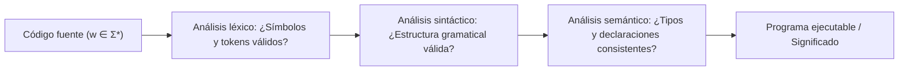

# 1.3 Lenguajes abstractos

## Introducción y motivación

La comunicación humana descansa en los **lenguajes naturales** (español, inglés, náhuatl, francés), sistemas extraordinariamente expresivos pero dotados de ambigüedades, excepciones gramaticales y significados dependientes del contexto cultural. Por el contrario, cuando los seres humanos diseñan especificaciones matemáticas o instruyen a una computadora mediante un lenguaje de programación, necesitan lenguajes desprovistos de ambigüedad estructural cuya validez pueda verificarse automáticamente.

Esta necesidad motivó la creación de la teoría de **lenguajes formales** (o lenguajes abstractos), impulsada en la década de 1950 por el lingüista Noam Chomsky y adoptada rápidamente por los pioneros de la computación para definir la sintaxis de lenguajes como ALGOL, Pascal y C y construir sus **compiladores** (De Castro Korgi, 2004, pp. 4, 81, 94; Acevedo Juárez, 2006, pp. 19, 39–40).

## Lenguajes naturales, lenguajes formales y lenguajes de programación

### Lenguajes naturales frente a lenguajes formales

De acuerdo con Acevedo Juárez (2006, pp. 19, 39–40), la diferencia esencial entre ambos radica en el origen y la precisión de sus reglas:

- **Lenguajes naturales:** Evolucionan históricamente a partir del uso de una comunidad hablante. Sus reglas gramaticales se describen *a posteriori*, admiten numerosas excepciones, producen oraciones ambiguas (una misma frase puede interpretarse de varias maneras) y resultan demasiado complejos para caracterizarse por completo mediante un conjunto reducido de reglas rígidas.
- **Lenguajes formales (abstractos):** Son lenguajes artificiales cuyas reglas de formación se establecen *antes* de construir o aceptar sus expresiones (Acevedo Juárez, 2006, p. 19). Su pertenencia está delimitada de forma matemática exacta sobre un alfabeto finito, prescindiendo en principio de su significado en el mundo real.

### Relación con los lenguajes de programación

Un lenguaje de programación (C, Java, Rust, Python) es una aplicación directa de los lenguajes formales, aunque conviene hacer una precisión importante (De Castro Korgi, 2004, nota de la Secc. 1.7, p. 11):

- En el lenguaje cotidiano, un "lenguaje de programación" abarca tanto las reglas de escritura (sintaxis) como el significado ejecutable de sus instrucciones (semántica).
- En el sentido estricto de la Teoría de la Computación, si tomamos como alfabeto $\Sigma$ el conjunto de caracteres permitidos (por ejemplo, caracteres ASCII o Unicode), cualquier programa fuente es simplemente una **cadena finita** $w \in \Sigma^*$. El conjunto de todos los programas sintácticamente válidos conforma un **lenguaje abstracto** $L \subseteq \Sigma^*$.

| Criterio | Lenguaje natural | Lenguaje formal abstracto | Lenguaje de programación |
| :--- | :--- | :--- | :--- |
| **Origen de las reglas** | Histórico y social (*a posteriori*). | Matemático y explícito (*a priori*). | Diseñado por ingeniería sobre bases formales (*a priori*). |
| **Alfabeto** | Fonemas, letras, signos ortográficos. | Alfabeto finito arbitrario $\Sigma$ (p. ej. $\{a,b\}$ o $\{0,1\}$). | Caracteres ASCII / Unicode y conjunto finito de *tokens*. |
| **Ambigüedad** | Frecuente e incluso deseable (literatura, retórica). | Evitada por diseño; pertenencia exacta ($w \in L$ o $w \notin L$). | Eliminada en la especificación del compilador para garantizar una única interpretación. |
| **Herramienta de definición** | Diccionarios y gramáticas descriptivas. | Teoría de conjuntos, expresiones regulares, gramáticas formales, autómatas. | Especificaciones BNF / EBNF, expresiones regulares para *tokens* y reglas semánticas. |

## Sintaxis frente a semántica

Todo lenguaje utilizado en computación puede analizarse desde dos niveles complementarios (Acevedo Juárez, 2006, p. 40; De Castro Korgi, 2004, p. 94):

1. **Sintaxis (forma o estructura):** Conjunto de reglas formales que determinan qué secuencias de símbolos pertenecen al lenguaje, es decir, cómo se combinan los símbolos para formar palabras (*nivel léxico*) y sentencias u oraciones bien construidas (*nivel gramatical*). En los compiladores, gran parte de la sintaxis se especifica mediante gramáticas libres de contexto en forma Backus-Naur (**BNF**).
2. **Semántica (significado e interpretación):** Reglas que asignan un sentido operativo o denotacional a las cadenas sintácticamente válidas, incluyendo restricciones dependientes del contexto que no suelen capturarse con reglas puramente locales (por ejemplo, verificar que una variable haya sido declarada antes de usarse o que los tipos de datos de una suma sean compatibles).

Una cadena puede ser **sintácticamente correcta pero semánticamente inválida** (o carente de sentido). En español, la oración *"Las ideas verdes duermen furiosamente"* (célebre ejemplo lingüístico de Chomsky) cumple la sintaxis sujeto–verbo–adverbio, pero carece de sentido semántico. Análogamente, en C o Java, la instrucción `int x = "hola" + 3;` respeta la forma sintáctica de una declaración con asignación, pero falla en la fase semántica por incompatibilidad de tipos.

## Definición formal de alfabeto y lenguaje abstracto

Siguiendo la notación de De Castro Korgi (2004, Secc. 1.1 y 1.7, pp. 5–6, 10–11):

- **Definición (Alfabeto):** Un **alfabeto**, denotado usualmente por $\Sigma$ (o $\Gamma$), es un conjunto **finito y no vacío** cuyos elementos se denominan **símbolos**.
- **Definición (Cadena y universo $\Sigma^*$):** Una **cadena** (o palabra) sobre $\Sigma$ es una secuencia finita de símbolos de $\Sigma$. La única cadena sin símbolos es la **cadena vacía** ($\lambda$). El conjunto de todas las cadenas finitas que pueden formarse con símbolos de $\Sigma$, incluida $\lambda$, se denota por $\Sigma^*$.
- **Definición (Lenguaje formal o abstracto):** Un **lenguaje** $L$ sobre un alfabeto $\Sigma$ es cualquier subconjunto de $\Sigma^*$, es decir:
  $$L \subseteq \Sigma^*.$$

De esta definición se desprenden consecuencias inmediatas:
1. Todo lenguaje $L$ sobre $\Sigma$ satisface $\varnothing \subseteq L \subseteq \Sigma^*$.
2. Existen dos **casos extremos**:
   - El **lenguaje vacío** $L = \varnothing$, que no contiene ninguna cadena.
   - El **lenguaje universal** $L = \Sigma^*$, que contiene todas las cadenas posibles sobre $\Sigma$.
3. Un lenguaje puede ser **finito** (como el conjunto de palabras reservadas de Python o el diccionario oficial de la RAE) o **infinito** (como el conjunto de todos los programas sintácticamente válidos en C o el lenguaje $\{a^n : n \ge 1\}$).

## Ejemplos desarrollados paso a paso

### Ejemplo 1: Un lenguaje de expresiones de asignación simples frente a su semántica

Supóngase un micro-lenguaje de programación donde solo se permiten asignaciones de enteros no negativos a identificadores de una sola letra minúscula. Definimos el alfabeto:
$$\Sigma = \{x, y, z, 0, 1, 2, 3, 4, 5, 6, 7, 8, 9, =, ;\}$$
y definimos sintácticamente el lenguaje formal $L \subseteq \Sigma^*$ como el conjunto de cadenas con la forma `<identificador>=<dígitos>;`, donde `<identificador>` $\in \{x, y, z\}$ y `<dígitos>` es una secuencia de uno o más dígitos.

Evaluemos paso a paso cuatro cadenas sobre $\Sigma$:
1. $w_1 = \texttt{x=42;}$:
   - ¿Todos sus símbolos pertenecen a $\Sigma$? Sí (`x`, `=`, `4`, `2`, `;`).
   - ¿Cumple la estructura `<identificador>=<dígitos>;`? Sí (`x` es identificador, `=` es operador, `42` es secuencia no vacía de dígitos, `;` cierra la sentencia). Por tanto, $w_1 \in L$.
2. $w_2 = \texttt{42=x;}$:
   - Todos los símbolos están en $\Sigma$, pero a la izquierda de `=` aparece una secuencia de dígitos en lugar de un identificador. Viola la regla sintáctica: $w_2 \notin L$.
3. $w_3 = \texttt{x=05}$:
   - Falta el terminador `;` obligatorio al final. Viola la sintaxis: $w_3 \notin L$.
4. $w_4 = \texttt{w=10;}$:
   - El símbolo `w` ni siquiera forma parte del alfabeto $\Sigma$ definido, por lo que $w_4 \notin \Sigma^*$ y en consecuencia $w_4 \notin L$ (error léxico).

Ahora añadamos una regla **semántica**: *el valor asignado no puede exceder 100*. Entonces la cadena $\texttt{z=250;}$ pertenece a $L$ (es **sintácticamente válida**), pero sería rechazada por el analizador semántico.

### Ejemplo 2: Lenguajes formales clásicos sobre $\Sigma = \{a, b\}$ y $\Sigma = \{0, 1\}$

Considérense los siguientes lenguajes formales y verifiquemos paso a paso la pertenencia de cadenas concretas:

1. **Lenguaje $L_1$ sobre $\Sigma = \{a, b\}$:**
   $$L_1 = \{a b^n a : n \ge 0\} \cup \{\lambda\}.$$
   (De Castro Korgi, 2004, p. 11).
   - Para $n = 0$: $a b^0 a = a \lambda a = aa \in L_1$.
   - Para $n = 1$: $a b^1 a = aba \in L_1$.
   - Para $n = 2$: $a b^2 a = abba \in L_1$.
   - Además $\lambda \in L_1$ por la unión explícita con $\{\lambda\}$.
   - ¿Pertenece $abab$ a $L_1$? No, porque termina en $b$ y no tiene la forma $ab^n a$. ¿Pertenece $aabba$? No, porque inicia con dos símbolos $a$ consecutivos antes de las $b$.

2. **Lenguaje $L_2$ sobre $\Sigma = \{0, 1\}$:**
   $$L_2 = \{w \in \{0, 1\}^* : w \text{ contiene un número impar de unos}\}.$$
   - Evaluemos $w_1 = \lambda$: contiene $0$ unos; como $0$ es par, $\lambda \notin L_2$.
   - Evaluemos $w_2 = 010$: contiene exactamente $1$ uno (impar); por lo tanto, $010 \in L_2$.
   - Evaluemos $w_3 = 10110$: contiene $3$ unos (impar); por lo tanto, $10110 \in L_2$.
   - Evaluemos $w_4 = 1100$: contiene $2$ unos (par); por lo tanto, $1100 \notin L_2$.

Ambos lenguajes son subconjuntos infinitos de sus respectivos universos $\Sigma^*$, definidos de manera completamente precisa *antes* de examinar cualquier cadena individual.

## Ejercicios propuestos

1. **Lenguaje natural frente a formal:** Construya dos oraciones en español que sean sintácticamente correctas pero presenten (a) ambigüedad estructural o (b) carencia de sentido semántico. Después explique cómo un lenguaje formal elimina ese tipo de problemas en la definición de expresiones aritméticas.
2. **Sintaxis frente a semántica en programación:** Tome un lenguaje de programación conocido (C, Python o Java) y escriba tres fragmentos de código breves que ilustren respectivamente: (a) un error léxico (símbolo fuera del alfabeto permitido o token mal formado), (b) un error sintáctico y (c) un fragmento sintácticamente válido pero con error semántico.
3. **Especificación de conjuntos como lenguajes:** Siguiendo el ejemplo de los números naturales en De Castro Korgi (2004, p. 11), defina un alfabeto adecuado $\Sigma$ y especifique por comprensión el lenguaje $L_{\mathbb{Z}} \subseteq \Sigma^*$ que representa a todos los números enteros $\mathbb{Z} = \{\dots, -2, -1, 0, 1, 2, \dots\}$ sin ceros a la izquierda innecesarios ni la representación inválida `-0`.
4. **Pertenencia a lenguajes abstractos:** Sea $\Sigma = \{a, b, c\}$ y $L = \{w \in \Sigma^* : w \text{ no contiene el símbolo } c \text{ y } |w| \text{ es par}\}$. Determine cuáles de las siguientes cadenas pertenecen a $L$ y justifique su respuesta: $\lambda$, $ab$, $aba$, $abba$, $abca$.

## Referencias

- Acevedo Juárez, A. (2006). *Teoría de la computación* [Tesis de licenciatura, Instituto Tecnológico de Celaya]. (Sección 1.2.3 Cadenas y Lenguajes, p. 19; Lectura complementaria: Lenguaje una forma de comunicación, pp. 39–40).
- De Castro Korgi, R. (2004). *Teoría de la computación: Lenguajes, autómatas, gramáticas*. Universidad Nacional de Colombia. (Introducción, p. 4; Secc. 1.1 Alfabetos y cadenas, pp. 5–6; Secc. 1.7 Lenguajes, pp. 10–11; Secc. 4.1 Gramáticas generativas, p. 81; Secc. 4.5 Gramáticas para lenguajes de programación, p. 94).
