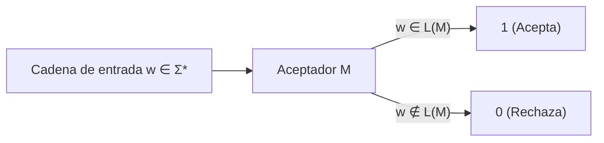
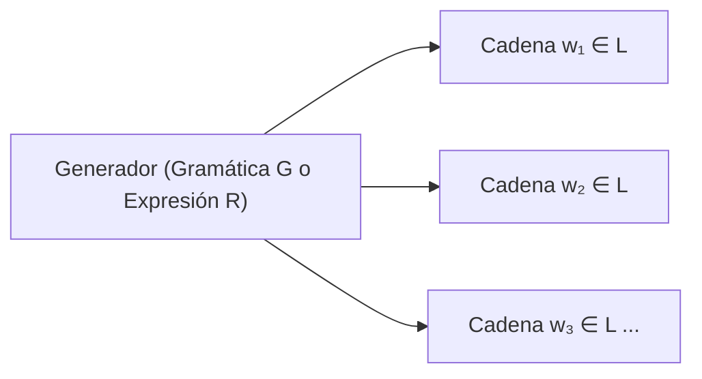
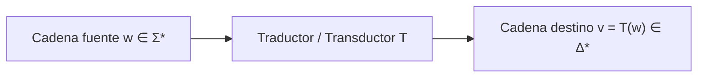
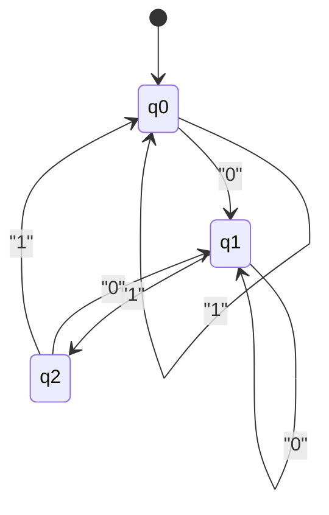
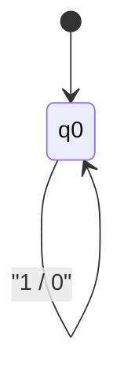

# 1.4 Aceptadores, generadores y traductores

## Introducción y motivación

En el estudio de los lenguajes formales y la construcción de compiladores, una misma estructura lingüística puede abordarse desde tres perspectivas operativas complementarias:

- ¿Cómo **decidir** si un programa o expresión dada pertenece al lenguaje válido? (**Aceptadores**).
- ¿Cómo **especificar o producir** sistemáticamente todas las expresiones válidas de un lenguaje? (**Generadores**).
- ¿Cómo **transformar** una cadena válida de un lenguaje fuente en una cadena equivalente de un lenguaje destino? (**Traductores**).

Como resume De Castro Korgi (2004, p. 4), gran parte de la Teoría de la Computación gira en torno a la estrecha interacción entre mecanismos que **procesan o aceptan** cadenas (autómatas), mecanismos que **generan** cadenas (gramáticas y expresiones regulares) y mecanismos que **calculan funciones o traducen** entradas en salidas (máquinas con salida y máquinas de Turing).

## 1. Aceptadores (o reconocedores)

### Definición formal y función matemática

Un **aceptador** (o **reconocedor**) de lenguajes es una máquina abstracta $M$ que recibe una cadena de entrada $w \in \Sigma^*$ y, tras ejecutar un proceso de cómputo discreto, emite una respuesta binaria indicando si la cadena es aceptada o rechazada (De Castro Korgi, 2004, Secc. 2.1, p. 25; Secc. 6.1, pp. 167–170).

El conjunto de todas las cadenas aceptadas por $M$ constituye el **lenguaje aceptado o reconocido por $M$**, denotado por $L(M)$:
$$L(M) = \{w \in \Sigma^* : M \text{ acepta } w\}.$$

Desde el punto de vista matemático, un aceptador que siempre termina su ejecución implementa exactamente la **función característica** (o indicadora) del lenguaje $L(M)$:
$$f_M : \Sigma^* \longrightarrow \{0, 1\}, \qquad f_M(w) = \begin{cases} 1 & (\text{Acepta / Sí}), \quad \text{si } w \in L(M), \\ 0 & (\text{Rechaza / No}), \quad \text{si } w \notin L(M). \end{cases}$$

*(Nota técnica: En autómatas finitos deterministas y máquinas de Turing decididoras, $f_M$ es una función **total** porque toda entrada termina en un número finito de pasos. En máquinas de Turing arbitrarias, $M$ podría entrar en un bucle infinito para ciertas cadenas $w \notin L(M)$, por lo que el reconocimiento puede corresponder a un procedimiento semidecidible).*

### Ejemplos en teoría y compilación

- **Autómatas finitos (AFD/AFN):** Reconocen lenguajes regulares; en un compilador constituyen el núcleo del analizador léxico para validar si un lexema corresponde a un identificador, palabra clave o literal numérico.
- **Autómatas con pila (AFPD/AFPN):** Reconocen lenguajes independientes del contexto; actúan como la base teórica de los analizadores sintácticos (*parsers*).

## 2. Generadores

### Definición formal y mecanismos principales

Un **generador** es un sistema formal finito que describe constructivamente un lenguaje $L \subseteq \Sigma^*$ especificando reglas para producir todas las cadenas de $L$ y ninguna cadena ajena a $L$. En lugar de recibir una cadena candidata para juzgarla, un generador *construye* las cadenas válidas del lenguaje (De Castro Korgi, 2004, Secc. 1.14, p. 19; Secc. 4.1–4.2, pp. 81–83; Secc. 6.4, p. 179).

En el curso destacan tres modelos de generadores:

1. **Gramáticas formales ($G$):** Una gramática generativa es una cuádrupla $G = (V, \Sigma, S, P)$, donde $V$ es el conjunto de variables (símbolos no terminales), $\Sigma$ es el alfabeto de símbolos terminales ($V \cap \Sigma = \varnothing$), $S \in V$ es el símbolo inicial y $P$ es un conjunto finito de reglas de reescritura o **producciones** de la forma $\alpha \to \beta$ (De Castro Korgi, 2004, Secc. 4.1, p. 82). Partiendo de $S$ y aplicando producciones en cero o más pasos ($S \Rightarrow_G^* w$), se obtiene el **lenguaje generado por $G$**:
   $$L(G) = \{w \in \Sigma^* : S \Rightarrow_G^* w\}.$$
2. **Expresiones regulares ($R$):** Fórmulas algebraicas construidas recursivamente a partir de las expresiones básicas $\varnothing$, $\lambda$ y $a \in \Sigma$ mediante concatenación ($RS$), unión ($R \cup S$) y clausura de Kleene ($R^*$). Cada expresión regular denota y genera el conjunto de cadenas $L(R) \subseteq \Sigma^*$ (De Castro Korgi, 2004, Secc. 1.14, p. 19).
3. **Máquinas de Turing generadoras (enumeradoras):** Máquinas de Turing que inician con la cinta en blanco y escriben secuencialmente sobre la cinta todas las cadenas pertenecientes a $L$, retornando periódicamente a un estado distinguido o imprimiendo cada cadena generada (De Castro Korgi, 2004, Secc. 6.4, p. 179). Matemáticamente, cuando $L \neq \varnothing$, un enumerador induce una función sobreyectiva $g : \mathbb{N} \to L$ que lista las cadenas del lenguaje.

## 3. Traductores (o transductores)

### Definición formal y función matemática

Un **traductor** (denominado también **transductor** en la teoría de autómatas o **calculadora de funciones** en máquinas de Turing) es una máquina abstracta $T$ que recibe una cadena de entrada sobre un alfabeto fuente $\Sigma$, la procesa de acuerdo con sus reglas internas y produce como salida una cadena transformada sobre un alfabeto destino $\Delta$ (que puede coincidir o no con $\Sigma$) (De Castro Korgi, 2004, Secc. 6.3, pp. 176–178).

En el caso determinista, un traductor computa una función de transformación entre lenguajes:
$$T : \Sigma^* \longrightarrow \Delta^* \qquad (\text{función total o parcial}),$$
donde para cada entrada válida $w \in \text{Dom}(T) \subseteq \Sigma^*$ se produce una salida única $v = T(w) \in \Delta^*$. Si el dispositivo es no determinista, la traducción se formaliza mediante una relación $\tau \subseteq \Sigma^* \times \Delta^*$ (Acevedo Juárez, 2006, Secc. 1.2.2, pp. 11, 15).

### Variantes y ejemplos

- **Transductores finitos (máquinas de Mealy y de Moore):** Autómatas de estado finito con salida. En una máquina de **Mealy**, el símbolo de salida depende del estado actual y del símbolo de entrada ($\Delta$ asociado a cada transición); en una máquina de **Moore**, la salida depende únicamente del estado actual.
- **Máquinas de Turing calculadoras de funciones:** Como formaliza De Castro Korgi (2004, Secc. 6.3, p. 176), una MT $M = (Q, q_0, q_f, \Sigma, \Gamma, \bar{b}, \delta)$ computa $h : \Sigma^* \to \Gamma^*$ si para toda entrada $w$ en su dominio inicia en $q_0 w$ y se detiene en el estado final $q_f$ dejando la salida $v = h(w)$ en la cinta ($q_0 w \vdash^* q_f v$).
- **Compiladores e intérpretes:** Son traductores complejos que combinan aceptadores (análisis léxico y sintáctico) con esquemas de traducción dirigidos por gramáticas generadoras para mapear programas de un lenguaje de alto nivel a código intermedio o lenguaje ensamblador.

## Cuadro comparativo

| Aspecto | Aceptador | Generador | Traductor |
| :--- | :--- | :--- | :--- |
| **Pregunta central** | ¿Pertenece $w$ a $L$? | ¿Qué cadenas pertenecen a $L$? | ¿Qué salida $v$ corresponde a la entrada $w$? |
| **Objeto matemático** | Función característica $f_M : \Sigma^* \to \{0,1\}$. | Sistema de derivación $G$ o expresión $R$ que produce $L$. | Función $T : \Sigma^* \to \Delta^*$ (o relación $\tau \subseteq \Sigma^* \times \Delta^*$). |
| **Entrada** | Cadena candidata $w \in \Sigma^*$. | Símbolo inicial $S$ o regla generadora (o $\mathbb{N}$). | Cadena fuente $w \in \Sigma^*$. |
| **Salida** | Decisión binaria: Acepta ($1$) o Rechaza ($0$). | Conjunto $L(G)$ o $L(R)$ de cadenas válidas. | Cadena transformada $v \in \Delta^*$. |
| **Ejemplos típicos** | AFD, AFN, AFPN, MT aceptadora. | Gramáticas de Chomsky, expresiones regulares, MT enumeradora. | Máquinas de Mealy/Moore, MT calculadora, compiladores. |

## Ejemplos desarrollados paso a paso

### Ejemplo 1: Aceptador de cadenas binarias terminadas en `01`

Diseñemos un aceptador finito determinista $M$ sobre $\Sigma = \{0, 1\}$ que reconozca el lenguaje:
$$L = \{w \in \{0, 1\}^* : w \text{ termina en } 01\}.$$

Definimos $Q = \{q_0, q_1, q_2\}$, estado inicial $q_0$, aceptación $F = \{q_2\}$ y transiciones:
- $q_0$ (ningún símbolo del patrón visto): con `0` va a $q_1$, con `1` permanece en $q_0$.
- $q_1$ (el último símbolo visto fue `0`): con `0` permanece en $q_1$, con `1` avanza a $q_2$.
- $q_2$ (los últimos dos símbolos fueron `01`): con `0` regresa a $q_1$, con `1` regresa a $q_0$.

**Evaluación paso a paso de $f_M(w)$:**
1. Para $w_1 = 1001$:
   - Inicio en $q_0 \xrightarrow{1} q_0 \xrightarrow{0} q_1 \xrightarrow{0} q_1 \xrightarrow{1} q_2$.
   - Como $q_2 \in F$, $f_M(1001) = 1$ (**Acepta**).
2. Para $w_2 = 010$:
   - Inicio en $q_0 \xrightarrow{0} q_1 \xrightarrow{1} q_2 \xrightarrow{0} q_1$.
   - Como $q_1 \notin F$, $f_M(010) = 0$ (**Rechaza**).

### Ejemplo 2: Generador mediante gramática formal para palíndromos de longitud par

Considérese el lenguaje $L = \{w w^R : w \in \{a, b\}^*\}$ (cadenas de longitud par simétricas respecto a su centro). Podemos especificar un generador mediante la gramática $G = (V, \Sigma, S, P)$ con $V = \{S\}$, $\Sigma = \{a, b\}$ y las producciones:
$$S \to aSa \mid bSb \mid \lambda.$$

**Generación paso a paso de la cadena $w = abba \in L(G)$:**
1. Comenzamos con el símbolo inicial: $S$.
2. Aplicamos la producción $S \to aSa$: obtenemos $aSa$.
3. Aplicamos la producción $S \to bSb$ sobre la variable central: obtenemos $abSba$.
4. Aplicamos la producción $S \to \lambda$: obtenemos $ab\lambda ba = abba$.

Resumidamente: $S \Rightarrow aSa \Rightarrow abSba \Rightarrow abba$. Todo resultado obtenido al eliminar la variable $S$ pertenece a $L$, y recíprocamente cualquier cadena de $L$ puede generarse de este modo.

### Ejemplo 3: Traductor (transductor de Mealy) para el complemento a uno binario

Diseñemos un traductor $T : \{0, 1\}^* \to \{0, 1\}^*$ que convierte cualquier cadena binaria en su **complemento a uno** (reemplazando cada `0` por `1` y cada `1` por `0`). Para $\lambda$, la salida es $\lambda$.

Como no requiere recordar símbolos anteriores, basta un único estado $q_0$ con dos transiciones etiquetadas como `entrada / salida`:
- En $q_0$, al leer `0`: escribe `1` y permanece en $q_0$ (`0 / 1`).
- En $q_0$, al leer `1`: escribe `0` y permanece en $q_0$ (`1 / 0`).

**Traducción paso a paso de $w = 10110$:**
1. Lee `1` $\implies$ emite `0` (salida acumulada: `0`).
2. Lee `0` $\implies$ emite `1` (salida acumulada: `01`).
3. Lee `1` $\implies$ emite `0` (salida acumulada: `010`).
4. Lee `1` $\implies$ emite `0` (salida acumulada: `0100`).
5. Lee `0` $\implies$ emite `1` (salida acumulada: `01001`).

Resultado: $T(10110) = 01001$. Este esquema ilustra cómo un transductor finito realiza transformaciones léxicas símbolo a símbolo en tiempo lineal.

## Ejercicios propuestos

1. **Diferenciación conceptual:** Explique la diferencia matemática entre la función implementada por un aceptador $M$ y la implementada por un traductor $T$. ¿Puede un aceptador considerarse un caso particular de traductor cuyo alfabeto de salida codifica únicamente $\{0, 1\}$? Justifique su respuesta.
2. **Aceptador:** Considere el aceptador $M$ del Ejemplo 1 (cadenas sobre $\{0,1\}$ terminadas en `01`). Trace paso a paso su comportamiento y determine $f_M(w)$ para las cadenas $\lambda$, $01$, $0101$ y $110$.
3. **Generador:** Dada la gramática generadora $G$ con producciones $S \to 0S1 \mid 01$, genere paso a paso las tres cadenas más cortas de $L(G)$ y describa en notación de conjuntos cuál es el lenguaje $L(G)$ generado.
4. **Traductor:** Diseñe un transductor de Mealy (indicando estados y transiciones `entrada / salida`) que reciba cadenas sobre $\Sigma = \{a, b\}$ y reemplace cada aparición de dos símbolos `a` consecutivos (`aa`) por el símbolo `c`, dejando el resto de los símbolos inalterados (por ejemplo, $T(baaba) = bcba$ y $T(aaa) = ca$). Trace la traducción paso a paso sobre $w = aabaa$.

## Referencias

- Acevedo Juárez, A. (2006). *Teoría de la computación* [Tesis de licenciatura, Instituto Tecnológico de Celaya]. (Sección 1.2.2 Relaciones y Funciones, pp. 11–17; Sección 1.4 Autómatas, Computabilidad y Complejidad, p. 27).
- De Castro Korgi, R. (2004). *Teoría de la computación: Lenguajes, autómatas, gramáticas*. Universidad Nacional de Colombia. (Introducción, p. 4; Secc. 1.14 Expresiones regulares, p. 19; Secc. 2.1 AFD, pp. 25–28; Secc. 4.1–4.2 Gramáticas, pp. 81–83; Secc. 6.1, 6.3 y 6.4 Máquinas de Turing aceptadoras, calculadoras y generadoras, pp. 167–179).
