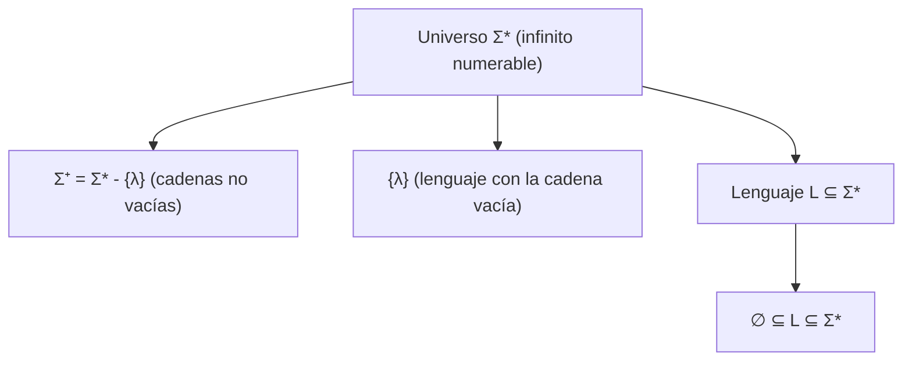

# 1.5 Cadenas de lenguajes

## Introducción y motivación

En todo compilador o intérprete, el archivo de entrada —por complejo que sea el algoritmo que contiene— es simplemente un flujo finito de caracteres extraídos de un repertorio acotado, como ASCII o UTF-8. Antes de analizar estructuras de control o tipos de datos, es necesario formalizar con rigor matemático qué son esos bloques elementales: los **símbolos**, los **alfabetos**, las **cadenas**, la **cadena vacía**, el universo de todas las palabras posibles y la relación de pertenencia a un lenguaje.

Como advierte De Castro Korgi (2004, p. 5), la exigencia teórica de que toda entrada y salida sea identificable en tiempo finito impone dos restricciones fundamentales: el alfabeto debe ser **finito** y solo se consideran cadenas de **longitud finita**.

## Alfabetos, símbolos y cadenas

### Símbolo y alfabeto ($\Sigma$)

- **Símbolo:** Entidad abstracta e indivisible que sirve como unidad mínima de representación (por ejemplo, `a`, `0`, `+`, `;`). Por convención, los símbolos se denotan con letras minúsculas iniciales ($a, b, c, d, \dots$) o dígitos (De Castro Korgi, 2004, p. 6).
- **Alfabeto ($\Sigma$):** Conjunto **finito y no vacío** cuyos elementos son símbolos. Se denota habitualmente con las letras griegas mayúsculas $\Sigma$, $\Gamma$ o $\Delta$.
  - $\Sigma$ debe ser finito ($|\Sigma| < \infty$) y no vacío ($\Sigma \neq \varnothing$).
  - Ejemplos clásicos:
    - $\Sigma = \{0, 1\}$ (**alfabeto binario**).
    - $\Sigma = \{a, b, c, \dots, z, A, B, \dots, Z\}$ (alfabeto alfabético latino).
    - $\Sigma_{\text{ASCII}}$ (conjunto finito de caracteres estándar ASCII utilizado por compiladores de C o Pascal).

### Cadena o palabra ($w$) y cadena vacía ($\lambda$)

- **Cadena (o palabra):** Sucesión o secuencia finita de símbolos pertenecientes a un alfabeto $\Sigma$, escritos uno tras otro por yuxtaposición (De Castro Korgi, 2004, Secc. 1.1, p. 5; Acevedo Juárez, 2006, Secc. 1.2.3, p. 18). Por convención, las cadenas se denotan con letras minúsculas finales ($u, v, w, x, y, z$) o letras griegas minúsculas ($\alpha, \beta, \gamma$).
- **Cadena vacía ($\lambda$):** Única secuencia formada por cero símbolos. Desempeña en las cadenas un papel análogo al del conjunto vacío $\varnothing$ en la teoría de conjuntos y al $0$ en la suma aritmética.

> **Nota sobre notación ($\lambda$ frente a $\varepsilon$):** Algunos textos (como Kelley, 1995, citado por Acevedo Juárez, 2006, p. 19) emplean la letra griega $\varepsilon$ para la cadena vacía. En estas notas adoptamos $\lambda$, siguiendo a De Castro Korgi (2004, p. 7), para evitar confusiones visuales con el símbolo de pertenencia $\in$.

### Igualdad de cadenas

A diferencia de un conjunto —donde $\{a, b\} = \{b, a\}$ y $\{a, a\} = \{a\}$—, una cadena es una **secuencia ordenada** en la que importan tanto el orden como la multiplicidad de sus símbolos (De Castro Korgi, 2004, p. 6; Acevedo Juárez, 2006, p. 6).

Formalmente, dadas dos cadenas $u = a_1 a_2 \cdots a_n$ y $v = b_1 b_2 \cdots b_m$ sobre $\Sigma$:
$$u = v \iff n = m \quad \text{y} \quad a_i = b_i \text{ para todo } 1 \le i \le n.$$
En particular, $aba \neq aab$ y $aa \neq a$.

## Universos de cadenas: $\Sigma^*$ y $\Sigma^+$

Dado un alfabeto $\Sigma$, definimos dos conjuntos fundamentales de cadenas:

1. **Clausura de Kleene del alfabeto ($\Sigma^*$):** Conjunto de *todas* las cadenas finitas que pueden formarse con símbolos de $\Sigma$, **incluyendo** la cadena vacía $\lambda$:
   $$\Sigma^* = \{\lambda\} \cup \{a_1 a_2 \cdots a_n : n \ge 1, \; a_i \in \Sigma\}.$$
2. **Clausura positiva del alfabeto ($\Sigma^+$):** Conjunto de todas las cadenas finitas **no vacías** sobre $\Sigma$:
   $$\Sigma^+ = \Sigma^* - \{\lambda\} = \{a_1 a_2 \cdots a_n : n \ge 1, \; a_i \in \Sigma\}.$$

### Propiedad de infinitud numerable

Aunque $\Sigma$ es siempre un conjunto finito y no vacío, tanto $\Sigma^*$ como $\Sigma^+$ son conjuntos **infinitos numerables** (De Castro Korgi, 2004, p. 7). Incluso en el caso más elemental con un único símbolo, $\Sigma = \{a\}$, se obtiene:
$$\Sigma^* = \{\lambda, a, aa, aaa, aaaa, \dots\}, \qquad \Sigma^+ = \{a, aa, aaa, aaaa, \dots\}.$$

## Distinción entre $\varnothing$, $\lambda$, $\{\varnothing\}$ y $\{\lambda\}$

Un error frecuente al iniciar el estudio de los lenguajes formales consiste en confundir la cadena vacía con el conjunto vacío (De Castro Korgi, 2004, p. 7). Los siguientes cuatro objetos son **completamente distintos** entre sí:

| Objeto | Naturaleza matemática | Cardinalidad (si es conjunto) | Interpretación |
| :---: | :--- | :---: | :--- |
| $\varnothing$ | Conjunto (lenguaje vacío) | $|\varnothing| = 0$ | Caja vacía: lenguaje sin ninguna cadena. |
| $\lambda$ | Cadena | No es un conjunto | Secuencia de $0$ símbolos (su longitud es $|\lambda| = 0$). |
| $\{\lambda\}$ | Conjunto (lenguaje unitario) | $|\{\lambda\}| = 1$ | Lenguaje que contiene exactamente una cadena: la vacía. |
| $\{\varnothing\}$ | Conjunto de conjuntos | $|\{\varnothing\}| = 1$ | Conjunto cuyo único elemento es el conjunto vacío (no es un lenguaje sobre $\Sigma$, sino una familia de conjuntos). |

## Pertenencia ($w \in L$) y especificación de lenguajes

Un lenguaje $L$ sobre $\Sigma$ es cualquier subconjunto $L \subseteq \Sigma^*$. Decir que una cadena $w \in \Sigma^*$ es aceptada o válida en el lenguaje se expresa mediante la relación conjuntista de **pertenencia**: $w \in L$ (y su negación $w \notin L$).

Existen tres formas principales de especificar un lenguaje como conjunto de cadenas:

1. **Por extensión (enumeración):** Listando todos sus elementos entre llaves cuando $L$ es finito, o sus primeros elementos en orden sistemático si el patrón es evidente.
   - Ejemplo: $L = \{a, aba, aca\}$.
2. **Por comprensión (propiedad característica):** Indicando la condición lógica $P(w)$ que debe satisfacer toda cadena $w \in \Sigma^*$ para pertenecer a $L$:
   $$L = \{w \in \Sigma^* : P(w)\}.$$
   - Ejemplo: $L = \{w \in \{a, b, c\}^* : w \text{ no contiene el símbolo } c\}$.
3. **Mediante sistemas formales constructivos:** Expresiones regulares, gramáticas generativas $L(G)$ o autómatas reconocedores $L(M)$, que serán objeto de las unidades 2 a 6.

## Ejemplos desarrollados paso a paso

### Ejemplo 1: Enumeración ordenada de $\Sigma^*$ y $\Sigma^+$, e igualdad de cadenas

Sea el alfabeto $\Sigma = \{a, b\}$. Construyamos ordenadamente $\Sigma^*$ y $\Sigma^+$ agrupando las cadenas por longitud creciente (orden canónico o lexicográfico por longitud):

- Longitud $0$: $\lambda$.
- Longitud $1$: $a, b$.
- Longitud $2$: $aa, ab, ba, bb$ ($2^2 = 4$ cadenas).
- Longitud $3$: $aaa, aab, aba, abb, baa, bab, bba, bbb$ ($2^3 = 8$ cadenas).

Por lo tanto:
$$\Sigma^* = \{\lambda, a, b, aa, ab, ba, bb, aaa, aab, aba, abb, \dots\},$$
$$\Sigma^+ = \{a, b, aa, ab, ba, bb, aaa, aab, aba, abb, \dots\}.$$

Verifiquemos paso a paso la igualdad y pertenencia de algunos elementos:
1. ¿$ab = ba$? No; aunque ambos contienen una `a` y una `b`, difieren en la posición $1$ ($a \neq b$) y en la posición $2$ ($b \neq a$).
2. ¿$\lambda \in \Sigma^*$? Sí, por definición de $\Sigma^*$.
3. ¿$\lambda \in \Sigma^+$? No, porque $\Sigma^+ = \Sigma^* - \{\lambda\}$.
4. ¿$\varnothing \subseteq \Sigma^*$? Sí, el conjunto vacío es subconjunto de todo conjunto; sin embargo, $\varnothing \in \Sigma^*$ es **falso**, porque los elementos de $\Sigma^*$ son cadenas y $\varnothing$ es un conjunto.

### Ejemplo 2: Especificación de los números naturales y evaluación de pertenencia

Consideremos el alfabeto decimal $\Sigma = \{0, 1, 2, 3, 4, 5, 6, 7, 8, 9\}$ (De Castro Korgi, 2004, Secc. 1.7, p. 11). Queremos especificar el lenguaje $L_{\mathbb{N}} \subseteq \Sigma^*$ correspondiente a la escritura decimal estándar de los números naturales $\mathbb{N} = \{0, 1, 2, 3, \dots\}$ sin ceros iniciales superfluos (es decir, admitiendo `"0"`, pero rechazando `"00"`, `"07"` o la cadena vacía $\lambda$).

Podemos definir $L_{\mathbb{N}}$ por comprensión así:
$$L_{\mathbb{N}} = \{0\} \cup \{w \in \Sigma^+ : \text{el primer símbolo de } w \text{ es distinto de } 0\}.$$

Evaluemos paso a paso si las siguientes cadenas pertenecen a $L_{\mathbb{N}}$:
1. $w_1 = \texttt{0}$: pertenece directamente al primer conjunto $\{0\}$, luego $w_1 \in L_{\mathbb{N}}$.
2. $w_2 = \texttt{2026}$: pertenece a $\Sigma^+$ (no es vacía y usa símbolos de $\Sigma$) y su primer símbolo es `2` $\neq 0$, luego $w_2 \in L_{\mathbb{N}}$.
3. $w_3 = \texttt{025}$: no es igual a `0`, y su primer símbolo es `0`, por lo que incumple la condición de pertenencia; $w_3 \notin L_{\mathbb{N}}$.
4. $w_4 = \lambda$: aunque `0` no es prefijo de $\lambda$, la condición exige $w \in \Sigma^+$ (longitud $\ge 1$); por lo tanto, $\lambda \notin L_{\mathbb{N}}$. (Este detalle muestra por qué debe excluirse explícitamente $\lambda$ cuando se formalizan representaciones numéricas).

## Ejercicios propuestos

1. **Construcción de $\Sigma^*$ y $\Sigma^+$:** Sea $\Sigma = \{0, 1, 2\}$. Liste todas las cadenas de $\Sigma^*$ de longitud menor o igual que $2$, e indique cuántas cadenas de longitud $3$ existen en $\Sigma^+$.
2. **Distinción formal:** Determine el valor de verdad (verdadero o falso) de cada proposición y justifique brevemente:
   - (a) $\lambda \in \varnothing$
   - (b) $\lambda \in \{\lambda\}$
   - (c) $\varnothing \subseteq \{\lambda\}$
   - (d) $\{\lambda\} = \varnothing$
   - (e) $\lambda \subseteq \Sigma^*$
3. **Especificación por comprensión:** Dado $\Sigma = \{a, b\}$, exprese por comprensión los siguientes lenguajes:
   - (a) $L_1$: cadenas no vacías que comienzan y terminan con el mismo símbolo.
   - (b) $L_2$: cadenas que contienen exactamente dos símbolos $b$.
   - (c) $L_3$: cadenas donde toda $a$ aparece antes que cualquier $b$.
4. **Enumeración de un lenguaje:** Sea $L = \{a^n b^m : n \ge 1, \; m \ge 0 \text{ y } n + m \le 3\}$ sobre $\Sigma = \{a, b\}$. Escriba $L$ por extensión y verifique si las cadenas $\lambda$, $a$, $ab$, $aab$ y $bb$ pertenecen a $L$.

## Referencias

- Acevedo Juárez, A. (2006). *Teoría de la computación* [Tesis de licenciatura, Instituto Tecnológico de Celaya]. (Sección 1.2.1 Conjuntos, pp. 4–6; Sección 1.2.3 Cadenas y Lenguajes, pp. 18–22).
- De Castro Korgi, R. (2004). *Teoría de la computación: Lenguajes, autómatas, gramáticas*. Universidad Nacional de Colombia. (Capítulo 1, Secc. 1.1 Alfabetos y cadenas, pp. 5–7; Secc. 1.7 Lenguajes, pp. 10–11).
