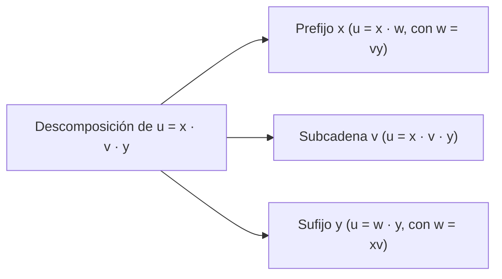

# 1.6 Cadenas y sus operaciones

## Introducción y motivación

En los compiladores y procesadores de texto, las cadenas no solo se almacenan y comparan: continuamente se miden, se ensamblan y se descomponen. Cuando un analizador léxico explora el código fuente, identifica el **prefijo más largo** de la entrada restante que forma un *token* válido; cuando un generador de código construye instrucciones o nombres simbólicos, **concatena** identificadores y literales; y al diseñar algoritmos de reconocimiento o gramáticas, resulta indispensable manipular potencias de símbolos, subcadenas e inversiones de cadenas.

En esta sección se formalizan las operaciones fundamentales sobre $\Sigma^*$ siguiendo el tratamiento deductivo e inductivo de De Castro Korgi (2004, Secc. 1.2–1.6, pp. 7–10).

## 1. Longitud de una cadena ($|w|$)

### Definición formal

La **longitud** de una cadena $w \in \Sigma^*$, denotada por $|w|$, es el número total de ocurrencias de símbolos que la conforman (contando repeticiones).

- **Definición descriptiva:**
  $$|w| = \begin{cases} 0, & \text{si } w = \lambda, \\ n, & \text{si } w = a_1 a_2 \cdots a_n \text{ con } a_i \in \Sigma. \end{cases}$$
- **Definición recursiva:**
  1. Base: $|\lambda| = 0$.
  2. Paso recursivo: $|wa| = |w| + 1$, para toda $w \in \Sigma^*$ y todo $a \in \Sigma$.

De la definición se sigue inmediatamente que $|w| = 0 \iff w = \lambda$, y que todo símbolo individual $a \in \Sigma$ tiene longitud $|a| = 1$.

## 2. Concatenación de cadenas ($uv$)

### Definición descriptiva y recursiva

Dadas dos cadenas $u, v \in \Sigma^*$, su **concatenación**, denotada por $u \cdot v$ o simplemente $uv$, es la cadena resultante de escribir los símbolos de $v$ inmediatamente a continuación de los símbolos de $u$ (De Castro Korgi, 2004, Secc. 1.2, p. 7).

- **Definición descriptiva:**
  1. $u \cdot \lambda = \lambda \cdot u = u$.
  2. Si $u = a_1 a_2 \cdots a_n$ y $v = b_1 b_2 \cdots b_m$, entonces $u \cdot v = a_1 a_2 \cdots a_n b_1 b_2 \cdots b_m$.
- **Definición recursiva:** Para $u, v \in \Sigma^*$ y $a \in \Sigma$:
  1. Base: $u \cdot \lambda = u$ (y $\lambda \cdot u = u$).
  2. Paso recursivo: $u \cdot (va) = (u \cdot v)a$.

### Propiedades algebraicas

1. **Asociatividad:** Para cualesquiera $u, v, w \in \Sigma^*$, se cumple:
   $$(uv)w = u(vw).$$
   Esto permite omitir paréntesis en concatenaciones múltiples como $uvw$.
2. **Elemento neutro (identidad):** La cadena vacía $\lambda$ es el único elemento neutro bilateral: $u\lambda = \lambda u = u$. En consecuencia, la terna $(\Sigma^*, \cdot, \lambda)$ conforma una estructura algebraica denominada **monoide libre** (Acevedo Juárez, 2006, p. 22).
3. **No conmutatividad:** En general, si $|\Sigma| \ge 2$, existen cadenas tales que $uv \neq vu$ (por ejemplo, $ab \neq ba$).
4. **Aditividad de la longitud:** Para cualesquiera $u, v \in \Sigma^*$,
   $$|uv| = |u| + |v|.$$
   *Demostración por inducción sobre $|v|$:*
   - *Caso base ($v = \lambda$):* $|u\lambda| = |u| = |u| + 0 = |u| + |\lambda|$.
   - *Hipótesis de inducción:* Supóngase que $|uv| = |u| + |v|$ para cierta $v \in \Sigma^*$.
   - *Paso inductivo:* Para $v' = va$ con $a \in \Sigma$, usando la definición recursiva de concatenación y longitud:
     $$|u(va)| = |(uv)a| = |uv| + 1 = (|u| + |v|) + 1 = |u| + (|v| + 1) = |u| + |va|.$$

## 3. Potencias de una cadena ($w^n$)

Dada una cadena $w \in \Sigma^*$ y un número natural $n \in \mathbb{N}$ ($n \ge 0$), la **$n$-ésima potencia** de $w$, denotada $w^n$, consiste en concatenar $w$ consigo misma $n$ veces (De Castro Korgi, 2004, Secc. 1.3, p. 8; Acevedo Juárez, 2006, p. 20):

- **Definición descriptiva:**
  $$w^0 = \lambda, \qquad w^n = \underbrace{ww\cdots w}_{n \text{ veces}} \quad (n \ge 1).$$
- **Definición recursiva:**
  1. Base: $w^0 = \lambda$.
  2. Paso recursivo: $w^{n+1} = w^n \cdot w$ (equivalentemente, $w \cdot w^n$) para $n \ge 0$.

### Propiedades de las potencias

Para cualesquiera $w \in \Sigma^*$ y $n, m \in \mathbb{N}$:
1. $\lambda^n = \lambda$ para todo $n \ge 0$.
2. $|w^n| = n \cdot |w|$.
3. $w^{n+m} = w^n w^m$ y por tanto $|w^{n+m}| = |w^n| + |w^m|$ (De Castro Korgi, 2004, p. 8).
4. $(w^n)^m = w^{nm}$.

## 4. Reflexión o inversa de una cadena ($w^R$) y palíndromos

La **reflexión** (o **inversa**) de una cadena $w \in \Sigma^*$, denotada por $w^R$ (otros autores emplean $w^{-1}$ o $w^I$), es la cadena formada al escribir los símbolos de $w$ en orden inverso (De Castro Korgi, 2004, Secc. 1.5, p. 9).

- **Definición descriptiva:**
  $$w^R = \begin{cases} \lambda, & \text{si } w = \lambda, \\ a_n \cdots a_2 a_1, & \text{si } w = a_1 a_2 \cdots a_n. \end{cases}$$
- **Definición recursiva:**
  1. Base: $\lambda^R = \lambda$.
  2. Paso recursivo: $(wa)^R = a \cdot w^R$, para todo $w \in \Sigma^*$ y $a \in \Sigma$.

### Teoremas y propiedades fundamentales

1. **Invarianza de longitud:** $|w^R| = |w|$.
2. **Involución:** $(w^R)^R = w$ para toda $w \in \Sigma^*$.
3. **Reflexión de una concatenación:** Para cualesquiera $u, v \in \Sigma^*$,
   $$(uv)^R = v^R u^R.$$
   *Demostración por inducción sobre $|v|$:*
   - *Caso base ($v = \lambda$):* $(u\lambda)^R = u^R = \lambda u^R = \lambda^R u^R$.
   - *Hipótesis de inducción:* Supóngase $(uv)^R = v^R u^R$.
   - *Paso inductivo:* Sea $v' = va$ con $a \in \Sigma$. Entonces:
     $$(u(va))^R = ((uv)a)^R = a(uv)^R = a(v^R u^R) = (a v^R) u^R = (va)^R u^R.$$
   Por inducción generalizada sobre $k$ factores: $(u_1 u_2 \cdots u_k)^R = u_k^R \cdots u_2^R u_1^R$.

- **Palíndromos:** Una cadena $w \in \Sigma^*$ se denomina **palíndromo** si coincide con su propia reflexión, es decir, $w = w^R$ (por ejemplo, $\lambda$, $a$, $bb$, $aba$, $1001$, `reconocer`).

## 5. Subcadenas, prefijos y sufijos

Sea $u \in \Sigma^*$ una cadena cualquiera (De Castro Korgi, 2004, Secc. 1.6, pp. 9–10):

- **Subcadena (o subpalabra):** Una cadena $v$ es una **subcadena** de $u$ si existen cadenas $x, y \in \Sigma^*$ tales que $u = xvy$.
- **Prefijo:** Una cadena $v$ es un **prefijo** de $u$ si existe $w \in \Sigma^*$ tal que $u = vw$ (es decir, $x = \lambda$). Se dice que $v$ es un **prefijo propio** de $u$ si $v$ es prefijo de $u$ y $v \neq u$ (equivalentemente, $w \neq \lambda$).
- **Sufijo:** Una cadena $v$ es un **sufijo** de $u$ si existe $w \in \Sigma^*$ tal que $u = wv$ (es decir, $y = \lambda$). Se dice que $v$ es un **sufijo propio** de $u$ si $v$ es sufijo de $u$ y $v \neq u$.

### Observaciones y conteo

- Como $u = \lambda u = u \lambda$, la cadena vacía $\lambda$ y la propia cadena $u$ son siempre prefijos, sufijos y subcadenas de $u$.
- Toda cadena $u$ de longitud $n = |u|$ posee exactamente **$n + 1$ prefijos** (de longitudes $0, 1, \dots, n$) y **$n + 1$ sufijos** (ambos con $n$ propios si $n \ge 1$).
- El número máximo de subcadenas no vacías distintas de una cadena de longitud $n$ es $\frac{n(n+1)}{2}$, más $\lambda$: a lo sumo $1 + \frac{n(n+1)}{2}$ subcadenas en total.

## Ejemplos desarrollados paso a paso

### Ejemplo 1: Evaluación recursiva de concatenación, potencia, longitud y reflexión

Sean $\Sigma = \{a, b, c\}$, $u = ab$ y $v = bca$.

1. **Concatenación paso a paso usando la definición recursiva** ($x \cdot (ya) = (x \cdot y)a$):
   - $uv = ab \cdot (bc \, a) = (ab \cdot bc)a = ((ab \cdot b)c)a = ((ab \cdot \lambda)b)ca = ((ab)b)ca = abbca$.
2. **Longitudes y verificación de aditividad:**
   - $|u| = |ab| = 2$, $|v| = |bca| = 3$.
   - $|uv| = |abbca| = 5 = 2 + 3 = |u| + |v|$.
3. **Potencia de cadena ($u^3$):**
   - $u^0 = \lambda$.
   - $u^1 = u^0 u = \lambda \cdot ab = ab$.
   - $u^2 = u^1 u = ab \cdot ab = abab$.
   - $u^3 = u^2 u = abab \cdot ab = ababab$, con longitud $|u^3| = 3 \cdot |u| = 3 \cdot 2 = 6$.
4. **Reflexión paso a paso y verificación de $(uv)^R = v^R u^R$:**
   - Calculemos $u^R$ recursivamente: $(ab)^R = b \cdot (a)^R = b \cdot (\lambda a)^R = b \cdot a \cdot \lambda^R = ba$.
   - Calculemos $v^R$ recursivamente: $(bca)^R = a(bc)^R = ac(b)^R = acb\lambda^R = acb$.
   - Entonces $v^R u^R = (acb)(ba) = acbba$.
   - Por otro lado, $(uv)^R = (abbca)^R = acbba$, confirmando $(uv)^R = v^R u^R$.

### Ejemplo 2: Prefijos, sufijos, subcadenas y su uso en análisis léxico

Sea $\Sigma = \{a, b, c, d\}$ y $u = bcbaadb$ (De Castro Korgi, 2004, Secc. 1.6, pp. 9–10), de longitud $|u| = 7$.

1. **Prefijos de $u$** (obtenidos tomando los primeros $0, 1, \dots, 7$ símbolos; $7+1=8$ prefijos):
   $$\lambda, \; b, \; bc, \; bcb, \; bcba, \; bcbaa, \; bcbaad, \; bcbaadb.$$
   Todos excepto `bcbaadb` son **prefijos propios**.
2. **Sufijos de $u$** (obtenidos tomando los últimos $0, 1, \dots, 7$ símbolos; $7+1=8$ sufijos):
   $$\lambda, \; b, \; db, \; adb, \; aadb, \; baadb, \; cbaadb, \; bcbaadb.$$
   Todos excepto `bcbaadb` son **sufijos propios**.
3. **Subcadenas de $u$:** Incluyen todos los prefijos, todos los sufijos y las porciones internas tales como `c`, `cb`, `ba`, `aa`, `aad`, `cba`, `baa`, etc. En cambio, `bcd` **no** es subcadena de $u$, porque aunque esos símbolos aparecen en $u$, no ocupan posiciones contiguas.

**Conexión con el analizador léxico (regla del prefijo más largo):** Supóngase que un compilador lee la entrada `int1 = 5;`. Al explorar los prefijos de `int1`:
- `i`, `in`, `int` coinciden con la categoría de identificador (`int` también coincide con palabra reservada).
- Al leer el cuarto carácter `1`, el prefijo `int1` sigue siendo un identificador válido pero ya no es palabra reservada.
- Al llegar al espacio, el analizador selecciona el **prefijo válido más largo** (`int1`) como un único token identificador y continúa con `= 5;`.

## Ejercicios propuestos

1. **Cálculo directo:** Sean $u = 101$ y $v = 00$ sobre $\Sigma = \{0, 1\}$. Calcule $uv$, $vu$, $u^2 v^R$, $|u^3 v^2|$ y $(uv)^R$, verificando en este caso que $(uv)^R = v^R u^R$ y que $uv \neq vu$.
2. **Prefijos, sufijos y subcadenas:** Para $w = abba$ sobre $\Sigma = \{a, b\}$:
   - (a) Liste todos sus prefijos y señale cuáles son propios.
   - (b) Liste todos sus sufijos y señale cuáles son propios.
   - (c) Liste todas las subcadenas *distintas* de $w$ (no olvide $\lambda$) y verifique cuántas son respecto a la cota $1 + \frac{4 \cdot 5}{2} = 11$.
3. **Inducción sobre cadenas:** Demuestre por inducción matemática sobre $n \in \mathbb{N}$ que para toda cadena $w \in \Sigma^*$ se cumple $|w^n| = n|w|$ y $(w^n)^R = (w^R)^n$.
4. **Palíndromos:** Demuestre que si $u \in \Sigma^*$ es un palíndromo, entonces $u^n$ también es un palíndromo para todo $n \ge 0$. ¿Es cierto que si $u$ y $v$ son palíndromos, entonces $uv$ es necesariamente un palíndromo? Demuéstrelo o dé un contraejemplo.

## Referencias

- Acevedo Juárez, A. (2006). *Teoría de la computación* [Tesis de licenciatura, Instituto Tecnológico de Celaya]. (Sección 1.2.3.1 Concatenación, pp. 19–22; Sección 1.3 Inducción matemática, pp. 25–26).
- De Castro Korgi, R. (2004). *Teoría de la computación: Lenguajes, autómatas, gramáticas*. Universidad Nacional de Colombia. (Capítulo 1, Secc. 1.2–1.6, pp. 7–10).
