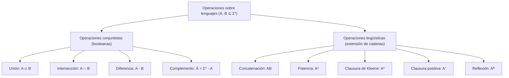

# 1.7 Operaciones sobre lenguajes

## Introducción y motivación

Así como las operaciones sobre cadenas permiten ensamblar e inspeccionar palabras individuales, las **operaciones sobre lenguajes** permiten construir lenguajes complejos a partir de lenguajes más sencillos. Esta álgebra de lenguajes cumple dos papeles esenciales en la Teoría de la Computación y en el diseño de traductores:

1. **Construcción constructiva de patrones:** Las operaciones de unión, concatenación y clausura de Kleene constituyen exactamente los operadores de las **expresiones regulares**, utilizadas universalmente para especificar los *tokens* en los analizadores léxicos de los compiladores (De Castro Korgi, 2004, Secc. 1.13–1.14, pp. 18–19).
2. **Propiedades de clausura:** Permiten determinar si una clase de máquinas (como los autómatas finitos o los autómatas con pila) sigue siendo capaz de reconocer el resultado de unir, intersecar, complementar o concatenar dos lenguajes de esa misma clase.

## 1. Operaciones conjuntistas (o booleanas)

Dado que todo lenguaje sobre un alfabeto $\Sigma$ es un subconjunto de $\Sigma^*$ ($A, B \subseteq \Sigma^*$), heredan directamente las operaciones de la teoría de conjuntos (De Castro Korgi, 2004, Secc. 1.8, p. 11; Acevedo Juárez, 2006, Secc. 1.2.3.2, pp. 23–24):

- **Unión:** $A \cup B = \{w \in \Sigma^* : w \in A \text{ o } w \in B\}$.
- **Intersección:** $A \cap B = \{w \in \Sigma^* : w \in A \text{ y } w \in B\}$.
- **Diferencia:** $A - B = \{w \in \Sigma^* : w \in A \text{ y } w \notin B\}$.
- **Complemento:** $\overline{A} = \Sigma^* - A = \{w \in \Sigma^* : w \notin A\}$.

> **Importancia del alfabeto de referencia en el complemento:** A diferencia de $A \cup B$ o $A \cap B$, el complemento $\overline{A}$ depende explícitamente del universo $\Sigma^*$ fijado. Si $A = \{a\}$ sobre $\Sigma_1 = \{a\}$, entonces $\overline{A} = \{\lambda, aa, aaa, \dots\}$; pero si el alfabeto es $\Sigma_2 = \{a, b\}$, $\overline{A}$ también incluye `b`, `ab`, `ba`, etc.

### Distinción crítica entre $\varnothing$ y $\{\lambda\}$

Aunque ambos conjuntos parecen "vacíos" a primera vista, poseen propiedades radicalmente distintas frente a las operaciones sobre lenguajes:

| Propiedad / Operación | Lenguaje vacío ($\varnothing$) | Lenguaje unitario ($\{\lambda\}$) |
| :--- | :--- | :--- |
| **Número de cadenas** | $0$ (no contiene cadenas) | $1$ (contiene la cadena vacía $\lambda$) |
| **Unión con $A$** | $A \cup \varnothing = A$ (neutro de $\cup$) | $A \cup \{\lambda\}$ agrega $\lambda$ si no estaba en $A$ |
| **Concatenación con $A$** | $A \cdot \varnothing = \varnothing \cdot A = \varnothing$ (**absorbente**) | $A \cdot \{\lambda\} = \{\lambda\} \cdot A = A$ (**neutro**) |
| **Potencias ($n \ge 1$)** | $\varnothing^0 = \{\lambda\}$, pero $\varnothing^n = \varnothing$ | $\{\lambda\}^n = \{\lambda\}$ para todo $n \ge 0$ |
| **Clausuras** | $\varnothing^* = \{\lambda\}$, mientras que $\varnothing^+ = \varnothing$ | $\{\lambda\}^* = \{\lambda\}^+ = \{\lambda\}$ |

## 2. Operaciones lingüísticas sobre lenguajes

### Concatenación de lenguajes ($AB$)

La **concatenación** de dos lenguajes $A, B \subseteq \Sigma^*$, denotada $A \cdot B$ o $AB$, es el conjunto de todas las cadenas formadas al concatenar una cadena de $A$ seguida de una cadena de $B$ (De Castro Korgi, 2004, Secc. 1.9, pp. 12–13):
$$AB = \{uv : u \in A, \; v \in B\}.$$

**Propiedades de la concatenación de lenguajes:** Para cualesquiera $A, B, C \subseteq \Sigma^*$ y familia arbitraria $\{B_i\}_{i \in I}$:
1. **Elemento absorbente:** $A \cdot \varnothing = \varnothing \cdot A = \varnothing$.
2. **Elemento neutro:** $A \cdot \{\lambda\} = \{\lambda\} \cdot A = A$.
3. **Asociatividad:** $A(BC) = (AB)C$.
4. **No conmutatividad:** En general, $AB \neq BA$.
5. **Distributividad respecto a la unión:**
   $$A(B \cup C) = AB \cup AC, \qquad (B \cup C)A = BA \cup CA,$$
   y de forma generalizada: $A \cdot \left(\bigcup_{i \in I} B_i\right) = \bigcup_{i \in I} (A \cdot B_i)$ y $\left(\bigcup_{i \in I} B_i\right) \cdot A = \bigcup_{i \in I} (B_i \cdot A)$.
6. **Comportamiento frente a la intersección:** Siempre se cumple $A(B \cap C) \subseteq AB \cap AC$, pero la igualdad **no se cumple en general**.
   *Contraejemplo (De Castro Korgi, 2004, p. 13):* Sean $A = \{a, \lambda\}$, $B = \{\lambda\}$ y $C = \{a\}$. Entonces $B \cap C = \varnothing$, de modo que $A(B \cap C) = A \cdot \varnothing = \varnothing$; sin embargo, $AB = \{a, \lambda\}$ y $AC = \{a^2, a\}$, luego $AB \cap AC = \{a\} \neq \varnothing$.

### Potencias de un lenguaje ($A^n$)

Dado un lenguaje $A \subseteq \Sigma^*$ y $n \in \mathbb{N}$, la potencia $A^n$ se define recursivamente como (De Castro Korgi, 2004, Secc. 1.10, p. 14):
$$A^0 = \{\lambda\}, \qquad A^n = A^{n-1} \cdot A \quad (n \ge 1).$$
De forma descriptiva:
$$A^n = \{u_1 u_2 \cdots u_n : u_i \in A \text{ para todo } 1 \le i \le n\}.$$
Es importante notar la diferencia entre $\{u^n : u \in A\}$ y $A^n$: por ejemplo, si $A = \{a, b\}$, entonces $A^2 = \{aa, ab, ba, bb\}$ incluye combinaciones de cadenas *distintas* de $A$, no solo $\{aa, bb\}$.

### Clausura de Kleene ($A^*$) y clausura positiva ($A^+$)

- **Clausura de Kleene** (o estrella de Kleene) de $A \subseteq \Sigma^*$: es la unión de todas las potencias no negativas de $A$ (De Castro Korgi, 2004, Secc. 1.11, p. 14):
  $$A^* = \bigcup_{n \ge 0} A^n = A^0 \cup A^1 \cup A^2 \cup \cdots = \{u_1 u_2 \cdots u_n : u_i \in A, \; n \ge 0\}.$$
- **Clausura positiva** de $A \subseteq \Sigma^*$: es la unión de todas las potencias estrictamente positivas de $A$:
  $$A^+ = \bigcup_{n \ge 1} A^n = A^1 \cup A^2 \cup A^3 \cup \cdots = \{u_1 u_2 \cdots u_n : u_i \in A, \; n \ge 1\}.$$

Observaciones clave:
$$A^* = A^+ \cup \{\lambda\}, \qquad \text{y} \qquad A^* = A^+ \iff \lambda \in A.$$

**Propiedades algebraicas de $*$ y $+$** (De Castro Korgi, 2004, pp. 15–16):
1. $A^+ = A^* A = A A^*$
2. $A^* A^* = A^*$
3. $(A^*)^n = A^*$ para todo $n \ge 1$
4. $(A^*)^* = A^*$ (idempotencia de $*$)
5. $A^+ A^+ \subseteq A^+$ (la igualdad falla en general: si $A = \{a\}$, entonces $A^+ = \{a^n : n \ge 1\}$, pero $A^+ A^+ = \{a^n : n \ge 2\}$)
6. $(A^*)^+ = A^*$
7. $(A^+)^* = A^*$
8. $(A^+)^+ = A^+$
9. $(A \cup B)^* = (A^* B^*)^*$

*Demostración ilustrativa de la propiedad 2 ($A^* A^* = A^*$):*
- $(\subseteq)$ Si $x \in A^* A^*$, entonces $x = uv$ con $u = u_1 \cdots u_n$ ($u_i \in A, n \ge 0$) y $v = v_1 \cdots v_m$ ($v_j \in A, m \ge 0$). Así, $x = u_1 \cdots u_n v_1 \cdots v_m$ es una concatenación de $n+m \ge 0$ cadenas de $A$, por lo cual $x \in A^*$.
- $(\supseteq)$ Si $x \in A^*$, como $\lambda \in A^0 \subseteq A^*$, se tiene $x = x \cdot \lambda \in A^* A^*$. Luego $A^* A^* = A^*$.

### Reflexión o inverso de un lenguaje ($A^R$)

La **reflexión** o **inverso** de $A \subseteq \Sigma^*$ es el lenguaje formado por la reflexión de cada una de sus cadenas (De Castro Korgi, 2004, Secc. 1.12, p. 17):
$$A^R = \{u^R : u \in A\}.$$

**Propiedades de la reflexión de lenguajes:** Para $A, B \subseteq \Sigma^*$:
1. $(A \cdot B)^R = B^R \cdot A^R$
2. $(A \cup B)^R = A^R \cup B^R$
3. $(A \cap B)^R = A^R \cap B^R$
4. $(A^R)^R = A$
5. $(A^*)^R = (A^R)^*$
6. $(A^+)^R = (A^R)^+$

## Ejemplos desarrollados paso a paso

### Ejemplo 1: Operaciones conjuntistas y concatenación

Sean $\Sigma = \{a, b\}$, $A = \{a, ab, \lambda\}$ y $B = \{b, ab\}$. Calculemos paso a paso:

1. **Operaciones conjuntistas:**
   - $A \cup B = \{\lambda, a, b, ab\}$.
   - $A \cap B = \{ab\}$ (única cadena presente en ambos).
   - $A - B = \{\lambda, a\}$.
   - $B - A = \{b\}$.
   - $\overline{A} = \Sigma^* - A = \{b, aa, ba, bb, aaa, \dots\}$ (todas las cadenas de $\Sigma^*$ salvo $\lambda, a, ab$).
2. **Concatenación $AB$ y $BA$:**
   - Formamos $AB = \{uv : u \in A, v \in B\}$ combinando cada elemento de $A$ con cada elemento de $B$:
     - Con $u = a$: $a \cdot b = ab$, $\; a \cdot ab = aab$.
     - Con $u = ab$: $ab \cdot b = abb$, $\; ab \cdot ab = abab$.
     - Con $u = \lambda$: $\lambda \cdot b = b$, $\; \lambda \cdot ab = ab$ (duplicado, se escribe una vez en el conjunto).
     - Por tanto, $AB = \{b, ab, aab, abb, abab\}$.
   - Formamos $BA = \{vu : v \in B, u \in A\}$:
     - Con $v = b$: $b \cdot a = ba$, $\; b \cdot ab = bab$, $\; b \cdot \lambda = b$.
     - Con $v = ab$: $ab \cdot a = aba$, $\; ab \cdot ab = abab$, $\; ab \cdot \lambda = ab$.
     - Por tanto, $BA = \{b, ab, ba, aba, bab, abab\}$.
   - Como $aab \in AB$ pero $aab \notin BA$, se comprueba que $AB \neq BA$.
3. **Verificación de $(AB)^R = B^R A^R$:**
   - $A^R = \{a, ba, \lambda\}$ y $B^R = \{b, ba\}$.
   - $B^R A^R = \{ba, bba, b, baa, baba, ba\} = \{b, ba, baa, bba, baba\}$.
   - Al invertir cada cadena de $AB = \{b, ab, aab, abb, abab\}$, obtenemos $\{b, ba, baa, bba, baba\}$, confirmando $(AB)^R = B^R A^R$.

### Ejemplo 2: Potencias, clausura de Kleene y clausura positiva

Sea $\Sigma = \{a, b\}$ y $L = \{a, bb\}$. Calculemos las primeras potencias de $L$ paso a paso:

1. **$L^0$:** Por definición, $L^0 = \{\lambda\}$.
2. **$L^1$:** $L^1 = L^0 \cdot L = \{\lambda\} \cdot \{a, bb\} = \{a, bb\}$.
3. **$L^2$:** $L^2 = L^1 \cdot L = \{a, bb\} \cdot \{a, bb\} = \{aa, abb, bba, bbbb\}$.
4. **$L^3$:** $L^3 = L^2 \cdot L$:
   - Concatenando por la derecha con $a$: $\{aaa, abba, bbaa, bbbba\}$.
   - Concatenando por la derecha con $bb$: $\{aabb, abbbb, bbabb, bbbbbb\}$.
   - Total: $L^3 = \{aaa, aabb, abba, abbbb, bbaa, bbabb, bbbba, bbbbbb\}$.
5. **Clausuras:**
   - $L^+ = L^1 \cup L^2 \cup L^3 \cup \cdots = \{a, bb, aa, abb, bba, bbbb, aaa, \dots\}$ (todas las cadenas no vacías formadas por bloques de `a` y `bb`, por lo que cualquier aparición de `b` ocurre en bloques de longitud par).
   - $L^* = L^0 \cup L^+ = \{\lambda\} \cup L^+$. Nótese que aquí $L^* \neq L^+$ porque $\lambda \notin L$.

Si consideramos en cambio $M = \{\lambda, a, bb\} = L \cup \{\lambda\}$, entonces $\lambda \in M$ implica que $\lambda \in M^1$, de modo que $M^+ = M^*$ (ambas contienen a $\lambda$ y generan exactamente las mismas cadenas que $L^*$).

### Ejemplo 3: Construcción algebraica de identificadores en un compilador

En la especificación léxica de un lenguaje de programación tipo Pascal o C (De Castro Korgi, 2004, Secc. 4.5, p. 95), definimos dos lenguajes unitarios de longitud $1$:
- $D_{\text{letra}} = \{a, b, \dots, z, A, B, \dots, Z\}$ (52 letras),
- $D_{\text{dígito}} = \{0, 1, \dots, 9\}$ (10 dígitos).

El lenguaje formal de los **identificadores válidos** (una letra inicial seguida de cero o más letras o dígitos) se construye directamente mediante unión, clausura de Kleene y concatenación de lenguajes:
$$I = D_{\text{letra}} \cdot (D_{\text{letra}} \cup D_{\text{dígito}})^*.$$

Desglosemos paso a paso cómo se clasifican tres lexemas respecto a $I$:
1. `x` $= \texttt{x} \cdot \lambda$: como `x` $\in D_{\text{letra}}$ y $\lambda \in (D_{\text{letra}} \cup D_{\text{dígito}})^0 \subseteq (D_{\text{letra}} \cup D_{\text{dígito}})^*$, se tiene $\texttt{x} \in I$.
2. `var2A` $= \texttt{v} \cdot (\texttt{a} \cdot \texttt{r} \cdot \texttt{2} \cdot \texttt{A})$: como `v` $\in D_{\text{letra}}$ y $\texttt{ar2A} \in (D_{\text{letra}} \cup D_{\text{dígito}})^4$, se tiene $\texttt{var2A} \in I$.
3. `2var`: su primer símbolo `2` pertenece a $D_{\text{dígito}}$, pero $2 \notin D_{\text{letra}}$; por tanto $\texttt{2var} \notin I$.
4. $\lambda$: toda cadena en $I$ tiene longitud $\ge 1 + 0 = 1$, por lo que $\lambda \notin I$.

## Ejercicios propuestos

1. **Cálculo con lenguajes finitos:** Sean $\Sigma = \{a, b, c\}$, $A = \{\lambda, a, bc\}$ y $B = \{b, ca\}$. Calcule por extensión:
   - (a) $A \cup B$, $A \cap B$ y $A - B$.
   - (b) $AB$, $BA$ y $A^2$.
   - (c) $(AB)^R$ y verifique que coincide con $B^R A^R$.
2. **Lenguajes infinitos:** Sean $A = \{ba, bc\}$ y $B = \{b^n : n \ge 0\}$ sobre $\Sigma = \{a, b, c\}$. Determine por comprensión las cadenas que componen $AB$ y $BA$, y pruebe si $AB = BA$ (De Castro Korgi, 2004, p. 12).
3. **Propiedades de $\varnothing$, $\{\lambda\}$, $*$ y $+$:** Indique si cada igualdad es verdadera para *todo* lenguaje $A \subseteq \Sigma^*$ o exhiba un contraejemplo si es falsa:
   - (a) $A \cdot \varnothing = A$
   - (b) $(A^*)^* = A^*$
   - (c) $A^+ \cdot A^+ = A^+$
   - (d) $(A \cup \{\lambda\})^+ = A^*$
   - (e) $A(B \cap C) = AB \cap AC$
4. **Demostraciones sobre la reflexión de lenguajes:** Demuestre formalmente que para cualesquiera lenguajes $A, B \subseteq \Sigma^*$ se cumplen (a) $(A \cup B)^R = A^R \cup B^R$, (b) $(A \cap B)^R = A^R \cap B^R$, y (c) $(A^*)^R = (A^R)^*$ (De Castro Korgi, 2004, Secc. 1.12, p. 17).
5. **Aplicación a compiladores:** Utilizando únicamente operaciones sobre los lenguajes base $D = \{0, 1, \dots, 9\}$, $S = \{+, -\}$ y $P = \{.\}$, construya una expresión algebraica para el lenguaje de los números reales decimales con signo opcional (que deben incluir al menos un dígito antes del punto y al menos un dígito después del punto, como `-12.5` o `0.05`, pero no `.5` ni `12.`).

## Referencias

- Acevedo Juárez, A. (2006). *Teoría de la computación* [Tesis de licenciatura, Instituto Tecnológico de Celaya]. (Sección 1.2.1.1 Operaciones con Conjuntos, pp. 7–10; Sección 1.2.3.1 Concatenación, pp. 21–22; Sección 1.2.3.2 Operaciones con Lenguajes, pp. 23–24).
- De Castro Korgi, R. (2004). *Teoría de la computación: Lenguajes, autómatas, gramáticas*. Universidad Nacional de Colombia. (Capítulo 1, Secc. 1.7–1.12, pp. 10–18; Secc. 1.13–1.14, pp. 18–20; Secc. 4.5, p. 95).
