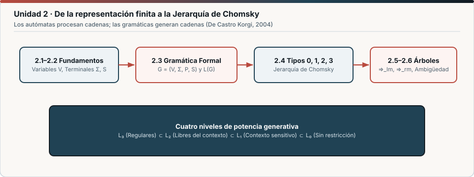

# Unidad 2: Gramáticas Formales

- **Duración:** 20 horas
- **Competencia(s) a desarrollar:** Compara las principales clases de gramáticas, construyendo gramáticas generadoras de lenguajes para conocer la relación que guardan con las clases de lenguajes de la jerarquía de Chomsky.

## Introducción

En la Unidad 1 se definieron los lenguajes abstractos como subconjuntos $L \subseteq \Sigma^*$ y se introdujo la distinción fundamental entre mecanismos **aceptadores** (autómatas que procesan cadenas de entrada para decidir si pertenecen al lenguaje) y mecanismos **generadores** (dispositivos capaces de producir sistemáticamente todas las cadenas válidas de un lenguaje). Como resume De Castro Korgi (2004, p. 81): *"los autómatas procesan cadenas; las gramáticas generan cadenas"*.

El estudio de las **gramáticas formales**, originado en los trabajos del lingüista Noam Chomsky (1956) sobre la estructura sintáctica de los lenguajes naturales y adoptado poco después en la especificación de lenguajes de programación mediante la notación BNF (*Backus-Naur Form*), aporta un marco algebraico finito para describir lenguajes infinitos. Al imponer restricciones progresivas sobre las reglas de reescritura se obtiene la **jerarquía de Chomsky**, que clasifica tanto a las gramáticas como a los lenguajes en cuatro niveles estrictamente encajados ($\mathcal{L}_3 \subsetneq \mathcal{L}_2 \subsetneq \mathcal{L}_1 \subsetneq \mathcal{L}_0$), cada uno emparejado con un modelo específico de autómata. Finalmente, en el ámbito de las gramáticas libres del contexto (Tipo 2), los **árboles de derivación** permiten capturar la estructura jerárquica de las cadenas y diagnosticar o corregir problemas de **ambigüedad** esenciales en el diseño de compiladores y traductores.

## Mapa conceptual

```mermaid
flowchart TD
    U2["Unidad 2: Gramáticas Formales"] --> R["2.1 Representación de lenguajes"]
    U2 --> C["2.2 Conceptos básicos"]
    U2 --> F["2.3 Gramática formal G = (V, Σ, P, S)"]
    U2 --> T["2.4 Jerarquía de Chomsky"]
    U2 --> A["2.5 Árboles de derivación"]
    U2 --> AM["2.6 Ambigüedad"]

    R --> R1["Descriptivas: Extensión, Comprensión, Recursión, ER"]
    R --> R2["Operacionales: Gramáticas y Autómatas"]

    C --> C1["Variables V, Terminales Σ, Inicial S"]
    C --> C2["Producciones α -> β y Formas sentenciales"]

    F --> F1["Derivación directa =>_G y cierre =>_G*"]
    F --> F2["Lenguaje generado L(G) y Equivalencia"]

    T --> T0["Tipo 0: Sin restricción - L_0 (MT)"]
    T --> T1["Tipo 1: Contexto sensitivo - L_1 (ALA)"]
    T --> T2["Tipo 2: Libres del contexto - L_2 (AP)"]
    T --> T3["Tipo 3: Regulares - L_3 (AF)"]

    A --> A1["Frontera (yield)"]
    A --> A2["Derivaciones =>_lm y =>_rm"]

    AM --> AM1["Múltiples árboles sintácticos"]
    AM --> AM2["Desambiguación y Lenguajes inherentemente ambiguos"]
```

## Subtemas

- [2.1 Representación de los lenguajes](2-1-representacion-de-los-lenguajes.md): Métodos finitos para especificar lenguajes finitos e infinitos (extensión, comprensión, definiciones recursivas, expresiones regulares, gramáticas y autómatas) junto con sus alcances expresivos.
- [2.2 Conceptos básicos de gramáticas](2-2-conceptos-basicos-de-gramaticas.md): Origen lingüístico (Chomsky, 1956), símbolos no terminales ($V$), símbolos terminales ($\Sigma$), símbolo inicial ($S$), reglas de producción ($\alpha \to \beta$), formas sentenciales y sentencias.
- [2.3 Gramáticas formales](2-3-gramaticas-formales.md): Definición matemática de una gramática generativa $G = (V, \Sigma, P, S)$, derivación directa ($\Rightarrow_G$), derivación en cero o más pasos ($\Rightarrow_G^*$), lenguaje generado $L(G)$ y equivalencia de gramáticas.
- [2.4 Tipos de gramáticas](2-4-tipos-de-gramaticas.md): Clasificación de la jerarquía de Chomsky ($\mathcal{L}_3 \subsetneq \mathcal{L}_2 \subsetneq \mathcal{L}_1 \subsetneq \mathcal{L}_0$) y su correspondencia con los modelos de cómputo:
  - 2.4.1 Gramáticas sin restricción: Producciones Tipo 0 ($\alpha \to \beta$), lenguajes recursivamente enumerables y Máquinas de Turing.
  - 2.4.2 Gramáticas de contexto sensitivo: Producciones Tipo 1 (contextuales y no contractivas), autómatas linealmente acotados y lenguajes como $\{a^n b^n c^n \mid n \ge 1\}$.
  - 2.4.3 Gramáticas libres del contexto: Producciones Tipo 2 ($A \to \alpha$), autómatas con pila, notación BNF y estructuras anidadas.
  - 2.4.4 Gramáticas regulares: Producciones Tipo 3 (lineales por la derecha y por la izquierda) y su equivalencia con los autómatas finitos.
- [2.5 Árboles y diagramas de derivación](2-5-arboles-y-diagramas-de-derivacion.md): Representación jerárquica de derivaciones en gramáticas libres del contexto, frontera (*yield*), derivaciones más a la izquierda ($\Rightarrow_{lm}$) y más a la derecha ($\Rightarrow_{rm}$), y teorema de equivalencia.
- [2.6 Ambigüedad](2-6-ambiguedad.md): Existencia de múltiples árboles sintácticos para una misma cadena, casos clásicos (expresiones aritméticas y *dangling else*), técnicas de desambiguación (precedencia y asociatividad) y lenguajes inherentemente ambiguos.

## Referencias

- Acevedo Juárez, A. (2006). *Teoría de la computación* [Tesis de licenciatura, Instituto Tecnológico de Celaya].
- Chomsky, N. (1956). Three models for the description of language. *IRE Transactions on Information Theory*, *2*(3), 113–124.
- De Castro Korgi, R. (2004). *Teoría de la computación: Lenguajes, autómatas, gramáticas*. Universidad Nacional de Colombia.
