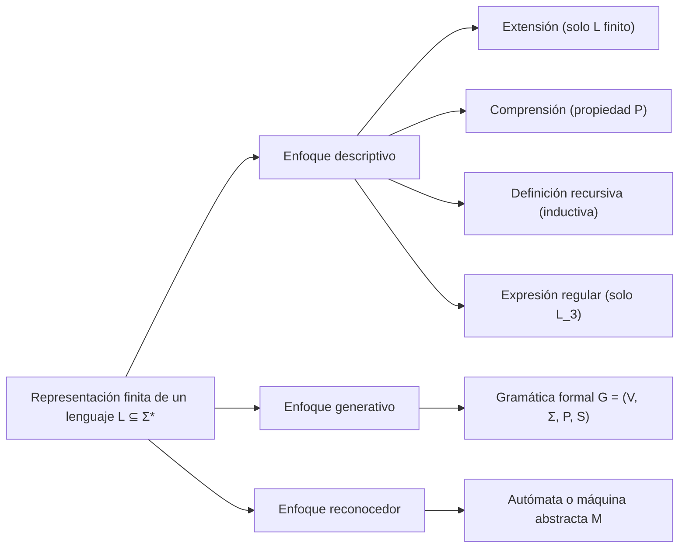
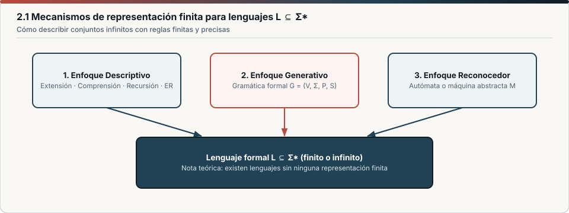
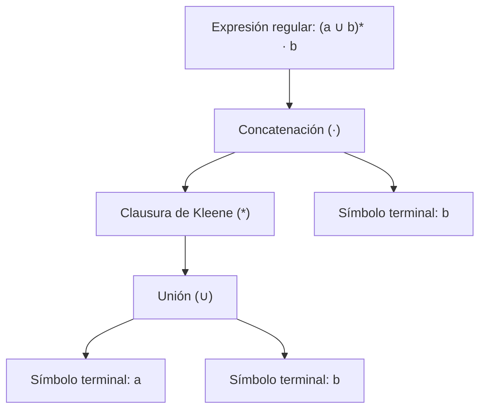

# 2.1 Representación de los lenguajes

## Introducción

Un lenguaje formal $L$ sobre un alfabeto $\Sigma$ se define como cualquier subconjunto de cadenas de $\Sigma^*$, es decir, $L \subseteq \Sigma^*$ (De Castro Korgi, 2004, p. 10). Aunque todo alfabeto $\Sigma$ es finito por definición, el conjunto $\Sigma^*$ es infinito numerable y la gran mayoría de los lenguajes de interés en ciencias de la computación —como el conjunto de identificadores válidos, el conjunto de expresiones aritméticas bien formadas o el conjunto de programas sintácticamente correctos en un lenguaje de programación— son también **lenguajes infinitos**.

Dado que tanto la mente humana como los sistemas de cómputo solo pueden almacenar y manipular descripciones de tamaño finito, surge un problema metodológico central en la teoría de la computación: **¿cómo representar de manera finita, precisa y sin ambigüedad un lenguaje que puede contener infinitas cadenas?** Para resolver este problema existen diversos mecanismos de representación que pueden agruparse en tres enfoques complementarios: representaciones **descriptivas**, representaciones **generativas** y representaciones **reconocedoras**.

## Mecanismos de representación finita

### 1. Representación por extensión

Consiste en enumerar explícitamente todos los elementos del lenguaje entre llaves:

$$L = \{w_1, w_2, \dots, w_n\}$$

**Alcance y limitaciones:** Es un método completamente riguroso únicamente para **lenguajes finitos** (incluidos el lenguaje vacío $\emptyset$ y el lenguaje $\{\lambda\}$). Cuando se aplica a lenguajes infinitos mediante puntos suspensivos —como $\{a, aa, aaa, \dots\}$—, la notación deja de ser formalmente precisa, pues exige inferir una regla implícita que puede resultar ambigua. Por ejemplo, escribir $\{ab, aabb, \dots\}$ podría aludir tanto a $\{a^n b^n \mid n \ge 1\}$ como a $\{(ab)^n \mid n \ge 1\}$ o a $\{a^{2^k-1} b^{2^k-1} \mid k \ge 1\}$.

### 2. Representación por comprensión

Consiste en especificar el lenguaje mediante un predicado o propiedad característica $P(w)$ que decide la pertenencia de cualquier cadena $w \in \Sigma^*$:

$$L = \{w \in \Sigma^* \mid P(w)\}$$

Alternativamente, se emplea notación paramétrica sobre exponentes o variables de cadena, como $L = \{a^n b^n \mid n \ge 0\}$ o $L = \{ww^R \mid w \in \{a, b\}^*\}$.

**Alcance y limitaciones:** Permite describir con total exactitud tanto lenguajes finitos como infinitos de cualquier complejidad. Sin embargo, es una especificación **declarativa** y no necesariamente algorítmica: saber que un lenguaje satisface una propiedad $P(w)$ no siempre proporciona de inmediato un procedimiento mecánico para generar sus cadenas ni para diseñar un analizador léxico o sintáctico eficiente.

### 3. Definiciones recursivas (o inductivas)

Una **definición recursiva** especifica un lenguaje $L \subseteq \Sigma^*$ en tres cláusulas formales:

1. **Cláusula base:** Se indica explícitamente un conjunto finito de cadenas iniciales (o lenguajes básicos) que pertenecen a $L$.
2. **Cláusula inductiva (o recursiva):** Se establecen reglas constructivas que permiten obtener nuevas cadenas de $L$ a partir de cadenas que ya pertenecen a $L$.
3. **Cláusula de cierre (o extremal):** Se estipula que ninguna otra cadena pertenece a $L$, salvo aquellas que se obtienen aplicando un número finito de veces las cláusulas base e inductiva.

Por ejemplo, el lenguaje de los paréntesis balanceados sobre $\Sigma = \{(, )\}$ se define recursivamente así:
- **Base:** $\lambda \in L$.
- **Paso inductivo:** Si $u, v \in L$, entonces $(u) \in L$ y $uv \in L$.
- **Cierre:** Ninguna otra cadena pertenece a $L$.

De forma análoga, De Castro Korgi (2004, pp. 18–19) define recursivamente la clase de los **lenguajes regulares** sobre $\Sigma$ partiendo de $\emptyset$, $\{\lambda\}$ y $\{a\}$ ($a \in \Sigma$) y cerrando bajo unión ($\cup$), concatenación ($\cdot$) y clausura de Kleene ($^*$).

### 4. Expresiones regulares (ER)

Las **expresiones regulares** ofrecen una notación algebraica compacta para describir exactamente la familia de los **lenguajes regulares** ($\mathcal{L}_3$). Formalmente, sobre un alfabeto $\Sigma$, se definen recursivamente (De Castro Korgi, 2004, p. 19):

- **Base:** $\emptyset$, $\lambda$ y cada símbolo $a \in \Sigma$ son expresiones regulares que representan respectivamente a $L(\emptyset) = \emptyset$, $L(\lambda) = \{\lambda\}$ y $L(a) = \{a\}$.
- **Paso inductivo:** Si $R$ y $S$ son expresiones regulares, también lo son $(R \cup S)$ (o $R + S$), $(R)(S)$ y $(R)^*$, cuyos lenguajes denotados cumplen:
  $$L(R \cup S) = L(R) \cup L(S), \qquad L(RS) = L(R)L(S), \qquad L(R^*) = (L(R))^*$$

**Ventajas y limitaciones:** Toda expresión regular representa un único lenguaje regular, aunque la representación **no es única** (por ejemplo, $(a \cup b)^*$ y $(a^* b^*)^*$ denotan el mismo lenguaje). Su principal limitación es su poder expresivo acotado: no existe ninguna expresión regular capaz de representar lenguajes con dependencias no acotadas, como $\{a^n b^n \mid n \ge 0\}$ o las expresiones con paréntesis anidados equilibrados.

### 5. Gramáticas formales (enfoque generativo)

Una **gramática formal** $G = (V, \Sigma, P, S)$ representa un lenguaje mediante un conjunto finito de reglas de reescritura o producción $P$ que, a partir del símbolo inicial $S$, generan paso a paso todas las cadenas de $L(G)$. A diferencia de las expresiones regulares, las gramáticas formales permiten describir lenguajes no regulares (como estructuras anidadas en compiladores) y abarcan todos los niveles computables de la jerarquía de Chomsky (De Castro Korgi, 2004, p. 81).

### 6. Autómatas (enfoque reconocedor)

Un **autómata** o máquina abstracta $M$ representa un lenguaje $L(M)$ de manera operacional: una cadena $w \in \Sigma^*$ pertenece a $L(M)$ si y solo si $M$ la procesa y alcanza una condición de aceptación. Según la memoria disponible del dispositivo, los autómatas corresponden exactamente a las clases de gramáticas:
- **Autómatas finitos (AFD/AFN):** reconocen lenguajes regulares (equivalentes a las expresiones regulares por el Teorema de Kleene).
- **Autómatas con pila (AP):** reconocen lenguajes libres del contexto.
- **Autómatas linealmente acotados (ALA):** reconocen lenguajes sensibles al contexto.
- **Máquinas de Turing (MT):** reconocen lenguajes recursivamente enumerables.

### Nota teórica sobre la existencia de lenguajes sin representación finita

Aunque disponemos de formalismos tan expresivos como las gramáticas generales o las Máquinas de Turing, **no todo lenguaje $L \subseteq \Sigma^*$ posee una representación finita**. La razón es intuitiva: cualquier descripción finita (ya sea una expresión regular, una gramática o un programa) es un texto de longitud finita, de modo que todas las descripciones posibles pueden enumerarse en una lista ordenada (primera receta, segunda receta, tercera receta, etc.). Sin embargo, la totalidad de los subconjuntos de cadenas posibles ($\mathcal{P}(\Sigma^*)$) forma un infinito estrictamente más grande que no cabe en ninguna lista numerable. Por ello, existen lenguajes para los cuales jamás podrá escribirse ninguna gramática, ningún autómata ni ninguna regla finita.

## Cuadro comparativo de representaciones

| Mecanismo | Naturaleza | Alcance (lenguajes que describe) | Ventaja principal | Limitación principal |
| :--- | :--- | :--- | :--- | :--- |
| **Extensión** | Descriptiva | Solo lenguajes finitos | Claridad absoluta sin ambigüedad | Imposible para lenguajes infinitos |
| **Comprensión** | Descriptiva | Cualquier lenguaje definible por predicado | Concisión matemática directa | No provee algoritmo generador o reconocedor |
| **Definición recursiva** | Descriptiva / Inductiva | Lenguajes con estructura inductiva | Facilita demostraciones por inducción | Menos uniforme para automatizar |
| **Expresión regular** | Descriptiva / Algebraica | Solo lenguajes regulares ($\mathcal{L}_3$) | Base estándar de analizadores léxicos | No expresa conteo arbitrario ni anidamiento |
| **Gramática formal** | Generativa | Jerarquía completa ($\mathcal{L}_3 \subsetneq \mathcal{L}_2 \subsetneq \mathcal{L}_1 \subsetneq \mathcal{L}_0$) | Modela sintaxis jerárquica y compiladores | Puede presentar ambigüedad sintáctica |
| **Autómata** | Reconocedora | Según modelo: AF ($\mathcal{L}_3$), AP ($\mathcal{L}_2$), ALA ($\mathcal{L}_1$), MT ($\mathcal{L}_0$) | Implementación directa como reconocedor | Diseño más laborioso que expresiones o reglas |

## Ejemplos desarrollados paso a paso

### Ejemplo 1: Múltiples representaciones de los naturales en binario

Considere sobre el alfabeto $\Sigma = \{0, 1\}$ el lenguaje $L_1$ de las cadenas que representan números naturales en numeración binaria **sin ceros a la izquierda** (excepto el propio $0$), estudiado por De Castro Korgi (2004, p. 85).

1. **Intento por extensión (insuficiente):**
   $$L_1 = \{0, 1, 10, 11, 100, 101, 110, 111, \dots\}$$
   Al ser $L_1$ infinito, la enumeración con puntos suspensivos es informal y no sirve como especificación rigurosa.

2. **Representación por comprensión:**
   $$L_1 = \{w \in \{0, 1\}^* \mid w = 0 \;\lor\; (w = 1u \text{ con } u \in \{0, 1\}^*)\}$$
   También puede expresarse como $L_1 = \{0\} \cup \{1w \mid w \in \{0, 1\}^*\}$.

3. **Definición recursiva:**
   - **Base:** $0 \in L_1$ y $1 \in L_1$.
   - **Paso inductivo:** Si $w \in L_1$ y $w \ne 0$, entonces $w0 \in L_1$ y $w1 \in L_1$.
   - **Cierre:** Ninguna otra cadena está en $L_1$.

   *Verificación paso a paso para $w = 101$:*
   - Por la base, $1 \in L_1$ (y $1 \ne 0$).
   - Por el paso inductivo añadiendo $0$, $10 \in L_1$ (y $10 \ne 0$).
   - Por el paso inductivo añadiendo $1$, $101 \in L_1$.
   En cambio, $01 \notin L_1$, pues el caso base $0$ no puede extenderse en el paso inductivo.

4. **Expresión regular:**
   $$R_1 = 0 \cup 1(0 \cup 1)^*$$
   *Verificación:* $L(R_1) = \{0\} \cup \{1\} \cdot \{0, 1\}^*$. Para $101$: el primer símbolo proviene de $1$, y el sufijo $01 \in \{0,1\}^2 \subseteq (0 \cup 1)^*$.

5. **Gramática formal (De Castro Korgi, 2004, p. 85):**
   Sea $G_1 = (\{S, A\}, \{0, 1\}, P_1, S)$ con producciones:
   $$S \to 0 \mid 1A, \qquad A \to 0A \mid 1A \mid \lambda$$
   *Derivación paso a paso de $w = 101$:*
   $$S \Rightarrow_{G_1} 1A \Rightarrow_{G_1} 10A \Rightarrow_{G_1} 101A \Rightarrow_{G_1} 101$$
   La única cadena que comienza con $0$ es $S \Rightarrow_{G_1} 0$.

6. **Autómata finito determinista (enfoque reconocedor):**
   Un AFD con estados $Q = \{q_0, q_1, q_2, q_e\}$, estado inicial $q_0$ y estados de aceptación $F = \{q_1, q_2\}$:
   - Desde $q_0$: con $0$ pasa a $q_1$ (aceptación, solo para el $0$ aislado); con $1$ pasa a $q_2$ (aceptación).
   - Desde $q_1$: con $0$ o $1$ pasa al estado pozo/error $q_e$ (rechaza ceros a la izquierda como `01`).
   - Desde $q_2$: con $0$ o $1$ permanece en $q_2$.

---

### Ejemplo 2: Representación de un lenguaje no regular $L_2 = \{a^n b^n \mid n \ge 0\}$

Considere sobre $\Sigma = \{a, b\}$ el lenguaje $L_2$ formado por bloques de $a$ seguidos de exactamente el mismo número de $b$.

1. **Por extensión (insuficiente):** $\{\lambda, ab, aabb, aaabbb, \dots\}$.
2. **Por comprensión:**
   $$L_2 = \{a^n b^n \mid n \ge 0\} = \{w \in \{a, b\}^* \mid w = a^n b^n \text{ para algún } n \in \mathbb{N}\}$$
3. **¿Por qué no admite expresión regular ni autómata finito?**
   Una expresión regular o un autómata finito solo cuenta con un número finito de estados de memoria. Para aceptar $a^n b^n$ es necesario recordar exactamente cuántas $a$ se leyeron antes de la primera $b$, para cualquier $n$ arbitrariamente grande. Por el lema de bombeo para lenguajes regulares (De Castro Korgi, 2004, Cap. 3), $L_2$ **no es regular**, por lo que **ninguna expresión regular** ni **ningún AFD/AFN** puede representarlo.
4. **Definición recursiva:**
   - **Base:** $\lambda \in L_2$.
   - **Paso inductivo:** Si $w \in L_2$, entonces $awb \in L_2$.
   - **Cierre:** Ninguna otra cadena pertenece a $L_2$.

   *Construcción paso a paso de $a^3 b^3$:*
   $$\lambda \in L_2 \;\Longrightarrow\; a\lambda b = ab \in L_2 \;\Longrightarrow\; a(ab)b = aabb \in L_2 \;\Longrightarrow\; a(aabb)b = aaabbb \in L_2$$

5. **Gramática formal (De Castro Korgi, 2004, p. 86):**
   Sea $G_2 = (\{S\}, \{a, b\}, \{S \to aSb,\; S \to \lambda\}, S)$.

   *Derivación paso a paso de $a^3 b^3$:*
   $$S \Rightarrow_{G_2} aSb \Rightarrow_{G_2} aaSbb \Rightarrow_{G_2} aaaSbbb \Rightarrow_{G_2} aaa\lambda bbb = aaabbb$$
   La gramática refleja de manera directa la estructura inductiva del lenguaje: cada aplicación de $S \to aSb$ agrega simultáneamente una $a$ a la izquierda y una $b$ a la derecha, garantizando igualdad de exponentes.

## Ejercicios propuestos

1. Para cada uno de los siguientes lenguajes sobre $\Sigma = \{a, b\}$, indica si es finito o infinito y escribe al menos **dos representaciones finitas distintas** (comprensión, definición recursiva, expresión regular o gramática):
   - a) El conjunto de todas las cadenas de longitud menor o igual que $2$.
   - b) El conjunto de todas las cadenas con un número par de símbolos $a$.
   - c) El conjunto de los palíndromos de longitud impar sobre $\{a, b\}$.
2. Dada la siguiente definición recursiva sobre $\Sigma = \{0, 1\}$:
   - Base: $0 \in L$ y $1 \in L$.
   - Paso inductivo: Si $w \in L$, entonces $0w0 \in L$ y $1w1 \in L$.
   - Cierre: Nada más está en $L$.
   Describe $L$ por **comprensión**, verifica paso a paso si $10101 \in L$ y $1001 \in L$, y construye una gramática que lo genere.
3. Demuestra por qué la expresión regular $(a \cup b)^*$ y la expresión regular $(a^* b^*)^*$ representan exactamente el mismo lenguaje (De Castro Korgi, 2004, p. 20), y muestra una cadena derivada con ambos esquemas.
4. Sea $L = \{a^n b^{2n} \mid n \ge 1\}$ sobre $\Sigma = \{a, b\}$. Explica por qué no puede representarse por extensión ni mediante expresiones regulares, y proporciona una definición por comprensión, una definición recursiva y una gramática formal para $L$.

## Referencias

- Acevedo Juárez, A. (2006). *Teoría de la computación* [Tesis de licenciatura, Instituto Tecnológico de Celaya].
- De Castro Korgi, R. (2004). *Teoría de la computación: Lenguajes, autómatas, gramáticas*. Universidad Nacional de Colombia.
