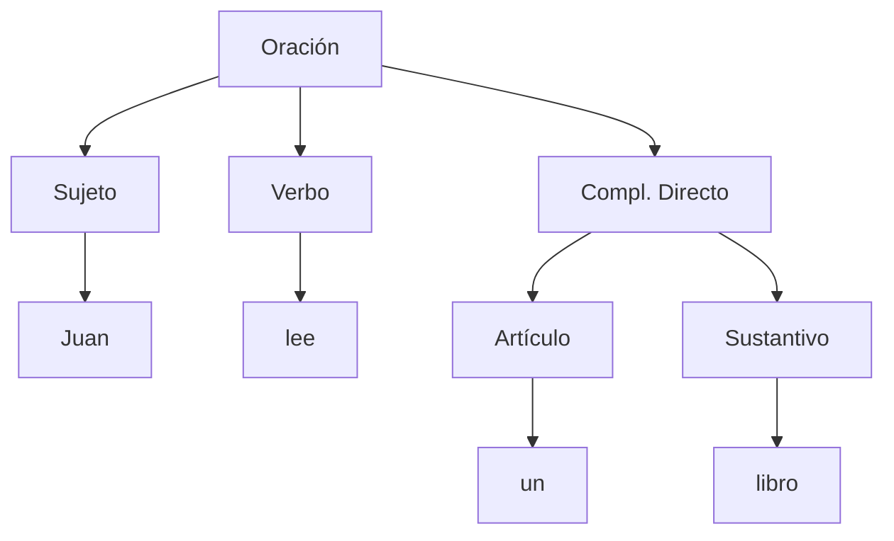
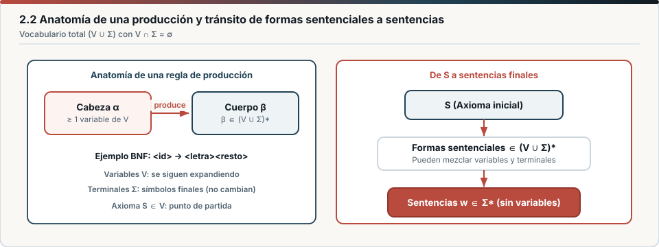
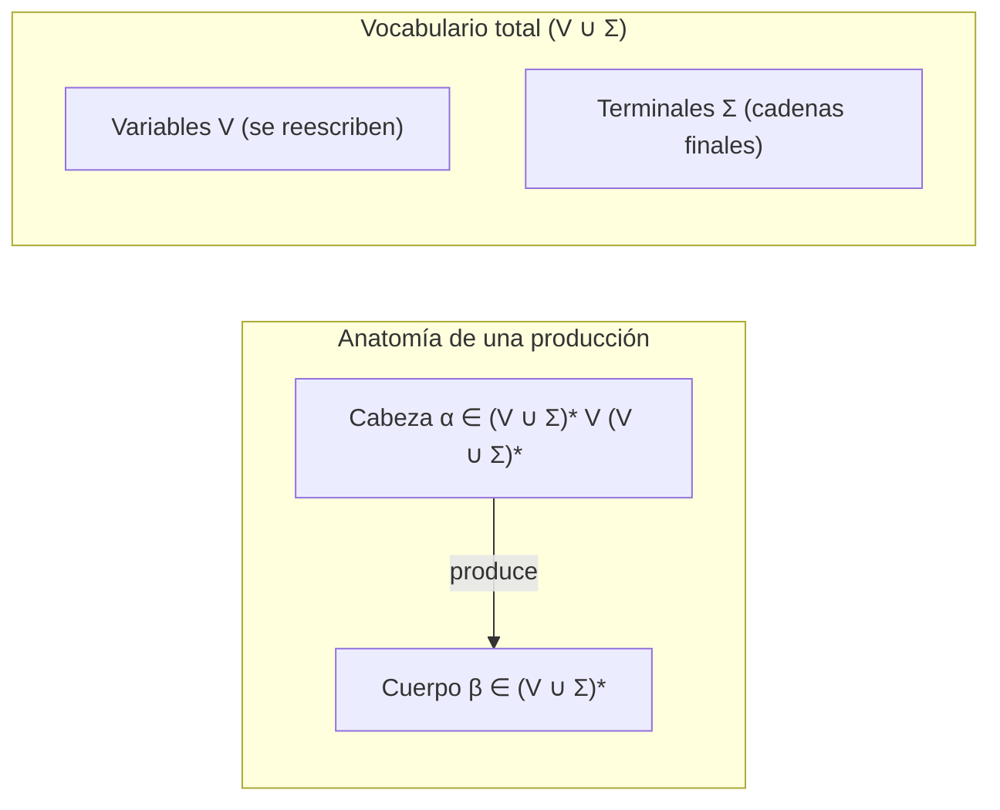

# 2.2 Conceptos básicos de gramáticas

## Origen e intuición de las gramáticas generativas

La noción moderna de gramática formal tiene su origen en los trabajos del lingüista estadounidense **Noam Chomsky** (1956), quien introdujo el concepto de **gramática generativa** con el objetivo de describir formalmente la sintaxis de las lenguas naturales como el español, el inglés o el francés (De Castro Korgi, 2004, p. 4, p. 81). La idea central de Chomsky consistió en modelar el conocimiento sintáctico de un hablante mediante un conjunto finito de reglas de transformación capaces de generar todas —y únicamente— las oraciones gramaticalmente válidas de un idioma.

Por ejemplo, en español una oración simple puede descomponerse en categorías sintácticas abstractas que se refinan sucesivamente hasta obtener palabras concretas del diccionario:

En la década de 1960, investigadores en ciencias de la computación (entre ellos John Backus y Peter Naur) advirtieron que este mismo mecanismo de reescritura permitía especificar con total precisión la sintaxis de lenguajes de programación como ALGOL 60 y construir analizadores sintácticos (*parsers*) para compiladores. A partir de esta convergencia surgieron la **notación BNF** (*Backus-Naur Form*) y los elementos estructurales que definen toda gramática formal.

## Elementos constitutivos de una gramática

Una gramática formal articula cuatro componentes fundamentales: dos conjuntos de símbolos (no terminales y terminales), un símbolo distinguido de arranque y un conjunto finito de reglas de producción.

### 1. Símbolos no terminales o variables ($V$)

Los **símbolos no terminales** (también llamados **variables** o categorías sintácticas) forman un conjunto finito no vacío $V$. Representan estructuras intermedias o abstracciones gramaticales que aún deben seguir desarrollándose durante el proceso de generación y que **no forman parte de las cadenas finales** del lenguaje.

- **Convención notacional:** En teoría de la computación suelen representarse mediante letras mayúsculas ($S, A, B, C, \dots$). En especificaciones de lenguajes de programación (BNF) o gramáticas de lenguajes naturales suelen escribirse entre paréntesis angulares, como $\langle\text{expresión}\rangle$, $\langle\text{identificador}\rangle$ o $\langle\text{Sujeto}\rangle$ (De Castro Korgi, 2004, pp. 94–96).

### 2. Símbolos terminales ($\Sigma$)

Los **símbolos terminales** constituyen el alfabeto básico $\Sigma$ a partir del cual se construyen las palabras o cadenas finales del lenguaje. Reciben este nombre porque, una vez generados en una derivación, **ya no pueden ser reemplazados** por ninguna regla gramatical.

- **Condición de disjunción:** Los conjuntos $V$ y $\Sigma$ deben ser estrictamente disjuntos:
  $$V \cap \Sigma = \emptyset$$
- **Convención notacional:** En textos matemáticos se denotan con letras minúsculas ($a, b, c, \dots$), dígitos ($0, 1, \dots$) u operadores ($+, *, (, )$). En el contexto de compiladores, los terminales corresponden a los **componentes léxicos**, **lexemas** o ***tokens*** del lenguaje de programación (De Castro Korgi, 2004, p. 94); en lenguajes naturales, a las palabras del vocabulario.

### 3. Símbolo inicial ($S$)

El **símbolo inicial** (también llamado **axioma** de la gramática) es una variable distinguida $S \in V$ desde la cual comienza obligatoriamente toda derivación. Representa la categoría sintáctica de mayor jerarquía del lenguaje que se desea generar (por ejemplo, $\langle\text{Oración}\rangle$, $\langle\text{Programa}\rangle$ o simplemente $S$).

### 4. Reglas de producción ($\alpha \to \beta$)

Las **reglas de producción** (o **reglas de reescritura**) forman un conjunto finito $P$ de pares ordenados $(\alpha, \beta)$, escritos habitualmente como:

$$\alpha \to \beta$$

y leídos *"$\alpha$ produce $\beta$"* o *"$\alpha$ se reescribe como $\beta$"*. Sus partes reciben nombres específicos (De Castro Korgi, 2004, p. 82):

- **Cabeza** (o lado izquierdo): la cadena $\alpha \in (V \cup \Sigma)^* V (V \cup \Sigma)^*$. Se exige que $\alpha$ contenga **al menos una variable** de $V$, pues de lo contrario las reglas podrían reescribir cadenas compuestas únicamente por terminales.
- **Cuerpo** (o lado derecho): la cadena $\beta \in (V \cup \Sigma)^*$, que puede contener variables, terminales o incluso ser la cadena vacía $\lambda$ (en cuyo caso $\alpha \to \lambda$ se denomina **producción $\lambda$** o producción anulable).

**Notación abreviada:** Cuando una misma cabeza $\alpha$ admite varios cuerpos posibles $\beta_1, \beta_2, \dots, \beta_k$, es costumbre agrupar las producciones utilizando la barra vertical $|$ (que se lee *"o"*):

$$\alpha \to \beta_1 \mid \beta_2 \mid \cdots \mid \beta_k$$

Así, las reglas $S \to aSb$ y $S \to \lambda$ se escriben de manera compacta como $S \to aSb \mid \lambda$. En la notación BNF clásica suele emplearse el símbolo `::=` en lugar de $\to$.

### 5. Formas sentenciales y sentencias

Al aplicar sucesivamente reglas de producción partiendo del símbolo inicial $S$, se obtienen cadenas intermedias sobre el vocabulario completo $(V \cup \Sigma)^*$:

- **Forma sentencial:** Es cualquier cadena $\gamma \in (V \cup \Sigma)^*$ que puede obtenerse a partir del símbolo inicial $S$ mediante cero o más aplicaciones de las reglas de producción. Una forma sentencial puede contener variables, terminales o una mezcla de ambos (incluidos el propio símbolo $S$ y la cadena vacía $\lambda$).
- **Sentencia** (o **frase / palabra del lenguaje**): Es toda forma sentencial que está formada **únicamente por símbolos terminales**, es decir, una cadena $w \in \Sigma^*$ obtenida desde $S$. El conjunto de todas las sentencias derivables constituye el lenguaje generado por la gramática.

$$\text{Sentencias} \;\subseteq\; \text{Formas sentenciales} \;\subseteq\; (V \cup \Sigma)^*$$

En otras palabras, toda sentencia es una forma sentencial sin variables pendientes de expandir, pero una forma sentencial que aún contenga al menos un elemento de $V$ representa un paso intermedio inconcluso.

## Ejemplos desarrollados paso a paso

### Ejemplo 1: Fragmento gramatical del español (inspiración lingüística)

Adaptando el modelo propuesto por De Castro Korgi (2004, Secc. 4.6, p. 96), considérese una gramática para generar oraciones simples en español:

- **Variables ($V$):**
  $$V = \{\langle\text{Oración}\rangle,\; \langle\text{Sujeto}\rangle,\; \langle\text{Verbo}\rangle,\; \langle\text{ComplDirecto}\rangle,\; \langle\text{Artículo}\rangle,\; \langle\text{Sustantivo}\rangle\}$$
- **Terminales ($\Sigma$):**
  $$\Sigma = \{\text{Juan},\; \text{María},\; \text{lee},\; \text{escribe},\; \text{un},\; \text{una},\; \text{libro},\; \text{carta}\}$$
  Se verifica que $V \cap \Sigma = \emptyset$.
- **Símbolo inicial ($S$):** $S = \langle\text{Oración}\rangle$.
- **Producciones ($P$):**
  $$\begin{aligned}
  \langle\text{Oración}\rangle &\to \langle\text{Sujeto}\rangle\;\langle\text{Verbo}\rangle\;\langle\text{ComplDirecto}\rangle \\
  \langle\text{Sujeto}\rangle &\to \text{Juan} \mid \text{María} \\
  \langle\text{Verbo}\rangle &\to \text{lee} \mid \text{escribe} \\
  \langle\text{ComplDirecto}\rangle &\to \langle\text{Artículo}\rangle\;\langle\text{Sustantivo}\rangle \\
  \langle\text{Artículo}\rangle &\to \text{un} \mid \text{una} \\
  \langle\text{Sustantivo}\rangle &\to \text{libro} \mid \text{carta}
  \end{aligned}$$

**Generación paso a paso y distinción entre formas sentenciales y sentencias:**

1. Partimos del símbolo inicial (primera **forma sentencial**, puramente no terminal):
   $$\langle\text{Oración}\rangle$$
2. Aplicamos $\langle\text{Oración}\rangle \to \langle\text{Sujeto}\rangle\;\langle\text{Verbo}\rangle\;\langle\text{ComplDirecto}\rangle$:
   $$\langle\text{Sujeto}\rangle\;\langle\text{Verbo}\rangle\;\langle\text{ComplDirecto}\rangle \quad \text{(forma sentencial)}$$
3. Reemplazamos $\langle\text{Sujeto}\rangle$ por $\text{María}$:
   $$\text{María}\;\langle\text{Verbo}\rangle\;\langle\text{ComplDirecto}\rangle \quad \text{(forma sentencial mixta)}$$
4. Reemplazamos $\langle\text{Verbo}\rangle$ por $\text{escribe}$:
   $$\text{María}\;\text{escribe}\;\langle\text{ComplDirecto}\rangle \quad \text{(forma sentencial mixta)}$$
5. Reemplazamos $\langle\text{ComplDirecto}\rangle$ por $\langle\text{Artículo}\rangle\;\langle\text{Sustantivo}\rangle$:
   $$\text{María}\;\text{escribe}\;\langle\text{Artículo}\rangle\;\langle\text{Sustantivo}\rangle \quad \text{(forma sentencial mixta)}$$
6. Reemplazamos $\langle\text{Artículo}\rangle$ por $\text{una}$ y luego $\langle\text{Sustantivo}\rangle$ por $\text{carta}$:
   $$\text{María}\;\text{escribe}\;\text{una}\;\langle\text{Sustantivo}\rangle \quad \text{(forma sentencial)}$$
   $$\text{María}\;\text{escribe}\;\text{una}\;\text{carta} \quad \text{(sentencia en }\Sigma^*\text{)}$$

Obsérvese que la gramática también puede generar cadenas sintácticamente válidas bajo estas reglas aunque semánticamente discordantes en género, como `"Juan lee una libro"`, lo que ilustra que la **sintaxis** formal captura la estructura posicional y exige reglas más finas (o contexto) para restringir la concordancia.

---

### Ejemplo 2: Identificadores en lenguajes de programación (notación BNF)

En la mayoría de los lenguajes de programación, un identificador válido comienza con una letra seguida de cero o más letras o dígitos (De Castro Korgi, 2004, Secc. 4.5, p. 95). Para facilitar la lectura usaremos un subconjunto reducido de letras y dígitos:

- **Variables ($V$):** $V = \{\langle\text{id}\rangle,\; \langle\text{resto}\rangle,\; \langle\text{letra}\rangle,\; \langle\text{dígito}\rangle\}$
- **Terminales ($\Sigma$):** $\Sigma = \{a, b, x, 0, 1, 2\}$
- **Símbolo inicial ($S$):** $\langle\text{id}\rangle$
- **Producciones ($P$):**
  $$\begin{aligned}
  \langle\text{id}\rangle &\to \langle\text{letra}\rangle\;\langle\text{resto}\rangle \\
  \langle\text{resto}\rangle &\to \langle\text{letra}\rangle\;\langle\text{resto}\rangle \mid \langle\text{dígito}\rangle\;\langle\text{resto}\rangle \mid \lambda \\
  \langle\text{letra}\rangle &\to a \mid b \mid x \\
  \langle\text{dígito}\rangle &\to 0 \mid 1 \mid 2
  \end{aligned}$$

**Generación paso a paso de la sentencia `x2a`:**

1. $\langle\text{id}\rangle$ *(forma sentencial inicial)*
2. $\langle\text{letra}\rangle\;\langle\text{resto}\rangle$ *(aplicando $\langle\text{id}\rangle \to \langle\text{letra}\rangle\;\langle\text{resto}\rangle$)*
3. $x\;\langle\text{resto}\rangle$ *(aplicando $\langle\text{letra}\rangle \to x$)*
4. $x\;\langle\text{dígito}\rangle\;\langle\text{resto}\rangle$ *(aplicando $\langle\text{resto}\rangle \to \langle\text{dígito}\rangle\;\langle\text{resto}\rangle$)*
5. $x2\;\langle\text{resto}\rangle$ *(aplicando $\langle\text{dígito}\rangle \to 2$)*
6. $x2\;\langle\text{letra}\rangle\;\langle\text{resto}\rangle$ *(aplicando $\langle\text{resto}\rangle \to \langle\text{letra}\rangle\;\langle\text{resto}\rangle$)*
7. $x2a\;\langle\text{resto}\rangle$ *(aplicando $\langle\text{letra}\rangle \to a$)*
8. $x2a$ *(aplicando $\langle\text{resto}\rangle \to \lambda$ — **sentencia**, ya que $x2a \in \Sigma^*$)*

**¿Por qué `2xa` no es una sentencia de esta gramática?**  
Toda derivación comienza obligatoriamente con $\langle\text{id}\rangle \to \langle\text{letra}\rangle\;\langle\text{resto}\rangle$, y $\langle\text{letra}\rangle$ únicamente puede producir $a, b$ o $x$. Como ninguna forma sentencial puede comenzar con $\langle\text{dígito}\rangle$, la cadena `2xa` jamás se convierte en sentencia del lenguaje.

## Ejercicios propuestos

1. Dada la siguiente gramática en notación compacta para números reales sin signo (adaptada de De Castro Korgi, 2004, p. 94):
   $$\begin{aligned}
   \langle\text{real}\rangle &\to \langle\text{dígitos}\rangle\;\langle\text{decimal}\rangle\;\langle\text{exp}\rangle \\
   \langle\text{dígitos}\rangle &\to \langle\text{dígitos}\rangle\;\langle\text{dígitos}\rangle \mid 0 \mid 1 \mid \cdots \mid 9 \\
   \langle\text{decimal}\rangle &\to .\langle\text{dígitos}\rangle \mid \lambda \\
   \langle\text{exp}\rangle &\to \texttt{E}\langle\text{dígitos}\rangle \mid \texttt{E+}\langle\text{dígitos}\rangle \mid \texttt{E-}\langle\text{dígitos}\rangle \mid \lambda
   \end{aligned}$$
   - a) Identifica explícitamente los conjuntos $V$, $\Sigma$ y el símbolo inicial $S$.
   - b) Muestra paso a paso la generación de `32.5E-1`, señalando en cada línea la forma sentencial obtenida.
   - c) Explica qué reglas impiden generar `.325` o `42.E`.
2. Considere las producciones $S \to aSb \mid A$, $A \to cA \mid c$. Clasifica cada una de las siguientes cadenas como *forma sentencial (no sentencia)*, *sentencia* o *ninguna de las dos*:
   `aSbb`, `aaAbb`, `aaccbb`, `accb`, `ba`. Justifica tu respuesta.
3. Explica por qué en la definición de regla de producción $\alpha \to \beta$ se exige que la cabeza $\alpha$ contenga al menos un símbolo de $V$ (y no pueda estar formada exclusivamente por símbolos terminales de $\Sigma$). ¿Qué ocurriría con la noción de terminal si se permitiera una regla como $ab \to ba$?
4. Diseña los conjuntos $V$, $\Sigma$, $S$ y $P$ de una gramática sencilla que modele asignaciones en un lenguaje de programación como `x = y + 1;` o `a = 0;` sobre variables $\{x, y, a\}$ y dígitos $\{0, 1\}$. Muestra paso a paso la obtención de una sentencia.

## Referencias

- Acevedo Juárez, A. (2006). *Teoría de la computación* [Tesis de licenciatura, Instituto Tecnológico de Celaya].
- Chomsky, N. (1956). Three models for the description of language. *IRE Transactions on Information Theory*, *2*(3), 113–124.
- De Castro Korgi, R. (2004). *Teoría de la computación: Lenguajes, autómatas, gramáticas*. Universidad Nacional de Colombia.
