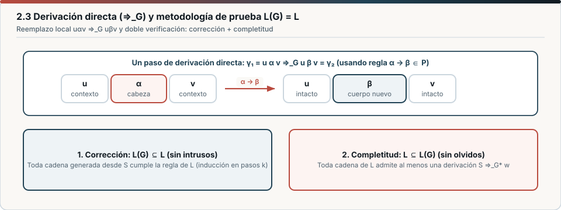
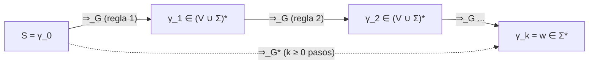
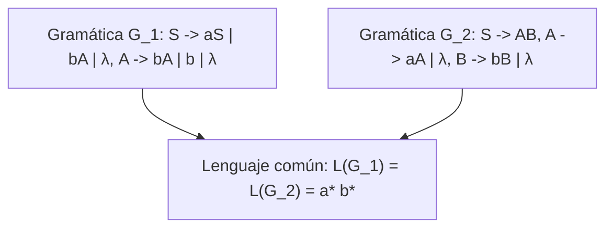

# 2.3 Gramáticas formales

## Introducción

Una vez identificados los ingredientes intuitivos de una gramática (variables, terminales, símbolo inicial y reglas de reescritura), resulta indispensable formalizarlos en una estructura matemática precisa. De manera análoga a como un autómata finito se define mediante una tupla de conjuntos y una función de transición, una **gramática formal** (o **gramática generativa**) se define mediante una cuádrupla y una relación de derivación que determina exactamente qué cadenas pertenecen al lenguaje generado (De Castro Korgi, 2004, Secc. 4.1–4.2).

Esta formalización permite demostrar rigurosamente que una gramática genera un lenguaje específico —mediante pruebas de corrección y completitud por inducción— y establecer cuándo dos gramáticas sintácticamente distintas son equivalentes.

## Definición formal de gramática generativa

### Definición 2.3.1 (Gramática formal)

Una **gramática formal** (o **gramática generativa**) es una cuádrupla ordenada:

$$G = (V, \Sigma, P, S)$$

donde:

1. $V$ es un alfabeto finito y no vacío cuyos elementos se denominan **variables** o **símbolos no terminales**.
2. $\Sigma$ es un alfabeto finito cuyos elementos se denominan **símbolos terminales**, tal que $V$ y $\Sigma$ son disjuntos:
   $$V \cap \Sigma = \emptyset$$
3. $P \subseteq (V \cup \Sigma)^* V (V \cup \Sigma)^* \times (V \cup \Sigma)^*$ es un conjunto finito de **producciones** o **reglas de reescritura**. Cada par $(\alpha, \beta) \in P$ se denota como $\alpha \to \beta$; la cabeza $\alpha$ debe contener al menos una variable de $V$ (de forma equivalente, $\alpha \in (V \cup \Sigma)^+ \setminus \Sigma^+$) y el cuerpo $\beta$ es cualquier cadena en $(V \cup \Sigma)^*$.
4. $S \in V$ es una variable distinguida denominada **símbolo inicial**.

> **Nota sobre convenciones notacionales:** Algunos autores, como De Castro Korgi (2004, p. 81), escriben la cuádrupla en el orden $(V, \Sigma, S, P)$, colocando el símbolo inicial antes del conjunto de producciones. La estructura matemática es idéntica y ambos órdenes expresan los mismos cuatro componentes.

## Relación de derivación y lenguaje generado

Para describir formalmente cómo se reescriben las cadenas mediante $P$, se define una relación binaria sobre el conjunto $(V \cup \Sigma)^*$.

### Definición 2.3.2 (Derivación directa $\Rightarrow_G$)

Sea $G = (V, \Sigma, P, S)$ una gramática formal. Dadas dos cadenas $\gamma_1, \gamma_2 \in (V \cup \Sigma)^*$, se dice que $\gamma_2$ **se deriva directamente** de $\gamma_1$ en $G$, lo cual se denota por:

$$\gamma_1 \Rightarrow_G \gamma_2$$

si y solo si existen cadenas $u, v \in (V \cup \Sigma)^*$ y una producción $\alpha \to \beta \in P$ tales que:

$$\gamma_1 = u\alpha v \qquad \text{y} \qquad \gamma_2 = u\beta v$$

Cuando la gramática $G$ se sobreentiende por el contexto, suele escribirse simplemente $\gamma_1 \Rightarrow \gamma_2$. Intuitivamente, un paso de derivación directa consiste en localizar una subcadena $\alpha$ dentro de $\gamma_1$ y sustituirla por $\beta$ dejando intactos el prefijo $u$ y el sufijo $v$.

### Definición 2.3.3 (Derivación en $k$ pasos, $\Rightarrow_G^*$ y $\Rightarrow_G^+$)

Sea $G = (V, \Sigma, P, S)$ una gramática formal y sean $\gamma, \delta \in (V \cup \Sigma)^*$:

- **Derivación en $k$ pasos ($\Rightarrow_G^k$):**
  - Para $k = 0$: $\gamma \Rightarrow_G^0 \gamma$ para toda cadena $\gamma \in (V \cup \Sigma)^*$.
  - Para $k \ge 1$: $\gamma \Rightarrow_G^k \delta$ si existen cadenas $\gamma_0, \gamma_1, \dots, \gamma_k \in (V \cup \Sigma)^*$ tales que $\gamma_0 = \gamma$, $\gamma_k = \delta$ y:
    $$\gamma_0 \Rightarrow_G \gamma_1 \Rightarrow_G \gamma_2 \Rightarrow_G \cdots \Rightarrow_G \gamma_{k-1} \Rightarrow_G \gamma_k$$
- **Derivación en cero o más pasos ($\Rightarrow_G^*$, llamada *clausura reflexiva y transitiva*):** Se dice que $\delta$ **se deriva** de $\gamma$ (aplicando cero, una o varias reglas consecutivas) si existe algún entero $k \ge 0$ tal que $\gamma \Rightarrow_G^k \delta$.
- **Derivación en uno o más pasos ($\Rightarrow_G^+$, llamada *clausura transitiva*):** Se dice que $\delta$ se deriva de $\gamma$ en **al menos un paso** si existe algún entero $k \ge 1$ tal que $\gamma \Rightarrow_G^k \delta$.

### Propiedad de compatibilidad con la concatenación

En toda gramática formal $G = (V, \Sigma, P, S)$, si $\gamma \Rightarrow_G^* \delta$, entonces para cualesquiera cadenas de contexto $u, v \in (V \cup \Sigma)^*$ se cumple que:

$$u\gamma v \Rightarrow_G^* u\delta v$$

Esta propiedad se demuestra inmediatamente por inducción sobre el número de pasos $k$ de la derivación $\gamma \Rightarrow_G^k \delta$, ya que en cada paso $\gamma_i = x\alpha y \Rightarrow_G x\beta y = \gamma_{i+1}$ basta tomar $(ux)$ y $(yv)$ como nuevo prefijo y sufijo.

### Definición 2.3.4 (Lenguaje generado por una gramática)

El **lenguaje generado** por una gramática formal $G = (V, \Sigma, P, S)$, denotado por $L(G)$, es el conjunto de todas las cadenas formadas exclusivamente por símbolos terminales que pueden derivarse desde el símbolo inicial $S$ (De Castro Korgi, 2004, p. 83):

$$L(G) = \{w \in \Sigma^* \mid S \Rightarrow_G^* w\}$$

> **Observación sobre $\Rightarrow_G^*$ y $\Rightarrow_G^+$:** Puesto que $S \in V$ y $V \cap \Sigma = \emptyset$, se cumple $S \notin \Sigma^*$. Por tanto, una cadena terminal $w \in \Sigma^*$ jamás puede obtenerse desde $S$ en $0$ pasos; toda derivación $S \Rightarrow_G^* w$ requiere al menos un paso ($k \ge 1$). De ahí que definir $L(G)$ con $\Rightarrow_G^*$ o con $\Rightarrow_G^+$ (como hace De Castro Korgi, 2004, p. 83) produce exactamente el mismo conjunto.

### Definición 2.3.5 (Equivalencia de gramáticas)

Dos gramáticas formales $G_1 = (V_1, \Sigma, P_1, S_1)$ y $G_2 = (V_2, \Sigma, P_2, S_2)$ sobre el mismo alfabeto terminal $\Sigma$ son **equivalentes** (denotado $G_1 \equiv G_2$) si y solo si generan exactamente el mismo lenguaje:

$$L(G_1) = L(G_2)$$

La equivalencia de gramáticas es un concepto central: una misma clase de cadenas puede generarse mediante diseños gramaticales muy distintos, lo cual permite transformar una gramática difícil de analizar en otra equivalente más simple, sin variables inútiles o sin ambigüedad (como se estudiará en las secciones 2.6 y en la Unidad 6).

## Metodología de prueba: corrección y completitud

Para demostrar formalmente que una gramática $G$ genera exactamente un lenguaje objetivo $L$ (es decir, probar la igualdad de conjuntos $L(G) = L$), deben comprobarse dos ideas complementarias —como verificar que una receta no produce platos equivocados y que tampoco deja fuera ningún plato del menú— (Acevedo Juárez, 2006, p. 88; De Castro Korgi, 2004, pp. 86–87):

1. **Corrección ($L(G) \subseteq L$, "no genera intrusos"):** Demostrar que toda cadena $w \in \Sigma^*$ derivable desde $S$ cumple la condición que define a $L$. Suele probarse por inducción matemática sobre el número de pasos $k$ de la derivación $S \Rightarrow_G^k w$, observando qué patrón conservan las cadenas intermedias.
2. **Completitud ($L \subseteq L(G)$, "no olvida ninguna cadena válida"):** Demostrar que toda cadena $w \in L$ admite al menos una derivación $S \Rightarrow_G^* w$ en $G$. Suele probarse por inducción sobre la longitud $|w|$ o sobre los exponentes que definen a $L$.

## Ejemplos desarrollados paso a paso

### Ejemplo 1: Derivaciones explícitas y equivalencia de gramáticas para $a^* b^*$

Adaptado de De Castro Korgi (2004, pp. 84–85), considérense las dos gramáticas sobre $\Sigma = \{a, b\}$:

- $G_1 = (\{S, A\}, \{a, b\}, P_1, S)$ con producciones:
  $$P_1 = \{S \to aS,\; S \to bA,\; S \to \lambda,\; A \to bA,\; A \to b,\; A \to \lambda\}$$
- $G_2 = (\{S, A, B\}, \{a, b\}, P_2, S)$ con producciones:
  $$P_2 = \{S \to AB,\; A \to aA,\; A \to \lambda,\; B \to bB,\; B \to \lambda\}$$

**Derivación detallada de $w = aabbb$ en $G_1$ indicando $u\alpha v \Rightarrow_{G_1} u\beta v$:**

1. $S \Rightarrow_{G_1} aS$ &nbsp; *(con $u = \lambda$, $\alpha = S$, $v = \lambda$, regla $S \to aS$)*
2. $aS \Rightarrow_{G_1} aaS$ &nbsp; *(con $u = a$, $\alpha = S$, $v = \lambda$, regla $S \to aS$)*
3. $aaS \Rightarrow_{G_1} aabA$ &nbsp; *(con $u = aa$, $\alpha = S$, $v = \lambda$, regla $S \to bA$)*
4. $aabA \Rightarrow_{G_1} aabbA$ &nbsp; *(con $u = aab$, $\alpha = A$, $v = \lambda$, regla $A \to bA$)*
5. $aabbA \Rightarrow_{G_1} aabbb$ &nbsp; *(con $u = aabb$, $\alpha = A$, $v = \lambda$, regla $A \to b$)*

Por lo tanto, $S \Rightarrow_{G_1}^5 aabbb$, así que $S \Rightarrow_{G_1}^* aabbb$ y $aabbb \in L(G_1)$. Para la cadena vacía: $S \Rightarrow_{G_1} \lambda$ (en 1 paso).

**Derivación detallada de $w = aabbb$ en $G_2$:**

1. $S \Rightarrow_{G_2} AB$ &nbsp; *(con $u = \lambda, v = \lambda$, regla $S \to AB$)*
2. $AB \Rightarrow_{G_2} aAB$ &nbsp; *(con $u = \lambda, v = B$, regla $A \to aA$)*
3. $aAB \Rightarrow_{G_2} aaAB$ &nbsp; *(con $u = a, v = B$, regla $A \to aA$)*
4. $aaAB \Rightarrow_{G_2} aaB$ &nbsp; *(con $u = aa, v = B$, regla $A \to \lambda$)*
5. $aaB \Rightarrow_{G_2} aabB$ &nbsp; *(con $u = aa, v = \lambda$, regla $B \to bB$)*
6. $aabB \Rightarrow_{G_2} aabbB$ &nbsp; *(con $u = aab, v = \lambda$, regla $B \to bB$)*
7. $aabbB \Rightarrow_{G_2} aabbbB$ &nbsp; *(con $u = aabb, v = \lambda$, regla $B \to bB$)*
8. $aabbbB \Rightarrow_{G_2} aabbb$ &nbsp; *(con $u = aabbb, v = \lambda$, regla $B \to \lambda$)*

Así $S \Rightarrow_{G_2}^8 aabbb$, y para la cadena vacía se tiene $S \Rightarrow_{G_2} AB \Rightarrow_{G_2} B \Rightarrow_{G_2} \lambda$.

**Equivalencia $G_1 \equiv G_2$:**
- En $G_1$, toda derivación parte aplicando $S \to aS$ un número $m \ge 0$ de veces (generando $a^m S$) y concluye con $S \to \lambda$ (obteniendo $a^m$) o bien pasa a $S \to bA$ seguido de $A \to bA$ y termina con $A \to b$ o $A \to \lambda$ (obteniendo $a^m b^n$ con $n \ge 1$). Así $L(G_1) = \{a^m b^n \mid m, n \ge 0\} = a^* b^*$.
- En $G_2$, la variable $A$ genera exactamente $a^m$ ($m \ge 0$) y la variable $B$ genera independientemente $b^n$ ($n \ge 0$), de modo que $S \Rightarrow_{G_2} AB \Rightarrow_{G_2}^* a^m B \Rightarrow_{G_2}^* a^m b^n$. Así $L(G_2) = a^* b^*$.
- Como $L(G_1) = L(G_2)$, las gramáticas $G_1$ y $G_2$ son **equivalentes**.

---

### Ejemplo 2: Prueba formal de $L(G) = \{a^n b^n \mid n \ge 0\}$ (corrección y completitud)

Sea $G = (\{S\}, \{a, b\}, \{S \to aSb,\; S \to \lambda\}, S)$. Queremos demostrar con rigor que $L(G) = L$, donde $L = \{a^n b^n \mid n \ge 0\}$.

**1. Corrección ($L(G) \subseteq L$):**  
Probaremos por inducción sobre el número de pasos $k \ge 0$ que toda forma sentencial $\gamma$ tal que $S \Rightarrow_G^k \gamma$ tiene necesariamente una de dos formas:
- $\gamma = a^k S b^k$, o bien
- $\gamma = a^{k-1} b^{k-1}$ (con $k \ge 1$).

*Caso base ($k = 0$):* La única cadena con $S \Rightarrow_G^0 \gamma$ es $\gamma = S = a^0 S b^0$. Se cumple la propiedad.

*Paso inductivo:* Supongamos válida la propiedad para $k \ge 0$ pasos y sea $S \Rightarrow_G^k \gamma \Rightarrow_G \delta$.
- Si $\gamma = a^{k-1} b^{k-1}$, entonces $\gamma \in \Sigma^*$ no contiene variables y no admite derivación directa $\gamma \Rightarrow_G \delta$, lo cual es imposible.
- Si $\gamma = a^k S b^k$, las únicas reglas aplicables a la única variable $S$ en $\gamma$ son:
  - $S \to aSb$, que produce $\delta = a^k (aSb) b^k = a^{k+1} S b^{k+1}$.
  - $S \to \lambda$, que produce $\delta = a^k \lambda b^k = a^k b^k = a^{(k+1)-1} b^{(k+1)-1}$.

En ambos casos la propiedad se mantiene para $k + 1$. Por lo tanto, si $w \in L(G)$, entonces $w \in \Sigma^*$ y $S \Rightarrow_G^k w$ para algún $k \ge 1$, lo que obliga a que $w = a^{k-1} b^{k-1} \in L$. Luego $L(G) \subseteq L$.

**2. Completitud ($L \subseteq L(G)$):**  
Probaremos por inducción sobre $n \ge 0$ que para todo $n$ se cumple $S \Rightarrow_G^* a^n S b^n$ (y por tanto $S \Rightarrow_G^* a^n b^n$).

*Caso base ($n = 0$):* $S \Rightarrow_G^0 S = a^0 S b^0$, y aplicando $S \to \lambda$ resulta $S \Rightarrow_G \lambda = a^0 b^0$.

*Paso inductivo:* Supongamos que $S \Rightarrow_G^* a^n S b^n$. Por la propiedad de compatibilidad con la concatenación, aplicando $S \to aSb$ obtenemos:
$$S \Rightarrow_G^* a^n S b^n \Rightarrow_G a^n (aSb) b^n = a^{n+1} S b^{n+1}$$
Finalmente, aplicando $S \to \lambda$ con $u = a^{n+1}$ y $v = b^{n+1}$:
$$S \Rightarrow_G^* a^{n+1} S b^{n+1} \Rightarrow_G a^{n+1} b^{n+1}$$
Por consiguiente, toda cadena $a^n b^n \in L$ pertenece a $L(G)$, de donde $L \subseteq L(G)$.

Concluimos que $L(G) = L = \{a^n b^n \mid n \ge 0\}$.

*Ejemplo concreto de derivación en $4$ pasos para $a^3 b^3$:*
$$S \Rightarrow_G aSb \Rightarrow_G aaSbb \Rightarrow_G aaaSbbb \Rightarrow_G aaabbb$$

---

### Ejemplo 3: Gramática de paréntesis balanceados (De Castro Korgi, 2004, pp. 86–87)

Considere la gramática $G_p = (\{S\}, \{(, )\}, \{S \to (S)S,\; S \to \lambda\}, S)$. Derivemos paso a paso la cadena `(()())`:

1. $S \Rightarrow_{G_p} (S)S$
2. $(S)S \Rightarrow_{G_p} ((S)S)S$ &nbsp; *(sustituyendo el primer $S$ por $(S)S$)*
3. $((S)S)S \Rightarrow_{G_p} (()S)S$ &nbsp; *(sustituyendo el $S$ más interno por $\lambda$)*
4. $(()S)S \Rightarrow_{G_p} (()(S)S)S$ &nbsp; *(sustituyendo el segundo $S$ por $(S)S$)*
5. $(()(S)S)S \Rightarrow_{G_p} (()()S)S$ &nbsp; *(sustituyendo el $S$ interno por $\lambda$)*
6. $(()()S)S \Rightarrow_{G_p} (()())S$ &nbsp; *(sustituyendo el $S$ restante dentro del paréntesis por $\lambda$)*
7. $(()())S \Rightarrow_{G_p} (()())$ &nbsp; *(aplicando $S \to \lambda$)*

Mediante inducción sobre el número de pares de paréntesis $n$, se prueba que $L(G_p)$ coincide exactamente con el lenguaje de las cadenas de paréntesis anidados y equilibrados (lenguaje de Dyck).

## Ejercicios propuestos

1. Formaliza explícitamente como cuádrupla $G = (V, \Sigma, P, S)$ las siguientes gramáticas y deriva una cadena de longitud al menos $4$ en cada una, señalando en cada paso directo la descomposición $u\alpha v \Rightarrow_G u\beta v$:
   - a) $S \to aS \mid aA,\; A \to bA \mid b$
   - b) $S \to aSa \mid bSb \mid a \mid b \mid \lambda$
2. Sean las gramáticas sobre $\Sigma = \{a, b\}$:
   - $G_1$: $S \to aSa \mid bSb \mid aSb \mid bSa \mid \lambda$
   - $G_2$: $S \to aaS \mid bbS \mid abS \mid baS \mid \lambda$
   - $G_3$: $S \to AAS \mid \lambda,\; A \to a \mid b$
   Verifica si $G_1$, $G_2$ y $G_3$ son equivalentes entre sí (De Castro Korgi, 2004, p. 86), determinando el lenguaje que genera cada una.
3. Demuestra formalmente (mediante corrección y completitud por inducción) que la gramática $G = (\{S\}, \{a, b\}, \{S \to aSbb,\; S \to \lambda\}, S)$ genera el lenguaje $L = \{a^i b^{2i} \mid i \ge 0\}$.
4. Construye dos gramáticas distintas pero equivalentes sobre $\Sigma = \{0, 1\}$ para el lenguaje $0^* 1 0^* 1 0^*$ (cadenas con exactamente dos unos) y muestra una derivación de `01001` en cada una.
5. Demuestra que la gramática $S \to SS \mid (S) \mid \lambda$ es equivalente a $G_p$: $S \to (S)S \mid \lambda$ (De Castro Korgi, 2004, p. 87).

## Referencias

- Acevedo Juárez, A. (2006). *Teoría de la computación* [Tesis de licenciatura, Instituto Tecnológico de Celaya].
- De Castro Korgi, R. (2004). *Teoría de la computación: Lenguajes, autómatas, gramáticas*. Universidad Nacional de Colombia.
